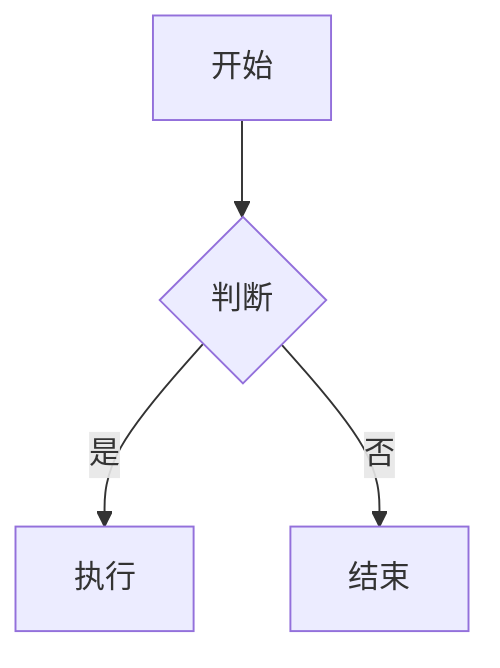

# Code Impact DocGen

从本地图谱知识库和当前 feature 目录下的 spec/plan 召回素材,合成**面向研发和技术负责子的设计文档**。

本 skill 在 feature 实现自测通过后调用,把 `docs/knowledge/` 中的 AI 导向知识文档与当前 feature 目录下的 spec/plan 一起,合成为连贯、精炼、可读性强的设计文档。输出文档不含 YAML frontmatter,不使用 AI 导向的稳定标题,按设计文档的章节结构组织内容。

**典型场景**:用户完成 feature 实现 + 自测后,说"生成设计文档"、"写设计文档"、"用 docgen 沉淀一下"——本 skill 召回 knowledge + 读取 spec/plan,合成一份设计文档落到 feature 目录。

## Trigger

使用此 skill 当:

- 用户完成 feature 自测后要求"生成设计文档"、"写设计文档"、"沉淀设计文档"
- 用户要求基于 spec/plan 和项目知识库合成一份技术文档
- 用户说"用 docgen 生成"、"自测完了,该写设计文档了"
- 用户要求把 spec + plan + knowledge 整理为一份可分享的设计文档
- 用户要求生成 HTML 或 Markdown 格式的设计文档

不要使用此 skill 当:

- 创建或编辑 AI 导向的知识文件(使用 `code-impact-markdown` skill)
- 查询知识以辅助代码编辑(使用 `code-impact-api` skill)
- 探索陌生项目(使用 `code-impact-init` skill)
- 写 PRD(使用 `write-prd` skill,设计文档是事后沉淀,PRD 是事前业务确认)
- 写 spec(使用 `write-spec` skill,设计文档不重新定义规格契约)
- 写 plan(使用 `write-plan` skill)

## 依赖

- cgraphx 已安装(`cgraphx --version` 可跑)
- 项目已跑过 `cgraphx docs index`,索引中有知识文档数据(用 `cgraphx docs concepts` 验证)
- 若 knowledge 索引为空:先按 `code-impact-markdown` skill 写文档到 `docs/knowledge/`,再 `cgraphx docs index`
- 当前 feature 目录下应有 spec(`docs/features/<feature-id>/<文件前缀>-spec.md`)和/或 plan(`docs/features/<feature-id>/plan/`)

## 内容来源规格

设计文档的内容来源**必须包含两类**:

1. **`docs/knowledge/` 中的 AI 导向知识文档** — 通过 `cgraphx docs find` 召回,提供项目级架构、决策、风险等背景
2. **当前 feature 目录下的 spec 和 plan** — 直接 Read,提供本 feature 的目标、契约、任务拆分、技术约束

**两类来源都不可缺**:若 knowledge 为空且 feature 目录无 spec/plan,skill 必须拒绝生成,提示用户先准备素材。

## feature-id 与文件前缀规则

**feature-id 识别(优先级从高到低)**:

1. 用户调用时显式传 feature-id 或输出路径参数 → 使用用户指定
2. skill 自动从 cwd 向上探测最近的 `docs/features/<feature-id>/` 目录 → 使用探测结果
3. 都失败 → skill 报错并要求用户显式传 feature-id 或输出路径

**文件前缀算法**:

feature-id 格式:`YYYY-MM-DD-[业务ID-]<标题>`

- 有业务ID:文件前缀 = `<业务ID>-<标题>`(如 `CRM-req19230-号百商品详情查询接口`)
- 无业务ID:文件前缀 = `<标题>`(如 `features目录结构调整`)

业务ID 段允许字母数字 + 连字符;标题段允许中文、英文或混合。**不得**对中文做英文 slug 转换。

文件名不得包含 `/`、`:`、`*`、`?`、`"`、`<`、`>`、`|`;若含敏感字符,要求用户重命名,不自动替换。

**默认输出路径**:`docs/features/<feature-id>/<文件前缀>-设计文档.md`(或 `.html`)

用户可显式参数覆盖默认路径。

## 召回与生成流程

生成设计文档前,必须通过以下流程收集源材料。不要凭空编写内容——所有事实性内容必须来自上述两类来源。

### 第一步:确认需求与识别 feature-id

向用户确认(如果未明确指定):

1. **feature-id / 输出路径** — 默认按上方规则识别,用户可覆盖
2. **输出格式** — `html` 或 `md`
3. **可选:目标章节** — 用户可以选择包含或排除哪些章节(见章节菜单)
4. **可选:主题范围补充** — 若 feature spec/plan 之外还有特定主题需要覆盖,用户可补充

### 第二步:召回 knowledge 文档

用 `cgraphx docs find` 按 concept/domain/keyword/tag 过滤(见下方命令)。

**按概念精确过滤(推荐,召回最精准)**:

```bash
cgraphx docs find --concept=<concept-name> --limit=20
```

**按 domain 过滤(覆盖整个业务领域)**:

```bash
cgraphx docs find --domain=<domain-name> --limit=20
```

**按关键词子串匹配(适合模糊探索;LIKE on title + Summary)**:

```bash
cgraphx docs find --q=<关键词> --limit=20
```

**按 tag 过滤(横向主题分组)**:

```bash
cgraphx docs find --tag=<tag-name> --limit=20
```

**组合多维过滤(交集)**:

```bash
cgraphx docs find --concept=X --domain=Y --status=active --type=decision
```

**列出全部 concept / domain / tag(找主题入口)**:

```bash
cgraphx docs concepts     # 跨文档去重的 concept + 各自关联文档数 + 所属 domain
cgraphx docs domains
cgraphx docs tags
```

`find` 输出每条结果包含 `title` / `document_type` / `status` / `updated` / `summary`(Summary 章节文本) / `path`(项目根相对,供 Read)。

### 第三步:读取 feature 目录下的 spec 和 plan

Read 以下文件(若存在):

- `docs/features/<feature-id>/<文件前缀>-spec.md` — 拿到目标、范围、业务规则、技术约束、不可留实现期决策
- `docs/features/<feature-id>/plan/<文件前缀>-index.md` — 拿到任务拆分、依赖图、改动范围
- `docs/features/<feature-id>/plan/<文件前缀>-01-schema.md` 等按需子文件 — 拿到具体 schema/接口/前端任务细节

如果 feature 目录下还没有 spec/plan(比如 plan 不存在),如实标注"无 plan 文件,任务拆分章节缺失",不要凭空补。

### 第四步:读取 knowledge 详情

`find` 返回的 `summary` 是 `## Summary` 章节内容,通常是文档的核心结论。**如果 Summary 不够**,用 `path` 字段直接 Read 原文件:

```bash
cgraphx docs show <doc-id-or-path>     # 输出 frontmatter 元数据 + Summary
# 或直接:
Read <path>                              # 拿到完整原文(含 Context / Decisions / Steps 等其他章节)
```

**重要**:**只有 `## Summary` 进 cgraphx 索引**,其他章节(Context / Decisions / Findings / Steps / ...)留在文件里。生成文档时,这些章节的内容来源是 **Read 文件原文**,不是图谱字段。

### 第五步:探索关联知识(可选,按需)

如果需要更全面的背景(文档间引用关系):

```bash
cgraphx docs refs <doc-id-or-path>
# 输出双向引用:
#   Outgoing: 这份文档引用了哪些
#   Incoming: 哪些文档引用了这份
```

适合"这个决策被哪些文档引用了"、"还有哪些相关文档"的扩展召回。

### 第六步:合成设计文档

基于 knowledge + spec/plan 两类来源,按章节菜单重组内容,生成设计文档。见后续章节。

## 设计文档定位

- **读者**:研发工程师、架构师、技术负责人、后续维护者
- **语气**:精确、专业,包含技术细节
- **结构重点**:架构设计、核心模块、数据流、技术决策、已知限制、扩展方向
- **典型场景**:feature 实现自测通过后,作为事后技术沉淀归档
- **与 spec 的区别**:spec 是事前契约,设计文档是事后沉淀;设计文档不得重新定义 spec 的契约

## 章节菜单

用户可以选择包含哪些章节。以下为完整章节库。

### 默认章节(用户未指定时全部包含)

| 章节名 | 用途 | 主来源 |
|--------|------|--------|
| 概述 / Overview | 设计文档覆盖的主题、目标和定位 | spec 目标与范围 + knowledge Summary |
| 架构设计 / Architecture | 系统架构和数据流 | spec 系统行为 + knowledge Summary + Read 原文 |
| 核心模块 / Core Modules | 各模块职责和交互 | plan 任务拆分 + knowledge Summary |
| 技术决策 / Key Decisions | 重要技术决策及理由 | spec 不可留实现期决策 + knowledge Decisions |
| 已知限制 / Known Limits | 技术约束和已知问题 | spec 待确认项 + knowledge Findings/Risks |
| 扩展方向 / Extension Points | 可扩展点和改进方向 | knowledge Outlook |

### 可选章节(按需添加)

| 章节名 | 用途 | 主来源 |
|--------|------|--------|
| 数据模型 / Data Model | 数据结构和存储方案 | plan schema 任务 + spec 数据口径 |
| API 参考 / API Reference | 接口和端点说明 | spec 接口边界 + plan backend 任务 |
| 性能特征 / Performance | 性能瓶颈和优化方向 | knowledge Findings |
| 运维指南 / Operations | 部署、监控、故障排除 | knowledge Operations |
| 术语表 / Glossary | 关键术语和定义 | spec 术语章节 + knowledge 各字段术语 |
| 相关资源 / References | 相关文档和代码链接 | spec / plan / knowledge 引用 |

### 章节选择规则

- 用户可以明确指定要包含的章节
- 用户可以从默认章节中排除不需要的章节
- 如果用户未指定,使用上述全部默认章节
- 按照上述表格顺序排列章节

## 输出格式

### HTML 格式

生成单文件独立 HTML 文档,特点:

- **内联 CSS**:不依赖外部样式表,所有样式写在 `<style>` 标签内
- **响应式布局**:使用 CSS 变量控制主题,支持不同屏幕宽度
- **打印友好**:包含 `@media print` 样式
- **浅色阅读主题**:白色背景,高对比度,适合长时间阅读
- **字体**:`-apple-system, BlinkMacSystemFont, "Segoe UI", "PingFang SC", "Microsoft YaHei", sans-serif`
- **代码块**:等宽字体,浅灰背景,圆角边框
- **表格**:斑马纹行,边框分隔
- **目录**:文档开头自动生成可点击目录(锚点链接)

生成前阅读对应模板文件获取完整 CSS 和结构参考:[template-design-html.md](template-design-html.md)

### Markdown 格式

生成干净的 Markdown 文档,特点:

- **无 YAML frontmatter**:与 `docs/knowledge/` 中的 AI 导向文档不同
- **层级标题**:`#`(文档标题)、`##`(章节)、`###`(子章节)
- **代码块**:三个反引号围栏代码块,标注语言
- **表格**:标准 Markdown 表格
- **链接**:`[文本](url)` 格式,优先使用相对路径
- **目录**:文档开头用标题列表作为目录
- **元信息**:文档开头用引用块注明生成日期、主题范围、feature-id

生成前阅读对应模板文件:[template-design-md.md](template-design-md.md)

## 图表绘制

当文档中需要使用图表(流程图、时序图、架构图、状态图等)来辅助说明时,遵循以下规则:

- **优先使用 Mermaid**:在保证表达效果的前提下,优先使用 Mermaid 语法绘制图表,以确保文档的纯文本可维护性和跨平台渲染一致性
- 适用的图表类型包括但不限于:`flowchart`(流程图)、`sequenceDiagram`(时序图)、`classDiagram`(类图)、`stateDiagram`(状态图)、`erDiagram`(ER 图)、`gantt`(甘特图)
- 图表应放在相关的章节中,紧跟在解释性文字之后
- 每张图表前应有简短的文字说明其用途
- 图表内容应精简,避免过于复杂;如果信息量过大,拆分为多张图表
- 仅当 Mermaid 无法表达所需的视觉效果时(如复杂的手绘风格、特殊布局),才使用外部图片或 SVG

Markdown 格式中使用 Mermaid 代码块:

````markdown

````

HTML 格式中使用 Mermaid 代码块(依赖 Mermaid.js CDN 渲染),模板中需引入 Mermaid 脚本:

```html
<script src="https://cdn.jsdelivr.net/npm/mermaid/dist/mermaid.min.js"></script>
<script>mermaid.initialize({startOnLoad:true});</script>
<pre class="mermaid">
flowchart TD
    A --> B
</pre>
```

## 合成规则

生成设计文档时遵循以下规则,确保从 knowledge + spec/plan 合成出连贯的人类文档。

### 内容来源

- 所有事实性内容必须来自 knowledge 文档或 feature 目录下的 spec/plan
- 不要编造不存在的细节、数据或结论
- 如果某个方面的知识缺失,在文档中如实标注"待补充"或省略该部分
- 可以基于多个来源进行归纳和总结,但归纳必须忠实于原文
- 设计文档**不得**重新定义 spec 已锁定的契约;若发现 spec 与代码现实不符,标注【待确认】而不是自行解释

### 结构重组

- knowledge 用稳定英文标题(Summary、Findings、Decisions 等)按分析目的组织
- spec/plan 用研发视角章节(目标、范围、任务、约束等)按交付目的组织
- 设计文档按"知识传递"目的组织(概述、架构、模块、决策、限制、扩展)
- **必须重新组织内容结构**,不要照搬 knowledge 的标题或 spec/plan 的章节
- 相关信息应合并到同一章节,避免内容分散
- 去除重复信息:knowledge 和 spec/plan 可能包含相同的背景信息,只需出现一次

### 语气转换

- knowledge 的语气是"分析记录"(记录观察、证据、影响)
- spec/plan 的语气是"契约 / 任务清单"(规则、约束、步骤)
- 设计文档的语气是"知识传递"(解释、说明、指导)
- 将被动描述转为主动解释
- 将技术分析转为可操作的指导

### 引用和溯源

- 不要在设计文档中引用 knowledge 文档的路径或文件名
- 不要在文档中引用 spec/plan 的文件路径(读者已经在 feature 目录里)
- 如需引用代码文件,使用相对路径
- 如需引用外部文档,使用 URL 或文档标题

## 语言和风格规则

### 语言

- 文档正文用**中文**编写
- 技术术语、代码标识符、文件路径、函数名、类名保留原始英文
- 章节标题可使用中英双语格式:"架构设计 / Architecture"(英文部分用于 HTML 锚点兼容性)
- 代码示例中的注释使用中文
- 专有名词(如 Neo4j、pgvector、BM25、RRF)保留英文原名

### 排版

- 段落之间空一行
- 每个章节以 `##` 标题开始
- 重要概念第一次出现时加粗
- 代码块标注语言类型
- 表格使用标准格式
- 列表项以动词或名词开头,保持一致
- 避免过长的段落(超过 5 行应考虑拆分)

### 风格

- 精炼、直接、避免冗余
- 每句话传递信息,不写废话
- 使用主动语态
- 避免模糊措辞(如"可能"、"也许"),除非表达不确定性
- 不确定性用明确标注:"当前不确定"、"待验证"

## 保存位置

**默认保存路径**:`docs/features/<feature-id>/<文件前缀>-设计文档.md`(或 `.html`)

feature-id 和文件前缀规则见上方"feature-id 与文件前缀规则"章节。用户可显式参数覆盖默认路径。

### 文件命名

- 使用 `<文件前缀>-设计文档.md` 或 `<文件前缀>-设计文档.html` 命名
- 文件前缀算法:有业务ID 时为 `<业务ID>-<标题>`,无业务ID 时为 `<标题>`
- 文件前缀允许中文(如 `features目录结构调整-设计文档.md`)
- 不做中文 → 英文 slug 转换
- 文件名不得包含敏感字符 `/`、`:`、`*`、`?`、`"`、`<`、`>`、`|`

### 生成后

保存文件后:

1. 告知用户文件保存位置(默认 feature 目录路径)
2. 简要说明文档覆盖的内容范围
3. 如有知识缺失(knowledge 和 spec/plan 都未覆盖的重要方面),列出"可能需要补充的知识"
4. 不触发分析(本 skill 只读取 knowledge + spec/plan,不写入 `docs/knowledge/`)

## 完整生成流程

1. **确认需求与识别 feature-id** — 与用户确认输出格式、章节选择;按规则识别 feature-id 和文件前缀
2. **召回 knowledge** — 用 `cgraphx docs find` 按概念/领域/关键词过滤,收集相关文档(Summary + path)
3. **读取 feature 目录** — Read spec、plan/index、plan/子文件,拿到本 feature 的契约和任务
4. **读取 knowledge 详情** — Summary 不够时,用 `cgraphx docs show` 或直接 `Read <path>` 拿完整原文
5. **评估覆盖度** — 检查 knowledge + spec/plan 是否足够覆盖设计文档的章节;如果不足告知用户
6. **合成内容** — 按照章节菜单,从 knowledge 和 spec/plan 重组、改写、整合内容
7. **格式化输出** — 按照 HTML 或 Markdown 的格式规则生成完整文档
8. **质量检查** — 检查文档是否满足以下条件:
   - 所有事实性内容有 knowledge 或 spec/plan 来源
   - 章节结构完整、逻辑连贯
   - 语言风格符合设计文档定位
   - 格式正确、排版整洁
   - 没有重新定义 spec 已锁定的契约
9. **保存文件** — 写入 `docs/features/<feature-id>/<文件前缀>-设计文档.md`(或 `.html`)
10. **反馈** — 告知用户保存位置和内容范围,列出知识缺失(如有)
