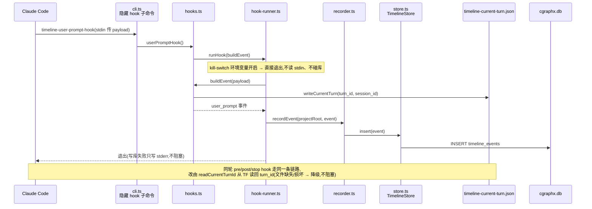
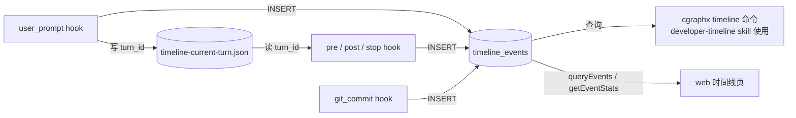

# 开发时间线记录 · 代码地图

> 派生视图:从代码生成,不手工修改。相关文件在 `source_commit` 之后有改动即视为过期,用 `/code-map-write` 重新生成。

## 一句话

Claude Code 每个事件触发一个短命 hook 进程,把事件写进 `timeline_events` 表;同一轮对话的多个 hook 进程靠一个状态文件共享 `turn_id`。日报/周报和 web 时间线页只读这张表。

## 代码链路:一轮对话中的 user_prompt 事件

看什么:turn_id 在哪里生成、经状态文件传给同轮的其他 hook;任何失败都不阻塞 Claude Code。

## 数据流转

看什么:只有 hook 写表,读方都只读;状态文件只在同一轮的 hook 之间传值。

## 节点索引

| 节点 | 代码指针 | 来源 |
|---|---|---|
| 隐藏 hook 子命令 | `src/core/timeline/cli.ts`:`timeline-user-prompt-hook` 等 5 个 | AI 读代码 |
| userPromptHook / readCurrentTurnId | `src/core/timeline/hooks.ts` | AI 读代码 |
| runHook | `src/core/timeline/hook-runner.ts`:`runHook` | AI 读代码 |
| recordEvent | `src/core/timeline/recorder.ts`:`recordEvent` | AI 读代码 |
| TimelineStore.insert | `src/core/timeline/store.ts`:`TimelineStore.insert` | AI 读代码 |
| timeline_events | `src/core/timeline/schema.sql` | AI 读代码 |
| web 时间线页 | `src/web/pages-timeline.ts`(调 core/timeline 门面 `queryEvents` / `getEventStats`) | AI 读代码 |

## 已知盲区

- pre_tool_use 只记录写类工具(白名单过滤),图中未展开过滤分支。
- git_commit hook 由 `cgraphx timeline install` 接入 git 侧,接入路径未画。
