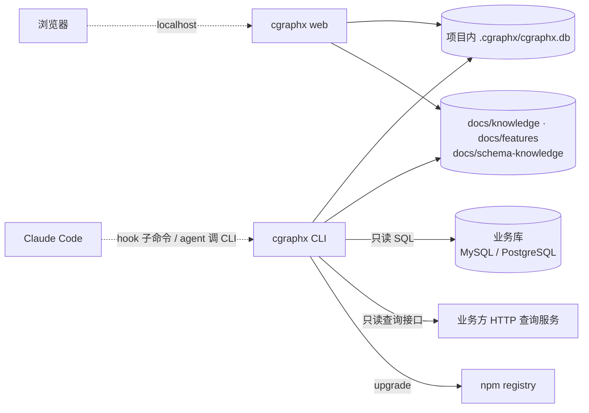

# 系统交互 · 代码地图

> 派生视图:从代码生成,不手工修改。相关文件在 `source_commit` 之后有改动即视为过期,用 `/code-map-write` 重新生成。

## 一句话

cgraphx 是本地 CLI:被 Claude Code 的 hook 和 agent 调用,读写项目内的 SQLite 与 markdown 文件;对外只有三类连接——只读查业务库、经 HTTP 只读查询接口查库、npm 自更新。

## 交互图

看什么:实线是本仓库代码发起的调用,虚线是外部系统调用 cgraphx;除业务库和 npm 外,全部在本机。

## 节点索引

| 连接 | 代码指针 | 来源 |
|---|---|---|
| Claude Code → hook 子命令 | `src/core/timeline/cli.ts`(5 个隐藏子命令) | AI 读代码 |
| CLI / web → SQLite | `src/core/db/sqlite-adapter.ts` | AI 读代码 |
| CLI → 业务库 | `src/core/dbquery/drivers/mysql.ts`、`postgres.ts` | AI 读代码 |
| CLI → HTTP 查询服务 | `src/core/dbquery/drivers/http.ts` | AI 读代码 |
| 浏览器 → web | `src/web/server.ts`(仅回环地址) | AI 读代码 |
| CLI → npm | `src/cli/upgrade/index.ts` | AI 读代码 |

## 已知盲区

- 业务库与 HTTP 查询服务的具体地址来自目标项目的 `.cgraphx/db-profiles.json`,属运行时配置,图中不列实例。
