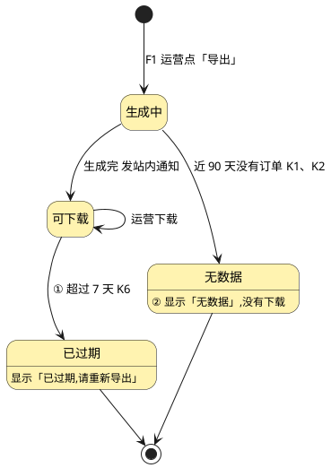

# 功能方案讨论稿范例

讨论稿从 ④ 写第一节起就有,收拢后照下面写;各功能点的图照同目录 `功能点配图.md`,泳道画法见 `泳道图画法.md`。讨论稿不写 `> 产物:` 头部;`/dev-spec` 收录 `---` 以上的正文,`---` 以下不收。

`docs/features/2026-10-21-REQ-1024-订单导出/REQ-1024-订单导出-功能方案-v2.md`:

````markdown
# 功能方案: 订单导出(讨论稿 v2)

> 讨论稿,不是契约:人终确认的那一版由 `/dev-spec` 原样收录为 spec 第一节,之后以 spec 为准,本文件不再维护。
> 图用支持 PlantUML 的 Markdown 预览打开(IDEA:设置 → 语言和框架 → Markdown → 启用 PlantUML)。

**一句话**:原来运营要找开发导订单;这次在订单列表加「导出」,运营自己下载近 90 天的订单去对账。

**功能清单**

| 编号 | 功能点 | 类别 | 从哪进 → 到哪去 | 一句话 |
|---|---|---|---|---|
| F1 | 订单导出 | 核心 | 订单列表「导出」→ 站内通知 → F2 | 运营点「导出」,后台生成近 90 天的订单文件,做完站内通知 |
| F2 | 导出记录查看 | 支撑 | 站内通知、「我的导出」→ 下载 | 「我的导出」列出近 30 天的导出与状态,点一条下载 |
| — | 自定义导出列 | 建议新增 ✂️ | — | 不做:用户原话只要固定几列 |

### F1 订单导出(核心)

订单服务收下导出请求就返回,后台导出任务异步取数、生成文件,做完站内通知;运营再到 F2「我的导出」下载。

```plantuml
@startuml
skinparam backgroundColor #FFFFFF
skinparam Activity {
  BackgroundColor #F1F1F1
  BorderColor #181818
  FontColor #000000
}
skinparam Swimlane {
  BorderColor #181818
  TitleBackgroundColor #FFFFFF
  TitleFontColor #000000
}
skinparam ArrowColor #181818

|运营|
start
:打开订单列表;
-[#2E7D32,bold]->
if (有导出权限? K4) then (是) <<#FFF3B0>>
  -[#2E7D32,bold]->
  :点「导出」; <<#FFF3B0>>
  -[#2E7D32,bold]->
else (否)
  :② 看不到「导出」按钮; <<#FFF3B0>>
  stop
endif
|订单服务|
:提交导出(新)\n记一条导出记录; <<#FFF3B0>>
|运营|
-[#2E7D32,bold]->
:立刻看到「已开始导出」; <<#FFF3B0>>
|导出任务|
-[#2E7D32,dashed]-> 异步;
:取近 90 天的订单 K1、K2; <<#FFF3B0>>
-[#2E7D32,bold]->
if (有订单? K1、K2) then (是) <<#FFF3B0>>
  -[#2E7D32,bold]->
  :生成 订单导出_20261021.xlsx\n订单号 客户 金额 K3 退款 支付时间\n导出记录改成可下载; <<#FFF3B0>>
  |运营|
  -[#2E7D32,bold]->
  :收到站内通知\n点开 F2「我的导出」下载; <<#FFF3B0>>
  stop
else (否)
  |导出任务|
  :① 不生成文件\n导出记录改成无数据\n发站内通知「近 90 天无数据」; <<#FFF3B0>>
  (A)
  detach
endif
|运营|
(A)
:收到站内通知「近 90 天无数据」; <<#FFF3B0>>
stop
@enduml
```

| 编号 | 哪一步 | 怎么判定 | 算 / 不算(例子) | 依据 |
|---|---|---|---|---|
| K4 | ② 谁能导出 | 有「订单导出」权限点的角色 | 算:运营、财务;不算:客服 | `role_permission.perm_code`=`order:export`(新增权限点);新定 |
| K1 | 取订单 · 哪些算订单 | 已支付的订单,后来退款的也算 | 算:已支付、已退款;不算:待支付、已取消 | `orders.status`;沿用「销售日报」 |
| K2 | 取订单 · 近 90 天 | 按支付时间,含今天往前数 90 天 | 今天 10-21:07-24 支付的算,07-23 的不算;07-23 23:59 下单、07-24 00:01 支付的算 | `orders.paid_time`;新定(销售日报按下单时间) |
| K3 | 生成文件 · 金额 | 实付金额,不扣退款;退款另起一列 | 实付 100、退了 30 → 金额 100,退款 30 | `orders.paid_amount`、`refund_record.amount`;新定(销售日报扣了退款) |

🎭 体验决策:导出走后台任务 + 完成通知,不让运营盯着转圈。

### F2 导出记录查看(支撑)

导出记录有四种状态,「我的导出」按状态显示,文件留 7 天。



| 编号 | 哪一步 | 怎么判定 | 算 / 不算(例子) | 依据 |
|---|---|---|---|---|
| K5 | 「我的导出」列哪些 | 本人近 30 天发起的导出,新的在前 | 今天 10-21:09-22 发起的列,09-21 的不列;别人发起的不列 | `export_task` 发起人、发起时间(新表,字段名 spec 定);新定 |
| K1、K2 | 生成中 → 无数据 | 见 F1 | — | — |
| K6 | ① 超过 7 天 | 按生成完的时间,满 7 天过期 | 10-14 15:00 生成完的,10-21 15:00 起显示「已过期,请重新导出」 | `export_task` 生成完成时间(新表,字段名 spec 定);沿用报表导出文件留 7 天 |

---

以下供 spec 使用,可不细读

**必须在 spec 前解决的问题**:无

**已锁定技术约束**:报表导出 report_export 的接口与文件格式不变(用户声明)。

**留给 spec 的细节决策**:导出任务表新建还是复用 report_task;取数复用报表查询还是单写;提交、下载的接口形态。

**影响半径与风险**:LOW——只新增导出入口和任务,不改既有报表。

**现实约束清单**

| 表 / 现有实现 | 事实 |
|---|---|
| `shop.orders` | `status` 取值 pending / paid / refunded / cancelled;`paid_time` 是支付时间,没支付为空;`paid_amount` 是实付金额 |
| `shop.refund_record` | 一笔订单可以退多次,`amount` 是每次退的金额 |
| `shop.report_task` | 报表导出的任务表,有 `status`、`file_path`;状态流转和订单导出不一样 |
| `shop.role_permission` | 角色权限点,`perm_code` 形如 `report:export` |
| 报表导出 report_export | 两段式接口:提交任务、下载文件;文件 7 天后清理 |
````

- 一个功能点一节,按 F 编号排在功能清单后面;节标题写编号、名称和类别。
- 判断框写一句意思加口径编号,完整定义在图下的口径表:读图的人往下一看,就知道「有订单?」问的是哪些订单。
- 口径表的行按图里的先后排,编号按写下来的先后——「谁能导出」是审卡时补的,编成 K4,不把 K1–K3 往后挪;K1、K2 在 F2 只写「见 F1」,共用的口径只写一次。
- 已有的步骤不标黄(打开订单列表),改动的步骤和判断标黄,读图的人一眼看出这次加在哪里,没标黄的就是现成的。
- 依据写到表名.字段;`export_task` 是这次新建的表,字段还没定,写业务说法并注明新表。

审卡中的 v1 和它差四处:头注多一行「> 审卡中,收拢时补齐其余各节。」;体验决策那一行还是「🎭 体验变体(待你定):后台任务 + 完成通知(图里画的这种,立刻返回,做完提醒)vs 等待框(盯着转圈,最长 30 秒)」;K6 编号后还标着【待确认】(运营还没认 7 天);`---` 以下还没写。
