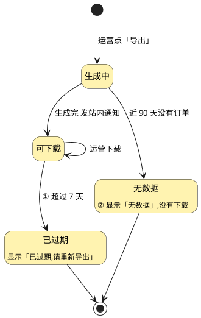
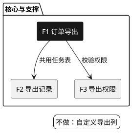

# 功能方案讨论稿范例

讨论稿从审卡时第一张图起就有,收拢后照下面写;各功能点的图照同目录 `功能点配图.md`,泳道画法见 `泳道图画法.md`,功能点关系图见文末。讨论稿不写 `> 产物:` 头部;`/dev-spec` 收录正文,从「一句话」到「体验决策」(`---` 以下不收)。

`docs/features/2026-10-21-REQ-1024-订单导出/REQ-1024-订单导出-功能方案-v2.md`:

````markdown
# 功能方案: 订单导出(讨论稿 v2)

> 讨论稿,不是契约:人终确认的那一版由 `/dev-spec` 原样收录为 spec 第一节,之后以 spec 为准,本文件不再维护。
> 图用支持 PlantUML 的 Markdown 预览打开(IDEA:设置 → 语言和框架 → Markdown → 启用 PlantUML)。

**一句话**:原来运营要找开发导订单;这次在订单列表加「导出」,运营自己下载近 90 天的订单去对账。

**业务口径**

| 编号 | 口径 | 怎么判定 | 算 / 不算(例子) | 依据 |
|---|---|---|---|---|
| K1 | 订单 | 已支付的订单,后来退款的也算 | 算:已支付、已退款;不算:待支付、已取消 | orders.status;沿用「销售日报」 |
| K2 | 近 90 天 | 按支付时间,含今天往前数 90 天 | 今天 10-21:07-24 支付的算,07-23 的不算;07-23 23:59 下单、07-24 00:01 支付的算 | orders.paid_time;新定(销售日报按下单时间) |
| K3 | 金额 | 实付金额,不扣退款;退款另起一列 | 实付 100、退了 30 → 金额 100,退款 30 | orders.paid_amount、refund_record;新定 |

**用户会这样用**(标黄的是这次新增的)

```plantuml
@startuml
skinparam backgroundColor #FFFFFF
skinparam Activity {
  BackgroundColor #F1F1F1
  BorderColor #181818
  FontColor #000000
}
skinparam Swimlane {
  BorderColor #181818
  TitleBackgroundColor #FFFFFF
  TitleFontColor #000000
}
skinparam ArrowColor #181818

|运营|
start
:打开订单列表;
-[#2E7D32,bold]->
:点「导出」\n立刻提示「已开始导出」; <<#FFF3B0>>

|系统|
-[#2E7D32,bold]->
:记一条导出记录\n取近 90 天的订单 按口径 K1、K2; <<#FFF3B0>>
-[#2E7D32,bold]->
if (有订单? K1、K2) then (是) <<#FFF3B0>>
  -[#2E7D32,bold]->
  :生成 xlsx\n导出记录改成可下载; <<#FFF3B0>>
  |运营|
  -[#2E7D32,bold]->
  :收到站内通知\n点开「我的导出」; <<#FFF3B0>>
  |系统|
  -[#2E7D32,bold]->
  :列出近 30 天的导出记录; <<#FFF3B0>>
  |运营|
  -[#2E7D32,bold]->
  :下载 订单导出_20261021.xlsx;
  stop
else (否)
  |系统|
  :导出记录改成无数据\n发送站内通知「近 90 天无数据」; <<#FFF3B0>>
  (A)
  detach
endif
|运营|
(A)
:收到站内通知「近 90 天无数据」; <<#FFF3B0>>
stop
@enduml
```

**功能点**

| 编号 | 类别 | 一句话 | 边界 |
|---|---|---|---|
| F1 | 核心 | 运营点「导出」,下载近 90 天的订单 | ① 近 90 天没有订单 → 通知「近 90 天无数据」,不生成文件 ② 无导出权限的角色看不到按钮 |
| F2 | 支撑 | 「我的导出」列出近 30 天的导出与状态,点一条下载 | ① 文件超过 7 天 → 显示「已过期,请重新导出」 ② 那次导出近 90 天没有订单 → 这一条显示「无数据」,没有下载 |

**F1 订单导出怎么走**

订单服务收下导出请求就返回,后台导出任务异步取数、生成文件,做完站内通知;运营再从「我的导出」下载。

```plantuml
@startuml
skinparam backgroundColor #FFFFFF
skinparam Activity {
  BackgroundColor #F1F1F1
  BorderColor #181818
  FontColor #000000
}
skinparam Swimlane {
  BorderColor #181818
  TitleBackgroundColor #FFFFFF
  TitleFontColor #000000
}
skinparam ArrowColor #181818

|运营|
start
:打开订单列表;
-[#2E7D32,bold]->
if (有导出权限?) then (是) <<#FFF3B0>>
  -[#2E7D32,bold]->
  :点「导出」; <<#FFF3B0>>
  -[#2E7D32,bold]->
else (否)
  :② 看不到「导出」按钮; <<#FFF3B0>>
  stop
endif
|订单服务|
:提交导出(新)\n记一条导出记录; <<#FFF3B0>>
|运营|
-[#2E7D32,bold]->
:立刻看到「已开始导出」; <<#FFF3B0>>
|导出任务|
-[#2E7D32,dashed]-> 异步;
:取近 90 天的订单\n按口径 K1、K2; <<#FFF3B0>>
-[#2E7D32,bold]->
if (有订单? K1、K2) then (是) <<#FFF3B0>>
  -[#2E7D32,bold]->
  :生成 xlsx\n导出记录改成可下载; <<#FFF3B0>>
  |运营|
  -[#2E7D32,bold]->
  :收到站内通知\n点开「我的导出」; <<#FFF3B0>>
  |订单服务|
  -[#2E7D32,bold]->
  :下载导出文件(新); <<#FFF3B0>>
  |运营|
  -[#2E7D32,bold]->
  :下载 订单导出_20261021.xlsx;
  stop
else (否)
  |导出任务|
  :① 不生成文件\n导出记录改成无数据\n发站内通知「近 90 天无数据」; <<#FFF3B0>>
  (A)
  detach
endif
|运营|
(A)
:收到站内通知「近 90 天无数据」; <<#FFF3B0>>
stop
@enduml
```

**F2 导出记录查看怎么走**

导出记录有四种状态,「我的导出」按状态显示,超过 7 天的文件过期。



不做:自定义导出列(用户原话只要固定几列)。

**体验决策**:导出走后台任务 + 完成通知,不让运营盯着转圈。

---

以下供 spec 使用,可不细读

**功能点明细**

| 编号 | 功能点 | 类别 | 行为链(已锁定) | 边界 | 落地依据 | 关联 |
|---|---|---|---|---|---|---|
| F1 | 订单导出 | 核心 | 运营点「导出」→ 立刻提示「已开始导出」→ 完成后站内通知,点通知进「我的导出」下载「订单导出_20261021.xlsx」:订单号 / 客户 / 金额(K3) / 退款 / 支付时间,近 90 天(K2)的订单(K1) | ① 近 90 天没有订单 → 通知「近 90 天无数据」,不生成文件 ② 无导出权限的角色看不到按钮 | orders 表有 paid_time;已有 report_export | F2(共用任务表) |
| F2 | 导出记录查看 | 支撑 | 「我的导出」列出近 30 天的导出与状态,点一条下载 | ① 文件超过 7 天 → 显示「已过期,请重新导出」 ② 那次导出近 90 天没有订单 → 这一条显示「无数据」,没有下载 | report_task 已有状态字段 | F1(同一次导出) |
| — | 自定义导出列 | 建议新增 ✂️ | 不做:用户原话只要固定几列 | — | — | — |
````

- 判断框和取数步骤写口径编号:读图的人对着口径表,就知道「有订单?」问的是哪些订单。
- 已有的步骤不标黄(打开订单列表),改动的步骤和判断标黄,读图的人一眼看出这次加在哪里。
- 各功能点的图照同目录 `功能点配图.md` 选和画,一个功能点一节「Fx 怎么走」,放在功能点短表之后、「不做」之前;图上的分支带卡片的边界编号;和全景图画的是同一件事的只留全景图。

**功能点关系图**(只有 ≥3 个点且关系非平凡时才画)

多功能点讨论稿在「用户会这样用」之后、功能点短表之前加一张有向关系图;节点写 F 编号 + 3–5 个字,箭头带具体关系,核心/支撑分组,≤8 个节点,不做项用一行文字;图不替代功能点表,箭头从「功能点明细」的「关联」列派生;冲突用 `..>` 虚线并标「冲突」;超过 8 个点不画图,回到表,不截断;图随讨论稿进 spec 第一节,但不用于 spec/plan 的实现章节/每个功能点,也不替代各功能点的图。规则见 `dev-clarify/SKILL.md` ⑤。

三点需求的形状示例:



主范例只有 F1、F2 两个点,关系是一条直线,不画。
