# 功能方案讨论稿范例

多功能点的需求在 ⑤ 写讨论稿,照下面写;图的画法见同目录 `泳道图画法.md`。讨论稿不写 `> 产物:` 头部;`/dev-spec` 收录正文,从「一句话」到「体验决策」。

`docs/features/2026-10-21-REQ-1024-订单导出/REQ-1024-订单导出-功能方案-v2.md`:

````markdown
# 功能方案: 订单导出(讨论稿 v2)

> 讨论稿,不是契约:人终确认的那一版由 `/dev-spec` 原样收录为 spec 第一节,之后以 spec 为准,本文件不再维护。

**一句话**:原来运营要找开发导订单;这次在订单列表加「导出」,运营自己下载近 90 天的订单去对账。

**业务口径**

| 编号 | 口径 | 怎么判定 | 算 / 不算(例子) | 依据 |
|---|---|---|---|---|
| K1 | 订单 | 已支付的订单,后来退款的也算 | 算:已支付、已退款;不算:待支付、已取消 | orders.status;沿用「销售日报」 |
| K2 | 近 90 天 | 按支付时间,含今天往前数 90 天 | 今天 10-21:07-24 支付的算,07-23 的不算;07-23 23:59 下单、07-24 00:01 支付的算 | orders.paid_time;新定(销售日报按下单时间) |
| K3 | 金额 | 实付金额,不扣退款;退款另起一列 | 实付 100、退了 30 → 金额 100,退款 30 | orders.paid_amount、refund_record;新定 |

**用户会这样用**(标黄的是这次新增的)

```mermaid
%%{init: {"theme": "base", "themeVariables": {"primaryColor": "#F1F1F1", "primaryBorderColor": "#181818", "primaryTextColor": "#000000", "lineColor": "#181818", "clusterBkg": "#FFFFFF", "clusterBorder": "#181818", "edgeLabelBackground": "#FFFFFF"}, "flowchart": {"curve": "stepAfter"}}}%%
flowchart TB
  subgraph 系统
    o1(取近 90 天的订单<br/>按口径 K1、K2):::changed
    q1{{有订单?}}:::changed
    o2(生成 xlsx<br/>记一条导出记录):::changed
    o3(列出近 30 天的导出记录):::changed
  end
  subgraph 运营
    s((" ")):::start --> u0(打开订单列表) --> u1(点「导出」<br/>立刻提示「已开始导出」):::changed
    r1([站内通知「近 90 天无数据」])
    u2(收到站内通知<br/>点开「我的导出」):::changed
    r2([下载 订单导出_20261021.xlsx])
  end
  u1 --> o1 --> q1
  q1 -- 否 --> r1
  q1 -- 是 --> o2 --> u2 --> o3 --> r2
  classDef start fill:#181818
  classDef changed fill:#FFF3B0
```



**功能点**

| 编号 | 功能点 | 类别 | 行为链(已锁定) | 边界 | 落地依据 |
|---|---|---|---|---|---|
| F1 | 订单导出 | 核心 | 运营点「导出」→ 立刻提示「已开始导出」→ 完成后站内通知,点通知进「我的导出」下载「订单导出_20261021.xlsx」:订单号 / 客户 / 金额(K3) / 退款 / 支付时间,近 90 天(K2)的订单(K1) | ① 近 90 天没有订单 → 通知「近 90 天无数据」,不生成文件 ② 无导出权限的角色看不到按钮 | orders 表有 paid_time;已有 report_export |
| F2 | 导出记录查看 | 支撑 | 「我的导出」列出近 30 天的导出与状态,点一条下载 | ① 文件超过 7 天 → 显示「已过期,请重新导出」 | report_task 已有状态字段 |
| — | 自定义导出列 | 建议新增 ✂️ | 不做:用户原话只要固定几列 | — | — |

**体验决策**:导出走后台任务 + 完成通知,不让运营盯着转圈。
````

- 判断框和取数步骤写口径编号:读图的人对着口径表,就知道「有订单?」问的是哪些订单。
- 已有的步骤不标黄(打开订单列表),读图的人一眼看出这次加在哪里。
- 要单独画行为链图时,在功能点表后加一节「F1 订单导出怎么走」:两条泳道(用户角色和系统),每条 ⚠️ 边界是一条分支,正常走通的路径标绿。
