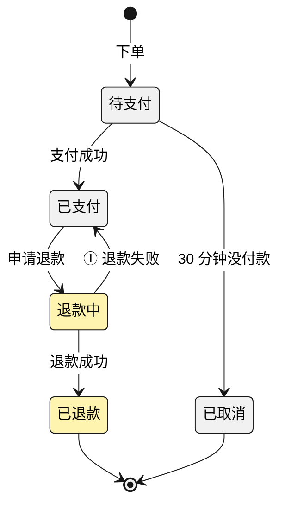
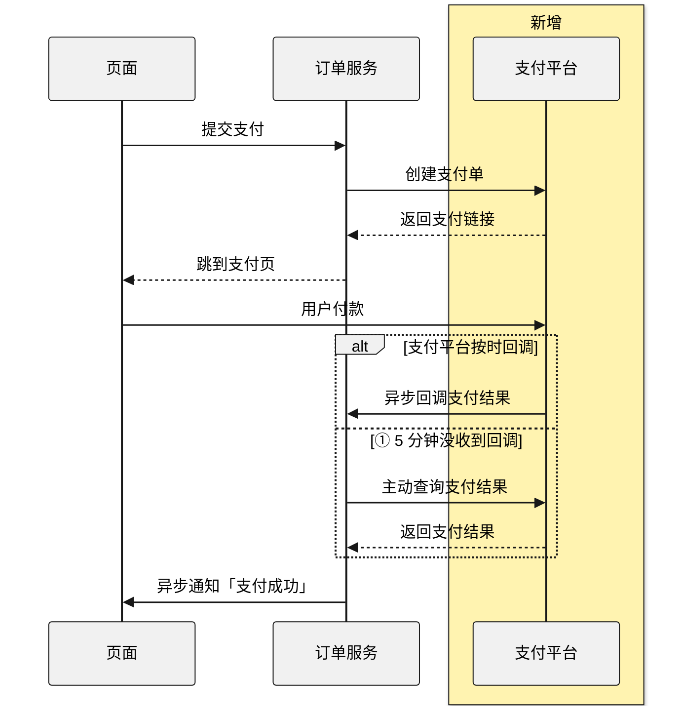
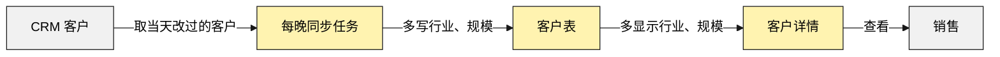

# 功能点配图

写稿时(dev-clarify ④)每个功能点按这里选图、画图,写进讨论稿里这个功能点那一节,口径表跟在图下面;收拢时(⑤)照这里核一遍有没有漏画。有泳道的图(接口内逻辑图、编排图、泳道图)的样式头、标黄标绿、判断写法这些通用画法见同目录 `泳道图画法.md`,本文件只写选图、用哪种语法和每种图另守的规则;单点图和 `泳道图画法.md` 冲突时(框数上限、能不能写接口名、活动文字里的括号、分支怎么收尾),以本文件为准。

## 选图

| 功能点在讲什么 | 画什么 | 算 | 不算 |
|---|---|---|---|
| 后端入口里有判断要定:页面调的接口、给别的系统调的接口、定时任务、消息消费;新入口本身有判断,或者给既有入口加判断、改判断 | 接口内逻辑图 | 新增「校验联系人号码」;既有校验接口加一个「在黑名单?」;收到「支付成功」消息时,订单已取消就原路退款;每天 2 点对账,金额对不上的标异常并通知财务 | 接口只多返回一个字段;只改提示原文、判断不变;只改任务几点跑、隔多久跑 |
| 一个功能点里按顺序调 2 个及以上接口,这次改了调用顺序,或者改了其中某个接口的判断;页面依次调、一个接口里调别的接口都算 | 编排图 | 提交订单时先校验联系人、再锁号码、再下单 | 一个接口里先查如意、查不到再查现网,两边都不改(写成接口内逻辑图里的一步);只调一个接口 |
| 一个东西有 3 个及以上状态,这次新增状态,或者改了状态之间怎么变 | 状态图 | 订单加「退款中」:已支付 → 退款中 → 已退款,退款失败回到已支付 | 只有开 / 关两个状态;状态不变,只改某个状态下页面显示什么 |
| 结果由 2 个及以上条件一起决定,组合出 4 种及以上,条件之间没有先后 | 决策表 | 会员等级 × 渠道 → 4 种积分倍率;角色 × 操作的权限表 | 条件一个接一个判断、先判断的先返回(画接口内逻辑图) |
| 数据从哪来(表、文件、别的系统),经过哪几步加工,落到哪;这次改了来源、加工或去向 | 数据流图 | CRM → 同步任务 → 客户表,这次多同步两个字段;每晚把订单汇总进日报表,这次多算一列退款 | 页面查一张表直接显示 |
| 3 方及以上(人或系统)之间有往返:回调、异步通知、审批来回,这次要定先后 | 时序图 | 提交支付 → 支付平台 → 回调订单服务 → 通知页面;提交审批 → 主管驳回 → 修改后重提 | 一次请求里按顺序调完(画编排图) |
| 用户在页面上做 3 步及以上操作,或者跨 2 个及以上角色,系统每步有响应;里面有接口判断要定的,画接口内逻辑图 | 泳道图(每个角色一条泳道,系统一条) | 运营建活动(选商品 → 设折扣 → 预览 → 发布),每步页面有提示 | 点「刷新」→ 列表更新 |
| 页面长什么样 | 线框(/dev-wireframe):布局不画图,提示要不要出线框;页面调的接口有判断要定的,照第一行画接口内逻辑图;只有取数口径的,写行为链,口径表跟在后面 | 新页面、布局变了 | — |
| 只改一句文案、只多返回一个字段 | 不画图:那一节写行为链和边界两行 | 「客户详情多返回地区名」 | — |

- 一个功能点最多占两种场景:先画讲得最多的那种;另一种这次也有东西要定,再加一张。编排图配的接口内逻辑图、超框拆出来的图不算数。
- 时间线(每天几点跑、隔多久重试)用表或编号步骤,不画图。

## 用哪种语法

- 有泳道的图用 PlantUML 活动图:接口内逻辑图、编排图、泳道图,画法见 `泳道图画法.md`。Mermaid 的泳道只能用 `subgraph` 框模拟,泳道高矮不齐、左右顺序排不准,同样的框画出来面积约 3 倍。
- 状态图、时序图、数据流图用 Mermaid:画出来和 PlantUML 一样清楚,GitLab、IDEA、claude.ai 都能直接显示。
- 一张图只用一种语法。Mermaid 图写在语言标成 `mermaid` 的代码块里,第一行照抄下面这行样式头,三种图共用,逐字一致(改样式时同步所有样例):

  ```text
  %%{init: {"theme":"base","themeVariables":{"primaryColor":"#F1F1F1","primaryBorderColor":"#181818","primaryTextColor":"#000000","lineColor":"#181818","edgeLabelBackground":"#FFFFFF","actorBkg":"#F1F1F1","actorBorder":"#181818","signalColor":"#181818"}}}%%
  ```

- Mermaid 标黄:状态图、数据流图在图种声明的下一行写 `classDef new fill:#FFF3B0,stroke:#181818`,再照各图种的写法挂到新增的元素上;时序图不认 `classDef`,改用 `box`(见「时序图」)。
- Mermaid 文字换行用 `<br/>`;文字里有 `[ ] # ;` 这类符号时整段用双引号包起来。
- 自己核对出图:PlantUML 用 `plantuml -tsvg 文件`(brew 装的 `plantuml` 自带 Java,别用系统的 `java -jar`);Mermaid 贴进 IDEA 的 Markdown 预览或 GitLab 看。

## 框数

单点图不超过 25 个框:活动、判断、开始 / 结束算;连接点、note、合并菱形不算。超了:新接口按段拆成两张(如「参数和开关」「业务规则」);改既有接口只画改动那段,前后各留一个判断,其余合成一个框「其余 N 个判断不变」;编排图按页面或阶段拆,一段一张。

## 编号和标绿

- 一节里有两张以上图时,每张图前一行「**图 N 名称**」,N 在这一节里从 1 编;引用本节的图写「见图 N」,引用别的功能点的图写它的编号(「判断见 F2」),不在本节再画一份。
- 一个功能点的边界编号在它的几张图里接着编,不重号;一张图汇总了另一张图里的几种失败时,写那几个编号(「①–⑤ 返回校验失败原因」),不另编。编号写在:活动图失败分支的第一个框;状态图转移文字的前面,讲某个状态下显示什么的写在状态说明前面;时序图 `alt` / `else` 条件的前面;数据流图箭头文字的前面;决策表结果列的前面。
- 活动图里一个 `if` 只剩一支往下走(另一支以 `stop` 或连接点收尾)时,接下来那根绿箭头写在这一支的末尾、`endif` 之前;写在 `endif` 后面,PlantUML 会把它画成黑线。连到 `(B)` 这类连接点之前,也写一根绿箭头。

## 从哪进、回到哪

活动图里触发方的第一步写从哪个功能点进来,最后一步写回到哪个功能点:「在 F1 列表点「新增绑定」」「回到 F1 列表」;跳去别的功能点的步骤写它的编号(「点「去走访」见 F5」)。状态图、时序图这类没有触发方的,从哪进写在图前的行为链里(「运营从站内通知或「我的导出」进来 → …」)。这几处和功能清单的「从哪进 → 到哪去」对上;从系统外触发的(别的系统、定时任务、消息)照接口内逻辑图写触发方。

## 接口内逻辑图

- 两条泳道:触发方在左,接口所在的服务在右。触发方泳道写谁触发:页面写用户操作(「输入联系人号码\n点「下一步」」),别的系统写「X 系统调用」,定时任务写「每天 2 点触发」,消息写发消息的一方和消息名(支付平台发「支付成功」消息)。
- 服务泳道先一个框写接口:「中文名」换行「对外接口名」,HTTP 写方法加路径(`POST /api/orders/export`),RPC 或服务接口写方法名(`qrystaffCodeAndCustIdByPhone`);新接口写「中文名(新)」,名字留给 spec 的接口契约;类名、行号、SQL 不写。
- 判断:从入口被触发到处理完,会让调用方看到不同结果、或者造成不同结果(改成不同状态、发不同通知)的判断都画,一个判断一个菱形。既有接口照代码顺序;新接口由 AI 先排顺序(几个条件同时不满足时,用户看到的是先判断的那句提示)。开关、请求头字段原样写进判断。日志、埋点、缓存、事务、重试、对象转换不画;几个字段校验返回同一句提示的,合成一个判断。
- 失败分支写提示原文,前面带这个功能点的边界编号:「① 校验失败\n「…不可为空」」;任何一步抛异常合成一条 note,也编号。
- 有人等结果的(页面、别的系统):失败后处理一样的连到 `(A)`,通过连到 `(B)`;连接点画在服务泳道的分支末尾,接 `detach`;图末尾切回触发方泳道,依次写 `(B)` → 结果 → `stop`、`(A)` → 结果 → `stop`。处理不一样的失败(身份失效跳登录页)用 `(C)`、`(D)`,各写各的结果。
- 没人等结果的(定时任务、消息):每个分支在服务泳道写它造成的结果再 `stop`,不画连接点;note 写处理失败重试几次、最后怎么兜底。
- 既有判断不标黄,这次新增或改的活动和判断标黄;正常走通的路径标绿(含分支入口);写法照 `泳道图画法.md`,只剩一支走到 `endif` 时照「编号和标绿」。
- 画到 25 个框以上照「框数」拆。
- 调的服务读不到代码(别的团队、外部系统):写成一步「调 X 校验」,分支照它的接口文档画;文档里也查不到的,在那一步标【待确认】。

有人等结果的入口,用「校验联系人号码」举例:假设这次新加的是黑名单判断,所以标黄;图里的 ①–⑤ 是这个功能点的边界编号。

```plantuml
@startuml
skinparam backgroundColor #FFFFFF
skinparam Activity {
  BackgroundColor #F1F1F1
  BorderColor #181818
  FontColor #000000
}
skinparam Swimlane {
  BorderColor #181818
  TitleBackgroundColor #FFFFFF
  TitleFontColor #000000
}
skinparam ArrowColor #181818

|填单页面|
start
:输入联系人号码\n点「下一步」;
|so-service|
-[#2E7D32,bold]->
:校验联系人号码\nqrystaffCodeAndCustIdByPhone;
note right
  任何一步抛异常
  → ⑤ 校验失败,返回异常信息
end note
-[#2E7D32,bold]->
if (custId 或手机号为空?) then (是)
  :① 校验失败\n「…不可为空」;
  (A)
  detach
else (否)
  -[#2E7D32,bold]->
  if (本人手机号?\n先查如意 查不到再查现网) then (是)
    -[#2E7D32,bold]->
    :校验通过;
    -[#2E7D32,bold]->
    (B)
    detach
  else (否)
    -[#2E7D32,bold]->
    if (开关 BLACK_PHONE_NEW_SWITCH = Y?) then (是)
      -[#2E7D32,bold]->
      if (请求头有 regionId?) then (是)
        -[#2E7D32,bold]->
        if (营业员手机号?) then (是)
          :③ 校验失败\n「…号码为营业员号码」;
          (A)
          detach
        else (否)
          -[#2E7D32,bold]->
        endif
      else (否)
        :② 校验失败\n「请求头regionId为空」;
        (A)
        detach
      endif
    else (否)
      -[#2E7D32,bold]->
    endif
    -[#2E7D32,bold]->
    if (在黑名单?) then (是) <<#FFF3B0>>
      :④ 校验失败\n「…不允许作为联系人」; <<#FFF3B0>>
      (A)
      detach
    else (否)
      -[#2E7D32,bold]->
      :校验通过;
      -[#2E7D32,bold]->
      (B)
      detach
    endif
  endif
endif

|填单页面|
(B)
-[#2E7D32,bold]->
:进入下一步;
stop
(A)
:停在填单页\n提示失败原因;
stop
@enduml
```

没人等结果的入口,用「收到支付成功消息」举例:假设这次新加的是已取消订单原路退款,所以标黄。

```plantuml
@startuml
skinparam backgroundColor #FFFFFF
skinparam Activity {
  BackgroundColor #F1F1F1
  BorderColor #181818
  FontColor #000000
}
skinparam Swimlane {
  BorderColor #181818
  TitleBackgroundColor #FFFFFF
  TitleFontColor #000000
}
skinparam ArrowColor #181818

|支付平台|
start
:支付成功\n发「支付成功」消息;
|order-service|
-[#2E7D32,bold]->
:处理支付成功消息\nonPaySuccess;
note right
  处理抛异常
  → ③ 重试 3 次,仍失败进死信并告警
end note
-[#2E7D32,bold]->
if (订单待支付?) then (是)
  -[#2E7D32,bold]->
  :改成已支付\n记一条支付流水;
  stop
elseif (订单已支付?) then (是)
  :① 重复消息 直接确认\n不重复记流水;
  stop
else (已取消)
  :② 原路退款\n通知用户「订单已取消,款项原路退回」; <<#FFF3B0>>
  stop
endif
@enduml
```

## 编排图

- 编排和各接口判断合起来不超过 25 个框,画成一张:接口按调用顺序往下排,各接口的判断照接口内逻辑图画在各自的服务泳道;超了先画编排图,有判断的接口再各配一张接口内逻辑图,放在同一节,编排图里配了逻辑图的接口框加一行「判断见图 N」;调的接口属于别的功能点的,写它的编号(「判断见 F2」)。图号和边界编号照「编号和标绿」。
- 泳道:触发方一条,每个服务一条,按第一次被调的先后从左往右。
- 一个接口一个框,写法同接口内逻辑图:「中文名」换行「对外接口名」,新接口写「中文名(新)」。
- 接口之间画清:前一个失败还调不调后一个,失败后要不要撤回前面做的;撤回步骤画在做撤回的服务泳道。撤回有两种体验(整批回滚 / 部分成功)时,图画默认的那种,另一种写进这一节最后的 🎭 体验变体;人选了另一种,照 dev-clarify ④ 的二拍循环出候选图。
- 两个接口同时调,用 `fork` / `fork again` / `end fork`。异步:触发方先写马上看到什么,再用虚线箭头接到后台泳道,在正常路径上写 `-[#2E7D32,dashed]-> 异步;`,不在正常路径上写 `-[dashed]-> 异步;`;后台做完回到触发方,写之后从哪知道结果(收到站内通知)。

用「提交订单」举例:流程和接口名是编的,这次新加的是锁号码和下单失败后释放号码,所以标黄。讨论稿里这一节有三张图:图 1 是下面这张编排图;图 2 校验联系人号码就是上一节那张,边界 ①–⑤;图 3 创建订单这里省略。编排图的边界接着从 ⑥ 编,校验失败只写图 2 里的「①–⑤」,不另编。

**图 1 提交订单**

```plantuml
@startuml
skinparam backgroundColor #FFFFFF
skinparam Activity {
  BackgroundColor #F1F1F1
  BorderColor #181818
  FontColor #000000
}
skinparam Swimlane {
  BorderColor #181818
  TitleBackgroundColor #FFFFFF
  TitleFontColor #000000
}
skinparam ArrowColor #181818

|提交页面|
start
:核对号码和联系人\n点「提交订单」;
|so-service|
-[#2E7D32,bold]->
:提交订单\nsubmitOrder;
-[#2E7D32,bold]->
:校验联系人号码\nqrystaffCodeAndCustIdByPhone\n判断见图 2;
-[#2E7D32,bold]->
if (校验通过?) then (否)
  :①–⑤ 返回校验失败原因;
  (A)
  detach
else (是)
  -[#2E7D32,bold]->
  |res-service|
  :锁定号码\nlockNumber; <<#FFF3B0>>
  |so-service|
  -[#2E7D32,bold]->
  if (锁定成功?) then (否) <<#FFF3B0>>
    :⑥ 返回「号码已被占用」; <<#FFF3B0>>
    (A)
    detach
  else (是)
    -[#2E7D32,bold]->
    :创建订单\ncreateOrder\n判断见图 3;
    -[#2E7D32,bold]->
    if (下单成功?) then (否)
      :⑦ 下单失败;
      |res-service|
      :释放号码\nreleaseNumber; <<#FFF3B0>>
      (A)
      detach
    else (是)
      |so-service|
      -[#2E7D32,bold]->
      :返回订单号;
      -[#2E7D32,bold]->
    endif
  endif
endif
|提交页面|
:跳到支付页;
stop
(A)
:停在提交页\n提示失败原因;
stop
@enduml
```

## 状态图

- 状态写名词(待支付、已退款),箭头写触发事件(支付成功、申请退款);起点 `[*] --> 第一个状态`,终态 `--> [*]`。
- 第二行写 `stateDiagram-v2`;状态用 `state "名称" as S1` 声明;要加说明写 `S1 : 说明`,显示在状态框下半格。
- 这次新增或改的状态,声明完写一行 `class S3, S4 new`;只改了已有状态之间怎么变的,转移标不了黄,写进那一节开头的说明(「新加:退款失败回到已支付」);状态图不标绿。

用订单退款举例:假设这次新加的是退款,所以退款中、已退款标黄;退款失败回到已支付是边界 ①。



## 时序图

- 第二行写 `sequenceDiagram`;参与者按出场先后从左往右,系统用 `participant 别名 as 名称`,人用 `actor 别名 as 名称`(别名在前,和 PlantUML 相反)。
- 同步调用用实线 `->>`,返回用虚线 `-->>`;异步回调、服务端主动推的通知也用实线 `->>`,消息文字里写「异步」;分支用 `alt 条件` … `else 条件` … `end`。
- 这次新增的参与者用 `box rgb(255,243,176) 新增` … `end` 包起来,整列标黄;Mermaid 不能给单个参与者上色,所以不用 `classDef`。新增的几个参与者不挨着时,各包一个 box。消息不上色,已有参与者之间新加的消息写进那一节开头的说明(「新加:主管驳回后可修改重提」);时序图不标绿。

用支付回调举例:假设这次新接入的是支付平台,所以支付平台标黄;5 分钟没收到回调是边界 ①。



## 数据流图

- 第二行写 `flowchart LR`,从左往右按数据走向排;框写数据或加工步骤(CRM 客户、同步任务、客户表),写成 `别名["名称"]`。
- 箭头写 `-->|文字|`,文字写带过去的是什么,或者怎么加工的(「取当天改过的客户」)。
- 这次新增或改的框在后面加 `:::new`;数据流图不标绿。

用客户同步举例:这次每晚同步多带行业、规模两个字段,所以同步任务、客户表、客户详情标黄。



## 决策表

- 用 Markdown 表:条件列在前,结果列在后,最后一列「这次」写「新增」或「改」,没变的空着。
- 每种组合一行,不合并单元格。
- 表前一句话说清这张表回答什么。

积分倍率按会员等级和下单渠道一起定,这次新加了黄金会员:

| 会员等级 | 渠道 | 积分倍率 | 这次 |
|---|---|---|---|
| 普通 | App | 1 倍 | |
| 普通 | 门店 | 1 倍 | |
| 黄金 | App | 2 倍 | 新增 |
| 黄金 | 门店 | 1.5 倍 | 新增 |
