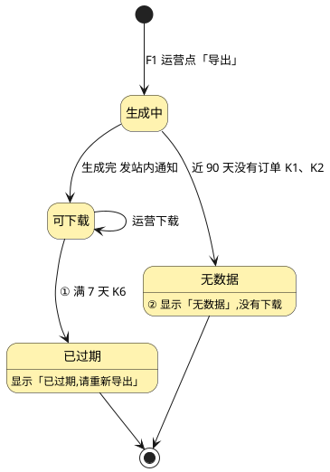

# 编写 Spec (dev-spec)

## 定位

- **做什么收录一次,怎么做是主体**:第一节「功能方案」原样收录 clarify 终确认的功能方案,它就是业务契约;spec 自己的笔墨全部花在「怎么实现」,正文按编号引用功能点和口径(F1、F1②、K1),不重述业务。
- **没有任何业务义务存在于 spec 之外**:clarify 的讨论稿和对话都不是契约,功能方案只有收录进 spec 才成为义务。
- **细节方案以设计决策表呈现**:每条给「选择 → 没选的(为什么)→ 理由(依据)→ 影响面」;程序员挑错式评审,🔒 的在收尾等确认,其余不改即采纳。
- **反向闸门**:细节方案改变了功能方案锁定的行为或口径(口径要的字段不存在、既有代码是另一种算法)→ 回 clarify 让用户确认,不在 spec 里改第一节。
- 不展开成任务列表、文件级修改步骤、代码实现细节——拆解编排归 plan,plan 也不重新选型。

<HARD-GATE>
没有功能方案:多功能点的新需求 → 先 `/dev-clarify`;小需求/bug 修复 → 按第一节同样的格式补写,先给用户确认。
业务问题不在 spec 里问,回 clarify;只补问读代码也答不了的设计问题,不阻塞成文的标【待确认】。
不编造代码结构、接口、数据结构;会影响 plan 写死或实现正确性的【待确认】,不能伪装成已确认。
</HARD-GATE>

## 工作流程

0. **命名先行**(写内容前必须落定):① 业务 ID——有无工单号/需求单号?允许留空但**必须显式确认**;② 标题语言——中/英/混合,用户选定,**禁止擅自中文转英文 slug**;③ 负责人——默认 `git config user.name`,向用户展示确认;必须和负责人本人的 `git config user.name` 一字不差,写成显示名,`features list --mine` 就找不到;写入头部 `> 负责人:`(「我的需求」检索以此为准);④ 规范里的段——有 `docs/guides/feature-standards.md`「需求目录命名」一节 → 确认 `格式:` 行里除 `YYYY-MM-DD` 外的每个占位段:有取值表的段(如模块)先按要改的代码目录给出建议值再确认;需求跨多个模块而规范没写怎么取 → 列出涉及的模块,问用户取哪个;改动不在模块表里而规范没写怎么取 → 列出改动的目录,问用户取哪个模块名,并提醒把它补进模块表。没有规范 → 命名和现在一样。用户已给 feature-id,或目录已由 clarify 讨论稿、`/dev-start` 建立 → 直接复用。
1. **收录功能方案**:原样写成第一节——收 clarify 讨论稿(`<前缀>-功能方案-v<N>.md`)人终确认的那一版 `---` 以上的正文:一句话、功能清单、各功能点那一节(图或行为链、口径表、体验决策)。`---` 以下不收:「必须在 spec 前解决的问题」不是「无」的,先列给用户,定完(回 `/dev-clarify` 出下一版)再写;现实约束清单、留给 spec 的细节决策在第 2、3 步用。没有讨论稿的(小需求、bug 修复直接来写 spec)按讨论稿同样的格式补写,先给用户确认。
   图:spec 第一节随讨论稿进 PlantUML 图;spec 自己新写的活动/时序/状态/类图默认 PlantUML;时间线等不擅长的用表或编号步骤。画法照 dev-clarify 的 `references/功能点配图.md`(各图种的样式头、样例和框数,图里可以写对外接口名、服务名),标黄标绿等通用画法见同目录 `泳道图画法.md`。
2. **读代码**:读设计要用的代码事实——既有机制怎么实现、能不能复用、调用方有哪些(grep/Read 查代码与调用关系;`db-query` 查 DDL,本地 `docs/schema-knowledge/` 优先;`knowledge-recall` 查历史决策),调用前告知用户。讨论稿 `---` 以下「现实约束清单」里核实过的不重复查。
3. **定细节方案**:每个功能点一节——设计决策表;这个功能点有接口、持久化数据、迁移、对外文案时,在表后写接口契约、数据格式、迁移与兼容、文案的技术包装。被体验决策锁定的选项直接引用不重开;口径在决策表里落成具体查询条件(字段、状态值、时间边界),几处用到同一口径的收在一处实现,不各写一遍;schema 变更标注走 `docs/guides/data-standards.md`「Schema 变更约定」。
4. **写全局约束、设计验收、待确认项**:全局约束只写跨功能点的(不能改的旧行为、必须复用的机制、零变化要求);设计验收只写功能方案里看不到的检查;待确认只留设计类。
5. **覆盖核对**:逐个功能点确认都有一节细节方案,或写明「沿用现有实现,无新决策」;逐条口径确认都落到了某条决策。

## 结构

按此范例写;小需求同样两部分,只是更短:

````markdown
# 规格说明: 订单导出

> 产物: spec
> feature-id: 2026-10-21-REQ-1024-订单导出
> 负责人: zhangsan
> 日期: 2026-10-21

## 功能方案

> 原样收录 clarify 终确认的功能方案(讨论稿 v2);业务要变,回 clarify 改,再同步这一节。

**一句话**:原来运营要找开发导订单;这次在订单列表加「导出」,运营自己下载近 90 天的订单去对账。

**功能清单**

| 编号 | 功能点 | 类别 | 从哪进 → 到哪去 | 一句话 |
|---|---|---|---|---|
| F1 | 订单导出 | 核心 | 订单列表「导出」→ 站内通知 → F2 | 运营点「导出」,后台生成近 90 天的订单文件,做完站内通知 |
| F2 | 导出记录查看 | 支撑 | 站内通知、「我的导出」→ 下载 | 「我的导出」列出近 30 天的导出与状态,点一条下载 |
| — | 自定义导出列 | 建议新增 ✂️ | — | 不做:用户原话只要固定几列 |

### F1 订单导出(核心)

订单服务收下导出请求就返回,后台导出任务异步取数、生成文件,做完站内通知;导出记录和 F2 共用,运营到 F2「我的导出」下载。

```plantuml
@startuml
skinparam backgroundColor #FFFFFF
skinparam Activity {
  BackgroundColor #F1F1F1
  BorderColor #181818
  FontColor #000000
}
skinparam Swimlane {
  BorderColor #181818
  TitleBackgroundColor #FFFFFF
  TitleFontColor #000000
}
skinparam ArrowColor #181818

|运营|
start
:打开订单列表;
-[#2E7D32,bold]->
if (有导出权限? K4) then (是) <<#FFF3B0>>
  -[#2E7D32,bold]->
  :点「导出」; <<#FFF3B0>>
  -[#2E7D32,bold]->
else (否)
  :② 看不到「导出」按钮; <<#FFF3B0>>
  stop
endif
|订单服务|
:提交导出(新)\n记一条导出记录; <<#FFF3B0>>
|运营|
-[#2E7D32,bold]->
:立刻看到「已开始导出」; <<#FFF3B0>>
|导出任务|
-[#2E7D32,dashed]-> 异步;
:取近 90 天的订单 K1、K2; <<#FFF3B0>>
-[#2E7D32,bold]->
if (有订单? K1、K2) then (是) <<#FFF3B0>>
  -[#2E7D32,bold]->
  :生成 订单导出_20261021.xlsx\n订单号 客户 金额 K3 退款 支付时间\n导出记录改成可下载; <<#FFF3B0>>
  |运营|
  -[#2E7D32,bold]->
  :收到站内通知\n点开 F2「我的导出」下载; <<#FFF3B0>>
  stop
else (否)
  |导出任务|
  :① 不生成文件\n导出记录改成无数据\n发站内通知「近 90 天无数据」; <<#FFF3B0>>
  (A)
  detach
endif
|运营|
(A)
:收到站内通知「近 90 天无数据」; <<#FFF3B0>>
stop
@enduml
```

| 编号 | 哪一步 | 怎么判定 | 算 / 不算(例子) | 依据 |
|---|---|---|---|---|
| K4 | ② 谁能导出 | 有「订单导出」权限点的角色 | 算:运营、财务;不算:客服 | `role_permission.perm_code`(新增一个导出权限点);新定 |
| K1 | 取订单 · 哪些算订单 | 已支付的订单,后来退款的也算 | 算:已支付、已退款;不算:待支付、已取消 | `orders.status`;沿用「销售日报」 |
| K2 | 取订单 · 近 90 天 | 按支付时间,含今天往前数 90 天 | 今天 10-21:07-24 支付的算,07-23 的不算;07-23 23:59 下单、07-24 00:01 支付的算 | `orders.paid_time`;新定(销售日报按下单时间) |
| K3 | 生成文件 · 金额 | 实付金额,不扣退款;退款另起一列 | 实付 100、退了 30 → 金额 100,退款 30 | `orders.paid_amount`、`refund_record.amount`;新定(销售日报扣了退款) |

🎭 体验决策:导出走后台任务 + 完成通知,不让运营盯着转圈。

### F2 导出记录查看(支撑)

和 F1 共用导出记录:F1 每导出一次记一条,这里列出来、按状态显示,文件留 7 天。

行为链:运营从站内通知或「我的导出」进来 → 列出本人近 30 天的导出 K5,新的在前,每条显示状态 → 点「可下载」的那条,下载文件。



| 编号 | 哪一步 | 怎么判定 | 算 / 不算(例子) | 依据 |
|---|---|---|---|---|
| K5 | 列出 · 列哪些、怎么排 | 本人近 30 天发起的导出,新的在前 | 今天 10-21:09-22 发起的列,09-21 的不列;别人发起的不列 | 导出记录的发起人、发起时间(新数据,存哪由 spec 定);新定 |
| K1、K2 | 生成中 → 无数据 | 见 F1 | — | — |
| K6 | ① 满 7 天 | 按生成完的时间,满 7 天过期 | 10-14 15:00 生成完的,10-21 15:00 起显示「已过期,请重新导出」 | 导出记录的生成完成时间(新数据,存哪由 spec 定);沿用报表导出文件留 7 天 |

## 怎么实现

### 细节方案:F1 订单导出

| # | 决策 | 选择 | 没选的(为什么) | 理由(依据) | 影响面 |
|---|---|---|---|---|---|
| D1 🔒 | 任务表 | 新建 export_task(id/user_id/params/status/file_path/created_at/finished_at) | 复用 report_task 加 type 列——两类任务状态流转不同,混表要改报表侧查询 | report_task DDL(本地已核实) | schema 变更,走 data-standards 约定 |
| D2 | 按口径取数 | 复用报表查询,加 K1 `status IN (paid, refunded)`、K2 `paid_time >= 今天 0 点往前 89 天`;K3 金额取 paid_amount,退款按订单汇总 refund_record | 导出单写一条查询——同一口径写两处,改一处漏一处 | `src/report/query.ts` 已按 status 取数 | 无 |
| D3 🔒 | 接口形态 | 提交任务、下载文件、「我的导出」列表三个接口(见下表) | 一个接口同步返回文件——体验决策已选后台任务,不重开 | 沿用 report_export 的两段式接口,列表另加 | 新增三个对外接口 |
| D4 🔒 | 导出权限点 | role_permission 新增 `order:export`,授给运营、财务;「导出」按钮和提交接口都校验(K4) | 只在页面上藏按钮——绕过页面直接调接口就能导 | role_permission 里已有 `report:export` 这类权限点 | 加一条权限点、两条角色授权的数据迁移 |

接口契约:

| 方法 | 路径 | 入参 | 出参 | 错误 |
|---|---|---|---|---|
| POST | `/api/orders/export` | 无 | `{ taskId }` | 403 无导出权限 |
| GET | `/api/exports` | 无 | `[{ taskId, status, createdAt, finishedAt }]` | — |
| GET | `/api/exports/:taskId/file` | taskId | xlsx 文件流 | 404 任务不存在;410 已过期 |

### 细节方案:F2 导出记录查看

| # | 决策 | 选择 | 没选的(为什么) | 理由(依据) | 影响面 |
|---|---|---|---|---|---|
| D5 | 按口径列记录、判过期 | 列表按 K5 取 export_task:`user_id` 是当前用户、`created_at` 不早于今天 0 点往前 29 天,按 `created_at` 倒序;K6 按 `finished_at` 满 7 天判过期,过期的下载返回 410 | 列表走 report_task——两类任务状态流转不同(D1) | D1 新建的 export_task | 无 |

### 全局约束

- 报表导出 report_export 的接口与文件格式不变,F1 只新增、不改它的对外行为。

## 设计验收

| # | 对应 | 验收点 | 怎么验 |
|---|---|---|---|
| 1 | D1 | 同一用户连点两次导出,生成两条任务、两个文件,互不串 | 单元测试 |
| 2 | 接口契约 | 无权限调用 `POST /api/orders/export` 返回 403 | 接口测试 |

## 待确认项

- 无
````

- **第一节只收录不改写**:spec 其余各节按编号引用功能点、边界和口径,不抄行为链和口径定义。
- **涉及 UI 且有人确认过线框**:第一节末尾写一行「页面布局与交互以 `<前缀>-线框-v<N>.html` 为准」,版本号写死,出新版要修订这一行;还没有线框,提示一句要不要先 `/dev-wireframe`。
- **决策只记有像样备选的**:照现有模式写、评审者不会选别的,就写「沿用现有实现,无新决策」一句,不进决策表。
- **理由列只写依据**:文件、表、知识库条目;读代码的结论写在这里,不单独成节。
- 🔒 只标四类难回头的决策:持久化的数据结构和表、对外接口与 URL、模块边界与依赖方向、安全边界;收尾时单独摆出来等确认。D 编号全文连续,plan 按编号引用。
- 接口契约、数据格式、迁移与兼容、文案的技术包装只在这个功能点有时才写,放在它的决策表后面;`/api-case` 从接口契约取接口范围。
- 设计验收只写功能方案里看不到的检查(并发、零变化、耗时、迁移校验等);业务验收由 `/unit-spec`、`/ui-case` 从第一节各功能点的图(分支就是边界)、行为链和口径表的「算 / 不算」例子派生。

## 产物位置与命名

- 路径:`docs/features/<feature-id>/<文件前缀>-spec.md`。无可写项目上下文 → 回复中直接输出正文。
- **feature-id**:有 `docs/guides/feature-standards.md` 的「需求目录命名」一节 → 按其 `格式:` 行的模板命名(必填段 `<名称>`、可选段 `[名称-]`、日期 `YYYY-MM-DD`);格式里没有 `YYYY-MM-DD` → 提示「命名规范缺少日期段 YYYY-MM-DD,本次按默认格式命名」,改用默认格式。没有这一节 → `YYYY-MM-DD-[业务ID-]<标题>`:业务ID 可选(字母数字 + 连字符);标题允许中/英/混合,**不得**中文转英文 slug;重名追加短后缀;同目录已有 PRD 优先复用同一 feature-id。
- **文件前缀**:文件前缀 = feature-id 去掉日期段 `YYYY-MM-DD`(例:`order-2026-10-25-REQ-1024-订单导出` → `order-REQ-1024-订单导出`);默认格式下就是 `<业务ID>-<标题>` 或 `<标题>`。
- 敏感字符(`/ \ : * ? " < > |`)拒绝,要求用户重命名,不自动替换;不转英文 slug、重名追加短后缀,对规范新增的段同样适用。
- 已有目录一律复用,不按新规范改名。
- 与旧目录共存:始终新命名,不探测旧 `spec.md`。

## 收尾

产物落盘后自动跑 `cgraphx features sync`(更新 `.cgraphx/my-features.md` 本人需求索引——本地文件、幂等、不问用户)。然后在回复里摆出全部 🔒 决策,每条一行「选择 → 为什么难回头」,按此范例写:

```markdown
**难回头的决策**(其余决策不改即采纳)

- D1 新建 export_task 表 → 上线后有数据,改结构要迁移
- D3 三个导出接口 → 前端直接调,改路径要兼容旧地址
- D4 新增 order:export 权限点 → 授权数据上线后,改编码要连角色授权一起迁移

**这几条难回头的决策确认吗?**
```

人确认才算定;人提出修改就改 spec 后再问;没有 🔒 决策时只提示审阅。**不主动继续写 plan 或代码。** 用户日后找需求目录:`cgraphx features list --mine`。

## 红线(绝对不能做)

1. ❌ **不编造**代码结构、接口、数据结构、技术约束——标【待确认】或先确认。
2. ❌ **不把【待确认】伪装成已确认**(尤其影响 plan 写死的)。
3. ❌ **不展开成任务列表/文件级修改步骤/代码实现细节**——拆解编排归 plan。
4. ❌ **不自动进入 plan/dev-impl**——输出后提示即停。
5. ❌ **不擅自中文转英文 slug**——命名归用户。
