# 设计文档

给领导和研发看:先用流程图看清这次改在流程的哪一步,再把改了内部逻辑的环节逐个展开。全部用图讲,图里只写业务语言。

## 素材

需求目录里的 spec(功能方案、怎么实现)、收口档案、测试报告,加上这次的代码改动(`git log` / `git diff`)。没有 spec 就不生成,提示先补 spec。流程和判断照代码画:每个判断、每个分支都要在代码里找得到,开关、参数校验、异常处理不能漏;spec 和代码对不上时以代码为准,标【待确认】。

## 范例

````markdown
# 设计文档: 积分发放规则

> 产物: design_doc
> 依据: spec@3f9a1c2

## 30 秒看懂

原来下单积分在订单服务里写死,按金额 1% 算,所有会员一个比例。现在按会员等级发放:普通会员每 1 元得 1 分,黄金会员得 2 分;发放规则从订单服务里抽出来,单独成了积分规则服务,退款按下单时的规则版本扣回。

- 改动:订单服务改了付款、退款两个环节,新增积分规则服务
- 数据:新增积分规则表,积分流水表加 1 列「规则版本」
- 验证:单元测试 18 条、接口测试 9 条全部通过,v2.3.0 已上线

## 流程全景:改在哪一步

付款发积分多了一步:订单服务不再自己算,改为调积分规则服务;写流水时多记规则版本。标黄的是这次改的。

原来:

```mermaid
%%{init: {"theme": "base", "themeVariables": {"primaryColor": "#F1F1F1", "primaryBorderColor": "#181818", "primaryTextColor": "#000000", "lineColor": "#181818", "clusterBkg": "#FFFFFF", "clusterBorder": "#181818", "edgeLabelBackground": "#FFFFFF"}, "flowchart": {"curve": "stepAfter"}}}%%
flowchart TB
  subgraph 订单服务
    o1(付款成功处理)
    o2(按金额 1% 算积分)
    o3(写流水 +积分)
  end
  subgraph 用户
    s((" ")):::start --> u1(付款)
    u2(积分到账)
  end
  u1 --> o1 --> o2 --> o3 --> u2
  classDef start fill:#181818
```



现在:

```mermaid
%%{init: {"theme": "base", "themeVariables": {"primaryColor": "#F1F1F1", "primaryBorderColor": "#181818", "primaryTextColor": "#000000", "lineColor": "#181818", "clusterBkg": "#FFFFFF", "clusterBorder": "#181818", "edgeLabelBackground": "#FFFFFF"}, "flowchart": {"curve": "stepAfter"}}}%%
flowchart TB
  subgraph 积分规则服务
    k1(按会员等级算积分<br/>带上规则版本):::changed
  end
  subgraph 订单服务
    o1(付款成功处理)
    o3(写流水 +积分<br/>记规则版本):::changed
  end
  subgraph 用户
    s((" ")):::start --> u1(付款)
    u2(积分到账)
  end
  u1 --> o1 --> k1 --> o3 --> u2
  classDef start fill:#181818
  classDef changed fill:#FFF3B0
```



退款流程同样改为调积分规则服务,按流水里记的规则版本算扣回。

## 改动的环节:付款成功处理(`POST /pay/notify`)

订单服务收到付款成功通知后,先防重复发,再调积分规则服务;积分规则服务超时或报错时,付款照常成功,积分记入待补发。

```mermaid
%%{init: {"theme": "base", "themeVariables": {"primaryColor": "#F1F1F1", "primaryBorderColor": "#181818", "primaryTextColor": "#000000", "lineColor": "#181818", "clusterBkg": "#FFFFFF", "clusterBorder": "#181818", "edgeLabelBackground": "#FFFFFF"}, "flowchart": {"curve": "stepAfter"}}}%%
flowchart TB
  subgraph 订单服务
    o0(付款成功处理)
    q0{{这笔订单发过积分?}}
    o1(调积分规则服务<br/>按会员等级算积分):::changed
    q1{{积分规则服务返回了?}}:::changed
    o2(写流水 +积分<br/>记规则版本):::changed
    o3(记入待补发<br/>每 10 分钟补一次):::changed
  end
  subgraph 支付回调
    s((" ")):::start
    r0([返回成功<br/>不重复发])
    r1([返回成功])
    r2([返回成功<br/>积分稍后到账])
  end
  s -- 付款成功通知 --> o0 --> q0
  q0 -- 是 --> r0
  q0 -- 否 --> o1 --> q1
  q1 -- 是 --> o2 --> r1
  q1 -- 超时或报错 --> o3 --> r2
  classDef start fill:#181818
  classDef changed fill:#FFF3B0
  linkStyle 0,1,3,4,5,6 stroke:#2E7D32,stroke-width:2px
```



## 改动的环节:退款成功处理(`POST /refund/notify`)

只改了扣回比例的来源:原来按金额 1%,现在取下单时流水里记的规则版本。没有新的判断,不单独画图。

## 数据变化

| 表 | 改了什么 | 历史数据 |
|---|---|---|
| 积分规则(新) | 按会员等级记发放比例,每次调整生成一个新版本 | — |
| 积分流水 | 加一列「规则版本」 | 历史流水补为 v1 |

## 关键决策与风险

| | 内容 |
|---|---|
| 决策 | 退款按流水记下的规则版本扣回:规则会调,按现在的比例倒推,调过比例后就会多扣或少扣 |
| 决策 | 规则单独成服务:付款、退款都要用同一套规则,留在订单服务里两处会各算各的 |
| 风险 | 积分规则服务不可用时,付款照常成功,积分由补发任务每 10 分钟补一次 |
````

## 写法

| 节 | 写什么 |
|---|---|
| 30 秒看懂 | 第一句讲原来,第二句讲现在;再用三行列出改动、数据、验证的数字 |
| 流程全景:改在哪一步 | 泳道图画这次涉及的业务流程,一步一个框,这次改的步骤标黄。流程本身变了(新增、删除步骤,调整次序或触发时机)就画「原来」「现在」两张;只改了某一步内部的逻辑,画一张「现在」。流程超过 15 步时,只画改动的那一段,前后各留一步 |
| 改动的环节:<步骤名>(<接口>) | 内部逻辑改了的步骤,一个一节:一句话讲这一步现在怎么走,再画内部泳道图。只换了取值来源、没有新判断的小改动,写一句话,不画图 |
| 数据变化 | 改了哪张表、改了什么、历史数据怎么处理;没动数据就整节删掉 |
| 关键决策与风险 | 2 到 3 条决策,每条带理由;风险一行 |

画图用 mermaid,样式模拟 PlantUML 活动图,照范例写:

- 每张图第一行照抄范例的 `%%{init: ...}%%`:直角连线、灰底黑框、泳道白底。
- 泳道用 `subgraph`,从右往左写:最右边的泳道先写,用户或调用方最后写,才会排在最左边。
- 起点 `s((" ")):::start`,步骤 `( )`,判断 `{{ }}`,返回给调用方的结果 `([ ])`;这次改的步骤加 `:::changed` 标黄。
- 用户或调用方的泳道要有起点也要有结果,泳道才会左右并排;环节图里每个分支各接一个调用方的结果,不要汇到同一个点。
- 环节图只画两条泳道:调用方和本服务;调下游写成本服务里的一步,写明调谁。
- 环节图里正常走通的路径用 `linkStyle` 标绿,序号按连线在源码里出现的顺序从 0 数,改了连线要跟着改序号。
- 判断按代码的顺序画全;一张图超过 15 个框就拆成两个环节。
- 图里只写业务语言,不写类名、方法名、行号和 SQL;接口写在环节标题的括号里,方便研发对代码。
