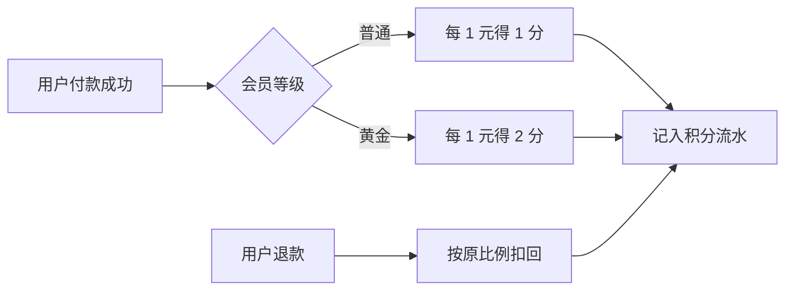

# 需求文档

给领导、客户、业务方看,业务可读,不要求懂代码。

## 可以写

- 业务背景和目标
- 需求范围和非范围
- 用户角色和使用场景
- 业务流程
- 功能需求
- 业务规则
- 数据口径的业务含义
- 权限和可见性
- 异常场景
- 验收标准
- 待确认项

## 不要写

- 代码实现步骤
- 数据库表结构和字段设计
- 接口参数细节,除非客户需要用它确认业务含义
- 类名、函数名、模块拆分
- 开发排期和任务分解
- 技术选型论证
- 测试用例明细,除非作为客户可读验收口径

## 模板

````markdown
# 需求文档: <需求名称>

> 产物: prd
> 依据: spec@<前 7 位>

## 需求概览

一句话需求,加业务流程图。第一句先讲原来的情况。


## 1. 需求范围

### 本次包含

### 本次不包含

## 2. 用户角色与使用场景

## 3. 业务流程

## 4. 功能需求

## 5. 业务规则

## 6. 数据口径与状态说明

## 7. 需拍板的业务决策

## 8. 权限与可见性

## 9. 异常与边界场景

## 10. 验收标准

## 11. 待确认项
````

## 需求概览范例

````markdown
## 需求概览

原来下单统一返 1% 积分,黄金会员和普通会员没有差别。现在按会员等级发放:普通会员每消费 1 元得 1 分,黄金会员得 2 分;退款时按当初的发放比例扣回。


````

## 章节写法

| 章节 | 写什么 |
|---|---|
| 需求概览 | 一句话需求,加业务流程图;第一句先讲原来的情况 |
| 需求范围 | 本次做什么、不做什么;非范围必须写清楚,防止客户误以为包含 |
| 用户角色与使用场景 | 谁使用、谁受影响、在什么业务场景下触发;角色用客户或项目里的叫法 |
| 业务流程 | 按客户能理解的步骤,从触发条件到业务结果;复杂流程用编号步骤、状态流转表或 Mermaid |
| 功能需求 | 按业务能力拆分;每条写清用户动作或系统动作、前置条件、业务行为、业务结果 |
| 业务规则 | 写领导或业务方需要确认的判断规则、限制条件、计算口径、状态变化、优先级、冲突处理;规则必须可验证 |
| 数据口径与状态说明 | 只写业务含义;说明关键字段、状态、数量、金额、时间、来源、统计口径等 |
| 需拍板的业务决策 | 集中列出只有领导、客户或业务方能决定的规则和口径;已确认的写「已确认」,未确认的写【待确认】 |
| 权限与可见性 | 哪些角色能看、能操作、不能操作;组织、租户、部门、区域或客户范围是否隔离 |
| 异常与边界场景 | 失败、重复、撤销、超时、空数据、无权限、数据不存在、部分成功、历史数据等 |
| 验收标准 | 用客户可判断的业务结果表达,不用「接口正常」「代码完成」这类开发视角 |
| 待确认项 | 列出仍需客户或业务方确认的内容,不藏在正文里 |
