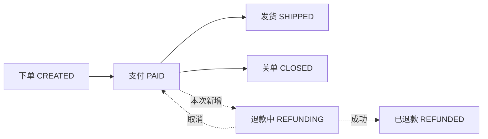

# 场景模板:改动型

本文件是 `write-delivery-guide` 的「改动型」形态场景模板——统一六项结构:判断特征 / 故事线主轴 / 讲解维度要求 / 图表类型 / 完整参考案例 / 常见讲错。生成交付讲解时 Read 本文件并照此生成。

> ⚠️ **本模板参考案例为拟真案例,待真实使用替换**(第一次真实改动交付后,用实际生成的讲解替换参考案例,并借此校准本模板六项)。

## 判断特征

- diff 以修改/删除既有代码为主(不是以新增文件为主);
- 触碰既有流程:状态机、既有接口行为、既有任务/事件的逻辑;
- spec 中表述为「修改/调整既有行为」,常伴随兼容性说明与需保留行为清单。

## 故事线主轴

**原流程中的部位**:先讲改动前的原故事线(读者已有的心智地图),再标出改动落在第几步。读者关心的第一问题是「改在我熟悉的流程的哪里」,不是「改了几个文件」。

## 讲解维度要求

1. **原流程全景**:改动前的完整故事线,高亮改动部位;
2. **前后对比**:之前什么样 → 现在什么样(两边各一句话逻辑 + 关键代码位置);
3. **为什么改**:来自 spec / 任务上下文,一句话;
4. **波及范围**:谁会受影响——逐个判断调用方、相关场景、定时任务、数据,列成表;
5. **什么没变**:显式列出需保留的行为(取自 spec「需保留行为」),让接收者确认既有行为安全;
6. 改动的组件按四问展开(见 SKILL.md 通用规则)。

## 图表类型

全景与改动定位用 flowchart / stateDiagram,改动部位用虚线或标注高亮;前后对比可用表格辅助。

## 完整参考案例

> 拟真案例(待真实使用替换):

---

# 交付讲解:订单状态机加入退款分支

## 1. 30 秒看懂

给订单流程加了一条退款分支:订单支付完成后可以进入 REFUNDING,退款处理完毕回到 PAID 或终态 REFUNDED。只改了状态机的流转部位,下单与支付流程不变。

## 2. 全景(高亮改动部位)

## 3. 场景故事线:原流程与改动部位

**原流程**(改动前):下单 → 支付 → {发货 | 关单}——PAID 之后只能去 SHIPPED / CLOSED。

**改动部位**:在「支付完成」这个环节之后,插入一条退款分支(上图虚线)。其余环节不变。

**为什么改**:业务要求支持支付后退款(spec:订单在发货前允许申请退款)。

## 4. 组件挂接(改动涉及的组件)

### `OrderStateMachine` — 状态流转注册(核心改动)

- **何时用**:任何推动订单状态的入口(支付回调、发货、关单、新增的退款入口)都会经过它
- **做什么**(改动后):PAID 的合法后继从 {SHIPPED, CLOSED} 扩为 {SHIPPED, CLOSED, REFUNDING};新增 REFUNDING 的两条出边(退款成功 → REFUNDED,退款取消 → 回 PAID)
- **用了之后使什么成为可能**:退款入口可以合法推动订单进入退款中
- **挂点**:各状态变更入口 → 本组件 → 下游按状态分发的逻辑
- 代码:`OrderStateMachine.java:45-67`(改动前仅 45 行的两条注册)

### `OrderCloseJob` — 关单定时任务(适配改动)

- **何时用**:定时扫描超时未发货订单并关单(既有任务,本次只加过滤)
- **做什么**(改动后):扫描 PAID 超时订单时**排除 REFUNDING**——退款中的订单不应被关单
- **用了之后使什么成为可能**:新分支不会误伤既有关单逻辑
- **挂点**:定时触发 → 本任务 → 订单置 CLOSED
- 代码:`OrderCloseJob.java:30`

## 5. 改动定位:前后对比与波及

| | 之前 | 现在 |
|---|---|---|
| PAID 可流转到 | SHIPPED / CLOSED | SHIPPED / CLOSED / **REFUNDING** |
| REFUNDING 流转到 | —(无此状态) | 退款成功 → REFUNDED;退款取消 → 回 PAID |

**波及范围**(逐个判断):

| 受影响方 | 影响 |
|---|---|
| `OrderCloseJob` 关单定时任务 | 原扫描「所有 PAID 状态订单」——现在必须排除 REFUNDING,否则会把退款中的订单关掉(已处理) |
| 订单列表页状态筛选 | 需要新增 REFUNDING 枚举展示(本次只交付后端枚举与接口返回,前端后续需求) |
| 发货流程 | 不受影响——SHIPPED 前置仍是 PAID,退款分支是并行岔路不是串行 |

**什么没变**:下单、支付回调、发货流程、关单规则(除排除 REFUNDING 外)。

## 6. 已验证与已知边界

- 已验证:PAID → REFUNDING → REFUNDED;退款取消回 PAID;关单任务不再误关 REFUNDING 订单。
- 已知边界:部分退款本次不支持(业务确认 v1 砍掉)。

## 7. 导读入口

以上任何一节都可以追问,例如:

- 「为什么退款取消回到 PAID,而不是单独加一个状态?」
- 「除了关单任务,还有哪些地方扫描 PAID 状态?」
- 「REFUNDING 中的订单,用户再次下单/再次支付会被拦截吗?」

---

(参考案例完)

## 常见讲错

- ❌ 只列改动的文件/函数,不把它放回原流程——接收者找不到改动部位;
- ❌ 只讲新逻辑,不讲原来是什么样——没有前后对比就看不出「改了什么」;
- ❌ 漏波及范围——不讲哪些调用方/定时任务/场景受影响;
- ❌ 全景图不高亮改动范围——接收者误以为整条流程都变了;
- ❌ 不讲「什么没变」——接收者无法确认既有行为是否安全。
