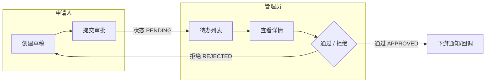

# 场景模板:多角色流程

本文件是 `write-delivery-guide` 的「多角色流程」形态场景模板——统一六项结构:判断特征 / 故事线主轴 / 讲解维度要求 / 图表类型 / 完整参考案例 / 常见讲错。生成交付讲解时 Read 本文件并照此生成。

## 判断特征

- 交付包含服务不同角色的多个接口/入口(如申请人 / 审批人 / 管理员);
- 流程有明确环节,环节之间有状态流转(草稿 → 已提交 → 通过/拒绝 之类);
- spec 中有角色、环节、状态流转章节。

## 故事线主轴

**角色 × 环节**:谁在第几步干什么。读者的心智索引是「那条用户提交、管理员审批的流程」,不是「那 6 个接口」——先给故事,接口挂在故事环节上。

## 讲解维度要求

1. **故事线表**:环节 / 谁 / 干什么 / 入口,一步一行;
2. **一次完整走查**:至少一个带真实角色与数据的请求走查(故事式);
3. **状态流转讲透**:哪个接口把状态从哪推到哪、哪个状态驱动哪个接口可见(如待办列表由 PENDING 驱动)——这是多角色流程最容易漏的暗线;
4. **角色边界**:哪些接口属于哪个角色、谁能看见什么;
5. 每个接口按四问展开(见 SKILL.md 通用规则)。

## 图表类型

全景节用 flowchart(按角色分组);故事线可用 sequenceDiagram;状态流转用 stateDiagram。

## 完整参考案例

以下是「审批流」交付的讲解全文(真实交付场景)。生成时模仿它的结构与讲解深度:

---

# 交付讲解:审批流

## 1. 30 秒看懂

给系统加了一条完整的「申请人发起 → 管理员审批」链路:申请人创建并提交审批,管理员在待办里看到并处理,通过后触发下游流程,拒绝后申请人可修改重提。本次交付全部为新增代码,未改动既有逻辑。

## 2. 全景

本次交付覆盖上图全部环节(均为新增)。

## 3. 场景故事线:审批流(角色:申请人 / 管理员)

| 环节 | 谁 | 干什么 | 入口 |
|---|---|---|---|
| 1 | 申请人 | 创建审批草稿 | `POST /approvals/draft` |
| 2 | 申请人 | 提交,进入审批流程 | `POST /approvals/{id}/submit` |
| 3 | 管理员 | 待办列表看到这条审批 | `GET /approvals/todo` |
| 4 | 管理员 | 查看审批详情 | `GET /approvals/{id}` |
| 5 | 管理员 | 通过或拒绝 | `POST /approvals/{id}/approve` / `reject` |

**一次审批走查**:张三要请假——先创建草稿(状态 DRAFT,可反复修改),确认后提交 → 状态变为 PENDING,系统给管理员生成一条待办 → 管理员李四打开待办列表看到「张三 · 请假」→ 点进详情查看 → 点通过:状态 APPROVED,张三收到通知,下游考勤流程触发;若拒绝:状态 REJECTED,张三可修改草稿后重新提交(回到环节 1)。

## 4. 组件挂接

### `POST /approvals/draft` — 创建草稿(环节 1)

- **何时用**:申请人开始填写审批时;无前置
- **做什么**:创建一条审批记录,状态初始化为 DRAFT
- **用了之后使什么成为可能**:草稿可反复修改、可提交(解锁环节 2)
- **挂点**:(入口)→ 本接口 → submit
- 副作用:`approval` 表 +1 行
- 代码:`ApprovalController.java:32` → `ApprovalService.createDraft()`

### `POST /approvals/{id}/submit` — 提交(环节 2)

- **何时用**:申请人填完草稿、要正式进入流程;前置:草稿存在且状态 = DRAFT
- **做什么**:校验必填 → 状态 DRAFT → PENDING → 给管理员生成待办
- **用了之后使什么成为可能**:这条审批出现在管理员待办列表(解锁环节 3)
- **挂点**:draft → 本接口 → 管理员待办
- 副作用:`approval.status` 变更、`todo` 表 +1 行、发通知
- 代码:`ApprovalService.java:58`

### `GET /approvals/todo` — 待办列表(环节 3)

- **何时用**:管理员打开待办页;须有审批权限
- **做什么**:查出本管理员权限范围内状态为 PENDING 的审批,返回列表
- **用了之后使什么成为可能**:管理员选择一条去处理(解锁环节 4)
- **挂点**:submit → 本接口 → 详情
- 关键点:列表由状态 = PENDING 驱动——是 submit 让数据出现在这里
- 代码:`ApprovalQueryController.java:21`

### `GET /approvals/{id}` — 查看详情(环节 4)

- **何时用**:管理员处理前看审批内容;前置:对该条有可见权限
- **做什么**:返回审批完整内容 + 附件信息 + 当前状态
- **用了之后使什么成为可能**:管理员能做出通过/拒绝决策(解锁环节 5)
- **挂点**:待办列表 → 本接口 → approve/reject
- 代码:`ApprovalQueryController.java:44`

### `POST /approvals/{id}/approve` — 通过(环节 5a)

- **何时用**:管理员决定通过;前置:状态 = PENDING 且有审批权限
- **做什么**:状态 PENDING → APPROVED → 移除待办 → 触发下游(通知 + 业务回调)
- **用了之后使什么成为可能**:审批生效,下游业务被触发
- **挂点**:详情 → 本接口 → 下游流程
- 副作用:`approval.status` 变更、`todo` 删行、发事件
- 代码:`ApprovalService.java:87`

### `POST /approvals/{id}/reject` — 拒绝(环节 5b)

- **何时用**:管理员决定拒绝;前置同通过
- **做什么**:状态 PENDING → REJECTED → 移除待办 → 记录拒绝原因 → 通知申请人
- **用了之后使什么成为可能**:申请人可修改草稿后重新提交(回到环节 1)
- **挂点**:详情 → 本接口 → 申请人修改重提
- 代码:`ApprovalService.java:112`

## 5. 改动定位

(本次交付全部为新增,未改动既有流程,此节省略。有改动已有流程时按改动型模板生成。)

## 6. 已验证与已知边界

- 已验证:提交 → 通过 → 下游触发全链路;拒绝 → 修改重提;待办列表由 PENDING 状态驱动。
- 已知边界:审批撤回本次不支持(业务已确认砍掉);会签/加签在下一期。

## 7. 导读入口

以上任何一节都可以追问,例如:

- 「为什么待办列表依赖 PENDING 状态,而不是单独维护一张待办表?」
- 「连续点两次通过会怎样(幂等)?」
- 「通过时触发的下游回调失败了怎么办?」

---

(参考案例完)

## 常见讲错

- ❌ 按接口清单逐个列协议,没有故事线——接收者无法重建场景;
- ❌ 只讲参数返回值,不讲何时用、谁触发;
- ❌ 漏掉状态流转暗线——没讲哪个状态驱动待办/可见性接口;
- ❌ 不标角色边界——分不清哪些接口是申请人的、哪些是管理员的。
