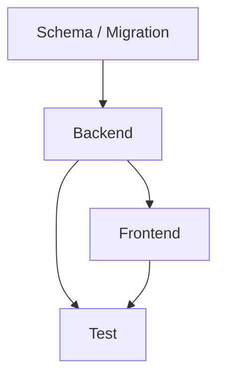

# 编写 Plan (Write Plan)

## 定位

把当前上下文中已经确认或给定的 spec、业务要求、技术边界和项目代码上下文,拆成**coding agent 可执行且应忠实执行的实现计划**。

Plan 的目标是指导后续 agent 实际编写代码:明确任务顺序、依赖关系、改动范围、验收方式、风险点和不可越界的约束。Plan 通过 review 后就是 implementation 的执行契约,不是临场发挥的建议稿。

<HARD-GATE>
如果缺少会影响计划正确性的关键信息,先补问 3-5 个关键问题;如果不阻塞成文,在 plan 中标记为【待确认】。
不要编造代码结构、接口、表结构、任务链路或测试命令。没有确认或没有查到的内容标记为【待确认】。
如果 spec 中有"不可留到实现期的决策"或会影响任务拆分的【待确认】,必须先解决或明确阻塞,不能把关键方案留给 implementer 自行决定。
</HARD-GATE>

## 与其他产物的边界

- PRD 说明客户或业务方要确认的业务逻辑。
- Spec 说明系统必须满足的行为、规则、接口、数据、权限、异常和约束。
- Plan 说明 coding agent 应该如何按顺序实施 spec,并锁定实施边界。
- Implementation 按 plan 修改代码;只有局部工程适配空间,不得重新设计 plan 已锁定方案。

Plan 可以包含具体文件、模块、接口、表、测试命令和任务依赖,但仍然只写计划,不执行实现。

## 输入理解

优先基于当前上下文中的以下信息写 plan:

- 已确认的 spec 或规格说明
- spec 中的 Plan 编写约束、不可留到实现期的决策、待确认项
- 已确认的业务边界、技术边界和非目标
- 项目代码结构、模块、接口、模型、任务、队列、页面、测试和构建方式
- 已有 PRD、影响分析、接口说明、数据库说明、历史 plan 或团队约定
- 用户明确指定的 feature-id、路径、技术约束或执行偏好

如果当前上下文足够,直接写 plan。不要重新澄清已经确认过的内容。

这些工具可作为上下文补充:
- `code-impact-api` — 查 docs/knowledge/ 历史决策、业务概念、项目经验
- `db-query` — 查数据库、查 DDL
- grep / Read — 查代码调用关系、定位符号与实现

如果缺少关键代码上下文,先读取项目结构、相关文件、测试脚本和既有模式,再写计划。不要凭空规划不存在的模块。


## 产物位置与文件

在可写项目上下文中,默认创建或更新:

`docs/features/<feature-id>/plan/`

目录下文件都加 `<文件前缀>-` 前缀(前缀算法见下一节),按需创建:

- `<文件前缀>-index.md` — 总任务清单 + 全局依赖图,必须创建
- `<文件前缀>-01-schema.md` — 建表/数据迁移任务,按需创建
- `<文件前缀>-02-backend.md` — 业务逻辑/接口任务,按需创建
- `<文件前缀>-03-frontend.md` — 前端任务,按需创建
- `<文件前缀>-04-test.md` — 测试与验收任务,按需创建

如果没有可写项目上下文,或用户明确只需要正文,则直接在回复中输出同等结构的 plan 内容。

不要创建空的按需文件。某类工作不存在时,在 `<文件前缀>-index.md` 中标记”不涉及”。

## feature-id 与文件前缀规则

**feature-id 格式**:`YYYY-MM-DD-[业务ID-]<标题>`

1. 日期使用当前日期。
2. 业务ID 是**可选**段落(字母数字 + 连字符,如 `CRM-req19230`)。skill 启动时提示用户填写,允许留空。
3. 标题段允许中文、英文或混合(例:`号百商品详情查询接口`、`features目录结构调整`)。**不得**对中文做英文 slug 转换。
4. 业务ID 段与标题段用连字符连接,组成 `<业务ID>-<标题>`。
5. 写入前检查 `docs/features/` 下是否重名;重名时追加简短后缀。
6. 若当前上下文或用户已提供 feature-id,则复用。
7. 如果同一目录下已有 PRD、spec 或其他需求文档,优先复用同一个 feature-id。

**文件前缀算法**:
- 有业务ID:文件前缀 = `<业务ID>-<标题>`(如 `CRM-req19230-号百商品详情查询接口`)
- 无业务ID:文件前缀 = `<标题>`(如 `features目录结构调整`)

**默认产物路径**:`docs/features/<feature-id>/plan/<文件前缀>-index.md` 等

例:
- 有业务ID:`docs/features/2026-06-10-CRM-req19230-号百商品详情查询接口/plan/CRM-req19230-号百商品详情查询接口-index.md`
- 无业务ID:`docs/features/2026-07-03-features目录结构调整/plan/features目录结构调整-index.md`

**敏感字符拒绝**:文件名不得包含 `/`、`:`、`*`、`?`、`”`、`<`、`>`、`|`。用户提供时若含敏感字符,skill 必须要求用户重命名,不得自动替换字符。

**与旧目录共存**:skill 始终用新命名,不主动探测旧目录的 `index.md` / `01-schema.md` 等。旧 feature 目录里继续更新会出现旧命名和新命名并存,由用户自行处理。

## 工作流程

通常按以下顺序处理,但允许根据项目上下文合并或跳过不必要步骤。不要把流程完整性置于计划可执行性之上。
在写任何 plan 内容前,**必须**先与用户确认两件事:

1. **业务 ID**:本次需求是否有对应的工单号 / 需求单号 / 项目代号?允许留空,但**留空也必须显式确认**(用户明确说"没有/留空"),不得默认跳过。
2. **标题语言**:用中文 / 英文 / 中英混合?由用户选定,**禁止** Agent 因为"目录看起来更整齐"/"和现有 feature 命名一致"/"避免中文路径问题"等原因,擅自把中文需求转成英文 slug。

- 用户主动给过完整 feature-id 或文件名 → 直接复用,跳过本步。
- 用户用 `/write-plan` 触发但未给命名决策 → **第一步就问这两个问题**,问完再写。
- 不得"先写 plan 内容,命名最后再说"。命名决策必须在内容产出之前落定,否则会在文件名上反复返工。

1. **读取输入和项目上下文**
  - 找到当前 feature-id、spec、PRD、现有 plan 或相关文档。
  - 阅读相关代码、目录结构、测试配置、迁移机制、路由/API、模型、页面和既有模式。
  - 只读取和计划正确性有关的上下文。
  - 对照 spec 的"不可留到实现期的决策"和"Plan 编写约束",确认没有关键空洞。

2. **识别实施范围**
  - 判断是否涉及 schema、backend、frontend、test、数据迁移、异步任务、外部系统或运维配置。
  - 明确不涉及的部分,避免 agent 后续扩大范围。

3. **拆分任务和依赖**
  - 把实现工作拆成可由 coding agent 执行的任务。
  - 每个任务应包含目标、输入、输出、依赖、涉及范围、验收方式和注意事项。
  - 标明必须串行的任务和可并行的任务;可并行任务必须写明无冲突依据。
  - 每个任务标明"必须严格执行"和"允许局部适配"的边界。

4. **生成计划文件**
  - `index.md` 总览全局任务、依赖图、执行顺序和风险。
  - 按需生成 schema/backend/frontend/test 子计划文件。
  - 不创建与本需求无关的空文件。

5. **Self-Review(主 agent 自审)**
  - **Spec 覆盖度**:逐条对照 spec 每条要求,都能对应到任务。遗漏的补任务。
  - **Placeholder 扫描**:全文搜 TBD / TODO / "implement later" / "add appropriate error handling" / "handle edge cases" / "similar to Task N" 等模糊表述,全部修掉(详见下方 "No Placeholders 规则")。
  - **跨任务一致性**:类型签名、命名、接口在跨任务引用时是否一致(Task 3 用 `clearLayers()` 但 Task 7 写 `clearFullLayers()` 是 bug)。
  - **每个任务有可验证完成条件**(具体的测试命令 / 验证步骤,不是"应该工作")。
  - **Plan 忠实度**:是否把 spec 已锁定契约完整落到任务,是否仍把关键方案留给 implementer 决定。

  发现问题直接 inline 修,不需要重审。

6. **Plan Review(默认派子 agent 审)**
  - Self-Review 通过后,**默认派 `plan-document-reviewer` 子 agent** 独立审一次 plan。
  - 子 agent 用同目录下 `plan-document-reviewer-prompt.md` 模板,检查 4 项:完整性 / Spec 对齐 / 任务可执行性 / 跨任务一致性。
  - 校准:**只标真正会阻塞 implementer 的问题**,措辞/风格不阻塞。
  - 子 agent 返回 issues → 主 agent 修 → 必要时再派一次复审。
  - **跳过条件**(用户明确说"不用派" / plan 极小 / 时间紧):主 agent 在 Self-Review 里说明跳过理由。

## index.md 内容要求

`index.md` 是总控文件,必须包含:

- feature-id、状态、日期、来源 spec 或上下文摘要
- 目标与范围摘要
- 明确不包含
- 计划文件列表,说明哪些文件存在、哪些不涉及
- 总任务清单
- 全局依赖图
- 推荐执行顺序
- 可并行任务(按批次列出,并写明不重叠的文件/模块/验证状态)
- 必须严格执行的契约
- 允许局部工程适配的范围
- Plan 冲突上报规则
- 关键风险与防跑偏约束
- 待确认项

依赖图可使用 Mermaid,也可用文本列表。复杂任务优先使用 Mermaid:



不要为了画图而强行制造依赖。没有依赖时直接说明。

## 子计划文件要求

### `01-schema.md` — 建表/数据迁移任务

按需创建。适用于新表、字段、索引、约束、迁移、回填、默认值、数据修复、兼容历史数据等。

建议包含:

- 涉及的数据对象
- 预期 schema 或迁移目标
- 迁移/回填顺序
- 兼容性和回滚考虑
- 数据校验方式
- 风险和待确认项

不要写不可确认的完整 DDL,除非上下文已经明确。

### `02-backend.md` — 业务逻辑/接口任务

按需创建。适用于后端业务逻辑、API、服务、权限、任务队列、缓存、外部系统、日志、审计等。

建议包含:

- 涉及模块、接口、服务或任务
- 业务规则落点
- 输入输出和错误处理
- 权限、安全、审计要求
- 幂等、重试、并发和一致性要求
- 需要更新的测试
- 风险和待确认项

### `03-frontend.md` — 前端任务

按需创建。适用于页面、表单、状态展示、交互、权限可见性、前端校验、加载/空/错误状态等。

建议包含:

- 涉及页面、组件或路由
- 用户流程和交互状态
- 展示字段和校验规则
- 权限和可见性
- API 对接点
- UI 状态: loading/empty/error/success
- 需要更新的测试或截图验证
- 风险和待确认项

### `04-test.md` — 测试与验收任务

按需创建。适用于单元测试、集成测试、端到端测试、迁移验证、回归验证、手工验收和风险覆盖。

建议包含:

- 测试范围
- 必测业务路径
- 边界和异常场景
- 权限/兼容性/迁移/性能相关验证
- 推荐测试命令或验证方式
- 手工验收步骤
- 不做的测试和原因
- 风险和待确认项

## 任务写法

任务应足够具体,让 agent 能执行,但不要替 agent 写代码。

推荐格式:

```markdown
### T-<编号>: <任务名称>

- 目标: ...
- 依赖: ...
- 涉及范围: ...
- 必须严格执行:
  - ...
- 允许局部适配:
  - ...
- 具体要求:
  - ...
- 完成条件:
  - ...
- 验证方式:
  - ...
- 风险/注意事项:
  - ...
```

任务编号可以按文件域命名,例如 `S-1`、`B-1`、`F-1`、`T-1`。跨文件依赖必须在 `index.md` 中体现。

## No Placeholders 规则

每个任务的"具体要求" / "完成条件" / "验证方式"必须写到 implementer 能直接执行的程度。以下表述是 **plan 失败**,严禁出现:

- **TBD / TODO / "implement later" / "fill in details"** —— 模糊推迟
- **"add appropriate error handling" / "add validation" / "handle edge cases"** —— 没说具体怎么处理
- **"write tests for the above"**(没给具体测试 case)—— 测试要内嵌具体 case 或矩阵
- **"similar to Task N"** —— 必须重复代码,implementer 可能跳着读任务
- **描述"做什么"但不给"怎么做"的步骤** —— 要给可执行命令 / 代码片段 / 验证条件
- **引用未在任何任务里定义的类型 / 函数 / 方法** —— Task 之间引用必须闭环
- **"implementer 自行决定方案" / "选择合适方案"** —— 关键技术路线、数据口径、接口契约、权限规则不能留给实现期

例外:plan 阶段确实无法预知的(如第三方 API 实际返回结构),标 **【待确认】** 并写"implementer 跑 X 命令后锁定字段名",这是诚实标注,不是 placeholder。

## 任务合并指导(降低 subagent-implement 流程开销)

**默认合并**(同一 implementer 一次完成),减少 spec review 次数:

- **T 测试任务和 B 实现任务默认合并**:同一 implementer 写代码 + 测试,一次完成。测试是验证实现的延伸,拆开会导致同一组改动审 4 次(implementer + spec 各 2 次)。
- **同文件多章节改写默认合并**:同一文件的多个章节/段落改写由单 implementer 完成,避免上下文断层。例:重构一个 React component 的多个生命周期方法、修改一个 service 类的多个方法、改一个 SQL schema 文件的多个表段、改写一个 skill 文档的多个章节。
- **schema 改动 + 对应 migration 测试默认合并**:schema.sql 改动 + `__tests__/.../schema-migration.test.ts` 一个任务。

**例外允许拆开**(plan 里写理由):

- 测试有独立复杂度(e2e / 大型集成测试 / 多 fixture 准备)
- 任务过大(单 implementer 一次做会撑爆上下文)
- 跨模块耦合需要前后任务实时反馈

例:`### B-2: cgraphx docs dedup 命令 + 测试(合并:命令实现 ~146 行 + 测试矩阵 7 case 在同一文件域,无独立复杂度)`

## 拆分原则

- 按依赖和风险拆,不是按文档模板拆。
- 先数据/契约,再后端,再前端,最后测试,但根据实际依赖调整。
- **测试默认并入实现任务**(见上方"任务合并指导"),不独立成 T 任务。
- 能独立验证的工作尽量拆成独立任务。
- 可并行任务必须显式成批标注,并说明文件集合、公共契约、测试状态互不冲突;不确定时默认串行。
- 高风险任务写清楚保护条件和回退思路。
- 不确定内容标【待确认】,不要把猜测变成任务。
- 不要让 agent 在 plan 之外扩大范围。
- 不要把 spec 已锁定的业务规则、数据口径、接口契约、权限和异常行为重新开放给 implementer 选择。
- 不要把简单需求拆成过多文件或过细任务。

## 质量检查

输出前确认:

- `index.md` 能让 agent 理解全局目标、顺序和依赖。
- 每个按需文件都有真实任务,没有空文件。
- 每个任务都有完成条件和验证方式。
- schema/backend/frontend/test 之间依赖清楚。
- plan 没有重新定义 spec 中未确认的业务规则。
- plan 没有要求实现非目标。
- plan 没有混入实际代码改动。
- plan 没有把关键方案或业务规则留给 implementation 阶段临场决定。
- 每个任务都写清了严格执行边界和允许局部适配范围。
- 待确认项不会被伪装成已确定任务。

## 收尾方式

输出或写入 plan + Self-Review + Plan Review 全部通过后,**主 agent 推荐执行模式**,让用户选:

| 任务规模 | 推荐执行 skill | 理由 |
|---|---|---|
| 1-3 文件 / 单模块 / 主 agent 上下文够 | `/implementation`(主会话顺序做) | 派子 agent 反而费 token,顺序做更快 |
| 跨多文件 / 多任务 / 需要隔离 | `/subagent-implement`(派子 agent) | 主 agent 上下文会被挤爆,隔离有价值 |

**推荐话术**:
> Plan 已就绪(Self-Review + Plan Review 通过)。基于任务规模,推荐 `/implementation`(简单)/ `/subagent-implement`(复杂)。

不要主动开始实现代码 —— 等用户决定。

## 跟其他 skill 的关系

| 阶段 | skill |
|---|---|
| 澄清需求 | `clarify-requirements` |
| 写 PRD | `write-prd` |
| 写 spec | `write-spec` |
| **写 plan + Self-Review + Plan Review**(本 skill) | `write-plan` |
| 执行 plan(主会话顺序) | `implementation` |
| 执行 plan(派子 agent) | `subagent-implement` |
| 收尾 | `finish-feature` / commit / PR |
