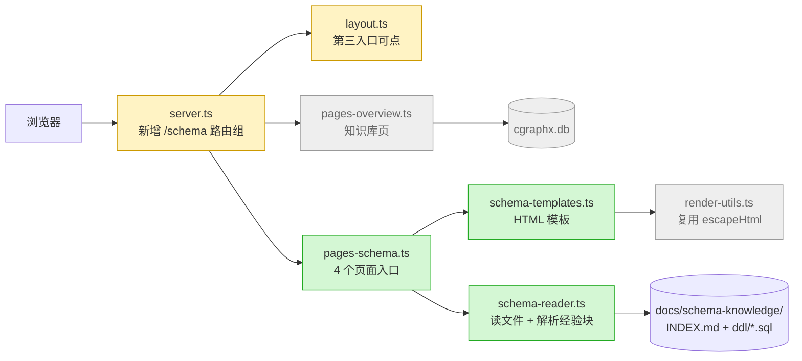
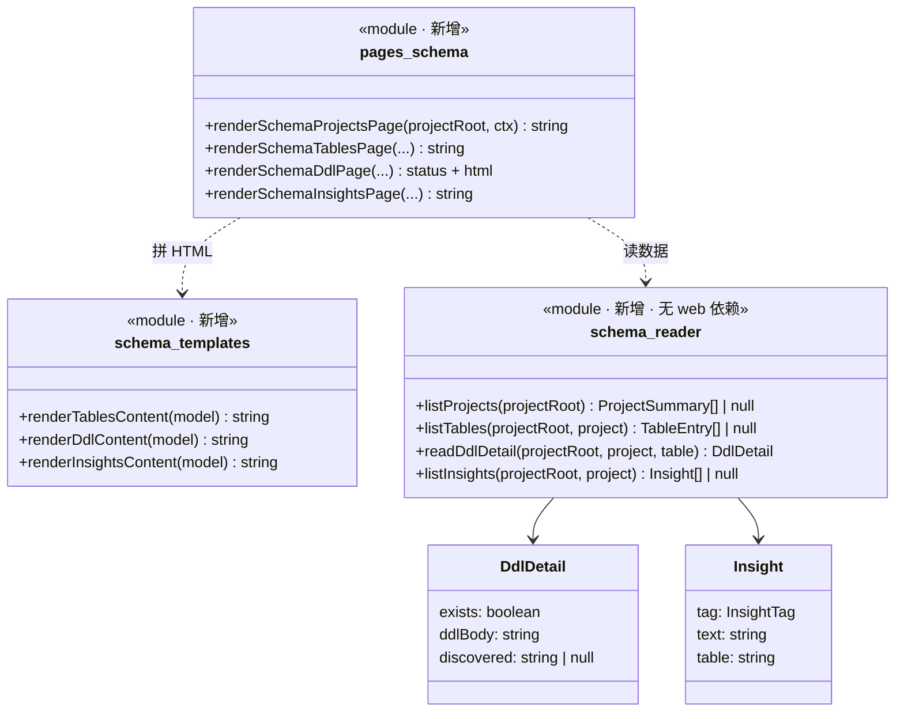

# 编写 Plan (Write Plan)

## 定位

- **Plan = spec 的执行契约**:把"做什么"拆成 coding agent 可执行且应忠实执行的任务清单(顺序、依赖、范围、验收、风险)。过审后是 implementation 的唯一依据,不是建议稿。
- **手段按业务可观察性分档(默认自主,越信封才回跳)**:判别一句——**手段有没有 spec 信封外的业务可观察后果?**
  - **无 → plan 自主**(内部结构、复用哪个既有模块、规范内命名、同步内的实现细节):结合 spec 容忍度 + 既有代码模式定(优先复用,YAGNI),记入 index「实现手段决策」节(选项 + 推荐 + 理由),透明可复审,plan 拍板即锁定。
  - **有 → 回跳 write-spec**(选异步 ⇒ 用户要看到"处理中"、软删 ⇒ 审计口径、选三方 ⇒ 成本/能力):这是伪装成技术决策的业务决策,回跳让业务拍板补契约,再定手段;拍板前推荐不是锁定。
- **两种读者两种写法**:index 开头的「设计预览」写给**人**——拍板放行的人读完它就知道代码写出来是什么样(挂在已有系统哪里、架构、流程、类图)以及哪几条最需要把关,确认后才进实现;其余部分写给被派出执行的 subagent(见「消费模型与防漂移」)。
- **优先级**:spec 显式契约 > plan > docs/guides/ 规范;规范与 spec 冲突时 spec 赢,例外写进风险/备注。
- **内容边界**:plan 写具体文件/模块/接口/表,不写实际代码改动、不写 PRD/spec、不排测试任务(测试是代码完成后的独立流程)。澄清总结 = 输入;spec = 唯一契约(plan 不得重新定义);implementation 只有局部工程适配空间。

<HARD-GATE>
缺少影响计划正确性的关键信息 → 先补问 3-5 个;不阻塞成文的标【待确认】。
不编造代码结构、接口、表结构、任务链路——没查到的一律【待确认】。
spec 中"不可留到实现期的决策"或影响任务拆分的【待确认】,必须先解决或明确阻塞,不许留给 implementer 自行决定。
</HARD-GATE>

## 输入与上下文

- **读**:spec(重点:Plan 编写约束、不可留到实现期的决策、待确认项、**业务容忍度**——手段决策的硬依据)、既有代码(结构/模块/接口/模型/任务/队列/页面/测试/构建)、已有 PRD/影响分析/历史 plan/团队约定。缺关键代码上下文 → 先读再写,不凭空规划不存在的模块。
- **工具**:`knowledge-recall`(知识库:历史决策/业务概念)、`code-map-recall`(代码地图:涉及流程/系统的已有视图,设计预览的底图)、`db-query`(查库/查 DDL)、grep/Read(调用关系/符号定位)。

## 工作流程

0. **命名先行**(写内容前必须落定):① 业务 ID——有无工单号/需求单号?允许留空但**必须显式确认**;② 标题语言——中/英/混合,用户选定,**禁止擅自中文转英文 slug**;③ 负责人——有 spec 继承 spec 头部的负责人,无 spec 则默认 `git config user.name` 并向用户确认,写入 index.md 头部 `> 负责人:`。用户已给 feature-id → 直接复用。
1. **读输入,查缺口**:对照 spec 的"不可留到实现期的决策"和"Plan 编写约束";关键缺口 → 补问或标【待确认】(影响拆分的不得伪装成已确认)。
2. **识别范围 + 拆任务**(见「拆分规则」);明确不涉及的部分,防 implementer 扩范围。
3. **召回代码地图**:调 `code-map-recall`,传入 spec 涉及的概念与预计改动的模块,拿到已有视图及是否过期——这是设计预览的底图;无 `docs/code-map/` 则记为"无底图,邻居读代码确认"。
4. **定手段 + 读规范**:手段按业务可观察性分档——无业务可观察后果的 plan 自主定(记入 index),越信封的回跳 write-spec 补契约再定;读 docs/guides/ 适用规范并落进契约(见「适用规范」——**规范缺失是硬门,中断提示 init-project-guides**)。
5. **生成文件**:index.md 必须;01-04 按需,不建空文件(不涉及 → index 中标记)。
6. **Self-Review**(唯一作者关卡,发现即 inline 修;Plan Review 跳过时它就是终审):
   - Spec 覆盖度 + 双向追溯:spec 每条要求都有承载任务(任务标对应 spec 条款编号);没重新定义 spec、没要求实现非目标。
   - Placeholder 扫描:TBD/"add appropriate error handling"/"similar to Task N" 等全修掉(见「No Placeholders」);待确认项没被伪装成已确定任务。
   - 跨任务一致性:签名/命名/接口/表名/路径跨任务逐字一致;契约两端同文(T-2 输出与 T-5 输入)。
   - 可执行性:每任务有可验证完成条件(具体命令/步骤,不是"应该工作")+ 验证方式。
   - Plan 忠实度:spec 契约完整落到任务,关键方案没留给 implementer 临场决定。
   - 规范遵循:契约级规范(表命名/字段类型/接口形态/目录分层)已落进具体契约、无"按规范建表"式转交;plan 契约不违反规范条目,违反的已记例外;强制引用标注齐全。
   - 提交粒度:标了「独立提交」的任务完成后仓库可工作(能编译、测试不红);提交规范已从 git-standards.md 结晶进 index「提交规范」节;没把强耦合任务误标独立提交。
   - 设计预览:只读这一节能说出代码写出来的样子;架构图每条边对照各任务的「涉及范围」与复用的既有函数逐条核对——任务里调用/复用了哪个模块,图上就有这条边(复用既有函数也要画,灰色邻居同样适用);「需要你重点看的」≤3 条且都是难回头的决策;架构图标了新增/修改/已有邻居(邻居读代码确认过);图中模块/类/方法名与任务原文一致。
   - 全局可读:index 看懂全局;按需文件都有真任务、无空文件;未混入代码;手段决策已按业务可观察性分档(自主项已记录、越信封项已回跳)。
7. **Plan Review**:默认派 `plan-document-reviewer` 子 agent(同目录 `plan-document-reviewer-prompt.md`),独立复核完整性/Spec 对齐/可执行性/跨任务一致性/执行契约清晰度/**规范遵循**;校准:只标真正阻塞 implementer 的问题。返回 issues → 修 → 必要时复审。跳过条件:用户明确说不用 / plan 极小 / 时间紧(在 Self-Review 里写跳过理由)。

## 拆分规则

- 按依赖和风险拆,不按模板拆:数据/契约 → 后端 → 前端(依实际依赖调整)。
- **默认合并**(减少审查次数,写明理由):同文件多章节改写归单 implementer;schema 改动 + 对应 migration 合一。拆开仅限:任务过大撑爆上下文、强耦合需实时反馈。
- **任务 = 工作包**(连贯的功能块/层块,可独立验证):「改 1 字段 / 加 1 参数 / 调 1 处样式」级微任务并入同层/同功能任务;总任务数一般 ≤6,超过先检查是否拆太细,优先合并。
- **测试不进 plan**:单元测试 / 接口测试是代码完成后的独立流程(`write-unit-test-spec` → `write-unit-test-code`、`write-api` → `run-api-test`,各自从 spec 派生),plan 不排测试任务、不写必测路径 / 测试命令、implementer 实现期不写新测试。plan 对测试的唯一要求是完成定义:任务提交后既有测试不被弄红(改动弄红的既有测试须同步修正)。
- 能独立验证的尽量独立成任务;高风险任务写保护条件和回退思路。
- **可独立提交的任务标「独立提交」**:任务完成后仓库处于可工作状态(能编译、相关测试不红)→ 标「独立提交:是」并给建议提交粒度 + commit message 主题;强耦合(完成后仓库不可工作、需后续任务才闭合)→ 不标,说明随哪个任务一起提交。判断依据写进任务,不机械地每任务都标——小步提交是为了原子化历史(好 review / revert / bisect),不是为了凑提交数。
- 可并行任务显式成批 + 写明文件集/公共契约/测试状态互不冲突;不确定 → 串行。
- 不重新打开 spec 已锁定的契约;不把简单需求拆碎。
- **执行方式建议(终判,写进 index)**:仅当三条件同时成立才建议 `/subagent-implement`——任务跨 ≥3 个相互独立的模块、预估变更文件总数 ≥10、任务间无需实时反馈(可独立派任);否则建议 `/implementation`,拿不准 → implementation。不以任务量或跨域数为依据(小全栈需求天然跨 3 域,任何需求都拆得出 ≥3 任务)。

## 消费模型与防漂移

**plan 的读者是被逐任务派出的隔离 subagent**:看不到全篇、不知道你脑中的默认、遇模糊处默默自行补全。写法纪律由此反推。

- **自包含 + 引用不指涉**:每个任务携带(或引用)执行者所需的一切。"见 T-3 的定义"是指涉——implementer 手里可能没有 T-3;写出契约原文是引用。依赖只管执行顺序;跨任务共享的契约(签名、接口形态、命名)在每个引用任务里各写一份同样的原文。
- **双向追溯**:任务标注对应 spec 条款编号(有疑义读 spec 原文,不猜转述)。权威链:任务 ← plan ← spec,冲突以上层为准并按 PLAN_CONFLICT 上报。
- **契约两端同文**:T-5 消费 T-2 产出时,接口形态(签名/字段名/错误语义)在 T-2 输出和 T-5 输入里逐字一致。
- **自由必须枚举**:「必须严格执行」= 契约边界,「允许局部适配」= 裁量边界,没列进允许的一律固定。钉死契约(签名、行为、spec 规则、验证命令),放开机制(内部拆分、局部命名、实现细节)。

## 适用规范(强制读 + 结晶 + 标注)

docs/guides/ 存在时(init-project-guides 产出),写 plan 前按下表读规范、落契约、打标注:

| 任务类型 | 写前必读 | 「强制引用」标注 |
|---|---|---|
| schema(建表/改表/迁移/回填) | `data-standards.md` | `data-standards.md` |
| 接口(API) | `interface-standards.md` | `interface-standards.md` |
| 动代码(所有任务) | `coding-standards.md` 契约部分(命名/目录/分层) | `coding-standards.md` |
| 提交(有「独立提交」任务时) | `git-standards.md` 提交消息规范 + 提交前检查点 | 结晶进 index「提交规范」节(plan 级,一次) |

- **结晶进契约**:契约级规范落进具体契约——任务直接写合规的表名/字段/签名,"按规范建表"式转交是失败(见红线)。index.md「适用规范」节列文件 + 章节标题(不写行号)。
- **标注是执行期规范送达的唯一载体**:有 plan 时 implementation/subagent-implement 只读「强制引用」标注的规范、不再自行识别——漏标 = 规范在执行期丢失。
- **git-standards.md 与其他三份不同**:它不是每任务开工前读的规范(提交规范不随任务变),而是 plan 级**一次结晶进 index「提交规范」节**——提交消息格式 + 提交前检查点原文摘录。实施期提交时直接按 index 已结晶的规范写 message、过检查点,precommit 门禁仅作兜底(不再现场学习规范,消除多次提交的重复读取成本)。
- **规范缺失 = 中断**:docs/guides/ 不存在或所需文件缺失 → 停止写 plan,列缺失文件,提示 init-project-guides 补齐;用户明确说不需要才可继续并记入风险/备注。

## 设计预览(index 开头,写给人)

目标:人读完这一节(不超过两屏),能说出代码写出来的样子——挂在已有系统的哪里、加了/改了哪些模块、一次请求怎么走、模块和类长什么样、哪几条改错了代价最大。按此示例写:

````markdown
## 设计预览

新增 schema 模块:三个新文件负责"读文件 → 拼 HTML → 出页面",server 加一组 `/schema` 路由,侧栏第三入口改为可点。全程只读本地文件,不碰 SQLite。

**需要你重点看的**(改错了代价最大,其余可略读)

| # | 决策 | 为什么难回头 |
|---|---|---|
| 1 | schema 页面函数签名**不带 db 参数**,模块永不读 `cgraphx.db` | 一旦有页面依赖 db,"纯文件派生"的边界就破了,后续都会往里加 |
| 2 | 工程名/表名含 `..` `/` `\` 时**在路由层直接 404**,不进页面层 | 路径安全边界;放到下层校验,任何新页面都可能漏 |
| 3 | URL 形态 `/schema/<工程>/<表>`,`insights` 为保留词 | 用户会收藏链接,改形态即失效 |

**架构**——看颜色:绿色新增,黄色修改,灰色是已有且不动的邻居;注意 db 只连知识库页,schema 模块没有箭头指向它。



**主流程:打开一张表的 DDL**——看路径非法和文件缺失分别在哪一层拦下。

```mermaid
sequenceDiagram
  participant B as 浏览器
  participant S as server.ts
  participant P as pages-schema.ts
  participant R as schema-reader.ts
  B->>S: GET /schema/<工程>/<表>
  alt 工程名或表名含 .. 或 /
    S-->>B: 404(不进页面层)
  else 名字合法
    S->>P: renderSchemaDdlPage(工程, 表)
    P->>R: readDdlDetail(工程, 表)
    R-->>P: DdlDetail
    P-->>B: 200 HTML(文件缺失时显示"DDL 文件缺失";工程不存在 → 404)
  end
```

**类图**——看三层各自的职责,以及层间只传 `DdlDetail` / `Insight` 这类纯数据。



**关键取舍**

| 选了 | 没选 | 为什么 |
|---|---|---|
| 拆三个文件(读取 / 模板 / 页面) | 一个文件装全部 | 和既有 overview 模块同构;单文件会超 600 行 |
| 每次请求现扫目录 | 进程级缓存 | 百级文件 ms 级;读即最新,不用处理缓存失效 |
````

| 块 | 回答人的哪个问题 | 何时要 |
|---|---|---|
| 一句话 | 改动落在系统哪里 | 必有 |
| 需要你重点看的 | 哪几条改错了代价最大 | 必有;≤3 条,只放难回头的:持久化数据结构/表、对外接口与 URL、模块边界与依赖方向、安全边界。内部拆分、命名、可逆手段不进此表 |
| 架构图 | 挂在已有系统哪里、动了哪些模块、谁依赖谁 | 必有;`flowchart`,新增绿 / 修改黄 / **已有邻居灰**(直接调用方、被复用的模块、同级兄弟模块,读代码确认后画),附图例 |
| 主流程 | 一次请求/任务从入口到结果经过哪些模块 | 跨 ≥2 模块或有分支时;跨模块 → `sequenceDiagram`,分支多 → `flowchart`,状态多 → `stateDiagram-v2` |
| 类图 | 每个模块/类有哪些对外方法、层间传什么数据 | 新增/变更类、模块、接口、类型时;`classDiagram`,只列对外成员,构造型标新增/修改;表结构变更另附字段表 |
| 关键取舍 | 为什么这样设计、放弃了什么 | 从「实现手段决策」挑影响结构的 ≤3 条 |

- **每张图前一句「看什么」**,告诉人这张图的重点。
- **粒度到模块/类/对外方法**,不画函数内部逻辑;图一般 3 张左右,宁少勿杂。
- **灰色邻居必须真实存在**:先 `code-map-recall` 取已有视图——新鲜的直接作底图;过期或没有的,读代码确认后才画,不凭印象补。
- **与任务、契约逐字一致**:文件名、函数名、类型名和下面的任务原文相同;plan 改了,预览一起改。

## index.md 必备内容

**设计预览**(开头,见上节) · feature-id/负责人/日期/来源 spec 摘要(需求阶段由 `cgraphx features` 从产物自动派生,不手填状态) · 目标与范围 · 明确不包含 · 计划文件清单(哪些存在/不涉及) · 总任务清单(每个任务标对应 spec 条款 + 是否「独立提交」) · 全局依赖图(Mermaid 或文本;没有依赖就直说,不强行造依赖) · 推荐执行顺序 · 可并行批次(文件/模块/验证状态不重叠依据) · 必须严格执行的契约 · 实现手段决策(自主项:选项+推荐+理由;回跳项:业务拍板结论) · **执行方式建议**(`/implementation` 或 `/subagent-implement` + 理由,判据见「拆分规则」终判条) · 适用规范(文件 + 章节标题) · **提交规范**(有「独立提交」任务时必备:从 `git-standards.md` 结晶的提交消息格式 + 提交前检查点,实施期据此提交,precommit 门禁仅兜底) · 允许局部工程适配的范围 · Plan 冲突上报规则 · 关键风险与防跑偏约束 · 待确认项。

## 子计划文件(按需,不建空文件)

| 文件 | 适用 | 写什么 |
|---|---|---|
| `-01-schema.md` | 新表/字段/迁移/回填 | 迁移目标与**执行顺序**(需求 sql/ 增量文件的序号依此定)、兼容与回滚、数据校验;建表/改表任务按项目 `docs/guides/data-standards.md`「Schema 变更约定」组织(增量文件 + 全量写透同步);不写不可确认的完整 DDL |
| `-02-backend.md` | 业务逻辑/API/权限/任务/队列 | 规则落点、输入输出与错误处理、幂等/重试/并发 |
| `-03-frontend.md` | 页面/表单/交互/可见性 | 用户流程、展示字段与校验、API 对接点、loading/empty/error 状态 |

## 任务写法

```markdown
### T-<编号>: <任务名称>

- 目标: ...
- 对应 spec 条款: ...(implementer 据此读 spec 原文,不凭任务转述猜)
- 强制引用: ...(implementer 开工前必读的 docs/guides 文件,按映射机械标注:schema 任务 → data-standards.md;接口任务 → interface-standards.md;动代码任务 → coding-standards.md;都不涉及 → 无)
- 依赖: ...
- 涉及范围: ...
- 必须严格执行:
  - ...
- 允许局部适配:
  - ...
- 具体要求:
  - ...
- 完成条件:
  - ...
- 验证方式:
  - ...
- 独立提交: 是/否(是 → 完成后仓库可工作,给建议提交粒度 + commit message 主题;否 → 说明耦合原因,随哪个任务一起提交)
- 风险/注意事项:
  - ...
```

编号可按文件域(`S-1`/`B-1`/`F-1`);跨文件依赖必须在 index 体现。任务足够具体让 agent 能执行,但不替 agent 写代码。

## No Placeholders

"具体要求/完成条件/验证方式"必须写到 implementer 可直接执行。以下是 **plan 失败**:TBD/TODO/"implement later" · "add appropriate error handling"/"handle edge cases" · "similar to Task N" · 只说"做什么"不给可执行步骤/命令/验证条件 · 引用未在任何任务定义的符号 · "implementer 自行决定方案"(关键路线/口径/契约/权限不得留到实现期)。

例外:plan 期确实无法预知的(如第三方 API 实际返回结构),标【待确认】+ "implementer 跑 X 命令后锁定"——诚实标注,不是 placeholder。

## 产物位置与命名

- 路径:`docs/features/<feature-id>/plan/<文件前缀>-index.md`(+ 按需 `-01-schema` / `-02-backend` / `-03-frontend`)。无可写项目上下文 → 回复中直接输出同等结构正文。
- **feature-id**:`YYYY-MM-DD-[业务ID-]<标题>`。业务ID 可选(字母数字 + 连字符);标题允许中/英/混合,**不得**中文转英文 slug;重名追加短后缀;同目录已有 PRD/spec 优先复用同一 feature-id。
- **文件前缀**:有业务ID = `<业务ID>-<标题>`,无 = `<标题>`。
- 敏感字符(`/ \ : * ? " < > |`)拒绝,要求用户重命名,不自动替换。
- 与旧目录共存:始终新命名,不探测旧文件。

## 收尾

产物落盘后自动跑 `cgraphx features sync`(更新本人需求索引,本地幂等)。然后请人确认设计:回复里给出设计预览的一句话 +「需要你重点看的」表,指向 index 中的架构图、主流程图和类图,问"**设计预览是否符合你的预期?确认后再开始实现。**"——人不确认不进实现;人提出修改 → 改 plan(预览随之更新)后再问。全部通过后推荐执行模式一句话(即 index「执行方式建议」):**小规模 → `/implementation`;大规模(≥10 文件且 ≥3 独立模块、任务可独立派任)→ `/subagent-implement`。** 不自动开始实现,停下等用户。找需求目录:`cgraphx features list --mine`。

## 红线(绝对不能做)

1. ❌ **不编造**代码结构/接口/表/命令——没查到的一律【待确认】。
2. ❌ **不把影响契约的决策留给实现期临场决定**(业务规则/口径/接口/权限 + 关键技术路线)。
3. ❌ **规范不转交**——"按规范建表"是失败,契约级规范必须落成具体契约;plan 契约不得违反规范条目(违反须记例外);规范缺失 → 中断,提示 init-project-guides。
4. ❌ **不把待确认伪装成已确定任务**,不把猜测变成任务。
5. ❌ **不重新打开 spec 已锁定的契约**;手段越信封 → 回跳 spec,不在 plan 夹带。
6. ❌ **不写实际代码改动**进 plan。
7. ❌ **不擅自中文转英文 slug**——命名归用户。
8. ❌ **不自动开始实现**——收尾停下,归用户。
