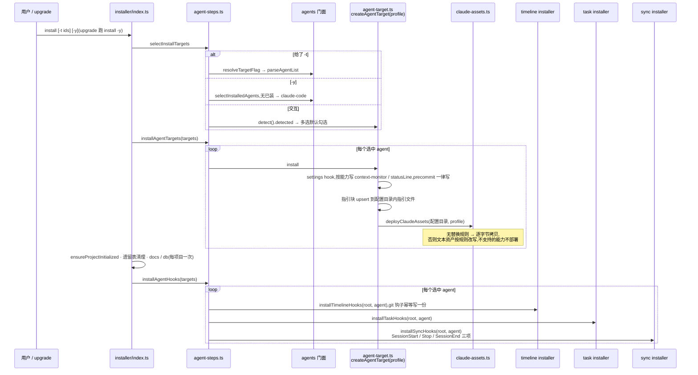
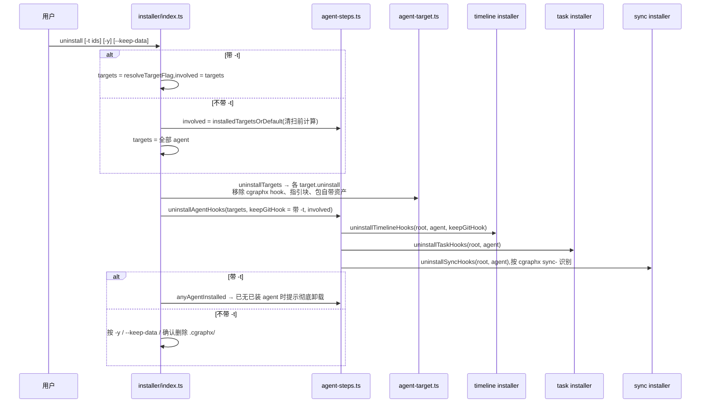
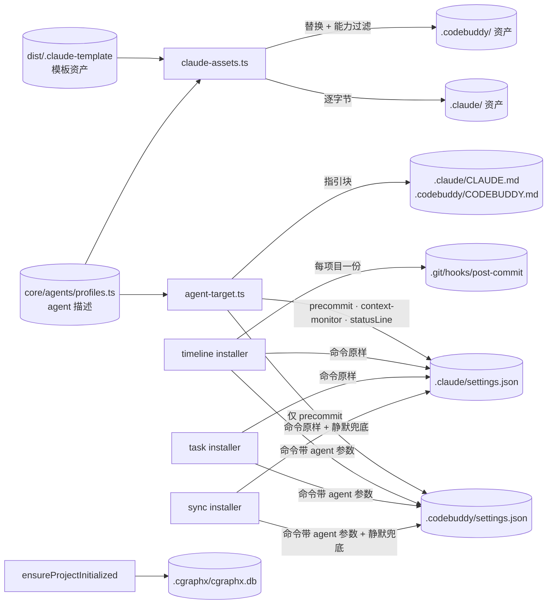

# 多 agent 安装 · 代码地图

> 派生视图:从代码生成,不手工修改。相关文件在 `source_commit` 之后有改动即视为过期,用 `/code-map-write` 重新生成。

## 一句话

`cgraphx install` 先决定这次装给哪些 agent:

- 给了 `-t`:按 `-t` 装;
- 用 `-y`(或 upgrade 触发):只刷新已装的 agent;
- 交互模式:多选,默认勾选检测到的 agent。

然后逐个 agent 写入它自己配置目录里的东西:

- settings hook、指引块;
- 按能力过滤、按替换规则改写后的资产;
- timeline、task 与 sync(平台同步)的 hook。sync hook 的命令带 `2>/dev/null || true`,旧版全局 cgraphx 不认识时不报错。

项目级的事每个项目只做一次:`.cgraphx/` 初始化、docs / db 子系统、git post-commit 钩子。

`cgraphx uninstall` 有两种模式:

- 不带 `-t`:对全部 agent 静默清扫,并按规则删除 `.cgraphx/`;
- 带 `-t`:只处理指定 agent,保留 `.cgraphx/` 和 git 钩子。

agent 之间的差异全部来自 `core/agents` 的描述。

## 代码链路:install

看什么:选择规则集中在 `selectInstallTargets`,单个 agent 安装失败只告警、继续装其他 agent,项目级步骤位于 agent 循环之外。

## 代码链路:uninstall

看什么:

- 不带 `-t` 时,对全部 agent 执行清扫,但只为清扫前已装的 agent 打印结果。只装了 Claude 的项目,输出与多 agent 改造前一致。
- 带 `-t` 时保留 git 钩子和 `.cgraphx/`。

## 数据流转

看什么:每个 agent 只写自己的配置目录。`.cgraphx/` 与 git 钩子属于项目,不属于某个 agent。

## 节点索引

| 节点 | 代码指针 | 来源 |
|---|---|---|
| install / uninstall 命令 | `src/cli/index.ts`:`install` / `uninstall` 命令注册(`-t` / `-y` / `--keep-data`) | AI 读代码 |
| 编排入口 | `src/cli/installer/index.ts`:`runInstallerWithOptions` / `runUninstaller` / `uninstallTargets` / `ensureProjectInitialized` | AI 读代码 |
| 选择与逐 agent 步骤 | `src/cli/installer/agent-steps.ts`:`selectInstallTargets` / `installAgentTargets` / `installAgentHooks` / `uninstallAgentHooks` / `installedTargetsOrDefault` / `anyAgentInstalled` | AI 读代码 |
| target 注册与 `-t` 解析 | `src/cli/installer/targets/registry.ts`:`ALL_TARGETS` / `resolveTargetFlag` / `getTarget` | AI 读代码 |
| 通用 target | `src/cli/installer/targets/agent-target.ts`:`createAgentTarget`。`commandsFor` 按描述拼命令;`cleanupDeadHooks` 清理死 hook。`src/cli/installer/targets/claude.ts` 只保留兼容导出 `claudeTarget` | AI 读代码 |
| 资产部署 / 移除 | `src/cli/installer/claude-assets.ts`:`deployClaudeAssets` / `removeClaudeAssets` / `cleanDeprecatedAssets` / `readTemplateClaudeMd` | AI 读代码 |
| agent 描述与判定 | `src/core/agents/index.ts`:`parseAgentList` / `selectInstalledAgents` / `isAgentInstalled` / `isAgentDetected` / `applyAssetReplacements` / `agentConfigDir`;取值来自 `src/core/agents/profiles.ts` | AI 读代码 |
| timeline / task / sync hook 写入 | `src/core/timeline/installer.ts`:`installTimelineHooks` / `uninstallTimelineHooks`;`src/core/task/installer.ts`:`installTaskHooks` / `uninstallTaskHooks`;`src/core/sync/installer.ts`:`installSyncHooks` / `uninstallSyncHooks`(`silent` 加兜底后缀) | AI 读代码 |
| upgrade 触发重装 | `src/cli/upgrade/index.ts`:拉包后以新入口执行 `install -y` | AI 读代码 |

## 已知盲区

- 交互模式下是否安装全局 CLI(`npm install -g`)这一步,图中没有画。
- 「可选子系统」多选(docs / db / timeline)也没有画。不勾选 timeline 时,不会执行 `installAgentHooks`。
- 卸载后配置目录里会留下模板根目录的顶层文件 `FLOW-MAP.md`。`removeClaudeAssets` 只按目录清单删除,这是改造前就有的行为。
- 只装了 CodeBuddy 的项目做彻底卸载时,git 钩子的移除日志带的是「Claude Code」前缀:git 钩子随清扫中的第一个 agent 移除,功能正确。
