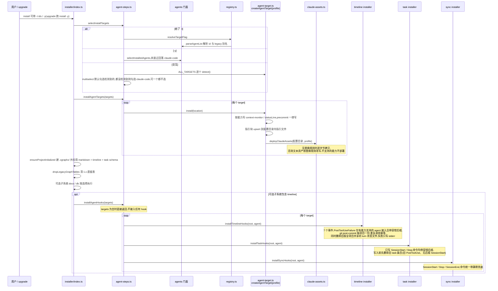
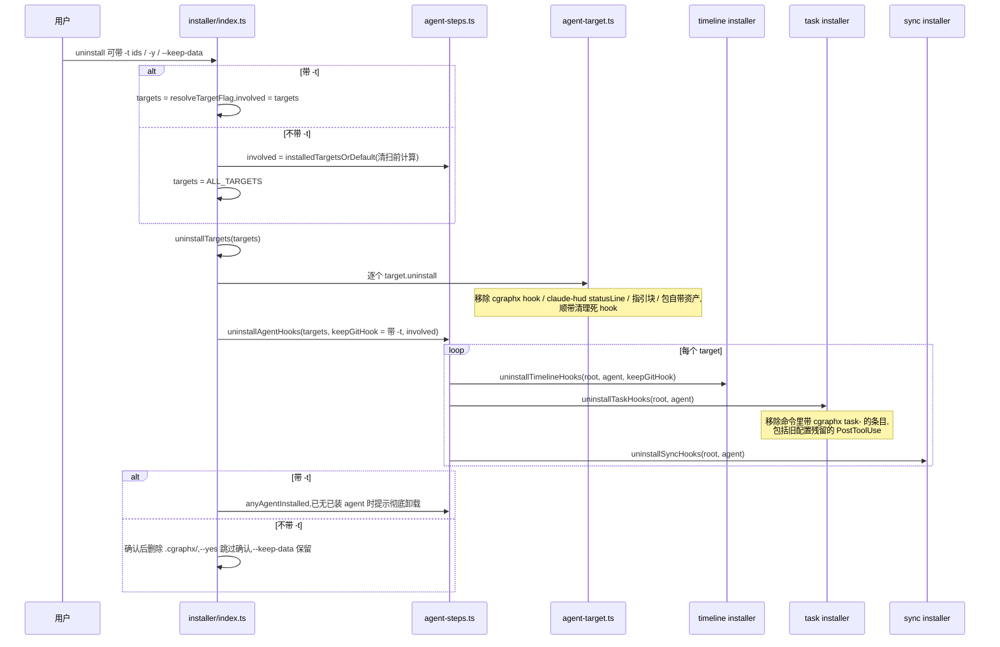
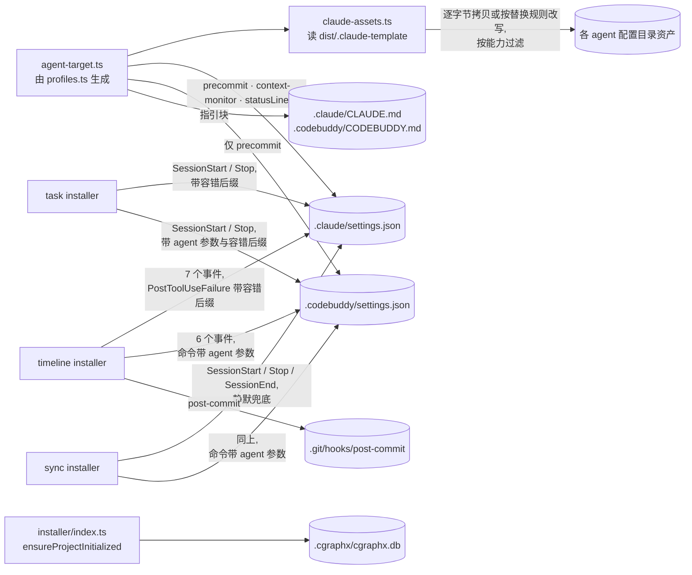

# 多 agent 安装 · 代码地图

> 派生视图:从代码生成,不手工修改。相关文件在 `source_commit` 之后有改动即视为过期,用 `/code-map-write` 重新生成。

## 一句话

`cgraphx install` 先决定本次装给哪些 agent:

- 给了 `-t`:按参数解析(`all` / `auto` / `none` / id 或 legacy 别名);
- `-y`(upgrade 走这条):只刷新已装的 agent,一个都没装时回落到 Claude Code;
- 交互:多选全部 agent,默认勾选检测到的。

然后逐个 agent 写它自己配置目录里的 settings hook、指引块和模板资产。项目级步骤每个项目一次:`.cgraphx/` 初始化(markdown + timeline + task schema)、1.x 遗留表清理、docs / db 子系统。勾选 Developer Timeline 时,再逐个 agent 接入 timeline、task 与 sync hook:timeline 写 7 个事件(PostToolUseFailure 只有支持的 agent 才写),task 只写 SessionStart / Stop 两条且都带旧版二进制容错后缀(SessionStart 注入会话 id,Stop 刷新自动绑定),sync 写 SessionStart / Stop / SessionEnd 并统一静默兜底。

`cgraphx uninstall` 有两种模式:不带 `-t` 清扫全部 agent 并移除 git post-commit 与 `.cgraphx/`;带 `-t` 只处理指定 agent,保留 git 钩子与 `.cgraphx/`。task 卸载按 `cgraphx task-` 标记移除条目,旧配置里的 PostToolUse 条目也会被清掉。`task-post-tool-use-hook` 仍注册,但只作兼容空操作。

## 代码链路:install

看什么:目标选择规则集中在 `selectInstallTargets`,逐 agent 配置与 hook 接入分两段执行,task 安装会先清旧条目再写两条新命令,单个 agent 失败只告警。

## 代码链路:uninstall

看什么:`-t` 决定是否保留 git post-commit 与 `.cgraphx/`,task 卸载按 `cgraphx task-` 标记清理,旧 PostToolUse 条目也在清理范围内。

## Hook 接入明细

看什么:三条 hook 子系统各自写哪些事件、命令怎么拼,以及 task 的旧条目清理规则。

| 子系统 | 写入事件 | 命令差异 | 代码指针 |
|---|---|---|---|
| timeline | UserPromptSubmit、PreToolUse、PostToolUse、Stop、SessionStart、SessionEnd、PostToolUseFailure | PostToolUseFailure 仅在 `capabilities.postToolUseFailure` 为真时写入且带容错后缀,其余 6 个命令保持原样(不带容错后缀)。非默认 agent 的命令追加 `--agent <id>` | `src/core/timeline/constants.ts`:`HOOK_EVENTS_TO_COMMANDS` / `LEGACY_BINARY_TOLERANT_SUFFIX`,`src/core/timeline/installer.ts`:`installTimelineHooks` |
| task | SessionStart、Stop | 两条都带容错后缀,非默认 agent 追加 `--agent <id>`。写入前删除旧 task 条目(旧 PostToolUse、无后缀 SessionStart) | `src/core/task/installer.ts`:`taskHookGroups` / `pruneStaleTaskHooks`,`src/core/task/hooks.ts`:`taskSessionStartHook` / `taskStopHook` |
| sync | SessionStart、Stop、SessionEnd | 三条都带静默兜底后缀,非默认 agent 追加 `--agent <id>` | `src/core/sync/installer.ts`:`syncHookGroups` / `silent` |

`task-post-tool-use-hook` 仍注册为隐藏命令,仅用于兼容旧配置,函数体解析 stdin 后直接返回,不写库、不输出。

## 数据流转

看什么:每个 agent 只写自己的配置目录,项目级数据只写一次,timeline / task / sync 三条 hook 的命令差异都来自 `core/agents` 的 agent 描述与 installer 的拼接规则。

## 节点索引

| 节点 | 代码指针 | 来源 |
|---|---|---|
| install / uninstall 命令 | `src/cli/index.ts`:`install` / `uninstall` 命令注册(`-t` / `-y` / `--keep-data`) | AI 读代码 |
| 编排入口 | `src/cli/installer/index.ts`:`runInstallerWithOptions` / `runUninstaller` / `uninstallTargets` / `ensureProjectInitialized` | AI 读代码 |
| 选择与逐 agent 步骤 | `src/cli/installer/agent-steps.ts`:`selectInstallTargets` / `installAgentTargets` / `installAgentHooks` / `uninstallAgentHooks` / `installedTargetsOrDefault` / `anyAgentInstalled` | AI 读代码 |
| target 注册与 `-t` 解析 | `src/cli/installer/targets/registry.ts`:`ALL_TARGETS` / `resolveTargetFlag` / `getTarget` | AI 读代码 |
| 通用 target | `src/cli/installer/targets/agent-target.ts`:`createAgentTarget` / `GenericAgentTarget.install` / `uninstall` / `cleanupDeadHooks` / `writeInstructionsEntry` | AI 读代码 |
| Claude target 兼容导出 | `src/cli/installer/targets/claude.ts`:`claudeTarget` | AI 读代码 |
| 资产部署 / 移除 | `src/cli/installer/claude-assets.ts`:`deployClaudeAssets` / `removeClaudeAssets` / `cleanDeprecatedAssets` / `readTemplateClaudeMd` | AI 读代码 |
| agent 描述与判定 | `src/core/agents/index.ts`:`parseAgentList` / `selectInstalledAgents` / `isAgentInstalled` / `isAgentDetected` / `hookCommand` / `agentSettingsPath`,取值来自 `src/core/agents/profiles.ts`:`AGENT_PROFILES` | AI 读代码 |
| timeline hook 写入 | `src/core/timeline/installer.ts`:`installTimelineHooks` / `uninstallTimelineHooks`,事件表与后缀在 `src/core/timeline/constants.ts`:`HOOK_EVENTS_TO_COMMANDS` / `LEGACY_BINARY_TOLERANT_SUFFIX` | AI 读代码 |
| task hook 写入 | `src/core/task/installer.ts`:`installTaskHooks` / `uninstallTaskHooks` / `pruneStaleTaskHooks`。隐藏入口 `src/core/task/cli.ts`:`task-session-start-hook` / `task-stop-hook` / `task-post-tool-use-hook`,实现 `src/core/task/hooks.ts`:`taskSessionStartHook` / `taskStopHook` / `taskPostToolUseHook` | AI 读代码 |
| sync hook 写入 | `src/core/sync/installer.ts`:`installSyncHooks` / `uninstallSyncHooks` / `syncHookGroups` / `silent` | AI 读代码 |
| git post-commit | `src/core/timeline/installer.ts`:`buildGitPostCommitSnippet` / `installTimelineHooks` | AI 读代码 |
| `.cgraphx` schema 初始化 | `src/cli/installer/index.ts`:`ensureProjectInitialized`(应用 markdown + timeline + task schema) | AI 读代码 |
| upgrade 触发重装 | `src/cli/upgrade/index.ts`:`runUpgrade` / `planProjectInstall`(以新入口执行 `install -y`) | AI 读代码 |

## 已知盲区

- 交互模式下安装全局 CLI 到 PATH(`npm install -g cgraphx`)这一步没有画,只画了 `install -y` 的项目内步骤。
- 「可选子系统」多选中的 docs / db 细节没有展开,只画了 timeline 被勾选后的 hook 接入。不勾选 timeline 时,不会执行 `installAgentHooks`。
- 项目根看起来是 `$HOME` / 文件系统根时,`ensureProjectInitialized` 返回 `skipped-unsafe`,`dropLegacyGraphTables` 也跳过,图中未展开该分支。
- timeline 除 PostToolUseFailure 外的 6 个事件与 sync 的 SessionEnd 没有能力开关,安装器按所有 profile 一律写入。各宿主是否实际触发这些事件由运行时决定。
- 旧配置若仍保留 task PostToolUse 条目且没有重跑 install,`task-post-tool-use-hook` 仍会被调用,只是空操作。重跑 install 后该条目会被 `pruneStaleTaskHooks` 删除。
- 卸载后配置目录里会留下模板根目录的顶层文件(如 `FLOW-MAP.md`)。`removeClaudeAssets` 只按目录清单删除,这是改造前就有的行为。
- 只装了 CodeBuddy 的项目做彻底卸载时,git 钩子的移除日志带的是「Claude Code」前缀:全量卸载按注册顺序先处理 claude-code,而 `involved` 只含 codebuddy。功能正确。
