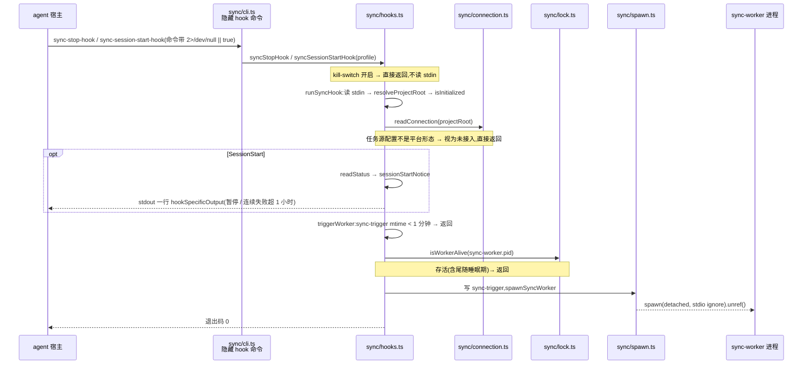
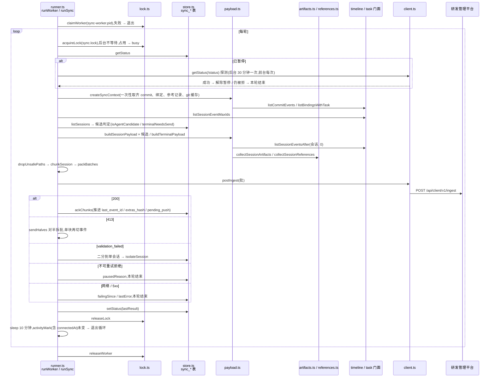
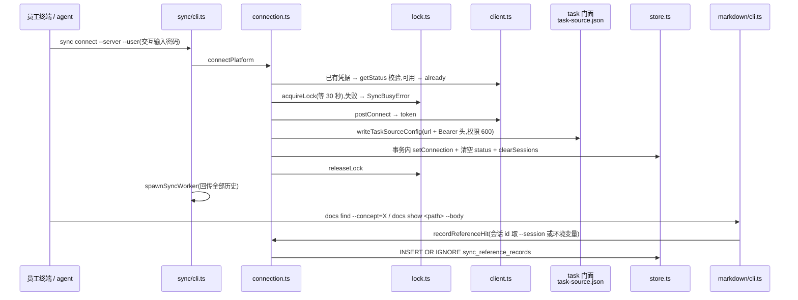

# 平台上报 · 代码地图

> 派生视图:从代码生成,不手工修改。相关文件在 `source_commit` 之后有改动即视为过期,用 `/code-map-write` 重新生成。

## 一句话

- **hook 只拉起进程**:agent 的 Stop / SessionEnd / SessionStart hook 只检查几个文件,然后拉起一个脱离的 `sync-worker`;所有网络请求都在 worker 里。
- **worker 怎么跑**:
  - 每轮持同步锁运行 `runSync`。
  - 从 timeline / task 门面只读取数,按白名单构造每个会话的上报内容,分批 POST 到平台的 `/ingest`。
  - 只有收到 200 才推进 `sync_sessions` 的进度。
  - 跑完睡 10 分钟,期间有新活动就再跑一轮。
- **接入**:`cgraphx sync connect` 用账号换凭据,写进任务源配置 `.cgraphx/task-source.json`;`docs` 命令在执行时写入精确参考记录。

## 代码链路:hook 拉起 worker

看什么:

- hook 不打开数据库(SessionStart 只读一次状态用于提示),不发网络请求。
- 「已有存活 worker」和「节流 1 分钟」两道检查,保证同一个仓库最多一个 worker。



## 代码链路:worker 的一轮同步

看什么:

- 三类失败在 `sendBatch` 里分流:暂停、连续失败、隔离。
- 进度只在 `ackChunks` 里推进。



## 代码链路:接入与精确参考记录

看什么:

- connect 在签发凭据之前就取同步锁,避免和运行中的同步争写进度。
- `docs` 命令只在「命中」和「读正文」两个点上写参考记录。



## 数据流转

看什么:

- 平台上报只读 timeline / task 的数据。
- 只写 `sync_*` 四张表、两个标记文件和任务源配置。
- 出本机的只有 `/connect` / `/status` / `/ingest` 三个请求。

```mermaid
flowchart LR
  ev[(timeline_events)] -- listSessionEventMaxIds / listSessionEventsAfter / listCommitEvents --> pl[payload.ts]
  ts[(task_sessions + task_items)] -- listBindingsWithTask --> pl
  rr[(sync_reference_records)] -- 预载 --> pl
  docs[docs find / show --body] -- recordReferenceHit --> rr
  git[(本地 git<br/>远程跟踪引用)] -- branch -r --contains / show / ls-files --> pl
  pl -- IngestSession 批 --> plat[研发管理平台<br/>/ingest]
  plat -- 200 --> ss[(sync_sessions<br/>水位 / 哈希 / 隔离)]
  run[runner.ts] -- lastResult / 暂停 / 失败 --> st[(sync_state)]
  conn[connect] -- token --> tsj[(task-source.json)]
  conn -- connection --> st
  tsj -- readConnection --> run
  lock[(sync.lock<br/>sync-worker.pid<br/>sync-trigger)] --- run
  hook[sync hooks] -- 只读 --> lock
  hook -- SessionStart 读 --> st
```

## 节点索引

| 节点 | 代码指针 | 来源 |
|---|---|---|
| 命令注册(connect / disconnect / now / status / sync-worker / 两个 hook) | `src/core/sync/cli.ts`:`registerSyncCommands` | AI 读代码 |
| hook 入口与拉起 | `src/core/sync/hooks.ts`:`syncStopHook` / `syncSessionStartHook` / `runSyncHook` / `triggerWorker` / `sessionStartNotice` | AI 读代码 |
| 拉起子进程 | `src/core/sync/spawn.ts`:`spawnSyncWorker` | AI 读代码 |
| 两个标记文件 | `src/core/sync/lock.ts`:`acquireLock` / `releaseLock` / `claimWorker` / `refreshWorker` / `releaseWorker` / `isWorkerAlive` | AI 读代码 |
| 执行器 | `src/core/sync/runner.ts`:`runWorker` / `runSync` / `collectChunks` / `sendBatch` / `sendHalves` / `ackChunks` / `isolate` / `activityMark` | AI 读代码 |
| 候选判定 | `src/core/sync/runner.ts`:`isAgentCandidate` / `terminalNeedsSend` / `isExcludedByIsolation` | AI 读代码 |
| 状态报告 | `src/core/sync/status.ts`:`getSyncStatus` | AI 读代码 |
| 上报内容构造 | `src/core/sync/payload.ts`:`createSyncContext` / `buildSessionPayload` / `buildTerminalPayload` / `bindingsHashOf` / `extrasHashOf` / `parseSlashSkill` / `terminalSessionId` | AI 读代码 |
| 产物类型映射 | `src/core/sync/artifacts.ts`:`classifyArtifactType` / `collectSessionArtifacts` | AI 读代码 |
| 参考识别 | `src/core/sync/references.ts`:`isSedimentPath` / `inferSedimentReads` / `collectSessionReferences` | AI 读代码 |
| 路径白名单 | `src/core/sync/paths.ts`:`isSafeRelPath` / `createPathResolver` | AI 读代码 |
| git 查询 | `src/core/sync/git.ts`:`getOriginUrl` / `getRepoToplevel` / `createGitCache` | AI 读代码 |
| 平台客户端 | `src/core/sync/client.ts`:`postConnect` / `getStatus` / `postIngest` | AI 读代码 |
| 接入 / 断开 / 精确参考写入 | `src/core/sync/connection.ts`:`connectPlatform` / `disconnectPlatform` / `readConnection` / `recordReferenceHit` | AI 读代码 |
| 本地状态表 | `src/core/sync/schema.sql`;`src/core/sync/store.ts`:`listSessions` / `ackSession` / `isolateSession` / `getStatus` / `setStatus` / `listAllReferenceRecords` | AI 读代码 |
| hook 安装 | `src/core/sync/installer.ts`:`installSyncHooks` / `uninstallSyncHooks`(由 `src/cli/installer/agent-steps.ts` 调用) | AI 读代码 |
| docs 记录点 | `src/core/markdown/cli.ts`:`docs find`(`--concept` 命中)、`docs show --body`(`writeDocumentBody`) | AI 读代码 |
| 取数门面 | `src/core/timeline/indexer.ts`:`listSessionEventMaxIds` / `listSessionEventsAfter` / `listCommitEvents`;`src/core/task/report.ts`:`listBindingsWithTask`;`src/core/task/source.ts`:`writeTaskSourceConfig` / `removeTaskSourceConfig` | AI 读代码 |

## 已知盲区

- 服务端收到 `/ingest` 后怎么处理(幂等键、路径过滤、绑定段解析)不在本仓库,见 cgraphx-server 仓库 `docs/code-map/flows/客户端接入与上报.md`。
- `artifacts.ts` 里 commitHash / create / modify 的判定细节,以及 `references.ts` 的 cd 前缀回退,图中没有展开,见代码与知识库「平台上报」「Bash 事件 cwd 是执行后的目录」。
- `sync status` 走同一套候选判定(`status.ts` 依赖 `runner.ts` 的判定函数),图中没有单独画。
- 后台 worker 的 stdio 全部是 ignore,运行时的告警在后台模式下看不到。
