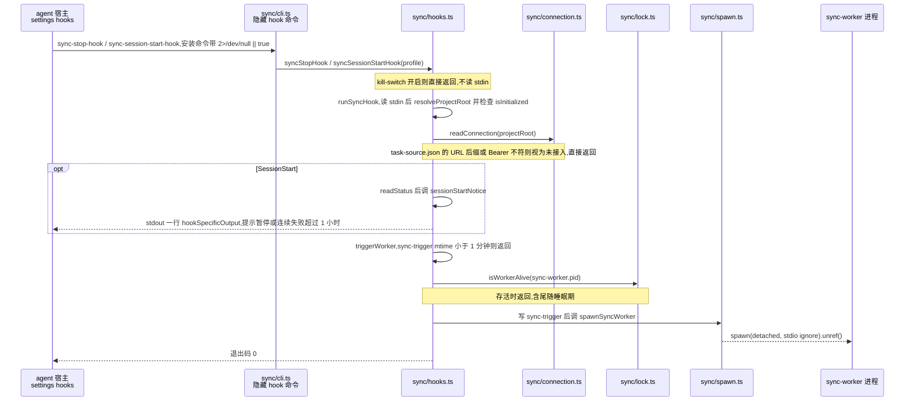
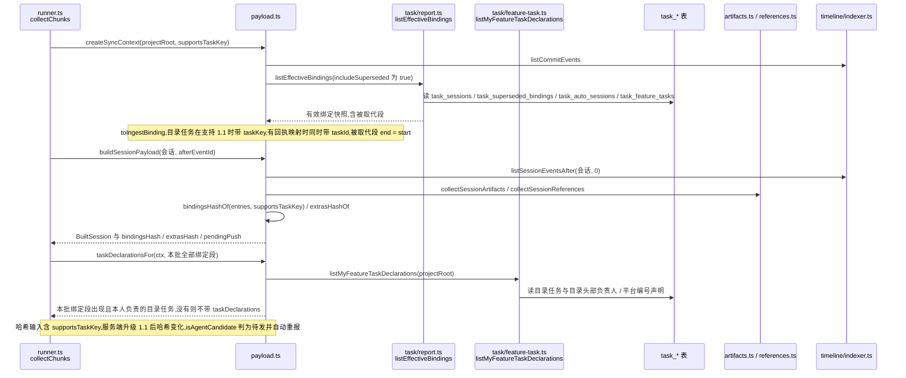
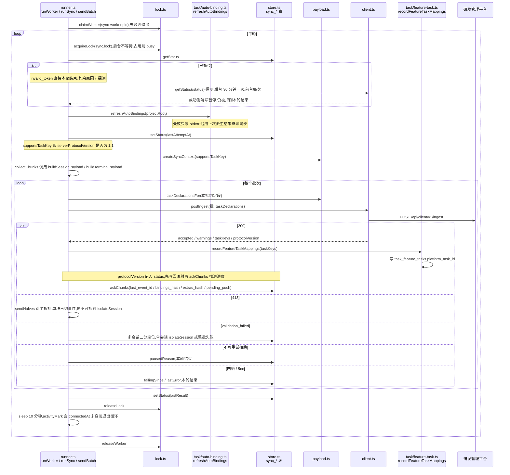
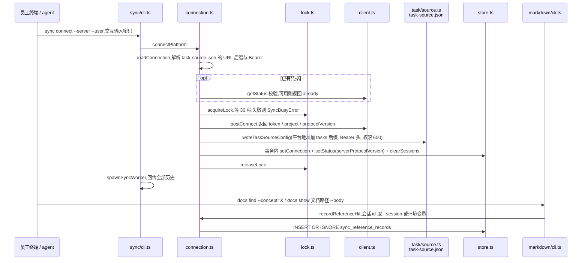
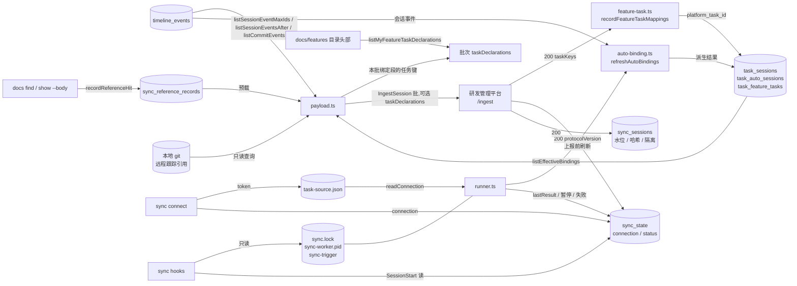

# 平台上报 · 代码地图

> 派生视图:从代码生成,不手工修改。相关文件在 `source_commit` 之后有改动即视为过期,用 `/code-map-write` 重新生成。

## 一句话

- **hook 只拉起进程**:agent 的 SessionStart / Stop / SessionEnd hook 自身不发网络请求,只检查已初始化与已接入,然后拉起一个脱离的 `sync-worker`;自动同步的网络请求都在 worker 里。
- **worker 每轮**:取同步锁 → 先刷新任务自动派生 → 按服务端协议版本构造上报内容(目录任务绑定段带 `taskKey`、批次带本人负责目录的任务声明、被取代段按零长度重报)→ 分批 POST 到 `/ingest` → 收到 200 后先写回回执的 `taskKeys`,再推进 `sync_sessions` 进度;`protocolVersion` 记入同步状态。
- **协议升级**:绑定段哈希的输入包含 `supportsTaskKey`。旧服务端按不支持处理,首次从回执拿到 `1.1` 后各会话哈希变化,下一轮自动重报全部绑定,目录任务在平台上自动获得归属。
- **接入**:`cgraphx sync connect` 用账号换凭据,写进任务源配置 `.cgraphx/task-source.json`;`docs` 命令在执行时写入精确参考记录。

## 代码链路:hook 拉起 worker

看什么:hook 在哪里停下,`sync-worker.pid` 与 1 分钟节流如何保证同一仓库最多一个后台 worker。

## 代码链路:一轮上报的内容构造

看什么:有效绑定如何变成绑定段,被取代段为何按零长度重报,`taskKey` 何时带上,批次里的任务声明从哪里来,绑定哈希为何会在服务端升级后变化。

## 代码链路:worker 的一轮同步与回执写回

看什么:上报前刷新自动派生在哪一步,协议版本怎样进入状态,回执里的任务键映射为什么先于进度确认写回,失败如何分级。

## 代码链路:接入与精确参考记录

看什么:connect 为什么在签发凭据之前取同步锁,接入响应里的协议版本落在哪里,`docs` 命令在哪两个点写参考记录。

## 数据流转

看什么:上报只读 timeline / task 的数据与本地 git,只写 `sync_*` 表、任务映射列、两个标记文件和任务源配置;出本机的只有 `/connect`、`/status`、`/ingest`。

## 节点索引

| 节点 | 代码指针 | 来源 |
|---|---|---|
| 命令注册(connect / disconnect / now / status / sync-worker / 两个 hook) | `src/core/sync/cli.ts`:`registerSyncCommands` | AI 读代码 |
| agent 宿主接入点 | `src/cli/installer/agent-steps.ts`:`installAgentHooks` / `uninstallAgentHooks`,经 `src/core/sync/installer.ts`:`installSyncHooks` / `uninstallSyncHooks` | AI 读代码 |
| hook 入口与拉起 | `src/core/sync/hooks.ts`:`syncStopHook` / `syncSessionStartHook` / `runSyncHook` / `triggerWorker` / `sessionStartNotice` | AI 读代码 |
| 拉起子进程 | `src/core/sync/spawn.ts`:`spawnSyncWorker` | AI 读代码 |
| 两个标记文件 | `src/core/sync/lock.ts`:`acquireLock` / `releaseLock` / `claimWorker` / `refreshWorker` / `releaseWorker` / `isWorkerAlive` | AI 读代码 |
| 执行器与候选判定 | `src/core/sync/runner.ts`:`runWorker` / `runSync` / `isAgentCandidate` / `terminalNeedsSend` / `isExcludedByIsolation` / `collectChunks` / `sendBatch` / `sendHalves` / `ackChunks` / `isolate` / `activityMark` | AI 读代码 |
| 上报前自动派生 | `src/core/task/auto-binding.ts`:`refreshAutoBindings` / `deriveSessionAutoBinding` | AI 读代码 |
| 上报内容构造 | `src/core/sync/payload.ts`:`createSyncContext` / `toIngestBinding` / `bindingsHashOf` / `taskDeclarationsFor` / `extrasHashOf` / `buildSessionPayload` / `buildTerminalPayload` | AI 读代码 |
| 协议字段与版本常量 | `src/core/sync/types.ts`:`IngestBinding.taskKey` / `IngestTaskDeclaration` / `IngestRequest.taskDeclarations` / `IngestResponse.taskKeys` / `TASK_KEY_PROTOCOL_VERSION` | AI 读代码 |
| 有效绑定 | `src/core/task/report.ts`:`listEffectiveBindings` / `collectEffectiveBindings` | AI 读代码 |
| 目录任务声明与回执写回 | `src/core/task/feature-task.ts`:`listMyFeatureTaskDeclarations` / `recordFeatureTaskMappings` | AI 读代码 |
| task 表 | `src/core/task/schema.sql`:`task_sessions` / `task_auto_sessions` / `task_feature_tasks` / `task_superseded_bindings` | AI 读代码 |
| 产物类型映射 | `src/core/sync/artifacts.ts`:`classifyArtifactType` / `collectSessionArtifacts` | AI 读代码 |
| 参考识别 | `src/core/sync/references.ts`:`isSedimentPath` / `inferSedimentReads` / `collectSessionReferences` | AI 读代码 |
| 路径白名单 | `src/core/sync/paths.ts`:`isSafeRelPath` / `createPathResolver` | AI 读代码 |
| git 查询 | `src/core/sync/git.ts`:`getOriginUrl` / `getRepoToplevel` / `createGitCache` | AI 读代码 |
| 平台客户端 | `src/core/sync/client.ts`:`postConnect` / `getStatus` / `postIngest` | AI 读代码 |
| 接入 / 断开 / 精确参考写入 | `src/core/sync/connection.ts`:`connectPlatform` / `disconnectPlatform` / `readConnection` / `recordReferenceHit` | AI 读代码 |
| 本地状态表 | `src/core/sync/schema.sql`:`sync_state` / `sync_sessions` / `sync_reference_records`;`src/core/sync/store.ts`:`listSessions` / `ackSession` / `advanceSessionEvents` / `isolateSession` / `getStatus` / `setStatus` / `setConnection` / `clearSessions` / `insertReferenceRecord` / `listAllReferenceRecords` | AI 读代码 |
| 状态报告 | `src/core/sync/status.ts`:`getSyncStatus` | AI 读代码 |
| 取数门面 | `src/core/timeline/indexer.ts`:`listSessionEventMaxIds` / `listSessionEventsAfter` / `listCommitEvents`;`src/core/task/source.ts`:`loadTaskSourceConfig` / `writeTaskSourceConfig` / `removeTaskSourceConfig` | AI 读代码 |
| docs 记录点 | `src/core/markdown/cli.ts`:`docs find`(`--concept` 精确命中)/ `docs show --body` | AI 读代码 |
| 运行时配置 | `src/core/sync/constants.ts`:`TRIGGER_THROTTLE_MS` / `WORKER_TRAIL_MS` / `LOCK_STALE_MS` / `PAUSE_PROBE_MS` / `BATCH_MAX_SESSIONS` / `BATCH_MAX_EVENTS` / `BATCH_MAX_BYTES` | AI 读代码 |

## 已知盲区

- 服务端收到 `/ingest` 后如何处理不在本仓库:任务声明按(仓库, 任务键)幂等建任务、`taskKey` 与 `taskId` 同时存在时的优先级、被取代段零长度重报后的计算口径、`binding_pending` 挂起后如何归入,均以平台实现为准,本视图未画。
- 协议版本只做字符串相等判断(`serverProtocolVersion === '1.1'`);更晚的次版本是否兼容未在本仓库定义,旧服务端不返回版本时按不支持处理。
- 任务声明不参与候选判定或绑定哈希,只按本批绑定段的 `taskKey` 过滤;目录负责人后补时是否触发重报取决于绑定快照与事件水位是否变化,代码没有显式的声明脏检查。
- `refreshAutoBindings` 的 R1–R7 派生规则、首轮历史取代与目录删除后的回退细节未展开,见代码与知识库「开发任务绑定」。
- `artifacts.ts` 的 commit 归属判定、`references.ts` 的 cd 前缀回退未展开,见代码与知识库「平台上报」「Bash 事件 cwd 是执行后的目录」。
- 未确认的边:回执里的 `binding_pending` / `task_key_declared_by_other` / `task_declaration_invalid` 客户端只计入 warnings,后续影响由服务端决定,图中未画分支。SessionStart 的提示 stdout 是否展示给模型属于 agent 宿主运行时行为。
- 运行时配置:hook 受 `CGRAPHX_NO_TIMELINE` kill-switch 控制;触发节流 1 分钟、worker 尾随 10 分钟、锁陈旧阈值 2 小时、单批上限 50 会话 / 5000 事件 / 4 MiB,均定义在 `src/core/sync/constants.ts`;后台 worker 的 stdio 全部 ignore,运行时告警不可见。
- 其他 agent 宿主通过 `agent-steps.ts` 接入同一组 hook,其 SessionStart / Stop / SessionEnd 的实际触发顺序与重复拉起行为未在本仓库验证,`2>/dev/null || true` 依赖 POSIX shell。
- `sync status` 走同一套候选判定(依赖 `runner.ts` 的 `isAgentCandidate` / `terminalNeedsSend`),图中没有单独画。
