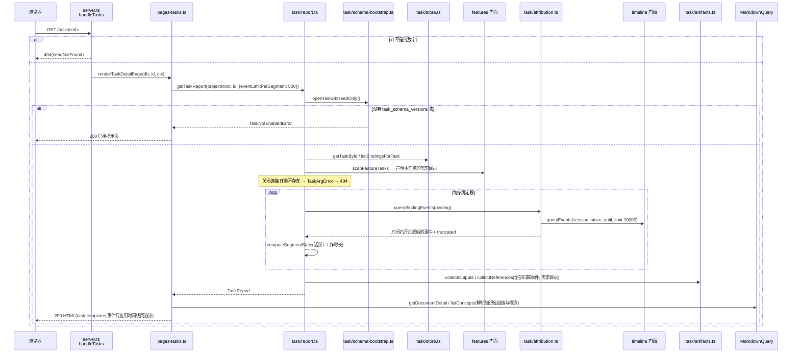
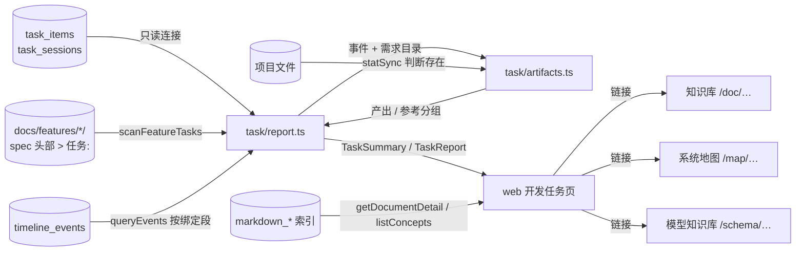

# 开发任务浏览 · 代码地图

> 派生视图:从代码生成,不手工修改。相关文件在 `source_commit` 之后有改动即视为过期,用 `/code-map-write` 重新生成。

## 一句话

浏览器打开 `/tasks` 或 `/tasks/<id>` 时,web 只调 task 门面的两个只读函数:`listTaskSummaries` / `getTaskReport`。task 用只读方式打开库(不建表),读任务和绑定后按每条绑定段向 timeline 门面取归属事件,算出时长、产出、参考;web 只做格式化,并把产出、参考里的文件解析成知识库、系统地图、模型知识库的链接。

## 代码链路:打开任务详情

看什么:没有 task 表时在 `openTaskDbReadOnly` 抛 `TaskNotEnabledError`,web 渲染启用提示页而不建表;读完 task 表就关连接,再逐段查 timeline;所有口径都在 `report.ts` / `artifacts.ts`。

列表页 `/tasks` 走同一条路:`listTaskSummaries` 用 `store.listTasks` + `listAllBindings` 一次读出全部任务与绑定,再逐段 `queryBindingEvents`,按最近活动排序后交给 `renderTaskListContent`。

## 数据流转

看什么:整条链路只读;task 表只经只读连接读,事件只经 timeline 门面读,项目文件只判断是否存在、不读内容。

## 节点索引

| 节点 | 代码指针 | 来源 |
|---|---|---|
| /tasks 路由 | `src/web/server.ts`:`handleTasks` | AI 读代码 |
| 侧栏「开发任务」入口 | `src/web/layout.ts`:`renderShellPage` 中 `navItem('开发任务', …)` | AI 读代码 |
| 页面入口 + 链接解析 | `src/web/pages-tasks.ts`:`renderTasksListPage` / `renderTaskDetailPage` / `resolveLink` / `buildSegmentItems` | AI 读代码 |
| HTML 模板 | `src/web/task-templates.ts`:`renderTaskListContent` / `renderTaskDetailContent` / `renderTaskNotEnabledContent` | AI 读代码 |
| 事件行 / 提交行复用 | `src/web/timeline-event-rows.ts`:`toEventRow` / `toCommitRow`;`src/web/timeline-templates.ts`:`renderEventRow` / `renderCommitRow` | AI 读代码 |
| 系统地图链接校验 | `src/web/codemap-reader.ts`:`isSafeCodemapName` | AI 读代码 |
| 概念筛选链接 | `src/web/pages-overview.ts`:`buildOverviewUrl` | AI 读代码 |
| task 门面 | `src/core/task/index.ts`:`listTaskSummaries` / `getTaskReport` / `TaskNotEnabledError` | AI 读代码 |
| 汇总与报告 | `src/core/task/report.ts`:`listTaskSummaries` / `getTaskReport` / `computeSegmentStats` | AI 读代码 |
| 产出与参考 | `src/core/task/artifacts.ts`:`collectOutputs` / `collectReferences` / `classifyArtifactPath` | AI 读代码 |
| 绑定段归属事件 | `src/core/task/attribution.ts`:`queryBindingEvents` | AI 读代码 |
| 只读打开库 | `src/core/task/schema-bootstrap.ts`:`openTaskDbReadOnly` | AI 读代码 |
| 读任务与绑定 | `src/core/task/store.ts`:`TaskStore.listTasks` / `listAllBindings` / `getTaskById` / `listBindingsForTask` | AI 读代码 |
| 需求目录声明解析 | `src/core/features/scanner.ts`:`scanFeatureTasks`;`src/core/task/resolve.ts`:`findTask` | AI 读代码 |
| 事件查询 | `src/core/timeline/indexer.ts`:`queryEvents`(经 timeline 门面) | AI 读代码 |
| 知识库查询 | `src/core/markdown/query.ts`:`MarkdownQuery.getDocumentDetail` / `listConcepts` | AI 读代码 |

## 已知盲区

- timeline 的 `queryEvents` 每次调用自行开关连接,并执行 timeline 的 schema 应用(timeline 表在 web 启动预检时已确认存在,属既有行为);图中只画到门面。
- 一条绑定段超过 10000 条事件时,`queryEvents` 按时间倒序截取,保留的是最近的 10000 条;报告标 `truncated`,页面注明。
- `commit_files` 是相对 git 仓库根的路径;项目根不是仓库根时,对不上的文件按「不存在」被过滤。
- 参考栏的 Bash 路径与概念是从命令文本推断的,含 `$` 的片段跳过;图中未展开切分规则。
