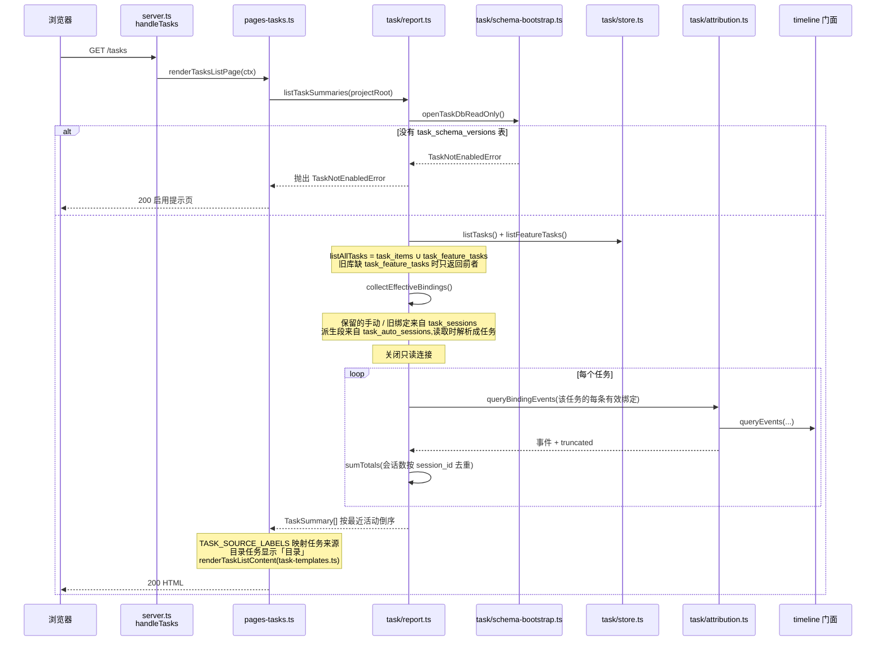
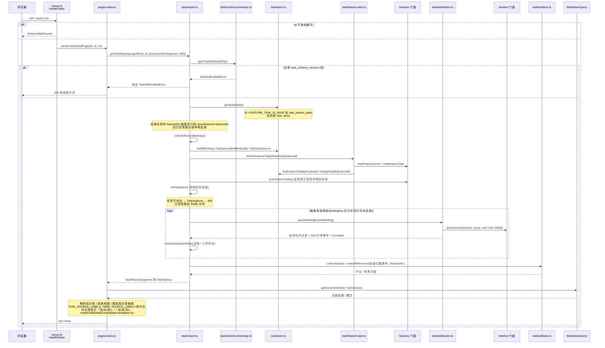
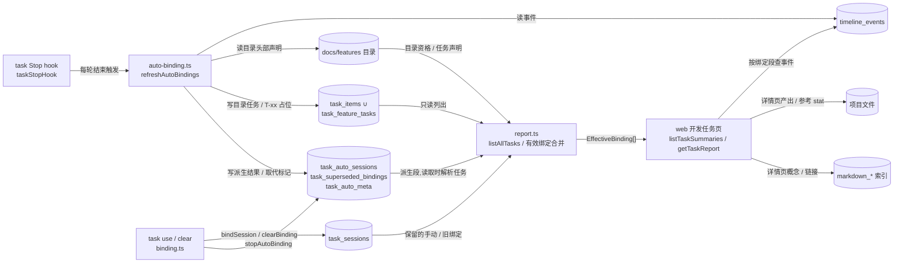

# 开发任务浏览 · 代码地图

> 派生视图:从代码生成,不手工修改。相关文件在 `source_commit` 之后有改动即视为过期,用 `/code-map-write` 重新生成。

## 一句话

浏览器打开 `/tasks` 或 `/tasks/<id>` 时,web 只经 task 门面读取:任务列表是 `task_items ∪ task_feature_tasks`(目录任务来源显示「目录」),绑定走 `collectEffectiveBindings`(与公开的 `listEffectiveBindings` 同一实现)——`task_sessions` 的手动 / 旧绑定加上 `task_auto_sessions` 在读取时合成的派生段(来源显示「自动(读)」/「自动(写)」),再按绑定段的 `bindingKey` 逐段向 timeline 取归属事件。web 全程只读,不主动刷新派生。

## 代码链路:打开任务列表

看什么:列表如何把两张任务表并起来、如何复用与详情相同的有效绑定合并逻辑,以及目录任务在来源列显示为「目录」。

## 代码链路:打开任务详情

看什么:一条任务 id 如何解析到 `task_items` 或 `task_feature_tasks`,有效绑定如何合并手动行与派生段,以及 `bindingKey` 在哪里产生、分段事件如何取。

CLI 的 `task show` 返回 `TaskDetail.sessions`,同样从 `listEffectiveBindings` 取绑定并保留每项的 `bindingKey`(`src/core/task/feature-link.ts`:`getTaskDetail`、`src/core/task/types.ts`:`TaskDetail.sessions` / `SegmentReport.bindingKey`),与 web 的 `SegmentReport` 是同一口径。CLI 的 `list` / `current` / `clear` / `show` 在读取前会先刷新派生,web 不会。

## 数据流转

看什么:web 只读三组 task 表和 timeline 索引,派生结果由 Stop hook 写入、手动绑定由 `task` 命令写入;web 不调用 `refreshAutoBindings`,只消费已有结果。

## 节点索引

| 节点 | 代码指针 | 来源 |
|---|---|---|
| `/tasks`、`/tasks/<id>` 路由 | `src/web/server.ts`:`handleTasks` | AI 读代码 |
| 列表页 / 详情页入口 | `src/web/pages-tasks.ts`:`renderTasksListPage` / `renderTaskDetailPage` / `resolveLink` / `toSegmentModel` / `buildSegmentItems` | AI 读代码 |
| 页面模板 | `src/web/task-templates.ts`:`renderTaskListContent` / `renderTaskDetailContent` / `renderTaskNotEnabledContent` | AI 读代码 |
| 页面标签 | `src/web/constants.ts`:`TASK_SOURCE_LABELS`(目录任务为「目录」)/ `BIND_SOURCE_LABELS`(派生绑定为「自动(读)」「自动(写)」)/ `TASK_SEGMENT_EVENT_LIMIT` | AI 读代码 |
| 事件行 / 提交行复用 | `src/web/timeline-event-rows.ts`:`toEventRow` / `toCommitRow`;`src/web/timeline-templates.ts`:`renderEventRow` / `renderCommitRow` | AI 读代码 |
| 壳布局与链接解析 | `src/web/layout.ts`:`renderShellPage`;`src/web/codemap-reader.ts`:`isSafeCodemapName`;`src/web/pages-overview.ts`:`buildOverviewUrl` | AI 读代码 |
| task 门面 | `src/core/task/index.ts`:`listTaskSummaries` / `getTaskReport`(转发 report.ts) | AI 读代码 |
| 列表汇总与详情报告 | `src/core/task/report.ts`:`listTaskSummaries` / `getTaskReport` / `listAllTasks` / `collectEffectiveBindings` / `loadSegments` / `computeSegmentStats` / `sumTotals` | AI 读代码 |
| 有效绑定与 bindingKey | `src/core/task/report.ts`:`listEffectiveBindings` / `getCurrentEffectiveBinding`;`src/core/task/types.ts`:`EffectiveBinding` / `SegmentReport.bindingKey` / `TaskDetail.sessions` | AI 读代码 |
| CLI 详情同源读取 | `src/core/task/feature-link.ts`:`getTaskDetail` | AI 读代码 |
| 只读打开库 | `src/core/task/schema-bootstrap.ts`:`openTaskDbReadOnly` | AI 读代码 |
| 任务 / 目录任务 / 绑定 / 派生结果 | `src/core/task/store.ts`:`TaskStore.getTaskById` / `getFeatureTaskById` / `listFeatureTasks` / `listAllBindings` / `listSupersededBindingIds` / `listAutoSessions` | AI 读代码 |
| 目录任务与头部声明 | `src/core/task/feature-task.ts`:`resolveFeatureTargetReadOnly` / `isEligibleFeatureDir`;`src/core/features/scanner.ts`:`scanFeatureTasks` / `readFeatureTask` / `readFeatureOwner`,经 `src/core/features/index.ts` 门面 | AI 读代码 |
| 任务声明匹配 | `src/core/task/resolve.ts`:`findTask` | AI 读代码 |
| 绑定段归属事件 | `src/core/task/attribution.ts`:`queryBindingEvents` / `EVENTS_PER_BINDING_LIMIT` | AI 读代码 |
| 产出与参考 | `src/core/task/artifacts.ts`:`collectOutputs` / `collectReferences` / `classifyArtifactPath` | AI 读代码 |
| timeline 读取 | `src/core/timeline/index.ts` 门面;`src/core/timeline/indexer.ts`:`queryEvents` / `listSessionEventMaxIds` / `listSessionEventsAfter`;`src/core/timeline/schema.sql`:`timeline_events` | AI 读代码 |
| 知识库链接 | `src/core/markdown/query.ts`:`MarkdownQuery.getDocumentDetail` / `listConcepts` | AI 读代码 |
| 自动派生写入 | `src/core/task/hooks.ts`:`taskStopHook`;`src/core/task/auto-binding.ts`:`refreshAutoBindings` / `deriveSessionAutoBinding` / `isHistoryPassDone` | AI 读代码 |
| 手动绑定 / 停止点写入 | `src/core/task/binding.ts`:`bindSession` / `clearBinding` / `stopAutoBinding`;`src/core/task/cli.ts`:`registerTaskCommands` | AI 读代码 |
| task 表结构 | `src/core/task/schema.sql`:`task_items` / `task_sessions` / `task_feature_tasks` / `task_auto_sessions` / `task_superseded_bindings` / `task_auto_meta` | AI 读代码 |
| 常量 | `src/core/task/constants.ts`:`FEATURE_TASK_ID_BASE` / `ACTIVE_GAP_MS` | AI 读代码 |

## 已知盲区

- **web 不主动刷新派生**:`pages-tasks.ts` 只调 `listTaskSummaries` / `getTaskReport`,两者都不调 `refreshAutoBindings`。派生结果由 Stop hook(`src/core/task/hooks.ts`:`taskStopHook`)写入;CLI 的 `list` / `current` / `clear` / `show` 会在读取前刷新,sync 构造上报前也会刷新(见 `flows/开发任务绑定.md`)。未安装或未触发 Stop hook 的旧项目,web 看到的派生绑定可能滞后。hook 安装点是运行时配置(`src/core/task/installer.ts`:`installTaskHooks` 写项目 settings),图中不展开。
- **含未提交改动**:`src/core/features/scanner.ts` 工作区有未提交改动(负责人读取口径),本图按当前工作区代码生成,`source_commit` 仍指向 `6ee30cb`;过期判定会命中该文件。
- 派生段在内存中的 `TaskBinding.id` 固定为 0,唯一区分靠 `bindingKey`(`auto:<sessionId>`);`bindSource` 的 `auto_read` / `auto_write` 只存在于读取时合成结果,不写入 `task_sessions`(表 CHECK 仍只有 `cli` / `feature_dir`)。
- `task_auto_sessions.feature_id` 指向的目录被删除且没有已持久化的目录任务行时,`resolveFeatureTargetReadOnly` 返回 null,该派生段不出现;图中未展开这个跳过分支。
- timeline 的 `queryEvents` 每次调用自行开关连接,并应用 timeline 的 schema(既有行为);图中只画到门面。
- 每条绑定段超过 `EVENTS_PER_BINDING_LIMIT`(10000)时,`queryEvents` 按时间倒序截取并保留最近的 10000 条,报告标 `truncated`。web 每段只显示 `TASK_SEGMENT_EVENT_LIMIT`(500)条,其余提示用 `cgraphx task show` 查看。
- 产出 / 参考只保留项目根内且当前存在的普通文件;`commit_files` 是相对 git 仓库根的路径,项目根不是仓库根时对不上的文件按「不存在」过滤。
- web 判断任务是否启用依赖 `task_schema_versions` 表;旧库缺新表时按表存在性降级读取(`task_feature_tasks` 缺失 → 列表不含目录任务,`task_auto_sessions` 缺失 → 绑定不含派生段)。
