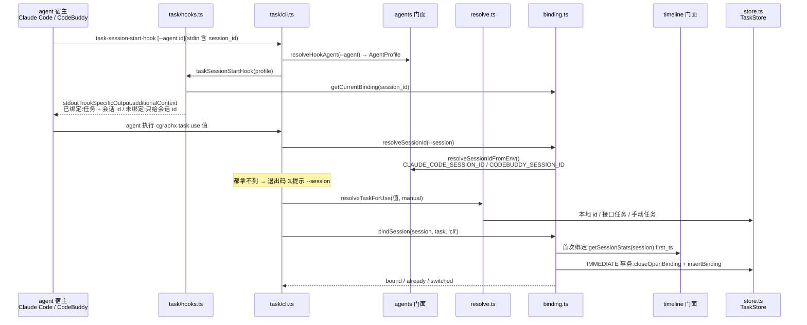
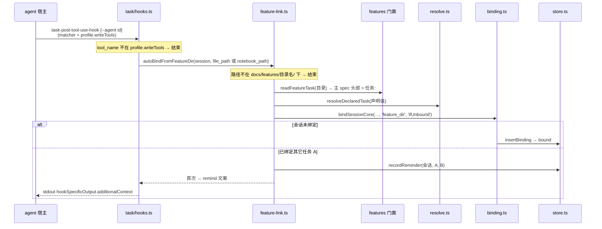
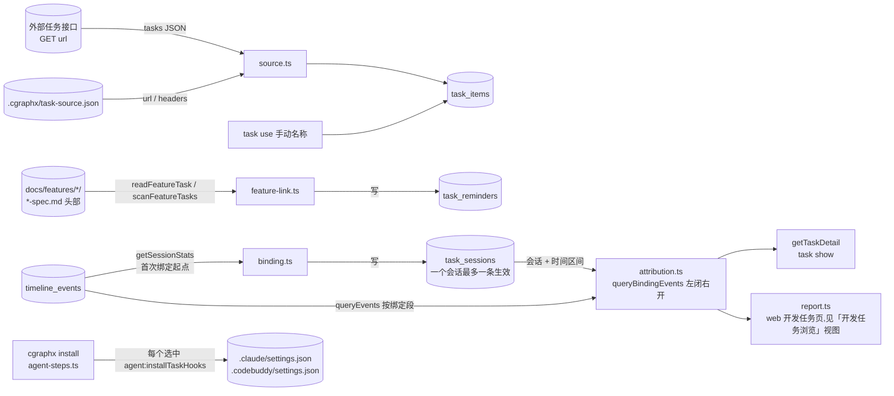

# 开发任务绑定 · 代码地图

> 派生视图:从代码生成,不手工修改。相关文件在 `source_commit` 之后有改动即视为过期,用 `/code-map-write` 重新生成。

## 一句话

一个 agent 会话(Claude Code 或 CodeBuddy)在一段时间区间内绑定一个开发任务。绑定有两种来源:

- agent 执行 `cgraphx task use`;
- 会话改动了某个需求目录里的文件,而该目录的 spec 头部声明了 `> 任务:`,于是自动绑定。

事件不直接记录自己属于哪个任务。查询时用「会话 + 时间区间」去 join `timeline_events`,得出归属。

各 agent 的差异只从 agents 门面取:hook 命令带不带 `--agent`、写类工具有哪些、会话 id 读哪个环境变量。task 只经门面读 timeline、features、agents,反方向没有依赖。

## 代码链路:会话开始提醒与显式绑定

看什么:

- hook 带 `--agent` 时按对应 agent 处理;不带或无法识别时,按 Claude Code 处理。
- CLI 进程拿会话 id 的顺序:先看 `--session`,再按 agent 登记顺序读各 agent 的会话环境变量。
- 首次绑定会把起点回溯到会话的第一条 timeline 事件,所以事后补绑不丢数据。

## 代码链路:改动需求目录时自动绑定

看什么:

- 哪些工具算「写类工具」由 agent 描述的 `writeTools` 决定,安装时写成 settings 的 matcher,hook 里再判断一次。
- 「检查是否已绑定」和「写入绑定」在同一个事务里('ifUnbound' 模式),所以并发时也不会切走别的进程刚绑上的任务。

## 数据流转

看什么:

- task 只写自己的 `task_*` 表;读 `timeline_events` 和 spec 头部都经门面,只读。
- hook 安装是按 agent 写进各自的 settings 文件。

## 节点索引

| 节点 | 代码指针 | 来源 |
|---|---|---|
| 命令组与隐藏 hook 命令 | `src/core/task/cli.ts`:`registerTaskCommands`。包括 list / use / current / clear / show,以及 `task-session-start-hook` / `task-post-tool-use-hook`(两者都接受 `--agent`) | AI 读代码 |
| 两个 hook 入口 | `src/core/task/hooks.ts`:`taskSessionStartHook(profile)` / `taskPostToolUseHook(profile)`。共用 `runTaskHook`,写类工具判定用 `profile.writeTools`,输出走 `writeAdditionalContext` | AI 读代码 |
| agent 差异 | `src/core/agents/index.ts`:`resolveHookAgent` / `resolveSessionIdFromEnv` / `hookCommand` / `agentSettingsPath` / `requireAgentProfile`。取值来自 `src/core/agents/profiles.ts` | AI 读代码 |
| 任务解析 | `src/core/task/resolve.ts`:`resolveTaskForUse` / `resolveDeclaredTask` / `findTaskByValue` / `listTasks` | AI 读代码 |
| 外部接口与配置 | `src/core/task/source.ts`:`loadTaskSourceConfig` / `fetchRemoteTasks` | AI 读代码 |
| 绑定 | `src/core/task/binding.ts`:`bindSession` / `bindSessionCore` / `getCurrentBinding` / `clearBinding` / `resolveSessionId` | AI 读代码 |
| 自动绑定与 task show | `src/core/task/feature-link.ts`:`autoBindFromFeatureDir` / `getTaskDetail` | AI 读代码 |
| 绑定段归属事件(task show 与 web 共用) | `src/core/task/attribution.ts`:`queryBindingEvents`、`EVENTS_PER_BINDING_LIMIT` | AI 读代码 |
| 持久化 | `src/core/task/store.ts`:`TaskStore`,包括 `insertBinding` / `closeOpenBinding` / `recordReminder` / `upsertApiTask` 等 | AI 读代码 |
| task_* 表 | `src/core/task/schema.sql` | AI 读代码 |
| spec 头部任务声明 | `src/core/features/scanner.ts`:`readFeatureTask` / `scanFeatureTasks`,经 features 门面调用 | AI 读代码 |
| timeline 门面 | `src/core/timeline/index.ts`:`getSessionStats` / `queryEvents` / `isKillSwitchOn` | AI 读代码 |
| hook 安装 | `src/core/task/installer.ts`:`installTaskHooks(root, { agent })` / `uninstallTaskHooks(root, { agent })`。按 agent 调用的入口在 `src/cli/installer/agent-steps.ts`:`installAgentHooks` / `uninstallAgentHooks` | AI 读代码 |

## 已知盲区

- 会话 id 环境变量是宿主注入的,没有官方文档保证。
  - Claude Code 的 `--resume` 恢复会话后 session_id 是否沿用,还没有实测;CodeBuddy 同样没有实测。
  - 两个 agent 嵌套启动时,会按登记顺序取 Claude Code 的变量,见知识库「会话 id 来源约束」。
- 外部任务接口的地址来自目标项目的 `.cgraphx/task-source.json`,属于运行时配置,图中不列具体实例。
- 每条绑定区间最多取 10000 条事件(`EVENTS_PER_BINDING_LIMIT`)。`task show` 截断时不提示,web 开发任务页会标注。
- web 开发任务页的只读链路(`openTaskDbReadOnly` → `report.ts`)见 `flows/开发任务浏览.md`,本图不展开。
