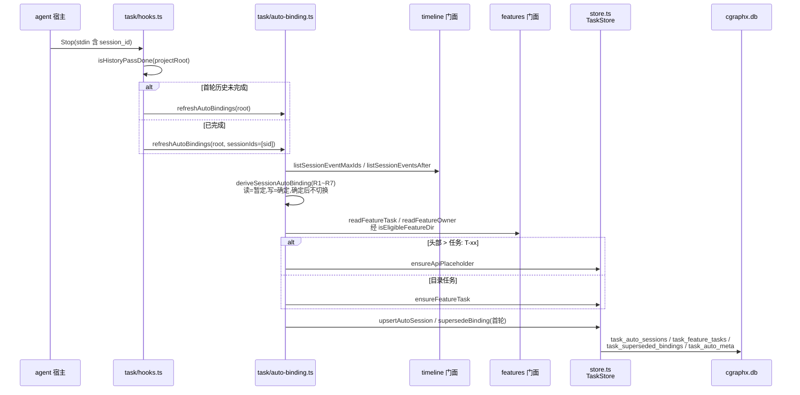
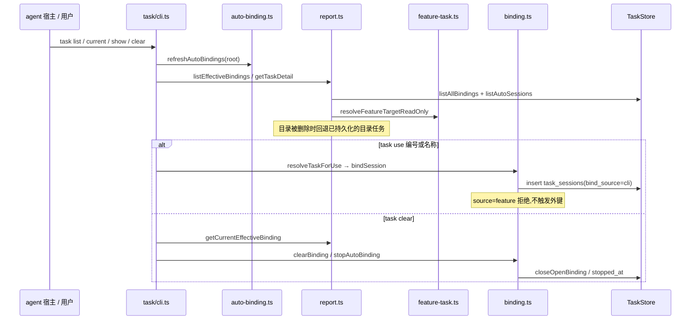
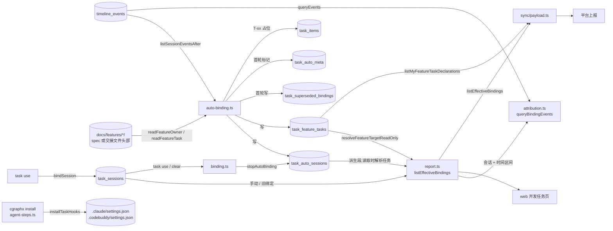

# 开发任务绑定 · 代码地图

> 派生视图:从代码生成,不手工修改。相关文件在 `source_commit` 之后有改动即视为过期,用 `/code-map-write` 重新生成。

## 一句话

一个 agent 会话在某个时间区间内归到一个开发任务。归属由程序从 timeline 事件按「会话读写了哪个产出目录」派生:读 = 暂定,写 = 确定;手动 `task use` 最高优先,手动 / `task clear` 之后自动规则停止。派生结果落 `task_auto_sessions`,本地展示与平台上报共用同一份「有效绑定」。agent 上下文只注入会话 id,不再出现任务内容。

事件不直接记录自己属于哪个任务。查询时用「会话 + 时间区间」去 join `timeline_events`,得出归属。

各 agent 的差异只从 agents 门面取:hook 命令带不带 `--agent`、写类工具有哪些、会话 id 读哪个环境变量。task 只经门面读 timeline、features、agents,反方向没有依赖;sync 只经 task 门面读有效绑定。

## 代码链路:每轮结束刷新自动派生

看什么:

- 派生只在 refresh 时发生:Stop hook、`task list/current/show/clear` 执行前、sync 构造上报前。web 只读不刷新。
- 首轮历史未完成(`history_pass_done` 缺失)时全量重算,之后只重算最大事件 id 变了的会话。
- 派生是纯函数,写库集中在 `refreshAutoBindings`;单会话失败只写 stderr,不中断其它会话。
- 目录头部 `> 任务: T-xx` 走接口任务占位,否则建目录任务;目录读取经 features 门面。

## 代码链路:本地读取与手动绑定

看什么:

- `listEffectiveBindings` 是本地展示与上报共用的唯一口径:手动 / 旧绑定来自 `task_sessions`,派生段来自 `task_auto_sessions` 并在读取时解析目录任务。
- 目录删除后,目录任务回退到已持久化的 `task_feature_tasks` 行;头部 `T-xx` 的目录没有可回退的行。
- `task use` 拒绝目录任务(避免 `task_sessions` 外键错误);`task clear` 在没有派生行时也写停止点。

## 数据流转

看什么:

- task 只写自己的 `task_*` 表;读 `timeline_events` 和产出目录头部都经门面,只读。
- 派生会话与目录任务单独成表;`task_sessions` 仍只存手动 / 旧绑定。
- sync 经 task 门面读有效绑定与本人负责目录的任务声明,不反向被 task 依赖。

## 节点索引

| 节点 | 代码指针 | 来源 |
|---|---|---|
| 命令组与隐藏 hook 命令 | `src/core/task/cli.ts`:`registerTaskCommands`。list / use / current / clear / show,以及 `task-session-start-hook` / `task-stop-hook` / `task-post-tool-use-hook`(兼容空操作,均接受 `--agent`) | AI 读代码 |
| hook 入口 | `src/core/task/hooks.ts`:`taskSessionStartHook` 只注入会话 id;`taskStopHook` 刷新派生;`taskPostToolUseHook` 读 stdin 后直接返回。共用 `runTaskHook` | AI 读代码 |
| 自动派生 | `src/core/task/auto-binding.ts`:`deriveSessionAutoBinding`(R1~R7 唯一实现)/ `refreshAutoBindings` / `isHistoryPassDone` | AI 读代码 |
| 目录资格与目录 → 任务 | `src/core/task/feature-task.ts`:`isEligibleFeatureDir` / `resolveFeatureTarget` / `resolveFeatureTargetReadOnly` / `listMyFeatureTaskDeclarations` / `recordFeatureTaskMappings` / `featureTaskBindError` | AI 读代码 |
| feature-id 命名 | `src/core/task/feature-name.ts`:`featureDatePrefix` / `featureTaskName`(store 与 feature-task 共用,避免循环依赖) | AI 读代码 |
| 有效绑定与报告 | `src/core/task/report.ts`:`listEffectiveBindings` / `getCurrentEffectiveBinding` / `listTaskSummaries` / `getTaskReport`;`listBindingsWithTask` 已删除 | AI 读代码 |
| 任务详情 | `src/core/task/feature-link.ts`:`getTaskDetail`(按有效绑定取归属事件) | AI 读代码 |
| 绑定段归属事件 | `src/core/task/attribution.ts`:`queryBindingEvents`、`EVENTS_PER_BINDING_LIMIT` | AI 读代码 |
| 手动绑定 | `src/core/task/binding.ts`:`bindSession` / `bindSessionCore` / `clearBinding` / `stopAutoBinding` / `resolveSessionId` | AI 读代码 |
| 任务解析 | `src/core/task/resolve.ts`:`resolveTaskForUse` / `findTask` / `findTaskByValue` / `listTasks`(目录任务可 show,不可手动绑定) | AI 读代码 |
| 持久化 | `src/core/task/store.ts`:`TaskStore`,包括 `ensureFeatureTask` / `listAutoSessions` / `upsertAutoSession` / `setAutoStop` / `supersedeBinding` 等 | AI 读代码 |
| task_* 表 | `src/core/task/schema.sql`(四张新表只加不升版本) | AI 读代码 |
| 目录头部 | `src/core/features/scanner.ts`:`readFeatureOwner` / `readFeatureTask` / `scanFeatureTasks`,经 features 门面调用 | AI 读代码 |
| Bash 读识别 | `src/core/timeline/command-paths.ts`:`extractCommandPathCandidates`(task 与 sync 共用) | AI 读代码 |
| timeline 门面 | `src/core/timeline/index.ts`:`listSessionEventMaxIds` / `listSessionEventsAfter` / `queryEvents` / `isKillSwitchOn` / `extractCommandPathCandidates` | AI 读代码 |
| agent 差异 | `src/core/agents/index.ts`:`resolveHookAgent` / `resolveSessionIdFromEnv` / `hookCommand` / `agentSettingsPath` / `requireAgentProfile`;取值来自 `src/core/agents/profiles.ts` | AI 读代码 |
| 平台上报消费 | `src/core/sync/payload.ts`:`createSyncContext` / `buildSessionPayload` / `toIngestBinding` / `taskDeclarationsFor`;`src/core/sync/runner.ts`:`runSync`(刷新派生、写回映射) | AI 读代码 |
| web 开发任务页 | `src/web/pages-tasks.ts`(只读,经 report.ts 取数) | AI 读代码 |
| hook 安装 | `src/core/task/installer.ts`:`installTaskHooks` / `uninstallTaskHooks`;入口 `src/cli/installer/agent-steps.ts` | AI 读代码 |

## 已知盲区

- 会话 id 环境变量是宿主注入的,没有官方文档保证。Claude Code 的 `--resume` 恢复会话后 session_id 是否沿用、CodeBuddy 是否一致,都没有实测。
- 外部任务接口的地址来自目标项目的 `.cgraphx/task-source.json`,属于运行时配置,图中不列具体实例。接入研发管理平台后,这个文件由 `cgraphx sync connect` 写成平台 `/tasks` 地址加上报凭据,见 `flows/平台上报.md`。
- 每条绑定区间最多取 10000 条事件(`EVENTS_PER_BINDING_LIMIT`)。`task show` 截断时不提示,web 开发任务页会标注。
- 头部 `> 任务: T-xx` 的目录被删除后,派生段没有目录任务行可回退,会从有效绑定与上报快照中消失。修复需要把任务快照落库,与「派生只存目录」的设计冲突,待定案。
- 本地 web 不主动刷新派生;未安装 Stop hook 的旧项目需要先执行一次 task 命令或 sync 才能看到自动绑定。
- 首轮全量派生在 Stop hook 内执行,耗时随历史事件线性增长;本仓库约 0.4 秒。
- 任务声明从文件系统实时读取,但不进同步脏检查;负责人头部在会话已上报后才补上时,可能要等该会话有新事件才重报。
- web 开发任务页的只读链路(`openTaskDbReadOnly` → `report.ts`)见 `flows/开发任务浏览.md`,本图不展开。
