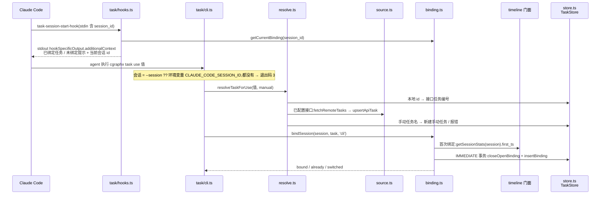
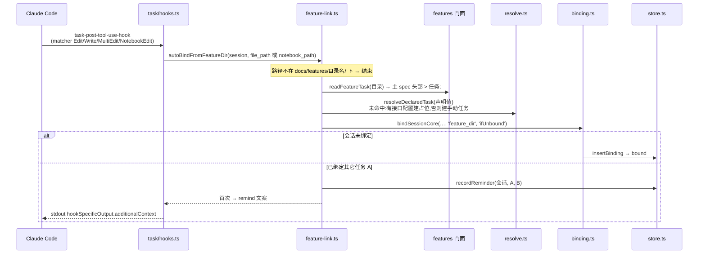
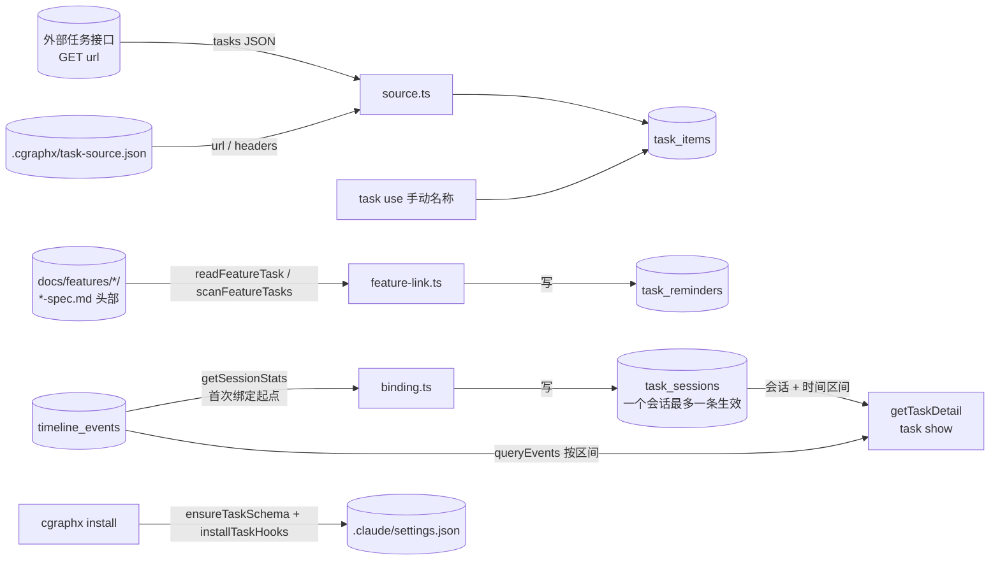

# 开发任务绑定 · 代码地图

> 派生视图:从代码生成,不手工修改。相关文件在 `source_commit` 之后有改动即视为过期,用 `/code-map-write` 重新生成。

## 一句话

一个 Claude Code 会话在某个时间区间内绑定一个开发任务。绑定有两种来源:agent 执行 `cgraphx task use`,或会话改动了 spec 头部声明 `> 任务:` 的需求目录而自动绑定。事件归属哪个任务,不存在事件上,而是查询时用「会话 + 时间区间」去 join `timeline_events` 得出。task 只经门面读 timeline 和 features,反方向没有依赖。

## 代码链路:会话开始提醒与显式绑定

看什么:会话 id 的两个来源(hook 的 stdin、CLI 的环境变量 / `--session`);首次绑定把起点回溯到会话的第一条 timeline 事件。

## 代码链路:改动需求目录时自动绑定

看什么:「检查是否已绑定」和「写入绑定」在同一个事务里('ifUnbound' 模式),所以并发时也不会切走别的进程刚绑上的任务;同一对任务的提醒只出现一次。

## 数据流转

看什么:task 只写自己的 `task_*` 表;读 `timeline_events` 和 spec 头部都经门面,只读。

## 节点索引

| 节点 | 代码指针 | 来源 |
|---|---|---|
| 命令组与隐藏 hook 命令 | `src/core/task/cli.ts`:`registerTaskCommands`(list/use/current/clear/show + `task-session-start-hook` / `task-post-tool-use-hook`) | AI 读代码 |
| 两个 hook 入口 | `src/core/task/hooks.ts`:`taskSessionStartHook` / `taskPostToolUseHook`(共用 `runTaskHook`,输出用 `writeAdditionalContext`) | AI 读代码 |
| 任务解析 | `src/core/task/resolve.ts`:`resolveTaskForUse` / `resolveDeclaredTask` / `findTaskByValue` / `listTasks` | AI 读代码 |
| 外部接口与配置 | `src/core/task/source.ts`:`loadTaskSourceConfig` / `fetchRemoteTasks` | AI 读代码 |
| 绑定 | `src/core/task/binding.ts`:`bindSession` / `bindSessionCore` / `getCurrentBinding` / `clearBinding` / `resolveSessionId` | AI 读代码 |
| 自动绑定与归属查询 | `src/core/task/feature-link.ts`:`autoBindFromFeatureDir` / `getTaskDetail` | AI 读代码 |
| 持久化 | `src/core/task/store.ts`:`TaskStore`(`insertBinding` / `closeOpenBinding` / `recordReminder` / `upsertApiTask` 等) | AI 读代码 |
| task_* 表 | `src/core/task/schema.sql` | AI 读代码 |
| spec 头部任务声明 | `src/core/features/scanner.ts`:`readFeatureTask` / `scanFeatureTasks`(经 features 门面) | AI 读代码 |
| timeline 门面 | `src/core/timeline/index.ts`:`getSessionStats` / `queryEvents` / `isKillSwitchOn` / `CLAUDE_SESSION_ID_ENV` | AI 读代码 |
| hook 安装 | `src/core/task/installer.ts`:`installTaskHooks` / `uninstallTaskHooks`;由 `src/cli/installer/index.ts` 调用 | AI 读代码 |

## 已知盲区

- `CLAUDE_CODE_SESSION_ID` 是宿主注入的环境变量,没有官方文档保证;用 `claude --resume` 恢复会话后 session_id 是否沿用,还没有实测。
- 外部任务接口的地址来自目标项目的 `.cgraphx/task-source.json`,属运行时配置,图中不列实例。
- `getTaskDetail` 每条绑定区间最多取 10000 条事件,图中未画截断。
