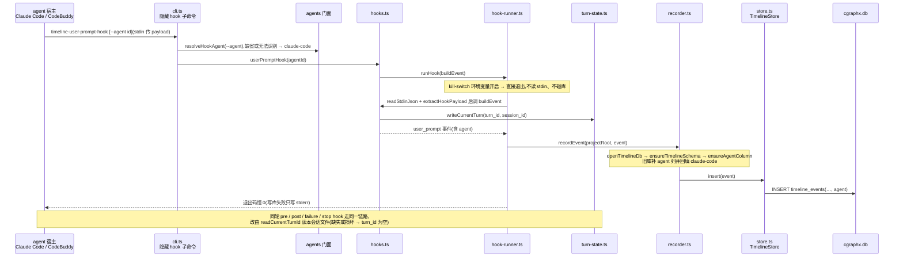
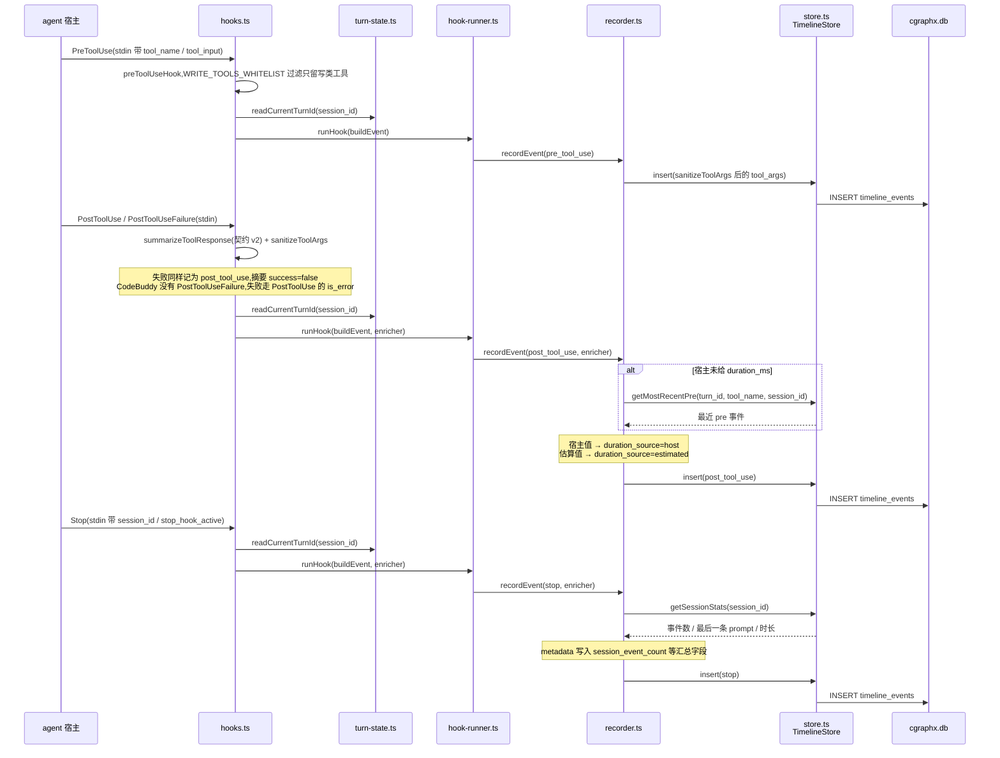
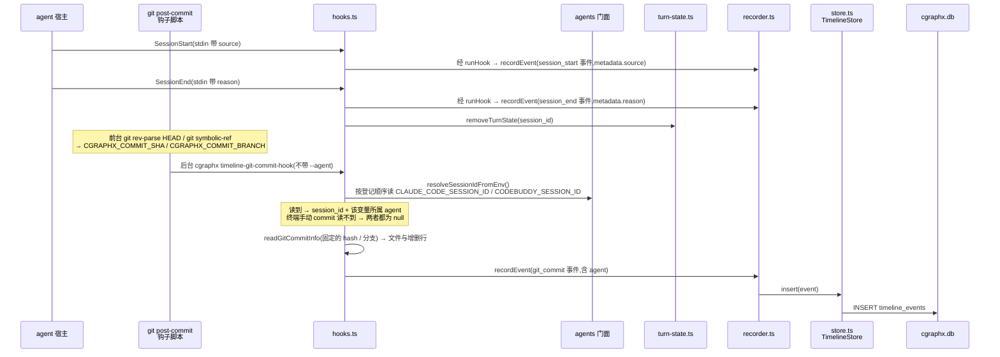
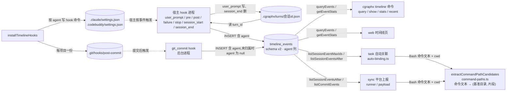

# 开发时间线记录 · 代码地图

> 派生视图:从代码生成,不手工修改。相关文件在 `source_commit` 之后有改动即视为过期,用 `/code-map-write` 重新生成。

## 一句话

两类事件会触发短命 hook,把一条记录写进 `timeline_events` 表:

- **agent 宿主的事件**:Claude Code 或 CodeBuddy 的会话开始 / 结束、提问、工具调用、工具失败、一轮结束。
- **git 提交**:由项目的 post-commit 钩子触发。

几条关键规则:

- **来源 agent**:宿主 hook 子命令带 `--agent` 时取该值,缺省或无法识别按 Claude Code。git 提交的来源由读到的会话环境变量属于哪个 agent 推出,读不到时 session_id 与 agent 都为 null。
- **turn_id 传递**:user_prompt hook 为每轮生成 UUID,按会话写进 `.cgraphx/turns/会话id.json`,同一轮的其它 hook 读回。文件缺失或损坏时退化为 null。
- **写入收缩**:pre_tool_use 只记写类工具。工具结果摘要按契约 v2 生成,Write 不存正文。JSON 列超限按字段截断,写入值始终是合法 JSON。
- **读取侧**:`store.rowToEvent` 把 agent 映射进 `TimelineEvent`(旧事件可为 null),task 自动关联按事件的 agent 取该 agent 的写类工具。CLI 表格与 web 时间线页不展示 agent,CLI JSON 输出保留该字段。所有读方都只读。

## 代码链路:一轮对话中的 user_prompt 事件

看什么:`--agent` 在 cli 层解析成 agentId 随事件写库,turn_id 由本会话的状态文件传给同轮其它 hook,每次打开库都会补旧库缺的 agent 列,任何失败都不阻塞宿主。

## 代码链路:工具事件与本轮结束

看什么:pre_tool_use 只保留写类工具。post 摘要按契约 v2 生成,失败事件也记成 post_tool_use。duration_ms 优先用宿主值,否则由 enricher 用同轮最近的 pre 事件估算。stop 事件带会话汇总。

## 代码链路:会话起止与 git 提交

看什么:session_end 写完事件后删掉本会话的 turn 文件。git 提交的 hash 与分支由钩子脚本在提交当下固定,经环境变量交给后台进程。git 提交的 session_id 和来源 agent 来自继承的会话环境变量,不来自 stdin。

## 数据流转

看什么:hook 是唯一写方,状态文件按会话隔离。读方各自只读,task 按事件 agent 选写类工具。命令文本路径候选由 task 与 sync 共用,纯函数不读文件系统。settings 与 git 钩子的触发侧属于运行时行为,图中用虚线表示。

## 节点索引

| 节点 | 代码指针 | 来源 |
|---|---|---|
| hook 名单与工具分类 | `src/core/timeline/constants.ts`:`HOOK_EVENTS_TO_COMMANDS`(7 个宿主事件)、`GIT_COMMIT_SUBCOMMAND`、`WRITE_TOOLS_WHITELIST`、`WRITE_FILE_TOOLS` / `READ_FILE_TOOLS`、`COMMIT_SHA_ENV` / `COMMIT_BRANCH_ENV` | AI 读代码 |
| 隐藏 hook 子命令 | `src/core/timeline/cli.ts`:`HOOK_HANDLERS` 按名单遍历注册,每个都接受 `--agent`;另注册 `timeline-git-commit-hook`(不带 `--agent`) | AI 读代码 |
| 查询命令 | `src/core/timeline/cli.ts`:`registerTimelineCommands` / `renderEventsTable` / `renderStatsTable`,摘要复用 `src/core/timeline/describe.ts`:`describeEvent` | AI 读代码 |
| 各 hook 处理函数 | `src/core/timeline/hooks.ts`:`userPromptHook` / `preToolUseHook` / `postToolUseHook` / `postToolUseFailureHook` / `stopHook` / `sessionStartHook` / `sessionEndHook` / `gitCommitHook` | AI 读代码 |
| git 提交信息读取 | `src/core/timeline/hooks.ts`:`readGitCommitInfo`。hash 只接受十六进制,否则退回读 HEAD | AI 读代码 |
| 工具事件元数据与宿主耗时 | `src/core/timeline/hooks.ts`:`toolEventMetadata`(tool_use_id、子 agent 归属)、`applyHostDuration`(duration_source=host) | AI 读代码 |
| 工具参数净化 | `src/core/timeline/tool-args.ts`:`sanitizeToolArgs`(Write 不存正文,Edit / MultiEdit 片段截断) | AI 读代码 |
| 工具结果摘要 v2 | `src/core/timeline/post-tool-summary.ts`:`summarizeToolResponse`(含失败、is_error 与中断判定) | AI 读代码 |
| payload 解析 | `src/core/timeline/payload.ts`:`readStdinJson` / `extractHookPayload` / `assertEventType` | AI 读代码 |
| turn 状态文件 | `src/core/timeline/turn-state.ts`:`writeCurrentTurn` / `readCurrentTurnId` / `removeTurnState` / `safeSessionName` | AI 读代码 |
| runHook 与 kill-switch | `src/core/timeline/hook-runner.ts`:`runHook` / `isKillSwitchOn` | AI 读代码 |
| recordEvent 与 enricher | `src/core/timeline/recorder.ts`:`recordEvent` / `EventEnricher`(enricher 在 insert 前执行) | AI 读代码 |
| TimelineStore 读写 | `src/core/timeline/store.ts`:`TimelineStore.insert`、`rowToEvent`(映射 agent)、`getMostRecentPre`、`getSessionStats`、`listSessionMaxIds` / `listSessionEventsAfter` / `listCommitEvents` | AI 读代码 |
| JSON 列截断 | `src/core/timeline/store.ts`(写库前调 `src/core/timeline/json-cap.ts`:`capJsonValue` / `truncateUtf8`) | AI 读代码 |
| 读取模型 | `src/core/timeline/types.ts`:`TimelineEvent.agent`(可选,旧事件为 null) | AI 读代码 |
| schema 与迁移 | `src/core/timeline/schema.sql`(版本行 2,agent 列);`src/core/timeline/schema-bootstrap.ts`:`openTimelineDb` / `ensureTimelineSchema` / `ensureAgentColumn` | AI 读代码 |
| 查询门面 | `src/core/timeline/indexer.ts`:`queryEvents` / `getEventById` / `getEventStats` / `listSessionEventMaxIds` / `listSessionEventsAfter` / `listCommitEvents`,经 `src/core/timeline/index.ts` 导出 | AI 读代码 |
| agent 差异 | `src/core/agents/index.ts`:`resolveHookAgent` / `resolveSessionIdFromEnv` / `hookCommand` / `agentSettingsPath` / `requireAgentProfile`;`src/core/agents/profiles.ts`:`AGENT_PROFILES`(writeTools / capabilities / sessionIdEnv) | AI 读代码 |
| hook 安装 | `src/core/timeline/installer.ts`:`installTimelineHooks` / `uninstallTimelineHooks` / `buildGitPostCommitSnippet` / `stripTimelineGitHook` | AI 读代码 |
| 命令文本路径候选 | `src/core/timeline/command-paths.ts`:`extractCommandPathCandidates`(纯函数,不读文件系统) | AI 读代码 |
| task 自动关联读事件 | `src/core/task/auto-binding.ts`:`deriveSessionAutoBinding` / `writeToolsFor`(按 `TimelineEvent.agent` 取 writeTools)/ `bashFeatureId` | AI 读代码 |
| sync 上报读事件 | `src/core/sync/runner.ts`:`listSessionEventMaxIds` / `listCommitEvents`;`src/core/sync/payload.ts`:`listSessionEventsAfter` / `listCommitEvents`;`src/core/sync/references.ts`:`inferSedimentReads`(复用路径候选) | AI 读代码 |
| web 时间线页 | `src/web/pages-timeline.ts`:`renderTimelinePage` / `assembleTimelineModel` / `bucketEvents`;行模型 `src/web/timeline-event-rows.ts`:`toEventRow` / `toCommitRow`(不展示 agent) | AI 读代码 |

## 已知盲区

- 宿主按 settings 触发 hook、git 按 post-commit 触发后台进程,属于运行时行为:本仓库只写配置与钩子片段,触发时机与 payload 字段未在代码内验证(图中这两条边为虚线)。
- pre_tool_use 只记写类工具,只读工具的 pre 事件不落库,它们的 post 事件仍记录。
- CodeBuddy 未接入 PostToolUseFailure(`capabilities.postToolUseFailure=false`),失败调用走 PostToolUse 的 is_error,摘要仍按 success=false 记录。
- git_commit 事件的 `ts` 是记录进程写库的时间,不是提交时间,连续提交时写库顺序可能与提交顺序不同。合并提交不触发 post-commit,不产生 git_commit 事件。
- 会话没有正常结束时(崩溃、强杀),`.cgraphx/turns/` 下的文件不会被删除,目前没有清理机制。
- CodeBuddy 的 `-p` 非交互模式实测只看到 session_start 和 stop,没看到 session_end。交互模式下的 SessionEnd 还没有实测。
- `TimelineEvent.agent` 在读取侧可能为 null(旧事件或未归属的 git 提交)。task 的 `writeToolsFor` 对 null 按默认 agent 处理。
- stop 的会话汇总依赖 session_id,为空时只记录 stop 本身,汇总字段不写。
- task 子系统读取 timeline 的具体方式见 `flows/开发任务绑定.md`,sync 上报见 `flows/平台上报.md`,本图只画到门面。
