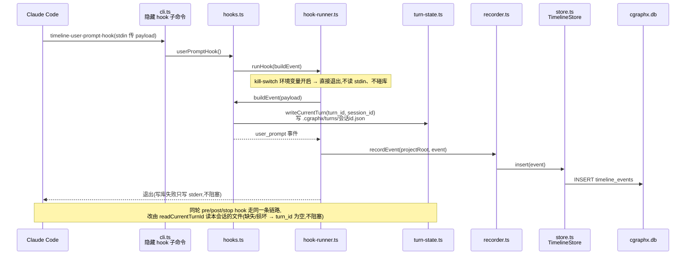
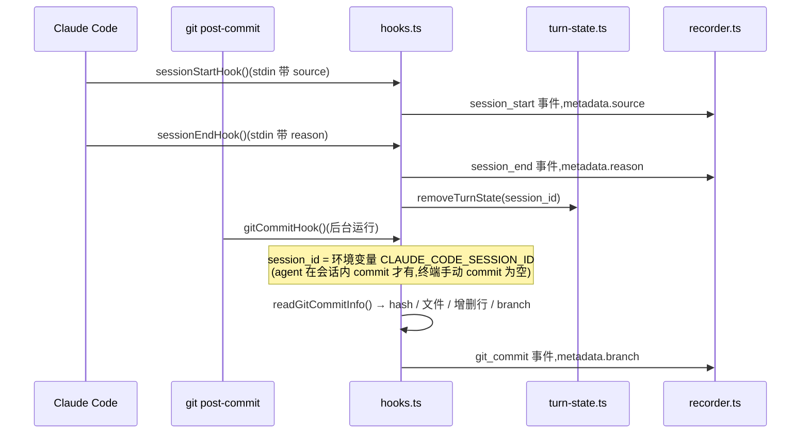
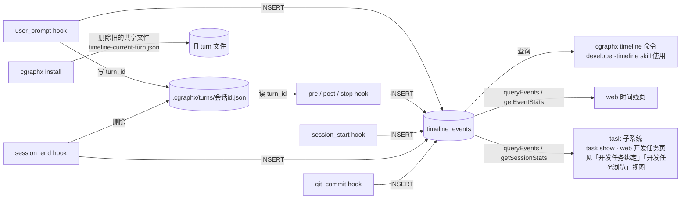

# 开发时间线记录 · 代码地图

> 派生视图:从代码生成,不手工修改。相关文件在 `source_commit` 之后有改动即视为过期,用 `/code-map-write` 重新生成。

## 一句话

Claude Code 的每个事件(会话开始/结束、提问、工具调用、一轮结束)和 git 提交,各触发一个短命 hook 进程,把事件写进 `timeline_events` 表。同一轮对话的多个 hook 进程靠「每个会话一个」的状态文件共享 `turn_id`。日报/周报、web 时间线页、`cgraphx task show` 与 web 开发任务页(后两者经 task 子系统)都只读这张表。

## 代码链路:一轮对话中的 user_prompt 事件

看什么:turn_id 在哪里生成、怎样经本会话自己的状态文件传给同一轮的其他 hook;任何失败都不阻塞 Claude Code。

## 代码链路:会话起止与 git 提交

看什么:session_end 写完事件后删掉本会话的 turn 文件;git 提交的 session_id 来自继承的环境变量,不来自 stdin。

## 数据流转

看什么:只有 hook 写表,读方都只读;turn 文件按会话隔离,只在同一会话同一轮的 hook 之间传值。

## 节点索引

| 节点 | 代码指针 | 来源 |
|---|---|---|
| hook 名单(唯一来源) | `src/core/timeline/constants.ts`:`HOOK_EVENTS_TO_COMMANDS`(6 个 Claude Code 事件)、`GIT_COMMIT_SUBCOMMAND` | AI 读代码 |
| 隐藏 hook 子命令 | `src/core/timeline/cli.ts`:`HOOK_HANDLERS` 遍历名单注册,另注册 `timeline-git-commit-hook` | AI 读代码 |
| userPromptHook / sessionStartHook / sessionEndHook / gitCommitHook | `src/core/timeline/hooks.ts` | AI 读代码 |
| readGitCommitInfo(含 branch) | `src/core/timeline/hooks.ts`:`readGitCommitInfo` | AI 读代码 |
| turn 状态文件 | `src/core/timeline/turn-state.ts`:`writeCurrentTurn` / `readCurrentTurnId` / `removeTurnState` / `safeSessionName` | AI 读代码 |
| runHook | `src/core/timeline/hook-runner.ts`:`runHook` | AI 读代码 |
| recordEvent | `src/core/timeline/recorder.ts`:`recordEvent` | AI 读代码 |
| TimelineStore.insert | `src/core/timeline/store.ts`:`TimelineStore.insert` | AI 读代码 |
| timeline_events | `src/core/timeline/schema.sql` | AI 读代码 |
| 清理旧 turn 文件 | `src/core/timeline/installer.ts`:`installTimelineHooks`(`LEGACY_TURN_STATE_FILENAME`) | AI 读代码 |
| web 时间线页 | `src/web/pages-timeline.ts`(调 core/timeline 门面 `queryEvents` / `getEventStats`) | AI 读代码 |
| 事件行 / 提交行模型(时间线页与开发任务页共用) | `src/web/timeline-event-rows.ts`:`toEventRow` / `toCommitRow` | AI 读代码 |

## 已知盲区

- pre_tool_use 只记录写类工具(白名单过滤),图中未展开过滤分支。
- git_commit hook 由 `cgraphx timeline install` / `cgraphx install` 接入 git 侧,接入路径未画。
- 会话没有正常结束时(崩溃、强杀),`.cgraphx/turns/` 下的文件不会被删除,目前没有清理机制。
- task 子系统读 `timeline_events` 的具体方式见 `flows/开发任务绑定.md`,本图只画到门面。
