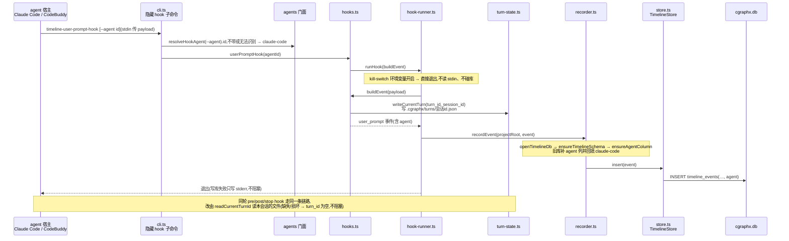
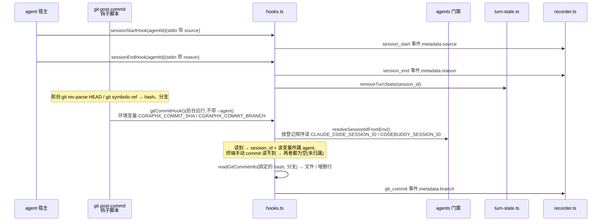
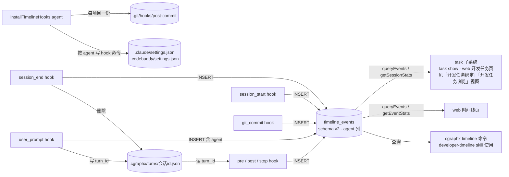

# 开发时间线记录 · 代码地图

> 派生视图:从代码生成,不手工修改。相关文件在 `source_commit` 之后有改动即视为过期,用 `/code-map-write` 重新生成。

## 一句话

两类事件会触发 hook,把一条记录写进 `timeline_events` 表:

- **agent 宿主的事件**:Claude Code 或 CodeBuddy 的会话开始 / 结束、提问、工具调用、一轮结束。
- **git 提交**:由项目的 post-commit 钩子触发。

每次触发都是一个短命的 hook 进程。几条关键规则:

- **来源 agent**:每条事件都记下自己来自哪个 agent。hook 命令带 `--agent` 时取该值,不带时视为 Claude Code。git 提交的来源,由读到的会话环境变量属于哪个 agent 推出。
- **turn_id 传递**:同一轮对话的多个 hook 进程,靠「每个会话一个」的状态文件共享 `turn_id`。
- **读方只读**:日报 / 周报、web 时间线页、`cgraphx task show` 与 web 开发任务页(后两者经 task 子系统)都只读这张表,读取输出不包含来源列。

## 代码链路:一轮对话中的 user_prompt 事件

看什么:

- `--agent` 在 cli 层被解析成 agentId,随事件写进库。
- turn_id 在 user_prompt hook 生成,经本会话自己的状态文件传给同一轮的其他 hook。
- 每次打开库都会补旧库缺的 agent 列。
- 任何失败都不阻塞宿主。

## 代码链路:会话起止与 git 提交

看什么:

- session_end 写完事件后,删掉本会话的 turn 文件。
- git 提交的 hash 与分支由钩子脚本在提交当下固定,经环境变量交给后台进程。
- git 提交的 session_id 和来源 agent 都来自继承的会话环境变量,不来自 stdin。

## 数据流转

看什么:

- 只有 hook 写表,读方都只读,读取输出不含 agent 列。
- turn 文件按会话隔离,只在同一会话同一轮的 hook 之间传值。
- 安装按 agent 写进各自的 settings,git 钩子每个项目只有一份。

## 节点索引

| 节点 | 代码指针 | 来源 |
|---|---|---|
| hook 名单(唯一来源) | `src/core/timeline/constants.ts`:`HOOK_EVENTS_TO_COMMANDS`(6 个宿主事件)、`GIT_COMMIT_SUBCOMMAND` | AI 读代码 |
| 隐藏 hook 子命令 | `src/core/timeline/cli.ts`:`HOOK_HANDLERS` 遍历名单注册,每个都接受 `--agent`;另注册 `timeline-git-commit-hook`(不带 `--agent`) | AI 读代码 |
| 安装命令的 agent 选择 | `src/core/timeline/cli.ts`:`selectAgents`(`-t` 走 `parseAgentList`,不给 `-t` 走 `selectInstalledAgents`)、`writeReports` | AI 读代码 |
| agent 差异 | `src/core/agents/index.ts`:`resolveHookAgent` / `resolveSessionIdFromEnv` / `hookCommand` / `agentSettingsPath` / `requireAgentProfile` | AI 读代码 |
| 各 hook 处理函数 | `src/core/timeline/hooks.ts`:`userPromptHook` / `preToolUseHook` / `postToolUseHook` / `stopHook` / `sessionStartHook` / `sessionEndHook`(都接收 agentId)、`gitCommitHook` | AI 读代码 |
| readGitCommitInfo(按固定 hash 读,含 branch) | `src/core/timeline/hooks.ts`:`readGitCommitInfo`。hash 只接受十六进制,否则退回读 HEAD | AI 读代码 |
| 提交当下固定 hash / 分支 | `src/core/timeline/installer.ts`:`buildGitPostCommitSnippet`。变量名定义在 `src/core/timeline/constants.ts`:`COMMIT_SHA_ENV` / `COMMIT_BRANCH_ENV` | AI 读代码 |
| turn 状态文件 | `src/core/timeline/turn-state.ts`:`writeCurrentTurn` / `readCurrentTurnId` / `removeTurnState` / `safeSessionName` | AI 读代码 |
| runHook | `src/core/timeline/hook-runner.ts`:`runHook` | AI 读代码 |
| recordEvent | `src/core/timeline/recorder.ts`:`recordEvent` | AI 读代码 |
| TimelineStore.insert | `src/core/timeline/store.ts`:`TimelineStore.insert`(写 agent)、`rowToEvent`(读取侧不映射 agent) | AI 读代码 |
| timeline_events 与迁移 | `src/core/timeline/schema.sql`(含版本行 2);`src/core/timeline/schema-bootstrap.ts`:`openTimelineDb` / `ensureTimelineSchema` / `ensureAgentColumn`(读写两侧打开库时都会执行) | AI 读代码 |
| hook 安装 | `src/core/timeline/installer.ts`:`installTimelineHooks(root, { agent })` / `uninstallTimelineHooks(root, { agent, keepGitHook })`。旧 turn 文件清理、旧版 post-commit 片段升级(`stripTimelineGitHook`)也在这里 | AI 读代码 |
| web 时间线页 | `src/web/pages-timeline.ts`(调 core/timeline 门面 `queryEvents` / `getEventStats`) | AI 读代码 |
| 事件行 / 提交行模型(时间线页与开发任务页共用) | `src/web/timeline-event-rows.ts`:`toEventRow` / `toCommitRow` | AI 读代码 |

## 已知盲区

- pre_tool_use 只记录写类工具(白名单过滤),图中没有展开过滤分支。
- git_commit 钩子由 `cgraphx timeline install` / `cgraphx install` 接入 git 侧,接入路径没有画。完整安装链路见 `flows/多agent安装.md`。
- git_commit 事件的 `ts` 是记录进程写库的时间,不是提交时间;连续提交时,写库顺序可能与提交顺序不同。
- 合并提交不触发 post-commit,不产生 git_commit 事件。
- 会话没有正常结束时(崩溃、强杀),`.cgraphx/turns/` 下的文件不会被删除,目前没有清理机制。
- 在 CodeBuddy 的 `-p` 非交互模式里实测,只看到 session_start 和 stop,没看到 session_end。交互模式下的 SessionEnd 还没有实测。
- task 子系统读 `timeline_events` 的具体方式见 `flows/开发任务绑定.md`,本图只画到门面。
