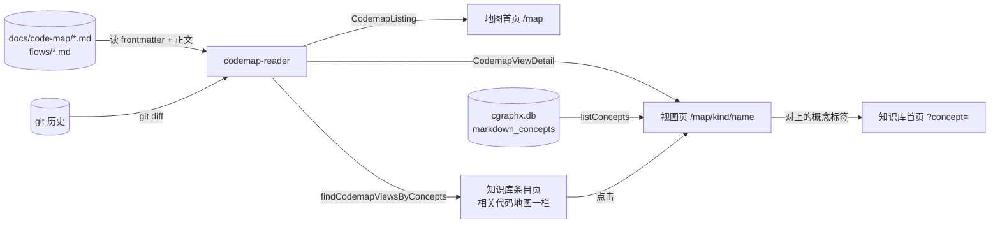

# 系统地图浏览 · 代码地图

> 派生视图:从代码生成,不手工修改。相关文件在 `source_commit` 之后有改动即视为过期,用 `/code-map-write` 重新生成。

## 一句话

浏览器打开 `/map/flow/<流程名>` 时,web 现读 `docs/code-map/` 下的视图文件、现跑 `git diff` 判断是否过期、查知识库索引判断概念能否点击,输出带 mermaid 原文的页面;浏览器再按需从 jsDelivr 加载画图组件把原文画成图,加载不到就保留原文。知识库条目页反过来按概念列出相关视图。

## 代码链路:打开一个流程视图

看什么:名字非法和视图不存在都在路由层出 404;过期判定在服务端每次请求现算;图在浏览器里画,服务端只给原文。

```mermaid
sequenceDiagram
  participant B as 浏览器
  participant S as server.ts<br/>handleCodemap
  participant P as pages-codemap.ts
  participant R as codemap-reader.ts
  participant G as 本机 git
  participant Q as MarkdownQuery
  participant T as codemap-templates.ts
  participant JS as app.js
  participant CDN as jsDelivr

  B->>S: GET /map/flow/<name>
  alt 解码失败或 isSafeCodemapName 不通过
    S-->>B: 404(sendNotFound)
  else 名字合法
    S->>P: renderCodemapViewPage(db, projectRoot, 'flow', name)
    P->>R: readCodemapView()
    R->>G: git diff --name-only <source_commit> HEAD -- <related_code>
    G-->>R: 改动文件 / 失败 → unknown
    R-->>P: CodemapViewDetail | null
    alt null(不存在 / 头部无法解析)
      P-->>S: { status: 404 }
      S-->>B: 404(sendNotFound)
    else 命中
      P->>Q: listConcepts() → 可点击概念集合
      P->>T: renderCodemapViewContent(detail, 概念集合)
      T-->>P: HTML(data-codemap + code.language-mermaid 原文)
      P-->>S: { status: 200, html }
      S-->>B: 200 HTML
      B->>JS: 发现 [data-codemap] 中的 mermaid 块
      JS->>CDN: 加载 mermaid@11.4.1
      alt 加载失败
        JS-->>B: 保留原文 + 「未联网」提示
      else 加载成功
        JS-->>B: 逐块 render 成 SVG;单块失败 → 保留原文 + 「写法有误」
      end
    end
  end
```

## 数据流转

看什么:整条链路只读——视图文件、git 历史、知识库索引都只被读取;两个方向的跳转都靠视图 `concepts` 与知识库概念名完全一致。



## 节点索引

| 节点 | 代码指针 | 来源 |
|---|---|---|
| /map 路由组 | `src/web/server.ts`:`handleCodemap` | AI 读代码 |
| 侧栏「系统地图」入口 | `src/web/layout.ts`:`renderShellPage` 中 `navItem('系统地图', …)` | AI 读代码 |
| 页面入口 | `src/web/pages-codemap.ts`:`renderCodemapHomePage` / `renderCodemapViewPage` | AI 读代码 |
| 视图读取 + 过期判定 | `src/web/codemap-reader.ts`:`listCodemapViews` / `readCodemapView` / `checkStale` / `isSafeCodemapName` | AI 读代码 |
| 按概念反查 | `src/web/codemap-reader.ts`:`findCodemapViewsByConcepts` | AI 读代码 |
| HTML 模板 | `src/web/codemap-templates.ts`:`renderCodemapHomeContent` / `renderCodemapViewContent` / `renderRelatedCodemapSection` | AI 读代码 |
| 正文渲染 | `src/web/markdown.ts`:`renderMarkdownBody` | AI 读代码 |
| 概念名查询 | `src/core/markdown/query.ts`:`MarkdownQuery.listConcepts` | AI 读代码 |
| 知识库条目页反向一栏 | `src/web/pages-detail.ts`:`renderDetailPage` | AI 读代码 |
| 浏览器端绘制 | `src/web/public/app.js`:`MERMAID_SRC` 与第 3 段绘制逻辑 | AI 读代码 |

## 已知盲区

- 地图首页的链路(`renderCodemapHomePage` → `listCodemapViews` → 逐视图 `git diff`)与视图页相同的部分未单独画图。
- mermaid 组件内部的渲染过程不在本仓库,图中只画到 `render` 调用。
