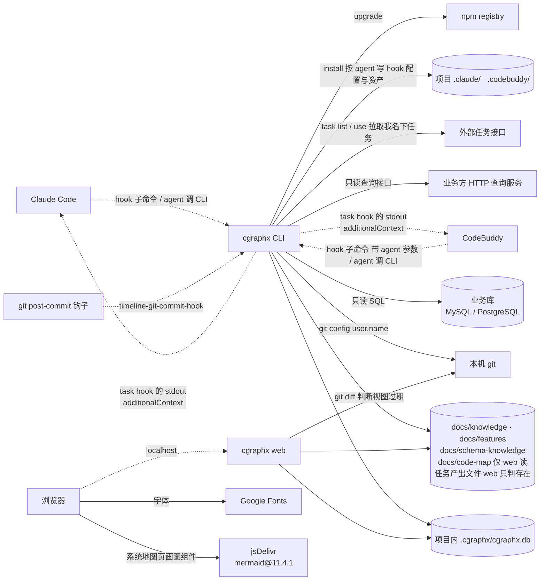

# 系统交互 · 代码地图

> 派生视图:从代码生成,不手工修改。相关文件在 `source_commit` 之后有改动即视为过期,用 `/code-map-write` 重新生成。

## 一句话

cgraphx 由本地 CLI 和本地 web 组成。

**谁调用它**:

- agent 宿主,目前是 Claude Code 和 CodeBuddy。通过 hook 调用:timeline 记录事件、task 回传上下文;agent 也会直接调用 CLI。
- git 的 post-commit 钩子。

**它读写什么**:

- 项目内的 SQLite 和 markdown 文件;
- 各 agent 自己的配置目录;
- 本机 git,只读调用。

**对外只有五类连接**:

1. 只读查业务库;
2. 经 HTTP 只读查询接口查库;
3. 拉取外部任务接口;
4. npm 自更新;
5. 浏览器从公网加载字体和画图组件。

## 交互图

看什么:

- 实线是本仓库代码发起的调用,虚线是外部系统调用 cgraphx。
- 两个 agent 宿主走同一套 hook 子命令。CodeBuddy 的命令带 `--agent codebuddy`,Claude Code 的命令不带。
- 业务库、npm、CDN 在本机之外,其余全部在本机。

## 节点索引

| 连接 | 代码指针 | 来源 |
|---|---|---|
| agent 宿主 → hook 子命令 | `src/core/timeline/cli.ts`:6 个宿主事件的隐藏子命令,按 `HOOK_EVENTS_TO_COMMANDS` 注册;`src/core/task/cli.ts`:`task-session-start-hook` / `task-post-tool-use-hook`。两处都接受 `--agent`,由 `src/core/agents/index.ts`:`resolveHookAgent` 解析,不带时视为 Claude Code | AI 读代码 |
| task hook → agent 宿主(回传上下文) | `src/core/task/hooks.ts`:`writeAdditionalContext`。Claude Code 与 CodeBuddy 都接受同一格式,CodeBuddy 2.167.0 已实测 | AI 读代码 |
| git post-commit 钩子 → CLI | `src/core/timeline/installer.ts`:`buildGitPostCommitSnippet` 写入 `.git/hooks/post-commit`。钩子在提交当下取 hash / 分支,经 `CGRAPHX_COMMIT_SHA` / `CGRAPHX_COMMIT_BRANCH` 在后台调用 `cgraphx timeline-git-commit-hook`。会话 id 与来源 agent 取自继承的会话环境变量(`src/core/timeline/hooks.ts`:`gitCommitHook` → `resolveSessionIdFromEnv`) | AI 读代码 |
| CLI / web → SQLite | `src/core/db/sqlite-adapter.ts`。web 读 task 表时走只读打开 `src/core/task/schema-bootstrap.ts`:`openTaskDbReadOnly`,不建表 | AI 读代码 |
| web → 项目文件(开发任务页产出 / 参考) | `src/core/task/artifacts.ts`:`collectOutputs` / `collectReferences`,只 `statSync`,不读内容 | AI 读代码 |
| CLI → 本机 git | `src/core/features/sync.ts`:`gitUserName` | AI 读代码 |
| web → 本机 git | `src/web/codemap-reader.ts`:`checkStale` | AI 读代码 |
| CLI → 业务库 | `src/core/dbquery/drivers/mysql.ts`、`postgres.ts` | AI 读代码 |
| CLI → HTTP 查询服务 | `src/core/dbquery/drivers/http.ts` | AI 读代码 |
| 浏览器 → web | `src/web/server.ts`,仅监听回环地址 | AI 读代码 |
| 浏览器 → Google Fonts | `src/web/layout.ts`:`renderShellPage` 里的字体 `<link>` | AI 读代码 |
| 浏览器 → jsDelivr | `src/web/public/app.js`:`MERMAID_SRC`,仅在 `[data-codemap]` 页面加载 | AI 读代码 |
| CLI → 外部任务接口 | `src/core/task/source.ts`:`fetchRemoteTasks`,GET 请求,10 秒超时 | AI 读代码 |
| CLI → 项目 agent 配置目录 | `src/cli/installer/index.ts` → `src/cli/installer/agent-steps.ts`。target 由 `src/cli/installer/targets/agent-target.ts`:`createAgentTarget` 按 `src/core/agents/profiles.ts` 的描述生成;hook 由 `src/core/task/installer.ts`:`installTaskHooks` 与 timeline installer 写入 | AI 读代码 |
| CLI → npm | `src/cli/upgrade/index.ts` | AI 读代码 |

## 已知盲区

- 业务库与 HTTP 查询服务的地址来自目标项目的 `.cgraphx/db-profiles.json`,外部任务接口的地址来自 `.cgraphx/task-source.json`,都是运行时配置,图中不列实例。
- 外部任务接口只在 `cgraphx task` 命令里调用,hook 进程内不发网络请求。
- 安装与卸载的完整链路见 `flows/多agent安装.md`。
- 两种调用解析 `cgraphx` 的方式不同,版本可能不一致:
  - agent 在 Bash 工具里调用 CLI:Bash 会先加载用户的 shell 配置,用的是配置后 PATH 上的 `cgraphx`。
  - hook 进程:继承宿主进程自己的 PATH。
  - CodeBuddy 2.167.0 实测中,这两种 PATH 不一致。
