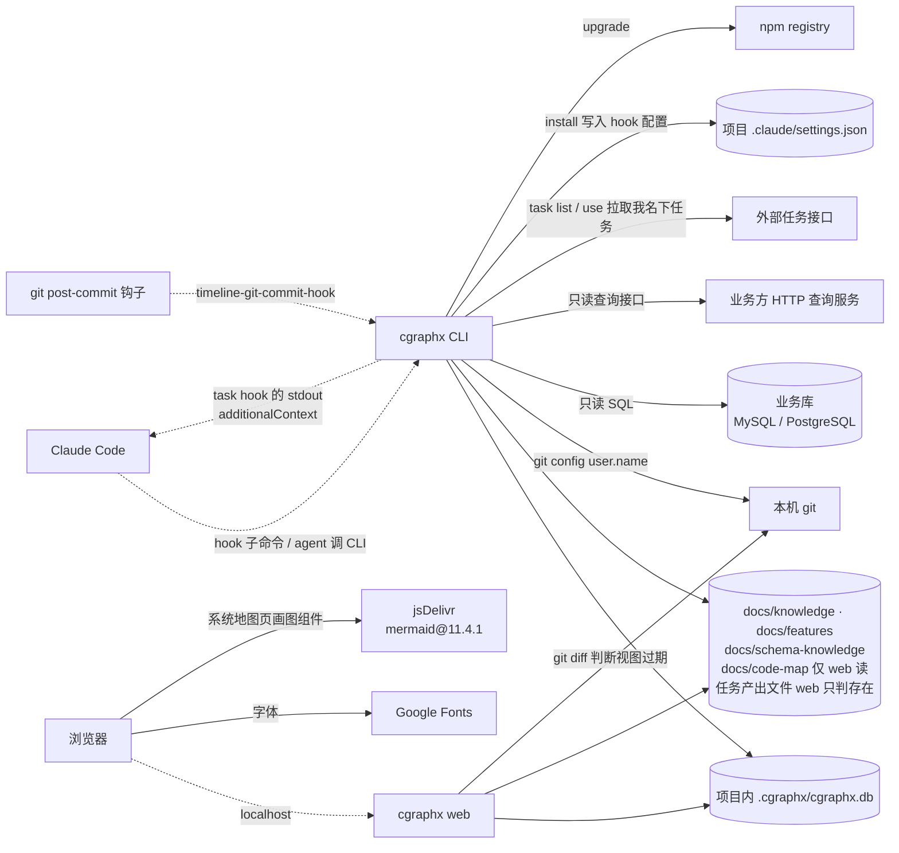

# 系统交互 · 代码地图

> 派生视图:从代码生成,不手工修改。相关文件在 `source_commit` 之后有改动即视为过期,用 `/code-map-write` 重新生成。

## 一句话

cgraphx 是本地 CLI + 本地 web:被 Claude Code 的 hook(timeline 记录事件、task 回传上下文)、git 的 post-commit 钩子和 agent 调用,读写项目内的 SQLite 与 markdown 文件,并只读调用本机 git;对外只有五类连接——只读查业务库、经 HTTP 只读查询接口查库、拉取外部任务接口、npm 自更新,以及浏览器从公网加载字体和画图组件。

## 交互图

看什么:实线是本仓库代码发起的调用,虚线是外部系统调用 cgraphx;业务库、npm、CDN 在本机之外,其余全部在本机。

## 节点索引

| 连接 | 代码指针 | 来源 |
|---|---|---|
| Claude Code → hook 子命令 | `src/core/timeline/cli.ts`(6 个 Claude Code 事件的隐藏子命令,按 `HOOK_EVENTS_TO_COMMANDS` 注册);`src/core/task/cli.ts`(`task-session-start-hook` / `task-post-tool-use-hook`) | AI 读代码 |
| task hook → Claude Code(回传上下文) | `src/core/task/hooks.ts`:`writeAdditionalContext` | AI 读代码 |
| git post-commit 钩子 → CLI | `src/core/timeline/installer.ts`:写入 `.git/hooks/post-commit`,调用 `cgraphx timeline-git-commit-hook`;会话 id 取继承的 `CLAUDE_CODE_SESSION_ID`(`src/core/timeline/hooks.ts`:`gitCommitHook`) | AI 读代码 |
| CLI / web → SQLite | `src/core/db/sqlite-adapter.ts`;web 读 task 表走只读打开 `src/core/task/schema-bootstrap.ts`:`openTaskDbReadOnly`(不建表) | AI 读代码 |
| web → 项目文件(开发任务页产出 / 参考) | `src/core/task/artifacts.ts`:`collectOutputs` / `collectReferences`(只 `statSync`,不读内容) | AI 读代码 |
| CLI → 本机 git | `src/core/features/sync.ts`:`gitUserName` | AI 读代码 |
| web → 本机 git | `src/web/codemap-reader.ts`:`checkStale` | AI 读代码 |
| CLI → 业务库 | `src/core/dbquery/drivers/mysql.ts`、`postgres.ts` | AI 读代码 |
| CLI → HTTP 查询服务 | `src/core/dbquery/drivers/http.ts` | AI 读代码 |
| 浏览器 → web | `src/web/server.ts`(仅回环地址) | AI 读代码 |
| 浏览器 → Google Fonts | `src/web/layout.ts`:`renderShellPage` 的字体 `<link>` | AI 读代码 |
| 浏览器 → jsDelivr | `src/web/public/app.js`:`MERMAID_SRC`(仅 `[data-codemap]` 页面加载) | AI 读代码 |
| CLI → 外部任务接口 | `src/core/task/source.ts`:`fetchRemoteTasks`(GET,10 秒超时) | AI 读代码 |
| CLI → 项目 .claude/settings.json | `src/cli/installer/index.ts` 调 `src/core/task/installer.ts`:`installTaskHooks` 与 timeline installer | AI 读代码 |
| CLI → npm | `src/cli/upgrade/index.ts` | AI 读代码 |

## 已知盲区

- 业务库与 HTTP 查询服务的具体地址来自目标项目的 `.cgraphx/db-profiles.json`,外部任务接口地址来自 `.cgraphx/task-source.json`,都属运行时配置,图中不列实例。
- 外部任务接口只在 `cgraphx task` 命令里调用;hook 进程内不发网络请求。
- `cgraphx install` 向目标项目 `.claude/` 部署 skill 资产属本地文件写入,图中未画。
