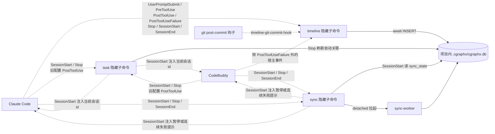
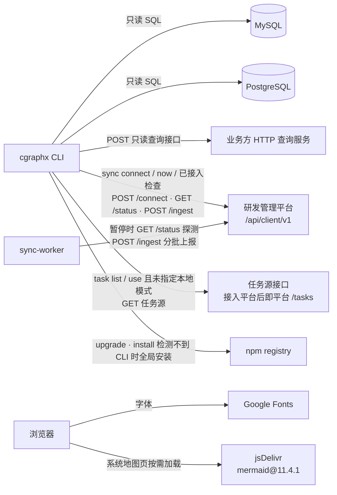

# 系统交互 · 代码地图

> 派生视图:从代码生成,不手工修改。相关文件在 `source_commit` 之后有改动即视为过期,用 `/code-map-write` 重新生成。

## 一句话

cgraphx 由本地 CLI 和本地只读 web 组成。

**谁调用它:**

- agent 宿主,目前是 Claude Code 和 CodeBuddy。宿主通过 hook 调用:timeline 记录事件,task 在 Stop 时刷新自动关联,sync 拉起后台同步进程。agent 也会直接调用 CLI。
- git 的 post-commit 钩子。
- 浏览器访问本机回环地址上的 web 服务。

**它读写什么:**

- 项目内的 SQLite(`.cgraphx/cgraphx.db`)和 markdown 文件;
- 项目级 agent 配置目录(`.claude/`、`.codebuddy/`),以及用户级 skills 目录的只读探测;
- 本机 git,既有只读查询,也在 `install` 时写入 post-commit 钩子。

**对外连接:**

1. 只读查业务库(MySQL / PostgreSQL);
2. 经 HTTP 只读查询接口查库;
3. 研发管理平台:接入、状态探测、分批上报。客户端协议前缀为 `/api/client/v1`,协议 1.1 增加任务键与任务声明;
4. 任务源接口:接入平台后就是平台的 `/api/client/v1/tasks`;
5. npm 自更新与缺失 CLI 时的全局安装;
6. 浏览器从公网加载字体和画图组件。

## 图 1:本机调用拓扑

看什么:实线是本仓库代码发起的调用,虚线是外部系统调用 cgraphx。两个 agent 宿主走同一套 hook 子命令,CodeBuddy 的命令带 `--agent codebuddy`。网络请求不由 hook 进程发出,sync hook 只拉起脱离的 `sync-worker`。

```mermaid
flowchart LR
  cc[Claude Code] -. hook 子命令 / agent 调 CLI .-> cli[cgraphx CLI]
  cb[CodeBuddy] -. hook 子命令带 agent 参数 / agent 调 CLI .-> cli
  gh[git post-commit 钩子] -. timeline-git-commit-hook .-> cli
  cli -. SessionStart additionalContext .-> cc
  cli -. SessionStart additionalContext .-> cb
  cli -- sync hook / connect 拉起 detached 进程 --> worker[sync-worker]
  browser[浏览器] -. 127.0.0.1 回环 .-> web[cgraphx web]
  cli -- 读写 · install 建 schema --> sqlite[(项目内 .cgraphx/cgraphx.db)]
  worker -- 读写同步状态与任务映射 --> sqlite
  web -- 只读 --> sqlite
  cli -- 读写 --> files[(docs/knowledge · docs/features<br/>docs/schema-knowledge · docs/code-map<br/>任务产出文件)]
  web -- 读 · 产物只判存在 --> files
  worker -- 读需求目录 --> files
  cli -- git config / 读提交信息 / 写 post-commit --> git[本机 git]
  worker -- remote get-url / branch 远程包含<br/>show / ls-files --> git
  web -- git diff 判断视图是否过期 --> git
  cli -- 安装资产与 hook 配置 --> agentcfg[项目级 .claude 与 .codebuddy]
  worker -- 读 skills 目录判断斜杠命令 --> agentcfg
```

## 图 2:hook 触发面

看什么:宿主事件到隐藏子命令的分发,以及哪个 hook 会向宿主 stdout 写 `additionalContext`。所有 hook 退出码恒为 0,sync hook 不发网络请求。



## 图 3:对外网络连接

看什么:只有 CLI、sync-worker 和浏览器发网络请求。数据库、平台与任务源在项目外,其余是本机资源。hook 进程不建连。



## 协议 1.1 对交互的影响

- `/connect` 响应里的 `protocolVersion` 写入 `sync_state.status.serverProtocolVersion`;`/ingest` 响应同样解析 `protocolVersion` 并回写。
- 只有 `serverProtocolVersion === '1.1'` 时才按任务键协议构造上报:绑定段携带 `taskKey`,请求携带 `taskDeclarations`。
- `/ingest` 响应里的 `taskKeys`(任务键 → 平台任务 id)由 runner 写回本地 `task_feature_tasks.platform_task_id`,不是新端点。
- 以上都是同一条平台连接上的载荷变化,不增加服务之间的调用边。

## 节点索引

| 图 | 连接或节点 | 代码指针 | 来源 |
|---|---|---|---|
| 1 | 宿主 → hook 子命令 / CLI | `src/cli/index.ts` 是各子系统 `register*Commands` 的组装入口;`src/core/timeline/cli.ts`:按 `src/core/timeline/constants.ts`:`HOOK_EVENTS_TO_COMMANDS` 注册 7 个事件与 `timeline-git-commit-hook`;`src/core/task/cli.ts`:`task-session-start-hook` / `task-stop-hook` / 兼容 `task-post-tool-use-hook`;`src/core/sync/cli.ts`:`sync-session-start-hook` / `sync-stop-hook` / `sync-worker`。宿主差异见 `src/core/agents/profiles.ts`:`AGENT_PROFILES`,`--agent` 由 `src/core/agents/index.ts`:`resolveHookAgent` 解析 | AI 读代码 |
| 1 | CLI → 宿主 additionalContext | `src/core/task/hooks.ts`:`writeAdditionalContext`(SessionStart);`src/core/sync/hooks.ts`:`syncSessionStartHook`(仅暂停或连续失败) | AI 读代码 |
| 1 | git post-commit → CLI | `src/core/timeline/installer.ts`:`buildGitPostCommitSnippet`。钩子在提交当下取 hash / 分支,经 `CGRAPHX_COMMIT_SHA` / `CGRAPHX_COMMIT_BRANCH` 在后台调用 `cgraphx timeline-git-commit-hook`,会话 id 由 `src/core/timeline/hooks.ts`:`gitCommitHook` 从会话环境变量解析 | AI 读代码 |
| 1 | CLI → sync-worker | `src/core/sync/cli.ts`:`sync connect` 成功后调用 `src/core/sync/spawn.ts`:`spawnSyncWorker`;`src/core/sync/hooks.ts`:`triggerWorker` 节流后同样拉起 detached worker | AI 读代码 |
| 1 | 浏览器 → web | `src/web/server.ts`:`startWebServer`,仅绑定 `127.0.0.1` | AI 读代码 |
| 1 | CLI / worker / web → SQLite | `src/core/db/index.ts`:`DatabaseConnection.open` 与 `src/core/db/sqlite-adapter.ts`:`createDatabase`;web 启动预检 `src/web/bootstrap.ts`:`openVerifiedConnection`;sync 经 `src/core/sync/schema-bootstrap.ts`:`openSyncDb`;web 任务页经 `src/core/task/schema-bootstrap.ts`:`openTaskDbReadOnly` 只读打开 | AI 读代码 |
| 1 | CLI → 项目文件 | `src/core/markdown/indexer.ts` 索引 `docs/knowledge/`;`src/core/features/cli.ts` 扫描 `docs/features/`;`src/core/features/sync.ts`:`syncMyFeatures` 写 `.cgraphx/my-features.md` | AI 读代码 |
| 1 | worker → 项目文件 | `src/core/task/auto-binding.ts`:`refreshAutoBindings` 读 `docs/features/` 派生的需求目录;`src/core/sync/payload.ts`:`createSyncContext` / `taskDeclarationsFor` 读任务声明 | AI 读代码 |
| 1 | web → 项目文件 | `src/web/schema-reader.ts` 读 `docs/schema-knowledge/`;`src/web/codemap-reader.ts` 读 `docs/code-map/`;`src/web/pages-tasks.ts` → `src/core/task/report.ts` 与 `src/core/task/artifacts.ts`:`collectOutputs` / `collectReferences`,任务产物只 `stat` 判存在 | AI 读代码 |
| 1 | CLI → 本机 git | `src/core/features/sync.ts`:`gitUserName`;`src/core/sync/git.ts`:`getOriginUrl` / `getRepoToplevel`;`src/core/timeline/installer.ts`:`findGitRoot` 并写 `.git/hooks/post-commit`;`src/core/timeline/hooks.ts`:`readGitCommitInfo` | AI 读代码 |
| 1 | worker → 本机 git | `src/core/sync/git.ts`:`createGitCache`(`branch -r --contains` / `show` / `ls-files`);`src/core/sync/payload.ts`:`createSyncContext` 读 origin 与仓库根 | AI 读代码 |
| 1 | web → 本机 git | `src/web/codemap-reader.ts`:`checkStale`,只调 `git diff --name-only` | AI 读代码 |
| 1 | CLI → agent 配置目录 | `src/cli/installer/index.ts` → `src/cli/installer/agent-steps.ts`:`installAgentTargets` / `installAgentHooks`;settings 写入由 `src/cli/installer/targets/agent-target.ts`、`src/core/timeline/installer.ts`、`src/core/task/installer.ts`、`src/core/sync/installer.ts` 完成;路径与命令由 `src/core/agents/index.ts`:`agentSettingsPath` / `hookCommand` 生成 | AI 读代码 |
| 1 | worker → agent 配置目录 | `src/core/sync/payload.ts`:`createSyncContext` 收集项目级与用户级 `<configDir>/skills` 判断斜杠命令 | AI 读代码 |
| 2 | timeline hook → SQLite | `src/core/timeline/cli.ts` → `src/core/timeline/hooks.ts`;每个处理器经 `src/core/timeline/hook-runner.ts`:`runHook` await `src/core/timeline/recorder.ts`:`recordEvent` | AI 读代码 |
| 2 | task hook → SQLite | `src/core/task/hooks.ts`:`taskStopHook` → `src/core/task/auto-binding.ts`:`refreshAutoBindings`,首轮全量、之后只刷新当前会话 | AI 读代码 |
| 2 | sync hook → SQLite | `src/core/sync/hooks.ts`:`syncSessionStartHook` → `readStatus` → `openSyncDb` / `getStatus`,只读 `sync_state` | AI 读代码 |
| 2 | sync hook → sync-worker | `src/core/sync/hooks.ts`:`triggerWorker` → `src/core/sync/spawn.ts`:`spawnSyncWorker`,stdio ignore 后立即返回 | AI 读代码 |
| 3 | CLI → MySQL | `src/core/dbquery/drivers/mysql.ts`:`createMysqlConnection`,短连接、无连接池。只读约束由 `src/core/dbquery/safety.ts`:`checkSafety` 统一校验 | AI 读代码 |
| 3 | CLI → PostgreSQL | `src/core/dbquery/drivers/postgres.ts`:`createPostgresConnection`,短连接、`statement_timeout` | AI 读代码 |
| 3 | CLI → HTTP 查询服务 | `src/core/dbquery/drivers/http.ts`:`createHttpConnection`,POST `mode=query` / schema 请求 | AI 读代码 |
| 3 | CLI → 研发管理平台 | `src/core/sync/connection.ts`:`connectPlatform` / `readConnection`;`src/core/sync/client.ts`:`postConnect` 解析 `protocolVersion`,`getStatus` 读 `/status`;前台 `sync now` 经 `src/core/sync/runner.ts` 上报 | AI 读代码 |
| 3 | worker → 研发管理平台 | `src/core/sync/runner.ts`:`runSync` / `runWorker`;`src/core/sync/client.ts`:`getStatus` 探测、`postIngest` 分批上报并解析 `protocolVersion` / `taskKeys` | AI 读代码 |
| 3 | 平台回执 → 本地任务映射 | `src/core/sync/runner.ts`:`sendBatch` → `src/core/task/feature-task.ts`:`recordFeatureTaskMappings`;允许携带任务键的判定来自 `src/core/sync/types.ts`:`TASK_KEY_PROTOCOL_VERSION` 与 `src/core/sync/payload.ts`:`toIngestBinding` / `taskDeclarationsFor` | AI 读代码 |
| 3 | CLI → 任务源接口 | `src/core/task/source.ts`:`fetchRemoteTasks`,GET、10 秒超时;调用方 `src/core/task/resolve.ts`:`listTasks` / `resolveTaskForUse`;接入平台时由 `src/core/sync/connection.ts`:`connectLocked` 经 `writeTaskSourceConfig` 写入平台 `/tasks` 地址与 Bearer 头 | AI 读代码 |
| 3 | CLI → npm | `src/cli/upgrade/index.ts`:`resolveLatestVersion` / `defaultRun`(`npm view` / `npm install -g`);`src/cli/installer/index.ts`:交互安装且 PATH 上无 cgraphx 时执行 `npm install -g` | AI 读代码 |
| 3 | 浏览器 → Google Fonts | `src/web/layout.ts`:`renderShellPage` 输出的字体 `<link>` | AI 读代码 |
| 3 | 浏览器 → jsDelivr | `src/web/public/app.js`:`MERMAID_SRC`,仅在 `[data-codemap]` 页面加载 | AI 读代码 |

## 已知盲区

- 业务库、HTTP 查询服务、任务源接口和研发管理平台的地址都是运行时配置,分别来自 `.cgraphx/db-profiles.json`、`.cgraphx/task-source.json` 和 `sync connect --server`,图中不列具体实例。
- hook 进程内不发网络请求。外部任务接口只在 `cgraphx task list` / `task use` 调用;平台请求只在 `cgraphx sync` 命令和 `sync-worker` 里发;web 任务页只读本地 task 表与文件,不请求任务源。
- `cgraphx report` 命令组只读写本地文件,没有对外连接,所以图中没画。
- 平台侧如何处理 `/connect`、`/tasks`、`/ingest` 和 `protocolVersion` / `taskKeys` 回执,不在本仓库;上报链路见 `docs/code-map/flows/平台上报.md`。
- CodeBuddy 没有 PostToolUseFailure,安装器按 `AgentProfile.capabilities` 跳过该事件;其余宿主 hook 行为按 `src/core/agents/profiles.ts` 的登记,未在图中区分更多宿主版本差异。
- task / sync hook 写 `hookSpecificOutput.additionalContext` 的代码对两个宿主一视同仁,但 CodeBuddy 是否消费该输出属宿主契约,本仓库内没有验证。
- `cgraphx` 有两种调用方式,解析到的可执行文件不同,版本可能不一致:
  - agent 在 Bash 工具里调用 CLI 时,用的是加载 shell 配置之后 PATH 上的 `cgraphx`。
  - hook 进程直接继承宿主进程的 PATH。
  - sync hook 命令带 `2>/dev/null || true`,即使命中旧版二进制,也不会出现错误输出。
