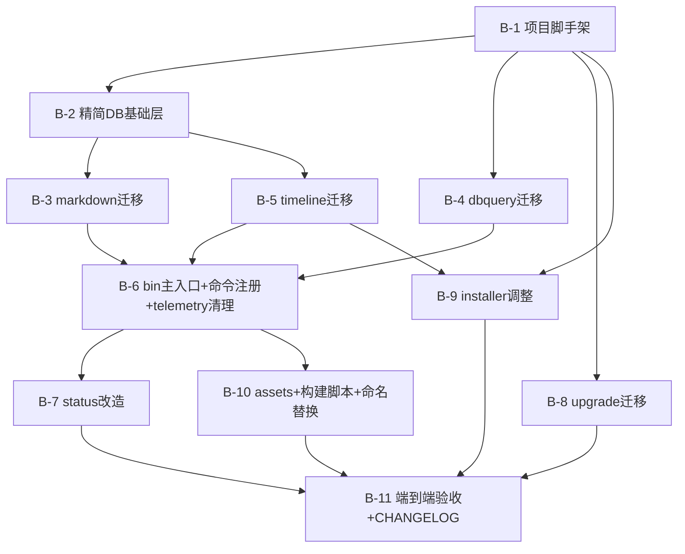

# 实现计划: cgraphx2.0重构
> feature-id: 2026-07-25-cgraphx2.0重构
> 状态: 草稿
> 日期: 2026-07-25
> 来源 spec: `../cgraphx2.0重构-spec.md`
> 复用源码: `/Users/smdnk/objects/ai/codegraph`(cgraphx 1.4.7)
> 新项目根: `/Users/smdnk/objects/ai/cgraphx`

## 目标与范围摘要

把 codegraph(cgraphx 1.x 源码)重构为 **cgraphx 2.0**:单包 + `src` 内分层,砍代码图谱 + 砍 MCP,复用 docs/markdown、dbquery、timeline 三块业务逻辑,精简 SQLite 基础层,CLI 挂载 2.0 命令集,installer 去 MCP。手动重构(非从零重写),三块语义不回归。

详细任务见 `cgraphx2.0重构-02-backend.md`。

## 明确不包含(本计划不做)

- 代码图谱(graph/extraction/search/sync/reasoning/resolution/context)—— 砍
- MCP server(`mcp/` 整体)—— 砍
- Web 前端 —— 后续阶段(MVP 只留 `src/web/` 空骨架)
- **skill 内容优化**(每个 skill 保留/改写/废弃)—— 延后到重构完成后的独立任务;本计划只保证 skill 源随程序分发(`assets/claude-template/` 结构完整迁移)
- telemetry 模块 —— 砍

## 计划文件列表

| 文件 | 状态 |
|---|---|
| `cgraphx2.0重构-index.md` | 本文件(总控) |
| `cgraphx2.0重构-02-backend.md` | ✅ 核心实现任务(B-1 ~ B-11) |
| `01-schema.md` | 不涉及:无新建 schema,markdown/timeline schema 沿用,精简 DB 基础层并入 B-2 |
| `03-frontend.md` | 不涉及:Web 是后续阶段,MVP 不做 |
| `04-test.md` | 不涉及:测试并入各实现任务(B-3/B-4/B-5 各自带测试迁移),端到端验收在 B-11 |

## 总任务清单

| 编号 | 任务 | 域 | 依赖 |
|---|---|---|---|
| B-1 | 项目脚手架(单包 + src 分层 + package.json/tsconfig) | 构建基础 | — |
| B-2 | 精简 DB 基础层(src/core/db,去图谱 schema) | core | B-1 |
| B-3 | markdown 迁移 + 测试(src/core/markdown) | core | B-2 |
| B-4 | dbquery 迁移 + 测试(src/core/dbquery) | core | B-1 |
| B-5 | timeline 迁移 + 测试(src/core/timeline) | core | B-2 |
| B-6 | bin 主入口 + 命令注册 + telemetry 清理(src/cli) | cli | B-3, B-4, B-5 |
| B-7 | status 改造(查三块状态) | cli | B-6 |
| B-8 | upgrade 迁移(src/cli/upgrade) | cli | B-1 |
| B-9 | installer 调整(去 MCP,部署 assets + timeline hooks) | cli | B-1, B-5 |
| B-10 | assets 迁移 + 构建脚本(copy-assets)+ 命名替换 | 构建/资产 | B-6 |
| B-11 | 端到端验收 + CHANGELOG breaking | 验收 | 全部 |

## 全局依赖图

## 推荐执行顺序

1. **B-1**(脚手架)—— 一切起点
2. **B-2、B-4、B-8 并行**(都只依赖 B-1,不同模块目录,无冲突)
3. **B-3、B-5 并行**(依赖 B-2,markdown vs timeline 目录不重叠);B-9 可在此批起步(依赖 B-1,但需 B-5 的 timeline installer 协作点,见 B-9 注意事项)
4. **B-6**(依赖三模块迁移完成)
5. **B-7、B-10 并行**(都依赖 B-6)
6. **B-11**(全部完成后整体验收)

## 可并行任务批次

| 批次 | 任务 | 不冲突依据 |
|---|---|---|
| 批次 1 | B-1 | 串行起点 |
| 批次 2 | B-2, B-4, B-8 | 不同 src/core 子目录(db / dbquery)+ src/cli/upgrade;B-4 零耦合不碰 B-2 产物 |
| 批次 3 | B-3, B-5 | src/core/markdown vs src/core/timeline,目录隔离;都只改各自 `../db` import 指向 B-2 产物(只读依赖,无写冲突) |
| 批次 4 | B-6 | 串行(消费三模块的 register*Commands) |
| 批次 5 | B-7, B-10 | B-7 改 status 命令(src/cli 内);B-10 改 assets/ + package.json scripts + 文案;文件集不重叠 |
| 批次 6 | B-11 | 串行验收 |

> 不确定是否冲突时默认串行。批次 3 的 B-3/B-5 都 import B-2 的 `src/core/db`,但 B-2 已在批次 2 完成(只读消费),无写冲突。

## 必须严格执行的契约(来自 spec,implementer 不得变更)

- **不重写三块业务逻辑**:markdown/dbquery/timeline 语义等价迁移,只调整 import 和目录归属。
- **精简 DB 基础层不含图谱 schema**:`DatabaseConnection.open()` 不 exec 图谱 `schema.sql`、不 `runMigrations`、不含 `db/queries.ts`。
- **存储**:`.cgraphx/` 沿用;markdown + timeline 共用 `cgraphx.db`(前缀表隔离);不拆 DB、不改目录名。
- **包名版本**:`cgraphx` `2.0.0`。
- **CLI 接口**:docs/db/timeline 子命令沿用 codegraph 语义;砍所有图谱命令 + `serve` + `telemetry`;`status` 改造为查三块状态;`upgrade` 沿用。
- **installer 不写 MCP 配置**:只部署 `assets/claude-template/` + 注册 timeline hooks。
- **timeline hook 不变量**:不阻塞 Claude(吞错 + exit 0 + 空 stdout)、kill-switch、exit codes(0/2/3/4)、`tool_args` 不截断。
- **dbquery 安全契约**:关键字黑名单 + 多语句检测 + 密码 redaction + 只读 LIMIT。
- **砍除模块**:graph/extraction/search/sync/reasoning/resolution/context/telemetry/mcp 不迁移。
- **schema-knowledge 写回是 skill 行为**,程序代码不实现。

## 允许局部工程适配的范围

- B-1:tsconfig target(ES2022 vs ES2023)、入口文件名(`src/cli/index.ts` vs `main.ts`)、deps 精确版本号。
- B-1:非三块直接依赖的 npm 包(ignore/picomatch/jsonc-parser/fast-string-width/fast-wrap-ansi/sisteransi)是否保留,按实际 import 裁剪。
- B-2:DB 基础层 API 形态(保留 `DatabaseConnection` 类 vs 改函数式)。
- B-6:命令组织(单文件 vs `src/cli/commands/` 目录)、无参数运行行为(runInstaller vs 显示 help)。
- 各任务:错误文案措辞(只要语义不变、含 cgraphx 2.0 命名)。

## Plan 冲突上报规则

- implementer 发现 spec 决策互相矛盾、或与 codegraph 实际代码冲突 → **停止该任务,上报**,不得自行改 spec 决策。
- implementer 发现某"允许局部适配"范围外的选择 → 上报,不得擅自扩大。
- 发现新的图谱耦合点(三块隐藏依赖图谱)→ 上报,不得自行解耦改语义。

## 关键风险与防跑偏

1. **schema.sql 运行时找不到**:markdown/timeline 的 `schema-bootstrap.ts` 用 `path.join(__dirname, 'schema.sql')` 定位。迁移后路径变为 `dist/core/markdown/schema.sql`,B-10 的 copy-assets 必须对齐,否则运行时 `readFileSync` 崩。**防跑偏**:B-3/B-5 迁移时记录 schema-bootstrap 的解析路径,B-10 copy-assets 严格对齐。
2. **telemetry 引用散落**:`src/bin/codegraph.ts` 多处 `getTelemetry()`/`recordIndexTelemetry`/`TELEMETRY_FLUSH_COMMANDS`/preAction hook。B-6 清理不彻底 → 编译错或运行时引用不存在的 telemetry 模块。**防跑偏**:B-6 用 grep 全量定位 telemetry 引用,逐一清。
3. **init 命令重定义**:1.x 的 init 建图谱索引,2.0 改为建空 db。B-6 不得保留任何图谱索引逻辑。
4. **timeline hooks 注册归属**:timeline 自带 `installer.ts`(写 hooks),installer 模块(B-9)也管部署。两者职责必须区分(B-9 调 timeline 的 `installTimelineHooks`,不重复写),否则 hooks 重复注册。
5. **Node 版本**:node:sqlite 需 Node ≥ 22.5.0(22.0–22.4 为 experimental)。engines 必须写 `>=22.5.0`,否则 timeline 在 22.0 崩。
6. **deps 裁剪过度**:砍 tree-sitter 后,若 markdown/dbquery/timeline 间接依赖某个"看似图谱专用"的包,裁剪会导致运行时缺包。**防跑偏**:B-1 先全保留,实现期按 `npm ls`/实际 import 裁剪。
7. **preuninstall 路径失效**:codegraph `preuninstall: node dist/bin/uninstall.js`,2.0 bin 移到 `dist/cli/`。必须同步迁移 `uninstall.ts` → `src/cli/uninstall.ts` + 更新 preuninstall 为 `dist/cli/uninstall.js`,否则 `npm uninstall -g cgraphx` 不清理 agent 配置。**防跑偏**:B-1 scripts 显式写 preuninstall,B-6 迁移 uninstall.ts。
8. **installer MCP 逻辑分散**:MCP 写入不在单文件,分散在 `installer/config-writer.ts` + `targets/*.ts`。B-9 必须逐文件 grep 清理,不得只改 index.ts。

## 待确认项(来自 spec,不阻塞本 plan 成文,实现期定)

- `CGRAPHX_*` 环境变量前缀是否保留(倾向保留)。
- CLI"部分优化"痛点清单(spec 基线 = 沿用 codegraph 接口)。
- 1.x→2.0 是否提供数据迁移/清理工具(图谱残留表)—— B-11 至少在 CHANGELOG 提示。
- dbquery 是否引入连接池(MVP 沿用短连接)。
- Node engines 写法(本 plan 建议 `>=22.5.0`)。
