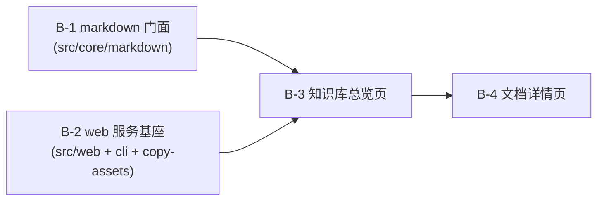

# 实现计划: cgraphx web 本地知识库浏览(服务基座 + 知识库)

> feature-id: 2026-07-30-cgraphx-web知识库浏览
> 状态: 待审阅
> 负责人: liulongfei
> 日期: 2026-07-30
> 来源 spec: `docs/features/2026-07-30-cgraphx-web知识库浏览/cgraphx-web知识库浏览-spec.md`(下称 spec)

## 1. 目标与范围

交付 spec 全部范围:`cgraphx web` 顶层命令启动**本地、只读、仅 localhost** 的浏览器服务,承载:

1. **web 服务基座**(spec §3.1 / §3.2 / §5.1):命令注册、启动预检(未初始化/端口占用)、回环绑定、单进程 DB 连接生命周期、应用壳(导航/顶栏/全局错误态)、静态资产分发、`/timeline` 占位路由;
2. **markdown 子系统公共门面**(spec §7 兼容契约):补齐 `src/core/markdown/index.ts`,并扩展两个只读方法(分页查询 + 统计聚合)支撑页面;
3. **知识库总览页**(spec §3.3):五维多选筛选(类型 17 种全集 / 状态 4 种 / 领域 / 概念 / 关键词)、统计条、文档卡列表、排序、分页、激活筛选 pill、空状态;
4. **文档详情页**(spec §3.4 / §5.2):元数据网格、摘要块、markdown-it 服务端全文渲染(路径边界:仅 DB 记录路径)、双向引用导航、文档 ID/路径展示、未找到/源文件缺失状态。

## 2. 明确不包含(防扩范围)

- ❌ 时间线页面任何真实实现(仅占位路由,属平行需求 `2026-07-30-cgraphx-web时间线浏览`);
- ❌ 任何写操作端点、schema 应用/迁移(web 进程只执行 SELECT,不调 `ensureMarkdownSchema` / `ensureTimelineSchema`);
- ❌ 前端构建链、前端框架、新增 chalk 类依赖;
- ❌ 对外稳定 API 契约(页面内部路由不承诺兼容);
- ❌ db 子系统对接、鉴权、LAN 绑定;
- ❌ 改动 CLI 任何命令的行为与输出。

## 3. 计划文件清单

| 文件 | 状态 | 内容 |
|---|---|---|
| `cgraphx-web知识库浏览-index.md` | 本文件 | 全局:决策/任务清单/依赖图/契约/规范/提交规范/风险 |
| `cgraphx-web知识库浏览-02-backend.md` | 存在 | B-1 markdown 门面 + B-2 web 服务基座(命令/服务器/预检/资产) |
| `cgraphx-web知识库浏览-03-frontend.md` | 存在 | B-3 知识库总览页 + B-4 文档详情页(服务端渲染页面) |
| `-01-schema.md` | **不涉及** | 本需求零 schema 变更(只读消费现有 `markdown_*` 表) |
| `-04-test.md` | **不涉及** | 测试并入各实现任务(同 implementer 写码 + 测试,减少交接) |

## 4. 已锁定的实现手段决策(用户已拍板)

| 议题 | 选项与权衡 | 结论 |
|---|---|---|
| 前端技术形态 | A 服务端渲染 HTML + 极少 JS(零前端依赖、零构建、URL 即状态;代价:全页刷新)/ B Vanilla SPA(交互顺滑但 JS 膨胀)/ C 框架 + 构建链(违背包极简现状) | **A**:页面由 TS 模板函数渲染 HTML;筛选/排序/分页走 URL 查询参数(可收藏、刷新不丢状态);JS 仅 `/` 快捷键等数行。本地毫秒级查询下全页刷新可接受;spec §3.5「加载态」在此形态下解读为:无空白假象(同步查询毫秒级返回)、错误/空态由服务端显式渲染——已按此解读执行,无异议即锁定 |
| markdown 渲染 | A markdown-it 服务端(纯 JS 无 native/wasm,结果可断言)/ B vendored marked 客户端(版本手动维护)/ C 自写(边界风险高) | **A**:新增依赖 `markdown-it`;`{ html: false, linkify: false, typographer: false }`(最小 + 安全);表格/代码块用内置规则 |
| HTTP 层 | A node:http + 手写路由(零依赖)/ B fastify(多一个运行时依赖) | **A**:`node:http` + 轻量路由(3 页面 + 静态资产);同步 SQLite + 本地单用户,无需中间件生态 |
| 默认端口 | 2468(罕用、好记)/ 4173(vite preview 占用)/ 3000(最易撞) | **2468**;选项 `-p, --port <port>`;被占用 → 报错 + 提示换端口,不自动换(spec §3.1) |

**plan 级推荐(未单独拍板,随 plan 审阅确认)**:分页 = 服务端 `?page=N`,页大小 30;筛选面板计数 = 全库计数(不随其他筛选联动,spec 允许 plan 定);概念面板 = Top 12 + 原生 `<details>` 展开全部;DB 连接 = 进程级单连接,SIGINT/SIGTERM 关闭;退出码 = 未初始化/schema 缺失 2(沿用 `status` 未初始化先例)、端口占用及其他 1;引用栏条目仅展示标题 + 路径(不附类型徽标,避免 N+1,与设计稿的细微偏差记录在案)。

**分层例外(已记录)**:`src/cli/index.ts` 作为组合根,允许 `import { registerWebCommand } from '../web'`(否则 `cgraphx web` 无法挂上 bin 入口);`src/web/` 模块自身只依赖 `src/core/`。此例外符合 interface-standards「顶层命令在 index.ts 注册」的既有形态(upgrade/install 同例),不违反「core 不反向依赖 cli/web」的实质约束。

## 5. 总任务清单

| 任务 | 文件 | 对应 spec 条款 | 独立提交 |
|---|---|---|---|
| **B-1** markdown 读侧门面 + 分页/统计扩展 | 02-backend.md | §3.3(不静默截断/类型全集)、§7(CLI 兼容)、§11 #4/#10 | ✅ 是 |
| **B-2** web 服务基座 + 命令注册 + 资产清单 | 02-backend.md | §3.1、§3.2、§4.1、§5.1、§6、§8(启动项)、§11 #1/#3/#6/#8/#9/#12 | ✅ 是 |
| **B-3** 知识库总览页(壳 + 筛选 + 列表 + 分页) | 03-frontend.md | §3.2、§3.3、§4.2、§8(空态项)、§11 #4/#5/#10/#12 | ✅ 是 |
| **B-4** 文档详情页(全文渲染 + 引用 + 路径边界) | 03-frontend.md | §3.4、§5.2、§8(缺失/未找到项)、§11 #6/#7 | ✅ 是 |

**spec 覆盖归属**:spec §9 验收标准 = B-1 至 B-4 完成条件与测试矩阵之并集 + 各任务手工冒烟(不单列任务);§10 Plan 编写约束 → 本 index §4/§7/§12 承接;§11 不可留到实现期的决策 → §7 契约逐条落点 + 各任务 spec 条款标注;§12 待确认项 → 本 index §13。

## 6. 依赖图、执行顺序、并行批次



- **批次 1(并行)**:B-1、B-2 —— 文件集不相交(B-1: `src/core/markdown/**` + `__tests__/core/markdown/**`;B-2: `src/web/**` + `src/cli/index.ts` + `scripts/copy-assets.cjs` + `__tests__/web/server.test.ts`;`package.json` 只有 B-4 动),验证状态互不干扰(各跑各的测试文件);
- **批次 2(串行)**:B-3(消费 B-1 门面 + B-2 服务器)→ B-4(消费 B-3 壳与路由);
- 推荐执行顺序:B-1 ∥ B-2 → B-3 → B-4。

## 7. 必须严格执行的契约(跨任务同文)

以下契约在引用任务中逐字重复;两端同文,不得各自演化。

### 7.1 markdown 门面(`src/core/markdown/index.ts`,B-1 产出,B-3/B-4 消费)

导出面(仅领域类型,`MarkdownDocumentRow` 等 `XxxRow` 原始行类型**不外泄**——data-standards「ORM 映射约定」):

```ts
export { MarkdownQuery } from './query';
export { openMarkdownDb, MARKDOWN_SCHEMA_VERSION, getCurrentMarkdownSchemaVersion } from './schema-bootstrap';
export { parseFrontmatter } from './frontmatter-parser';      // 详情页第 7.5 节复用
export { stripFrontmatter } from './frontmatter-parser';      // B-1 新增,见 7.3
export { DOCUMENT_TYPES, DOCUMENT_STATUSES, SOURCE_TYPES, KNOWLEDGE_DIR } from './constants';
export type { DocumentType, DocumentStatus, SourceType } from './constants';
export { MarkdownIndexError, SchemaMismatchError, DocumentNotFoundError, ProjectNotInitializedError } from './errors';
export type { ConceptSummary, DomainSummary, TagSummary, FindFilter, FindPagedResult, KnowledgeStats,
              DocumentDescriptor, DocumentDetail, ReferenceView, ReferenceTarget } from './types';
```

### 7.2 MarkdownQuery 扩展(B-1 新增;`find()` 签名与行为零变化)

```ts
// 类型新增(types.ts):
export interface FindFilter {
  // 原有单值字段全部保留(CLI 兼容):concept?/domain?/tag?/status?/documentType?/q?/limit?
  concepts?: string[];          // 新增:维度内 OR,维度间 AND
  domains?: string[];
  tags?: string[];
  statuses?: DocumentStatus[];
  documentTypes?: DocumentType[];
}
export interface FindPagedResult { total: number; items: DocumentDescriptor[]; }

// query.ts 新增方法:
findPaged(filter: FindFilter,
          opts?: { offset?: number; limit?: number; sort?: 'recency' | 'relevance' | 'title' }): FindPagedResult
```

- `total` = 匹配总数(分页前);`items` = 同一有序列表的 `[offset, offset+limit)` 切片;
- `limit` 沿用 find 语义(默认 20、上限 100、钳制);`offset` 默认 0,`Number.isInteger` 守卫(沿用 find 的 LIMIT 注入边界模式,拒绝非整数);
- 排序:`sort` 缺省时与 find 一致(有 q → 相关度,无 q → 时间倒序);`'title'` = title ASC(并列按 updated DESC);
- 实现复用 find 的候选交集管线(B-1 将 Phase 1/2 提取为私有方法,find 与 findPaged 共用;find 输出必须逐字节不变,现有测试为基线);
- **`DocumentDescriptor` 追加三个可选字段**(B-3 文档卡消费;同策略:`findPaged` 在 hydrate 阶段填,`find()` **不填**——字段缺省,CLI 输出逐字节不变,现有测试为基线):
  - `referencesCount?: number`(引用数 = 出向 + 入向):对当页 id 集合**一条** IN 聚合查询计数(非 N+1);
  - `owners?: string[]`、`aliases?: string[]`:hydrate 已持有 `MarkdownDocumentRow`,从其同行 JSON 列解析(沿用 `hydrateDetail` 的 `parseJsonArray` 模式,**零额外查询**);
- **统计聚合方法**(B-1 新增):

```ts
export interface KnowledgeStats {
  documentCount: number; conceptCount: number; domainCount: number; tagCount: number;
  latestIndexedAt: number | null;                          // 全库 max(indexed_at)
  byType: Record<DocumentType, number>;                    // 17 键全在,缺省 0
  byStatus: Record<DocumentStatus, number>;                // 4 键全在,缺省 0
}
getStats(): KnowledgeStats
```

### 7.3 stripFrontmatter(B-1 新增)

```ts
stripFrontmatter(raw: string): string   // 去掉开头 --- … --- frontmatter 块,返回正文;无 frontmatter 原样返回
```
实现复用 `frontmatter-parser` 既有块定位逻辑;独立单测(有/无 frontmatter、未闭合 frontmatter 降级为原样)。

### 7.4 web 基座(`src/web/`,B-2 产出)

```ts
// src/web/index.ts(门面):
export { registerWebCommand } from './register';
export { startWebServer } from './server';
export type { WebServer } from './server';     // { url: string; close(): Promise<void> }
export { WebError, WebStartupError } from './errors';

// register.ts:
registerWebCommand(program: Command): void
// 注册:program.command('web [project-path]')
//   .description('Start the local read-only web viewer (knowledge base)')
//   .option('-p, --port <port>', 'port to listen on (default 2468)', '2468')
// project-path 默认 process.cwd();port 解析为整数并校验 1–65535,非法 → 参数错误(exit 1)

// server.ts:
startWebServer(options: { projectRoot: string; port: number }): Promise<WebServer>
// port 允许传 0(测试临时端口;url 用实际端口)
```

**启动预检序列(契约,顺序固定)**:
1. `isInitialized(projectRoot)`(directory.ts)为假 → 抛 `WebStartupError { kind: 'uninitialized' }`,消息含项目路径 + 修复提示「run `cgraphx install` to initialize」;
2. `DatabaseConnection.open(getDatabasePath(projectRoot))` 打开**进程级单连接**(此时 DB 必存在,`open` 不会创建文件);web **不**调用 `ensureMarkdownSchema` / `ensureTimelineSchema`(只读契约);
3. schema 存在性检查:`SELECT name FROM sqlite_master WHERE type='table' AND name IN ('markdown_schema_versions','timeline_schema_versions')` —— 缺一或全缺 → 抛 `WebStartupError { kind: 'schema-missing', missing: ('markdown'|'timeline')[] }`,消息点名缺失的 schema + 修复提示「run `cgraphx install`」;
4. `createServer(handler).listen(port, '127.0.0.1')`(**仅回环**,安全契约);`'error'` 且 `code === 'EADDRINUSE'` → 抛 `WebStartupError { kind: 'port-in-use', port }`,消息含端口值 + 修复提示「use --port <port> to specify another port」。

**退出码映射**(`src/web/errors.ts`,interface-standards「退出码」——禁字面量散落):

```ts
exitCodeForWebError(err: unknown): number
// WebStartupError.kind: 'uninitialized' → 2 · 'schema-missing' → 2 · 'port-in-use' → 1 · 其他/未知 → 1
```
`register.ts` action 内 `try/catch` → `process.exitCode = exitCodeForWebError(err)`,stderr 输出带 `[web]` 前缀。

**生命周期**:SIGINT / SIGTERM → `server.close()` + `connection.close()`,exit 0;服务常驻,启动成功向 stdout 打印可点击地址 `http://127.0.0.1:<port>`。

**路由表**(B-2 落骨架,B-3/B-4 填页面):

| 方法 + 路径 | 处理 | 来源任务 |
|---|---|---|
| `GET /` | 知识库总览页 | B-3(B-2 期间为占位页:服务名 + 版本 + 「知识库页面实现中」) |
| `GET /doc/<ident>` | 文档详情(ident = 64 位十六进制 ID 或 URL 编码的项目相对路径) | B-4(B-2 期间 404) |
| `GET /timeline` | 占位页:「开发时间线属平行需求,尚未实现(feature-id: 2026-07-30-cgraphx-web时间线浏览)」 | B-2(时间线 plan 实现时替换) |
| `GET /assets/<file>` | 静态资产,从 `path.join(__dirname, 'public')` 提供(dist 与 src 布局同构) | B-2 |
| 其他 | 404 页(壳布局 + 「页面不存在」+ 回首页链接) | B-2 |

全局:任何处理器抛错 → 500 页(壳布局 + 可读错误原因,**不输出堆栈**);所有 DB/用户来源字符串插入 HTML 前必须过 `escapeHtml()`(B-3 落 `render-utils.ts`,B-2 占位页即用)。

**只读契约可断言**:web 进程内所有 SQL 为 SELECT;测试以「一串请求前后 `markdown_*` / `timeline_*` 各表行数不变」断言。

### 7.5 URL 查询参数契约(B-3 消费,B-4 复用壳)

`GET /` 参数(全部可选;`URLSearchParams.getAll` 取多值):

| 参数 | 语义 | 映射 |
|---|---|---|
| `q` | 关键词(单值) | `FindFilter.q` |
| `type`(可重复) | 文档类型多选,值为英文原值 | `FindFilter.documentTypes`(须全部 ∈ DOCUMENT_TYPES,非法值忽略) |
| `status`(可重复) | 状态多选 | `FindFilter.statuses`(同上校验) |
| `domain`(可重复) | 领域多选(精确名) | `FindFilter.domains` |
| `concept`(可重复) | 概念多选(精确名) | `FindFilter.concepts` |
| `sort` | `updated`(默认)/ `title` | findPaged opts.sort(有 q 时 updated 仍为显式 recency) |
| `page` | 页码,默认 1,正整数守卫;超界 → 渲染末页 + 提示 | findPaged opts.offset = (page-1)*30, limit=30 |

激活筛选 pill:每个激活条件渲染为带 `✕` 链接的 pill(链接 = 移除该值后的 URL);激活条件 ≥2 → 额外「清除全部」pill(链接到 `/`)。

### 7.6 显示标签映射(B-3,spec §3.3 逐字)

`src/web/constants.ts` 中 `TYPE_LABELS: Record<DocumentType, string>`(17 条,spec 表逐字):concept 实体概念 / decision 决策 / rule 规则 / lesson 教训 / warning 警示 / finding 发现 / analysis 分析 / exploration 探索 / note 笔记 / runbook 运维手册 / installation 安装部署 / api API / faq FAQ / architecture 架构 / guide 指南 / tutorial 教程 / conversation 对话。
`STATUS_LABELS: Record<DocumentStatus, string>`(4 条):draft 草稿 / active 现行 / superseded 已被替代 / deprecated 已废弃。
类型排序:**按 `byType` 计数降序**(同数按英文原值 ASC),全集 17 种始终全部渲染(计数 0 也显示)。

### 7.7 视觉基线(B-3,设计稿定稿)

配色变量:`--paper:#F1F4ED; --surface:#FBFCF8; --ink:#15211B; --line:#DCE3D8; --pine:#163B2F; --pine-2:#1D6B4F; --pine-tint:#E1EFE6; --blue:#2F5D8A; --gold:#8A6A1F; --rust:#B14E22; --orange:#C4551F`。字体:`'Space Grotesk'`(数字/标题拉丁)+ `'Noto Sans SC'`(正文)+ `'JetBrains Mono'`(路径/ID/时间),经 Google Fonts CDN 引入,`font-display: swap`,离线降级系统字体(本地工具可接受)。壳布局:深松绿侧栏(知识库/开发时间线→`/timeline`/数据库灰置「后续」)+ 顶栏只读 pill。文档卡:类型徽标块(中文 + 英文小标)、17px 标题 + alias、三行摘要截断、概念标签行(链接 = 追加 `concept=`)、右栏状态 pill/领域/引用数/更新时间。

## 8. 适用规范(强制引用,结晶自 docs/guides/)

| 规范 | 章节 | 本 plan 落点 |
|---|---|---|
| coding-standards.md | 「边界与结构」 | 分层铁律、门面硬约定(本需求即补齐 markdown 门面)、copy-assets 登记(B-2 任务契约)、dist 镜像 src |
| coding-standards.md | 「选型」 | 禁 chalk(终端输出手写 ANSI)、`as const` 枚举、`node:` 前缀、**新代码注释中文**、单文件 >600 行拆分(模板按 layout/pages-overview/pages-detail/render-utils 分文件) |
| coding-standards.md | 「错误与日志」 | `src/web/errors.ts` 类型化错误层级、**错误消息必带修复提示**(7.4 各错误已落提示文案) |
| testing-standards.md | 「Mock 政策与隔离」 | 真实栈、**禁 `vi.mock`**、`fs.mkdtempSync(os.tmpdir())` + 真实 SQLite 文件库、测试数据内联构造、无 fixtures 目录 |
| testing-standards.md | 「时区」 | 不碰 `vitest.config.ts` 的 `TZ:'UTC'`;本需求无跨时区断言需求(时间显示逻辑在 B-4,如需验证走显式 TZ 子进程) |
| testing-standards.md | 「测试描述」 | describe/it **英文**;spec 派生用例标注条款号(如 `'overview: type filter (spec §3.3)'`) |
| interface-standards.md | 「命令注册」 | `registerWebCommand(program)` 形态 + cli/index.ts 接入;顶层命令内联接入(4 节分层例外) |
| interface-standards.md | 「输出」「退出码」 | stderr `[web]` 前缀;`exitCodeForWebError` 映射,禁字面量退出码。**例外**:`web` 是常驻服务,无一次性机器输出,不提供 `--json`(记录在此,不推广该豁免) |
| data-standards.md | 「模型层」「ORM 映射约定」 | `XxxRow` 不外泄(7.1 门面导出面已排除);DB 入口只走 `src/core/db/` 适配器 |
| git-standards.md | 「提交消息规范」「提交前检查点」 | 结晶见第 9 节 |

## 9. 提交规范(结晶自 git-standards.md,实施期直接据此提交)

**提交消息格式**(原文摘录):

> 格式:`type(scope): 中文描述`(Conventional Commits + 中文)
> - type:feat / refactor / fix / docs;scope 常用:skills / installer,仓库级改动省 scope
> - 补充说明用「——」,并列用「+」,数值对比用「→」
> - 正例:`feat(skills): init-project-guides 双模式——新项目立起步规范`
> - 反例:`update skill`(无 type、英文、零信息)
> - 无票据关联:需求追踪走 `docs/features/` 目录,不进标题
> - body:非琐碎提交写 body——背景一行 + 「-」列要点
> - agent 署名:尾行 `Co-Authored-By: Claude <noreply@anthropic.com>`

本需求建议 scope:`markdown`(B-1)/ `web`(B-2/B-3/B-4)。建议 subject:
- B-1:`feat(markdown): 补 docs 子系统公共门面——findPaged 分页 + getStats 统计`
- B-2:`feat(web): cgraphx web 服务基座——本地回环 HTTP、启动预检、命令注册`
- B-3:`feat(web): 知识库总览页——五维筛选、文档列表分页、统计条`
- B-4:`feat(web): 文档详情页——markdown-it 全文渲染、双向引用、路径边界`

**提交前检查点**(原文摘录,门禁由 precommit-check 兜底):

> - 与 TS 同放的运行时资产未登记 `scripts/copy-assets.cjs` —— 不随包发布,用户机器运行时 ENOENT
> - src/core 出现对 src/cli / src/web 的 import —— 分层硬约定破坏,无 lint 拦截,只靠人眼
> - schema.sql 丢失 `IF NOT EXISTS` —— 已初始化项目重复应用 schema 直接报错(本需求不动 schema)
> - timeline hook 链路出现未 await 的 DB 写入 / 抛错不吞(本需求不涉及)
> - `vitest.config.ts` 的 `TZ: 'UTC'` 钉死被改 —— 日期断言失去跨机器可复现性
> - 被注释掉的命令注册 / hook 接入项 —— 功能静默失效
> - 写死的魔法值:绝对路径、密钥、阈值、版本号写进源码
> - 新增 TODO / FIXME:确认是否应转任务,不随提交入库

## 10. 允许局部工程适配的范围

- 路由分发器的内部写法(switch/表驱动)、模板函数的内部拆分与命名;
- 静态资产服务的内容类型表(最小集合:css/js/svg/woff2)、缓存头;
- findPaged 内部重构手法(提取私有方法的方式),只要 find 输出不变;
- 错误页/占位页的具体文案与版式(信息要素固定);
- 测试用例的具体 fixture 文档数量与内容(覆盖矩阵固定)。

**未列入允许的一律固定**(尤其 7 节全部契约、第 2 节全部排除项)。

## 11. Plan 冲突上报规则

权威链:任务 ← plan ← spec。implementer 发现任务与 plan 矛盾 → 按 plan 执行并上报;plan 与 spec 矛盾 → **不自行裁决**,上报 PLAN_CONFLICT(引 spec 条款号 + plan 位置),停该任务等裁决。spec 未覆盖的可观察后果 → 上报,不夹带实现。

## 12. 关键风险与防跑偏约束

| 风险 | 等级 | 防范 |
|---|---|---|
| 门面重构波及 CLI | HIGH | B-1 先跑 `npx vitest run __tests__/core/markdown/` 全绿基线,重构后再跑必须全绿;`find()` 签名/输出逐字节不变 |
| web 意外产生写入(违反只读契约) | HIGH | 不调 ensure*Schema;B-2 测试断言请求前后各表行数不变;open 前必过 isInitialized 存在性检查(open 会创建文件) |
| cli→web 分层例外被扩大 | MEDIUM | 例外仅限 cli/index.ts 一处 wiring import;precommit 检查点拦截 core→cli/web 反向 import |
| 服务端模板膨胀破 600 行 | MEDIUM | 强制拆分:register/server/bootstrap/errors/layout/pages-overview/pages-detail/render-utils/constants |
| XSS(文档标题/概念名等插入 HTML) | MEDIUM | 非 markdown 来源一律 `escapeHtml`;markdown-it `html:false`;B-4 测试含 `<script>` 标题转义断言 |
| markdown-it 依赖引入 | LOW | 纯 JS、无 native/wasm、MIT,满足 spec 约束;锁 `^` 主版本 |
| 顺手实现时间线 | LOW(漂移) | `/timeline` 仅占位页(7.4 文案固定);任何 timeline 查询代码出现即越界 |
| Google Fonts CDN 依赖 | LOW | `font-display: swap` + 系统字体降级;离线可用(视觉降级) |

## 13. 待确认项

无阻塞项。plan 级推荐(第 4 节末段:分页 30/页、计数不联动、引用条目仅标题等)随 plan 审阅一并确认;有异议在审阅时提出即改。
