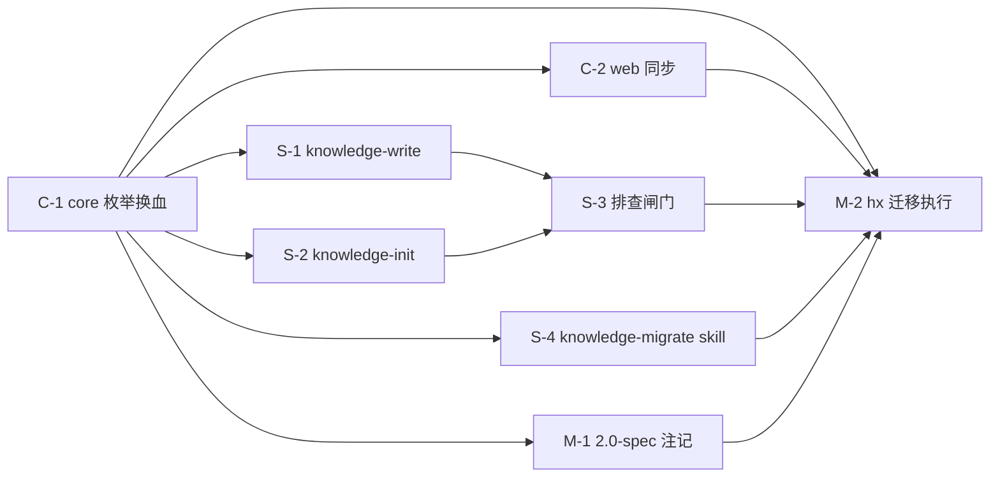

# 实现计划: docs 知识库分类体系重设计(换血式)

> feature-id: 2026-07-31-知识库分类体系重设计
> 状态: 待审阅
> 负责人: liulongfei
> 日期: 2026-07-31
> 来源 spec: `docs/features/2026-07-31-知识库分类体系重设计/知识库分类体系重设计-spec.md`(下称 spec)

## 1. 目标与范围

交付 spec 全部范围:document_type 换血 7 枚举(废 13 旧值)+ source_type 重定义 5 枚举 + domains 业务域语义转向 + 迁移 skill 新建 + hx 61 篇迁移(验收试金石)+ 六处同步修订。

## 2. 明确不包含

- ❌ 索引层表结构/查询实现变更;validator 对 domains 的枚举校验(通用性约束);
- ❌ source_type 消费点建设(find 过滤/web 展示);
- ❌ 其他接入项目的代迁(发布时通知 + 迁移 skill 自助);
- ❌ 版本号 bump 与发布(发布阶段决策;本 plan 只保证实现作为**一个发布单元**完成);
- ❌ concepts 词汇收敛等分类外治理。

## 3. 计划文件清单

| 文件 | 状态 | 内容 |
|---|---|---|
| `知识库分类体系重设计-index.md` | 本文件 | 全局:决策/任务清单/依赖图/契约/规范/提交规范/风险 |
| `知识库分类体系重设计-01-code.md` | 存在 | C-1 core 枚举换血 + validator 消息 + 测试基线 + 本仓库 KB 文档迁移;C-2 web spec 条款修订 + TYPE_LABELS/TYPE_TONES + web 测试 |
| `知识库分类体系重设计-02-skills.md` | 存在 | S-1 knowledge-write 换血(+ 新建 template-flow、template-runbook 并入 guide);S-2 knowledge-init 同步;S-3 全 skill 旧枚举排查闸门;S-4 新建 knowledge-migrate 迁移 skill |
| `知识库分类体系重设计-03-migration.md` | 存在 | M-1 2.0-spec 兼容性注记;M-2 hx 61 篇迁移执行与验收 |
| `-01-schema.md` | **不涉及** | 零 schema 变更 |
| `-04-test.md` | **不涉及** | 测试并入各实现任务 |

## 4. 已锁定的实现手段决策(用户已拍板)

| 议题 | 选项与权衡 | 结论 |
|---|---|---|
| 迁移 skill 执行模式 | A dry-run 报告→确认→执行(改动前见全貌,61 篇批量变更风险可控)/ B 逐篇确认即改(61 轮交互过慢)/ C 直接批改+事后抽检(无事前审查,判错成片) | **A**:全量扫描逐篇判定 → 迁移报告表 → **用户确认(硬检查点)** → 批量改写 → 逐篇 validate → 确认后重建索引 → 抽检提议 + 剔除清单 |
| knowledge-write 模板映射 | A 新建 template-flow(流程类专用)+ runbook 并入 guide / B 不新建,流程复用 memory(削足适履,hx 35 篇流程是最大类)/ C A + 保留 runbook 子模板 | **A**:template-flow 新建(触发/参与者/状态流转/异常分支/代码入口);template-concept→business-entity;template-memory→mechanism/decision/rule/lesson;template-guide→guide(含 runbook 子类);template-runbook 并入后移除 |
| validator 错误消息 | 现状 detail 仅 `field=value`,不列合法值(spec §4.1 要求列举) | 三个枚举字段的 detail 统一充实为 `<field>=<value> (valid: <逗号分隔合法值>)`;status 一并充实(格式统一,非枚举变更) |
| web 类型色系 | 现 5 色系为 17 种设计;7 种后 'record' 色系(note/conversation/exploration/faq)失去所有类型 | TYPE_TONES 重映射 7 项;TypeTone 联合类型**移除 'record'**(无类型使用);对应 CSS 类清理列入允许适配 |
| 迁移 skill 命名 | knowledge-migrate(沿用 knowledge-* 族命名) | **knowledge-migrate** |

## 5. 总任务清单

| 任务 | 文件 | 对应 spec 条款 | 独立提交 |
|---|---|---|---|
| **C-1** core 枚举换血 + validator 消息充实 + 测试基线更新 + 本仓库 KB 文档迁移 | 01-code.md | §3.1 §3.2 §3.4 §4.1 §7-5 §7-6 §8 | ✅ 是(**批末提交**:与 C-2 同批,全仓转绿后先于 C-2 提交) |
| **C-2** web:spec §3.3 条款先行修订 + TYPE_LABELS/TYPE_TONES 7 项 + web 测试更新 | 01-code.md | §3.1 §4.3 §7-3 | ✅ 是(**批末提交**:全仓转绿后随 C-1 之后提交) |
| **S-1** knowledge-write 换血(枚举说明 + 模板重映射 + template-flow 新建 + template-runbook 并入移除 + domains 引导) | 02-skills.md | §3.1 §3.2 §3.3 §7-2 | ✅ 是 |
| **S-2** knowledge-init 新枚举同步 | 02-skills.md | §7-2 | ✅ 是 |
| **S-3** 全 skill 资产旧枚举排查闸门(grep 校验零残留,plugins 构建产物误报排除) | 02-skills.md | §7-2 | 视排查结果(有改动则提交,零残留则无提交) |
| **S-4** 新建 knowledge-migrate 迁移 skill(dry-run→确认→执行流程 + 映射表内嵌) | 02-skills.md | §4.4 §7-2 | ✅ 是 |
| **M-1** 2.0-spec 追加兼容性注记 | 03-migration.md | §6.1 | ✅ 是(docs 提交) |
| **M-2** hx 61 篇迁移执行与验收(dry-run 报告 → 用户确认 → 执行 → 重建索引 → 抽检) | 03-migration.md | §6.2 §6.3 §9 | ⚠️ 特殊:改动落在 hx 仓库,hx 侧是否提交归用户;本仓库无提交 |

## 6. 依赖图、执行顺序、并行批次



- **批次 1**:C-1(一切的基础:枚举源、validator 行为、测试基线);
- **提交执行者**:本 plan 全部「独立提交」均由 **controller** 执行(implementer 只改文件、不 git add/commit——验证闸门在 controller 侧,提交点与闸门同侧);
- **批次 1 → 批次 2 实为一个编译闭合单元**:C-1 单独完成时 web 存在**预期编译失败**(`Record<DocumentType,…>` 穷尽性,由 C-2 修复),故 C-1 不即时提交——**C-2 完成且全仓 `npx tsc --noEmit` + 全量测试转绿后,按 C-1 → C-2 顺序各做一次原子提交**;批次 2 的其余任务(S-1/S-2/S-4/M-1,skill 文本与 docs,不影响编译)各自验证后即可提交,无需等待 C-2;
- **批次 2(并行)**:C-2 ∥ S-1 ∥ S-2 ∥ S-4 ∥ M-1 —— 文件集不相交(src/web + web 需求 spec / assets knowledge-write / assets knowledge-init / assets 新建 knowledge-migrate 目录 / 2.0 需求 docs),共享契约仅为 C-1 产出的枚举表(只读引用,不修改);
- **批次 3**:S-3 排查闸门(依赖 S-1/S-2 完成,校验零残留);
- **批次 4**:M-2 hx 迁移执行(依赖全部就绪:新 validator + 迁移 skill + 修订后的 skill 文本;含用户确认检查点)。

**前置条件(分支层面)**:本需求的 web 同步修订(C-2)基于 web 知识库需求的实现产物(TYPE_LABELS 等)。**建议先将 `feature/cgraphx-web-knowledge-base` 合并入 main,再从 main 切本需求实现分支**;若用户选择直接在 web 分支上继续叠加,则本 plan 全部任务在同一分支顺序执行(发布单元不受影响)。该选择归用户,implementer 不裁决。

## 7. 必须严格执行的契约(跨任务同文)

### 7.1 document_type 新枚举(7,spec §3.1 逐字)

| 枚举值 | 显示标签 | 语义 |
|---|---|---|
| business-entity | 业务实体 | 业务对象主条目 |
| business-flow | 业务流程 | 业务活动端到端流转 |
| mechanism | 技术机制 | 技术机制与架构(含原 architecture) |
| decision | 决策 | 取舍记录 |
| rule | 规则 | 长期有效约束 |
| lesson | 教训 | 事故/问题复盘 |
| guide | 指南 | 指南/运维手册/教程/安装/FAQ/API 文档 |

废除 13 值:conversation / exploration / finding / analysis / note / warning / architecture / tutorial / runbook / installation / api / faq / concept。

### 7.2 source_type 新枚举(5,spec §3.2 逐字)

| 枚举值 | 显示标签 | 语义 |
|---|---|---|
| work_context | 工作上下文 | 需求/任务流中沉淀 |
| batch_exploration | 批量探索 | knowledge-init 式批量探索 |
| review | 评审 | 代码/架构评审中发现 |
| debugging | 调查排障 | 问题调查中发现 |
| manual | 手工 | 人工主动整理 |

### 7.3 validator 错误消息格式(C-1 产出)

三个枚举字段(document_type / status / source_type)非法时的 `detail` 统一为:

```
<field>=<value> (valid: <合法值逗号分隔>)
```

如 `document_type=exploration (valid: business-entity, business-flow, mechanism, decision, rule, lesson, guide)`。skipReason 不变(`invalid_enum_value`),ValidationResult 结构不变。

### 7.4 web TYPE_LABELS / TYPE_TONES(C-2 产出)

```ts
TYPE_LABELS: Record<DocumentType, string> = {
  'business-entity': '业务实体', 'business-flow': '业务流程', mechanism: '技术机制',
  decision: '决策', rule: '规则', lesson: '教训', guide: '指南',
}
type TypeTone = 'entity' | 'process' | 'judgment' | 'lesson';   // 移除 'record'
TYPE_TONES: Record<DocumentType, TypeTone> = {
  'business-entity': 'entity', mechanism: 'entity',
  'business-flow': 'process', guide: 'process',
  decision: 'judgment', rule: 'judgment',
  lesson: 'lesson',
}
```
STATUS_LABELS 不变。常量文件头注释改指本 spec(不再引用 web 需求 spec 的 17 条表)。

### 7.5 存量映射原则(spec §3.1/§3.2,迁移判定用,S-4 内嵌、M-2 执行)

document_type:concept→business-entity;exploration/finding/analysis 按内容主题判定(business-flow / mechanism / business-entity);architecture→mechanism;warning 约束类→rule、复盘类→lesson;tutorial/runbook/installation/api/faq→guide;conversation/note 按主题判定,确无主题→剔除入库(记录剔除清单)。
source_type:ai_session→work_context;architecture_review/code_review→review;debugging→debugging;manual/human_note/external_summary→manual。
domains:服务模块值迁 tags;按内容填业务域;迁移后 domains ≥1 项(spec §6.3 边界)。
同名保留值(decision/rule/lesson/guide/debugging/manual)同样按新语义复核——值合法 ≠ 归属准确。

### 7.6 knowledge-migrate skill 流程契约(S-4 产出,M-2 消费)

触发 → 定范围(目标项目知识库或指定文件集)→ **dry-run**:逐篇读内容,按 §7.5 判定,生成迁移报告表(文件 / 旧类型→新类型 / 旧来源→新来源 / 旧 domains→新业务域 / 移入 tags 的服务模块 / 剔除建议),不改任何文件 → **用户确认(硬检查点,未确认不执行)** → 批量改写 frontmatter(保留正文与其他字段,仅改 document_type/source_type/domains/tags)→ 逐篇 `docs validate` → 提议重建索引(**用户确认后**执行)→ 输出抽检建议(抽样篇目)+ 剔除清单。
红线:不改正文;未知 frontmatter 字段保留;validate 不过的条目回滚该条并报告;不自动跑 `docs index`。

### 7.7 模板映射(S-1 产出)

| 类型 | 模板 |
|---|---|
| business-entity | template-concept.md(适用类型行改为 business-entity) |
| business-flow | **template-flow.md(新建)**:触发与前置 / 参与者与系统 / 状态流转或主链路 / 异常分支 / 关键约束与陷阱 / 代码入口 / Summary 规范(沿用 knowledge-write「只有 ## Summary 进索引」契约) |
| mechanism / decision / rule / lesson | template-memory.md(适用类型行改为这四类) |
| guide(含 runbook 子类) | template-guide.md(runbook 的运维要点——步骤/回滚/检查点——并入本模板的分支指引) |
| — | template-runbook.md **并入后移除** |

## 8. 适用规范(结晶自 docs/guides/)

| 规范 | 章节 | 本 plan 落点 |
|---|---|---|
| coding-standards.md | 「边界与结构」「选型」「错误与日志」 | 门面导出面不变(C-1 只改常量与 validator detail);禁 chalk;validator detail 带修复提示(§7.3 即修复提示);新代码注释中文 |
| testing-standards.md | 「Mock 政策与隔离」「测试描述」 | 真实栈禁 vi.mock;mkdtemp + 真实索引;describe/it 英文 |
| data-standards.md / interface-standards.md | — | 不涉及(零 schema 变更;CLI 命令接口不变) |

## 9. 提交规范(结晶自 git-standards.md **工作区当前版本**,实施期据此提交)

> 格式:`type(scope): 中文描述`(Conventional Commits + 中文)
> - type:feat / refactor / fix / docs;scope 常用:skills / installer / markdown / web,仓库级改动省 scope
> - 补充说明用「——」,并列用「+」,数值对比用「→」
> - 无票据关联:需求追踪走 docs/features/,不进标题
> - body:非琐碎提交写 body——背景一行 +「-」列要点
>
> 提交前检查点(门禁兜底):与 TS 同放的运行时资产登记 copy-assets · core 不得 import cli/web · schema.sql IF NOT EXISTS(本需求不动 schema) · timeline hook await(不涉及) · vitest TZ:UTC 不改 · 无被注释的注册项 · 无魔法值 · 无新增 TODO/FIXME

**注**:git-standards.md 工作区有一笔未提交变更(删去 agent 署名行),本节按工作区版本结晶——本 plan 的实施提交**不附** Co-Authored-By 尾行;若该变更被回滚,署名惯例随文件恢复。

建议 commit subjects:C-1 `feat(markdown): 知识库分类体系换血——document_type 7 值 + source_type 5 值`;C-2 `feat(web): 类型体系换血——spec 条款先行修订 + TYPE_LABELS/TYPE_TONES 7 项`;S-1 `feat(skills): knowledge-write 分类体系换血——新枚举 + template-flow 新建`;S-2 `feat(skills): knowledge-init 同步新分类枚举`;S-4 `feat(skills): knowledge-migrate 迁移 skill——dry-run 报告 + 确认执行`;M-1 `docs: 2.0-spec 追加分类枚举换血兼容性注记`。

## 10. 允许局部工程适配的范围

- validator detail 的文案措辞(格式 §7.3 固定);
- 测试 fixture 旧枚举值替换为哪个新值(按 fixture 测试意图判定,保持用例原意;如 filter 测试需要多类型则分散取值);
- web CSS 中 'record' 色系类的清理方式(删或留,不影响渲染);
- template-flow.md 的章节细节(§7.7 骨架固定);
- 迁移报告表的呈现格式(表格要素 §7.6 固定);
- skill 文本的具体措辞(枚举表逐字,解说可适配)。

**未列入的一律固定**(尤其 §7 全部契约、§2 排除项)。

## 11. Plan 冲突上报规则

权威链:任务 ← plan ← spec。任务与 plan 矛盾 → 按 plan 执行并上报;plan 与 spec 矛盾 → 不自行裁决,上报 PLAN_CONFLICT(引 spec 条款)停任务等裁决。M-2 的 dry-run 判定遇主题不明文档 → 列入剔除清单交用户确认,不自行决定去留。

## 12. 关键风险与防跑偏约束

| 风险 | 等级 | 防范 |
|---|---|---|
| 六处修订不同步发布 → 枚举/标签/技能文本错位 | HIGH(spec 定级) | 批次 4 完成前不发布;M-2 验收即全链路(validator + web + skill)联调 |
| hx 迁移判错成片 | HIGH | dry-run 报告用户确认(硬检查点)+ 判错可逆(frontmatter 纯文本)+ 抽检 |
| 测试基线更新变成"改期望绕过" | MEDIUM | 仅枚举契约变更引起的期望更新合法(spec §7-6);用例的测试意图不变,implementer 逐条说明替换理由 |
| 分支叠加冲突(web 分支未合并即开本需求) | MEDIUM | 前置条件(§6)交用户选择;C-2 基于 web 产物,顺序不可颠倒 |
| hx 仓库改动失控 | MEDIUM | M-2 implementer 不改 hx 的 git 状态(不 add/commit);迁移后报告 diff 摘要,hx 提交归用户 |
| 迁移 skill 越权(改正文/跑索引) | MEDIUM | §7.6 红线写进 SKILL.md;M-2 验收核对正文未变(抽样 diff 仅 frontmatter 块) |
| 本仓库自身 KB 文档(cgraphx-web.md)旧值遗留 | LOW | 并入 C-1 同批迁移(concept→business-entity、ai_session→work_context、domains 填业务域「web 服务」) |

## 13. 待确认项

无阻塞项。发布阶段:版本号(major/minor)与节奏、其他接入项目通知方式。实施期适配项见 §10。
