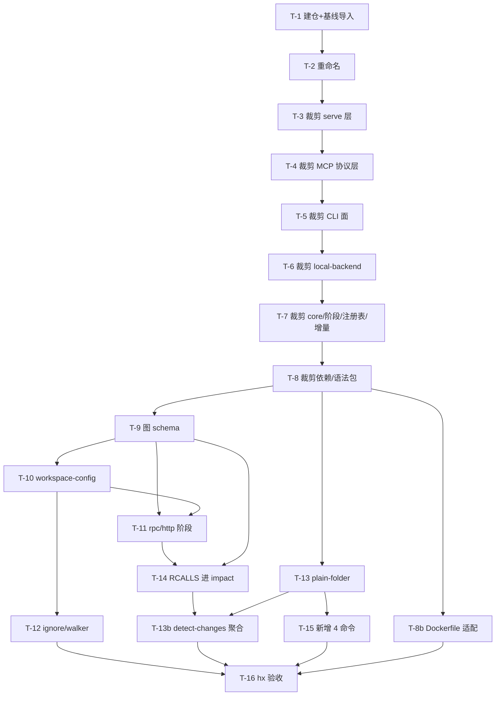

# 实现计划: 轻量代码智能引擎(cgraph)

> feature-id: 2026-08-08-轻量代码智能引擎
> 负责人: liulongfei
> 日期: 2026-08-08
> 来源 spec: [`../轻量代码智能引擎-spec.md`](../轻量代码智能引擎-spec.md)(定稿,无待确认项)
> 配套输入: [`../gitnexus-core-port-conflict-exploration.md`](../gitnexus-core-port-conflict-exploration.md)(移植冲突探索报告,P1-P9)

---

## 1. 目标与范围

在 `/Users/smdnk/objects/ai/cgraph/`(新建仓库)交付 v1 轻量代码智能引擎:

- 以 **GitNexus 当前主分支**(`/Users/smdnk/objects/ai/GitNexus`)的 `gitnexus/` + `gitnexus-shared/` 两个包为基线,**裁剪**掉 spec §1.3 非目标;
- **移植** fork(`/Users/smdnk/objects/ai/code-workflow/gitnexus/gitnexus`,fork point `2cf7e7fa` = v1.6.6)的定制资产:workspace-config、rpc-edges、http-api-calls、plain-folder、RCALLS 进 impact;
- 交付 spec §4 锁定的 CLI 面:`analyze` / `status` / `context` / `trace` / `cypher` / `impact` / `detect-changes` / `route-map` / `api-impact` / `shape-check` / `tool-map`;
- hx 端到端验收达标(spec §11.1 锚点)。

**参考源码均为只读**:实现期不得修改 `/Users/smdnk/objects/ai/GitNexus/` 与 fork 仓库的任何文件,只读取/复制。

## 2. 明确不包含

- spec §1.3 全部非目标(MCP/web/embeddings/PDG/group/rename/query+FTS/增量同步/wiki/skills 注入…);
- 测试编写(测试是代码完成后的独立流程;本 plan 对测试的唯一要求:**既有测试不被弄红**,被删模块的测试随模块删除);
- Windows/Linux 实机验证、CI 搭建、npm 发布、cgraphx 集成设计(spec §8:成熟后另行设计);
- 语言扩展(v1 仅 Java/JS/TS)、workspace 多 RPC 框架配置(spec §6.3:单框架+预留)。

## 3. 计划文件清单

| 文件 | 状态 |
|---|---|
| `轻量代码智能引擎-index.md` | 本文件;唯一 plan 文件,全部任务在此 |
| `-01-schema.md` | **不涉及**——无业务数据库;图 schema(NODE_TABLES/REL_TYPES)为代码级改动,归 T-9 |
| `-02-backend.md` | **并入 index**——单域引擎项目,无前后端之分 |
| `-03-frontend.md` | **不涉及**——无 UI |
| `-04-test.md` | **不涉及**——测试不进 plan |

## 4. 总任务清单

| 任务 | 内容 | spec 条款 | 独立提交 |
|---|---|---|---|
| T-1 | 建仓 + 基线导入(首提交) | §1.2 §10 §13 | 是 |
| T-2 | 包/品牌重命名(gitnexus→cgraph) | §1.2 §8 | 是 |
| T-3 | 裁剪 serve/web/eval/docker 层 | §1.3 | 是 |
| T-4 | 裁剪 MCP 协议层(保留 LocalBackend) | §1.3 §8 | 是 |
| T-5 | 裁剪 CLI 命令面(含 query 命令、ai-context 注入、skills 安装器) | §4 §1.3 | 是 |
| T-6 | 裁剪 local-backend(删 query/FTS/rename/explain/pdg/group/list_repos 实现) | §4 §1.3 §12.10 | 是 |
| T-7 | 裁剪 core 子系统 + 流水线阶段 + 全局注册表 | §1.3 §5.4 §8 | 是 |
| T-8 | 裁剪依赖与语法包(onnx/7 个语法包) | §1.3 §7 | 是 |
| T-8b | Dockerfile.cli 适配(spec §1.4 Docker 兜底) | §1.4 | 是 |
| T-9 | 移植图 schema(ExternalService/RCALLS/HTTP_CALLS) | §6.1 §6.2 | 是 |
| T-10 | 移植 + 泛化 workspace-config | §5.2 §6.3 | 是 |
| T-11 | 移植 rpc-edges + http-api-calls 阶段并注册 | §5.4 §6.1 §6.2 | 是 |
| T-12 | ignore/walker workspaceDirs 补丁重打 | §4(analyze 契约) | 是 |
| T-13 | plain-folder analyze 重打(含增量路径移除的文案适配) | §4 §9 §5.3 | 是 |
| T-13b | detect-changes 多 git 子工程聚合 | §4 §9 | 是 |
| T-14 | RCALLS/HTTP_CALLS 纳入 impact/cypher 面(全量重定位) | §4 §12.3 | 是 |
| T-15 | 新增 4 个 CLI 命令(route-map/api-impact/shape-check/tool-map) | §4 | 是 |
| T-16 | hx 端到端验收 + 冒烟 | §11 | 否(验收任务;期间发现的修复各自独立提交) |

## 5. 依赖图与执行顺序

**推荐执行顺序(串行主干)**:T-1 → … → T-8 严格串行(裁剪交叉影响 import 网,同工作区不可并行)。

**可并行批次**(文件集不相交,供 subagent-implement 参考;并行时各自只跑本任务相关测试文件,避免并发全量 vitest 互相干扰):
- 批次 A:T-9(cgraph-shared 包)∥ T-13(cli/analyze.ts)∥ T-8b(Dockerfile.cli)——三者文件集不相交
- 批次 B(批次 A 后):T-10(新增 ingestion/workspace-config.ts)∥ T-15(cli/ 新命令文件 + index.ts 注册)
- 批次 C(批次 B 后):T-11(pipeline-phases 新文件 + pipeline.ts 注册)∥ T-12(config/ignore-service.ts + ingestion/filesystem-walker.ts)——均依赖 T-10 的 workspace-config 模块
- 批次 D:T-14(local-backend.ts,单独)
- 批次 E:T-13b(local-backend.ts 同文件,**必须在 T-14 之后**串行)
- T-16 最后(依赖 T-8b/T-12/T-13b/T-14/T-15 全部完成)。

## 6. 必须严格执行的契约(跨任务共享,逐字生效)

1. **验证基线**(所有任务完成条件通用):在 `/Users/smdnk/objects/ai/cgraph/` 仓库根
   - 构建:`npm run build` 退出码 0(包内即 `node scripts/build.js`);
   - 测试:`npm test`(vitest run)全绿;
   - CLI 自检:`node dist/cli/index.js --help` 正常输出。
2. **v1 命令集**(spec §4,不得增减):`analyze` `status` `context` `trace` `cypher` `impact` `detect-changes` `route-map` `api-impact` `shape-check` `tool-map`。
3. **内部 API 接缝**(spec §8/§12.4):`LocalBackend.callTool(method, params)` 必须保留且可被库形式调用;新增 4 命令的 tool 名逐字为 `route_map` / `api_impact` / `shape_check` / `tool_map`。
4. **workspace 配置文件名**(spec §5.2):`cgraphx-workspace.yaml`;不读取 `gitnexus-workspace.yaml`。
5. **索引数据目录**:`.cgraph/`(项目根下);无全局注册表(spec §8)。
6. **stderr 前缀**:CLI 错误/警告消息带 `[cgraph] ` 前缀;结果 JSON 走 stdout。
7. **fork 匹配语义**(spec §12.6):serviceId + methodName 匹配、methodId 去重、单边挂 ExternalService——移植逐字保持,不得重设计。
8. **基线依赖版本冻结**:裁剪期不得升级任何保留依赖的版本号(防语法/查询兼容漂移)。
9. **fork 参照前提**:fork 工作区(`/Users/smdnk/objects/ai/code-workflow/gitnexus/gitnexus`)必须处于定制分支(HEAD 链含 `bffa2e84`)。每个移植任务(T-9~T-14)开工前先确认 checkout 状态;定制文件缺失或不符 → 按 §11 规则 4 停工上报。

## 7. 实现手段决策(plan 自主项,已锁定)

| # | 决策 | 选项 | 结论与理由 |
|---|---|---|---|
| 1 | 建仓方式 | A 整包导入后裁剪 / B 挑选文件重组 | **A**:基线两包完整拷贝为首提交,裁剪历史 diffable、可 bisect |
| 2 | 包命名 | A 保留 gitnexus 包名 / B 重命名 cgraph | **B**:包名 `cgraph`、`cgraph-shared`,codemod 全部 import;未来并入 cgraphx 免二次改名 |
| 3 | 索引目录名 | `.gitnexus` / `.cgraph` | **`.cgraph`**:品牌一致、与 cgraphx `.cgraphx` 哲学对齐 |
| 4 | 移植手段 | git cherry-pick / 手工重打 | **手工重打**:基线漂移大(churn 统计见探索报告 §3),cherry-pick 必然大面积冲突;以 fork 文件为参照源手工适配 + 测试随迁 |
| 5 | 新 4 命令实现 | 新写 backend 方法 / 复用 callTool | **复用 `callTool`**:零 backend 改动,输出层统一 |
| 6 | 裁剪顺序 | 自底向上 / 自顶向下 | **自顶向下**(serve→MCP 协议→CLI 面→backend→core→deps):先删调用方再删实现方,中间态无悬空 import |
| 7 | 回退基线 | — | 每任务独立提交;任何任务失败可 `git reset --hard` 至上一任务提交 |

无回跳 spec 项(spec 定稿无待确认,所有手段均无 spec 信封外的业务可观察后果)。

## 8. 适用规范

来源:`/Users/smdnk/objects/ai/cgraphx/docs/guides/`(cgraphx 仓库规范;cgraph 为未来子系统,对齐适用,例外如下)。

| 规范 | 适用性 | 落点 |
|---|---|---|
| `coding-standards.md`「边界与结构」「选型」「错误与日志」 | **适用**:硬分层(core 不得依赖 cli)基线已满足,保持;新代码注释中文;用户可修复错误带修复提示;内置模块 `node:` 前缀 | 全部动代码任务强制引用 |
| `interface-standards.md` | **部分适用**:CLI 即接口;stderr `[cgraph]` 前缀采纳(见 §6.6);命令注册沿用基线 commander 结构(基线为单域 CLI,不套 cgraphx 多子系统自注册模式) | T-5/T-13/T-15 |
| `git-standards.md` | **适用**,已结晶至 §9 | 全部「独立提交」任务 |
| `data-standards.md` | **不适用**(例外):规范范围为 cgraphx 的 SQLite 子系统;cgraph 无业务数据库,图 schema 为 LadybugDB 代码级定义,遵循基线 schema-constants 既有约定(NODE_TABLES/REL_TYPES/RELATION_SCHEMA 三元一致) | T-9 按基线约定执行 |
| `testing-standards.md` | 测试不进 plan;仅约束"既有测试不弄红" | 全部任务 |

**例外记录**:① 基线大文件(local-backend.ts 等远超 600 行)裁剪期**不拆分**——控制变更面,拆分留待后续独立需求;② 基线既有依赖选型裁剪期不替换(只删不换)。

## 9. 提交规范(结晶自 git-standards.md)

**消息格式**:`type(scope): 中文描述`
- type:`feat`(移植/新能力)/ `refactor`(裁剪/重命名)/ `fix`(验收修复)/ `chore`(建仓/依赖)
- scope:`cgraph` 或模块名(如 `ingestion`/`cli`/`schema`);仓库级改动省 scope
- 补充说明用"——",并列用"+",数值对比用"→";**不带票据号**;非琐碎提交写 body(背景一行 + "-" 要点)
- 正例:`refactor(cli): 裁剪命令面——删 setup/wiki/group 等 14 个非 v1 命令`

**提交前检查点**(逐项对照 `git diff --cached`):
1. `src/core/` 出现对 `src/cli/` 的 import → 阻断(分层硬约定)
2. 写死的魔法值:绝对路径、密钥、阈值写进源码 → 阻断
3. 新增 TODO/FIXME → 转任务,不随提交入库
4. 被注释掉的命令注册(commander `.command(...)`)→ 阻断,删除即删除
5. 被删模块仍有 import 残留(构建会拦,双保险)
6. 保留依赖版本号被改动(§6.8 冻结)→ 阻断
(cgraphx 原检查点中 copy-assets/schema.sql/timeline 条目与本仓库无关,不适用)

## 10. 允许局部工程适配的范围

- 裁剪时的具体删除边界(哪些辅助函数随主模块删除),只要不触碰保留契约(§6);
- 移植时 fork 代码与基线 API 差异的适配写法(参数名、import 路径),语义不变;
- 测试文件随模块删除的裁剪粒度;
- CLI 选项文案/help 文本措辞;
- 构建脚本内与裁剪适配的细节(入口、files 字段)。

除上述外一律按任务契约执行;拿不准 → PLAN_CONFLICT 上报(§11)。

## 11. Plan 冲突上报规则

implementer 发现以下情形,**停止该任务并上报**,不得自行裁决:
- spec 与 plan 冲突(以 spec 为准,报 PLAN_CONFLICT);
- 基线代码结构与 plan 描述不符(如文件已改名/机制已变);
- 完成任务必须修改 §6 契约或 §7 决策;
- fork 资产缺失或与探索报告描述不符。

## 12. 关键风险与防跑偏约束

| 风险 | 防护 |
|---|---|
| **local-backend 漂移**(47 commit,探索报告 §3 最大冲突点) | T-14 强制全量 grep 重定位:`VALID_RELATION_TYPES`、impact 遍历 JS 数组、内联 Cypher `WHERE r.type IN [...]` 字面量、边置信度表——四类位置全部覆盖,缺一即 RCALLS 影响不可见 |
| 裁剪弄红保留模块测试 | 每任务完成条件 = 全量 `npm test` 绿;被删模块测试随删,保留模块测试不得跳过/弱化 |
| 语法版本漂移破坏查询 | §6.8 版本冻结;T-8 只删依赖不升级 |
| hx 验收数值波动 | RCALLS≈1595 允许小幅波动,但**必须在提交说明中解释差异原因**(spec §11.1) |
| plain-folder × 多分支逻辑 | T-13 必须验证无 git 时不触发 branch 作用域路径(staleness/`--branch` 代码容忍 lastCommit 为空) |
| 误删保留能力 | T-16 冒烟覆盖全部 11 命令;任何命令缺失/行为退化 = 验收失败 |

## 13. 待确认项

- Windows/Linux 实机验证环境(spec §1.4 正式支持 5 平台):当前仅 macOS 可验证,其余平台验证待用户提供环境后再补——**不阻塞 v1 交付**(探索报告确认主流平台为预编译二进制,安装路径无分叉代码)。

---
---

# 任务定义

## 批次 0:脚手架

### T-1: 建仓 + 基线导入

- 目标:创建 cgraph 仓库,导入基线两包,构建测试基线绿
- 对应 spec 条款:§1.2(基线选择)、§10、§13
- 强制引用:`coding-standards.md`
- 依赖:无
- 涉及范围:`/Users/smdnk/objects/ai/cgraph/`(新建)
- 必须严格执行:
  - `git init` 于 `/Users/smdnk/objects/ai/cgraph/`,默认分支 `main`
  - 从 `/Users/smdnk/objects/ai/GitNexus/` **只拷贝**:`gitnexus/`、`gitnexus-shared/` 两个目录(完整拷贝,含 test/vendor/scripts);不拷贝 gitnexus-web、pr-swarm-review、eslint-rules、deploy、.github、docs、根级 Dockerfile/docker-compose/render.yaml/docker-server.mjs
  - 新建仓库根 `package.json`(private workspaces:`["gitnexus", "gitnexus-shared"]`)+ 根 `.gitignore`(node_modules/dist/.cgraph 等,参考基线两包各自 .gitignore 合并)
  - 在仓库根 `npm install` 后:进入 `gitnexus/` 验证 `npm run build` 与 `npm test` 全绿——**这是后续所有裁剪的对照基线;若基线本身测试有红,记录红清单,后续任务以该清单为"既有红"基准**
  - 不修改任何导入文件的代码内容(原样导入)
- 允许局部适配:根 package.json 的 scripts 细节;`.gitignore` 条目取舍
- 完成条件:构建 + 测试通过(或既有红清单记录在案);`git log` 恰有首提交
- 验证方式:§6.1 验证基线(于 gitnexus/ 包内执行);`ls` 确认无 web/deploy 等目录被带入
- 独立提交:是 —— 粒度:单次导入提交;message:`chore: 导入 GitNexus 主分支基线(gitnexus + gitnexus-shared)`
- 风险/注意事项:GitNexus 工作区副本若有未提交改动,导入前 `git -C /Users/smdnk/objects/ai/GitNexus status` 确认干净度并记录;node_modules 不得入库

### T-2: 包/品牌重命名

- 目标:包名、bin、import、运行时路径全部去 GitNexus 品牌
- 对应 spec 条款:§1.2(命名)、§8(索引目录)
- 强制引用:`coding-standards.md`
- 依赖:T-1
- 涉及范围:两包 package.json、全部 `from 'gitnexus-shared'` import、CLI bin、运行时路径常量
- 必须严格执行:
  - 包名:`gitnexus` → `cgraph`、`gitnexus-shared` → `cgraph-shared`;workspaces 与互相引用同步
  - bin:`"cgraph": "dist/cli/index.js"`(删除 gitnexus bin 条目)
  - codemod:全部 TS 源码 `from 'gitnexus-shared'` → `from 'cgraph-shared'`(含 test);package.json 内依赖引用同步
  - 运行时索引目录常量:`.gitnexus` → `.cgraph`(项目根索引目录);`~/.gitnexus` 全局目录引用本任务**仅改路径名不删逻辑**(注册表逻辑删除归 T-7)
  - 环境变量前缀 `GITNEXUS_*` → `CGRAPH_*`(全量替换,help 文本同步)
  - workspace 目录同步改名:`gitnexus/` → `cgraph/`、`gitnexus-shared/` → `cgraph-shared/`,根 package.json workspaces 字段同步;**已知硬编码点**:`scripts/build.js` 存在兄弟目录硬编码(`path.resolve(ROOT, '..', 'gitnexus-shared')`)与 dist 内 bare specifier 重写('gitnexus-shared'),必须同步改为新名
- 允许局部适配:codemod 的执行方式(脚本/批量替换);个别字符串常量位置
- 完成条件:§6.1 验证基线绿;`node dist/cli/index.js --help` 正常;`grep -rn "gitnexus-shared" src/` 零命中;`grep -rn "\.gitnexus" src/` 仅剩与注册表删除相关的 T-7 范围(记录清单)
- 验证方式:§6.1;上述 grep 断言
- 独立提交:是 —— message:`refactor: 品牌重命名 gitnexus→cgraph——包名/bin/环境变量/索引目录`
- 风险/注意事项:字符串里的 gitnexus(日志文案、docs 引用)允许残留到裁剪任务清理,但**标识符与路径不得残留**

## 批次 1:裁剪(严格串行)

### T-3: 裁剪 serve/web/eval/docker 层

- 目标:删除 HTTP/守护进程/评测服务整层
- 对应 spec 条款:§1.3(Web UI/HTTP serve 非目标)
- 强制引用:`coding-standards.md`
- 依赖:T-2
- 涉及范围:`src/server/`(整目录)、`src/cli/serve.ts`、`src/cli/eval-server.ts`、index.ts 对应注册、相关测试
- 必须严格执行:
  - 删除 `src/server/` 全目录(api.ts/mcp-http.ts/analyze-*/upload-* 等)、`src/cli/serve.ts`、`src/cli/eval-server.ts`
  - 删除 index.ts 中 `serve`、`eval-server` 命令注册;删除对已删模块的 import
  - 删除/改写引用这些模块的测试(unit/integration 中 serve/eval-server/api 相关)
  - **保留** `src/mcp/`(T-4 处理)与 `src/storage/`
- 允许局部适配:测试删除边界(整个测试文件删除优先于改写)
- 完成条件:§6.1 绿;`--help` 无 serve/eval-server
- 验证方式:§6.1;`node dist/cli/index.js --help | grep -E "serve|eval"` 零命中
- 独立提交:是 —— message:`refactor: 裁剪 serve/eval-server/web 桥接层——CLI-only 无 HTTP 面`
- 风险/注意事项:local-backend 若 import server 层工具函数,将依赖反转(被依赖者留、调用者删)——遇到即按"保留 local-backend 完整"原则处理

### T-4: 裁剪 MCP 协议层(保留 LocalBackend)

- 目标:删 MCP server/工具注册/资源/传输,保留 LocalBackend 内部 API 接缝
- 对应 spec 条款:§1.3(MCP 非目标)、§8/§12.4(接缝保留)
- 强制引用:`coding-standards.md`
- 依赖:T-3
- 涉及范围:`src/mcp/`(除 `local/` 外)、`src/cli/mcp.ts`、index.ts 注册
- 必须严格执行:
  - 删除:`src/mcp/server.ts`、`src/mcp/tools.ts`、`src/mcp/resources.ts`、`src/mcp/http-transport.ts` 及 stdio/协议注册相关文件、`src/cli/mcp.ts`、index.ts 的 `mcp` 命令注册
  - **保留**:`src/mcp/local/` 整目录(local-backend.ts 及其本地依赖)——内部 API 接缝;若目录名含 mcp 造成分层误解,允许将 `mcp/local/local-backend.ts` 移至 `src/core/local-backend/` 并全量修 import(移动属允许适配,但非必须)
  - `LocalBackend.callTool(method, params)` 签名与 dispatch 保持不变(§6.3)
- 允许局部适配:local-backend 对已删 MCP 模块的 import 解耦方式(类型引用改本地声明等)
- 完成条件:§6.1 绿;`--help` 无 mcp;`grep -rn "callTool" src/` 仍命中 local-backend 定义
- 验证方式:§6.1;手工冒烟:`node -e` 实例化 LocalBackend 并 callTool('context', {}) 返回正常错误 payload(如无索引)而非模块缺失异常——验接线不验业务
- 独立提交:是 —— message:`refactor: 裁剪 MCP 协议层——保留 LocalBackend 内部 API 接缝`
- 风险/注意事项:tools.ts 内若有被 local-backend 引用的纯函数,随迁至 local-backend 侧,不得反向依赖

### T-5: 裁剪 CLI 命令面

- 目标:CLI 只剩 v1 命令集 + 删除 ai-context 注入/skills 安装器
- 对应 spec 条款:§4(命令集锁定)、§1.3(注入/安装器非目标)、§8(不写被索引项目)
- 强制引用:`coding-standards.md`、`interface-standards.md`
- 依赖:T-4
- 涉及范围:`src/cli/` 大部、index.ts、ai-context.ts、setup.ts、skills 相关
- 必须严格执行:
  - 删除命令及模块:`setup` `uninstall` `install` `index` `list` `remove` `clean` `doctor` `wiki` `augment` `publish` `query` `check` `mcp`(T-4 已删)`serve`(T-3 已删)`embeddings`、`group`(整 group.ts)
  - 删除 `ai-context.ts`(CLAUDE.md/AGENTS.md 注入)、`standard-skills.ts`、`skill-gen.ts`、`editor-targets.ts` 及 setup/uninstall 的 skills 安装逻辑
  - **保留**:`analyze.ts` `status.ts` `tool.ts`(context/trace/cypher/impact/detect-changes 部分)`lazy-action.ts` `resolve-invocation.ts` `cli-message.ts` `format-elapsed.ts` 等被保留命令依赖的公共模块
  - `tool.ts` 中 `queryCommand` 删除(其余命令函数保留);`detect-changes` 的 alias `detect_changes` 保留
  - 命令注册处不得留注释掉的 `.command(...)`(提交检查点 4)
- 允许局部适配:保留命令依赖的公共模块若被已删命令共用,做最小拆分
- 完成条件:§6.1 绿;`--help` 输出命令集与 §6.2 逐字一致(新 4 命令 T-15 才加,此时为 7 个:analyze/status/context/trace/cypher/impact/detect-changes)
- 验证方式:§6.1;`node dist/cli/index.js --help` 输出比对;`grep -rn "upsertGitNexusSection\|installSkills" src/` 零命中
- 独立提交:是 —— message:`refactor(cli): 裁剪命令面——保留 v1 七命令,删注入与安装器`
- 风险/注意事项:analyze.ts 内若有 setup/skills 调用残留(索引后自动注入),一并删除——**analyze 不得向被索引项目写任何文件**(spec §8)

### T-6: 裁剪 local-backend

- 目标:backend 只保留 v1 能力实现 + callTool 分发
- 对应 spec 条款:§4、§1.3、§12.10(FTS 整体移除)
- 强制引用:`coding-standards.md`
- 依赖:T-5
- 涉及范围:`src/mcp/local/local-backend.ts`(或 T-4 移动后位置)
- 必须严格执行:
  - 删除实现:`query`(bm25Search/semanticSearch/RRF 合并)、`rename`、`explain`、`pdg_query`、`group_list`/`group_sync`、`list_repos`、以及 callTool 中对应 dispatch 分支
  - 删除 FTS 相关:`ensuredFTSIndexes`、`CREATE_FTS_INDEX` 调用、bm25-index 动态导入、FTS 扩展加载(扩展加载器中 FTS 分支)
  - 删除 embeddings 调用点(semanticSearch 依赖)
  - **保留**:`context`/`impact`/`trace`/`cypher`/`detect_changes` 实现、`route_map`/`api_impact`/`shape_check`/`tool_map` 实现(T-15 消费)、`VALID_RELATION_TYPES`、callTool 分发与错误 payload 语义(`{ error }` + 退出码约定)
  - callTool 对已删工具名返回明确错误(不得静默)
- 允许局部适配:私有辅助函数的去留;大文件内部顺序整理(不拆分,§8 例外)
- 完成条件:§6.1 绿;`grep -n "bm25\|semanticSearch\|CREATE_FTS" src/` 零命中;callTool dispatch 分支恰为 9 个:context/impact/trace/cypher/detect_changes/route_map/api_impact/shape_check/tool_map
- 验证方式:§6.1;`node -e` 调 callTool('impact',{...}) 于任一已索引小仓可用(若无索引,构造 fixture 或跳到 T-16 验证,记录即可)
- 独立提交:是 —— message:`refactor(backend): 裁剪 LocalBackend——删 query/FTS/rename/explain/pdg/group/list_repos`
- 风险/注意事项:该文件漂移最大,**只做删除不做重写**;每删一块立即 build,避免积累

### T-7: 裁剪 core 子系统 + 流水线阶段 + 全局注册表

- 目标:删除 embeddings/group/wiki/taint(PDG)/markdown/cobol 子系统与阶段、**增量索引子系统**;索引完全项目本地化
- 对应 spec 条款:§1.3、§5.3(无增量)、§5.4(阶段链)、§8(无全局状态)、§13
- 强制引用:`coding-standards.md`
- 依赖:T-6
- 涉及范围:`src/core/embeddings/`、`src/core/group/`、`src/core/wiki/`、`src/core/incremental/`(整目录)、`src/core/ingestion/taint/`、pipeline-phases 中 `taint-summaries.ts` `call-summaries.ts` `markdown.ts` `cobol.ts`、`pipeline.ts` 注册、`run-analyze.ts` 增量写回/isIncremental 分支、repo-manager 注册表逻辑、analyze 的 `--pdg`/`--embeddings`/`--branch`/`--force`/`--repair-fts` 选项
- 必须严格执行:
  - 删除上述目录/文件,并从 `buildPhaseList` 的 PhaseRegistry 注册链中移除对应 `.register()`
  - **增量索引整体删除**(spec §5.3/§13):`src/core/incremental/` 删除;run-analyze 的增量写回/增量判断分支删除;analyze 恒为全量重建;`--force` 选项删除(无增量后失去意义);`--repair-fts` 随 FTS 移除一并删除
  - analyze 选项:`--pdg` `--embeddings` `--skills` 删除;`--branch` 多分支作用域逻辑删除(plain-folder/单图模型不支持分支索引;staleness 对 lastCommit 为空必须容忍——为 T-13 铺路)
  - **查询命令参数去向**(spec §4 单索引免 repo、§8 无全局状态):context/trace/cypher/impact/detect-changes 的 `--repo`/`--branch` 参数删除,命令一律操作当前项目根(或 `--path` 显式路径)的唯一索引
  - **全局注册表删除**:`~/.cgraph/registry.json`(T-2 改名后)维护逻辑删除;`analyze`/`status` 一律对"当前目录或 `--path` 显式路径"的项目根操作;repo-manager 保留路径/清理职责,删注册表读写
  - 保留阶段链逐字为:scan → structure → springConfig → parse → routes → tools → orm → crossFile → scopeResolution → springAutoConfiguration → springAop → pruneLocalSymbols → mro → springAopInheritance → di → communities → processes(spec §5.4)
- 允许局部适配:staleness 模块的删改边界(保留"索引时间"报告,删 commit 新鲜度对无 git 的报错路径)
- 完成条件:§6.1 绿;`--help`(analyze)无 pdg/embeddings/skills/branch;`grep -rn "registry.json" src/` 零命中;buildPhaseList 注册链与 spec §5.4 逐字一致(+T-11 将加的 2 个阶段位置预留不需要)
- 验证方式:§6.1;对任一 JS 小项目跑 `node dist/cli/index.js analyze`(无 git 目录亦可,此时已可降级或报 skip-git 提示——plain-folder 完整行为 T-13 交付)
- 独立提交:是 —— message:`refactor(core): 裁剪 embeddings/group/wiki/PDG/markdown/cobol + 全局注册表移除`
- 风险/注意事项:communities/processes 阶段依赖若有 PDG 残留引用,顺藤删除;不得误删 di/spring 系列

### T-8: 裁剪依赖与语法包

- 目标:native 语法包 10 → 3(删 7 个);embeddings 依赖清零
- 对应 spec 条款:§1.3、§7(语法包裁剪)
- 强制引用:`coding-standards.md`
- 依赖:T-7
- 涉及范围:`cgraph`(原 gitnexus)包 package.json、lock、postinstall 脚本(`scripts/build-tree-sitter-grammars.cjs`)
- 必须严格执行:
  - dependencies 删除:`onnxruntime-common`、`onnxruntime-node`(若存在)、`@huggingface/transformers`(若存在)、`tree-sitter-c-sharp` `tree-sitter-cpp` `tree-sitter-go` `tree-sitter-php` `tree-sitter-python` `tree-sitter-ruby` `tree-sitter-rust`;**保留** `tree-sitter`(0.21.1 版本冻结)`tree-sitter-java` `tree-sitter-javascript` `tree-sitter-typescript` `node-addon-api` `js-yaml` 及其余非嵌入依赖
  - **保留** `vendor/` 可选语法机制文件与 optional-grammar 懒加载代码(spec §7:后续迁移用),但默认不构建非 v1 语法
  - postinstall 脚本调整:只为 java/js/ts 激活构建;脚本"永不抛错"硬约束保持
  - `npm install` 重新生成 lock;语言 provider 注册表若硬引用已删语法 → 对应语言降级为"未支持语言按结构层收录"(spec §7 末条)
- 允许局部适配:postinstall 脚本内部实现;optionalDependencies 结构
- 完成条件:§6.1 绿;`npm ls tree-sitter-java tree-sitter-javascript tree-sitter-typescript` 存在、`npm ls onnxruntime-common` 不存在;对一个 TS 小项目 analyze 冒烟通过
- 验证方式:§6.1;上述 npm ls 断言;TS 项目 analyze + context 冒烟
- 独立提交:是 —— message:`refactor(deps): 语法包裁剪 10→3 + embeddings 依赖清零`
- 风险/注意事项:lock 重建可能带入保留依赖的 patch 升级——**不允许**,必要时用 `npm install --save-exact` 锁定原版本(§6.8)

### T-8b: Dockerfile.cli 适配

- 目标:保留 Docker 兜底(spec §1.4),CLI 镜像可构建
- 对应 spec 条款:§1.4
- 强制引用:无(构建资产,非代码任务)
- 依赖:T-8(裁剪完成后镜像内容才是 v1 形态)
- 涉及范围:cgraph 仓库根新增 `Dockerfile.cli`(参照源:`/Users/smdnk/objects/ai/GitNexus/Dockerfile.cli`,只读)
- 必须严格执行:
  - 复制上游 Dockerfile.cli 并按裁剪结果适配:移除 web/embeddings/FTS 相关层与文件拷贝;构建入口对齐 T-2 后的包名与 workspace 目录名(cgraph/cgraph-shared)
  - 镜像入口为 CLI(`cgraph`),不含 serve/web 启动路径
  - 本机有 docker 环境:`docker build -f Dockerfile.cli .` 成功,且容器内 `cgraph --help` 正常;无 docker 环境:构建验证标【待环境验证】写入提交 body,Dockerfile 适配本身不得省略
- 允许局部适配:层结构整理、基础镜像版本保持上游选择
- 完成条件:Dockerfile.cli 存在且与 v1 裁剪面一致;(有环境时)构建与 --help 冒烟通过
- 验证方式:上述构建/冒烟命令;`grep -in "embed\|web\|fts" Dockerfile.cli` 无残留引用
- 独立提交:是 —— message:`chore(docker): Dockerfile.cli 适配——CLI-only 兜底镜像`
- 风险/注意事项:上游镜像若内置 FTS 运行库(Windows FTS 相关说明不涉及 Linux 镜像),删除时确认不影响 ladybug 核心加载

## 批次 2:移植

### T-9: 移植图 schema(ExternalService / RCALLS / HTTP_CALLS)

- 目标:图 schema 支持新节点/边类型
- 对应 spec 条款:§6.1、§6.2、§2
- 强制引用:`coding-standards.md`(data-standards 不适用,§8 例外)
- 依赖:T-8
- 涉及范围:`cgraph-shared`(原 gitnexus-shared)包:`src/graph/types.ts`、`src/lbug/schema-constants.ts`
- 必须严格执行:
  - 参照 fork 提交 `d9de558c` + `3ac5b845` + `f3bf6912` 的 schema 改动:
    - `NodeLabel` 联合 + `NODE_TABLES`:新增 `ExternalService`
    - `RelType` 联合 + `REL_TYPES`:新增 `RCALLS`、`HTTP_CALLS`
  - `RELATION_SCHEMA` 成对声明为**基线特有机制**(fork 无此机制,无参照可抄):按下列标签对补入——RCALLS:Method→Method、Method→ExternalService、ExternalService→Method;HTTP_CALLS:以 fork `http-api-calls.ts` 阶段代码中实际的 addEdge 端点为准(实现时读码确认,不得猜测)
  - NODE_TABLES/REL_TYPES/RELATION_SCHEMA 三者必须一致(基线约定)
- 允许局部适配:标签对组合若与基线 RELATION_SCHEMA 结构有出入,按基线结构适配(语义不变)
- 完成条件:§6.1 绿;`node -e` 加载构建产物断言 REL_TYPES 含 RCALLS/HTTP_CALLS、NODE_TABLES 含 ExternalService;建库路径(含新标签对的 CREATE REL TABLE)留待 T-11/T-16 以 fixture/真实项目实证
- 验证方式:§6.1;上述 `node -e` 断言脚本退出码 0
- 独立提交:是 —— message:`feat(schema): 新增 ExternalService 节点 + RCALLS/HTTP_CALLS 边类型`
- 风险/注意事项:RELATION_SCHEMA 缺标签对会导致建表失败——T-11 阶段注册后第一次 analyze 冒烟即验证建库路径,失败即回本任务修

### T-10: 移植 + 泛化 workspace-config

- 目标:workspace 配置解析器落地,任意 RPC 框架可配
- 对应 spec 条款:§5.2、§6.3
- 强制引用:`coding-standards.md`
- 依赖:T-8
- 涉及范围:`src/core/ingestion/workspace-config.ts`(新)、fork `workspace-config.test.ts`(113 行)随迁
- 必须严格执行:
  - 以 fork `workspace-config.ts`(53+20 行)为参照重写:
    - 文件名逐字 `cgraphx-workspace.yaml`(§6.4);**不**回退读 `gitnexus-workspace.yaml`
    - `WorkspaceConfig`:`services: string[]`;`annotations.rpc: { provider, consumer, serviceIdArg, matchBy }`(单框架);`httpApi?: { frontends: [{dir, apiDir, framework}], serviceMapping? }`
    - 泛化:注解名/serviceIdArg/matchBy 全部来自配置,**不得**出现 `@Center`/`@RCenter` 等字面量默认值
    - **异常语义两分**(spec §9,与 fork 的 catch→null 不同,此处按 spec 改):
      - 配置文件**缺失** → 返回 null,契约阶段跳过,其余正常
      - 配置文件**存在但解析失败/结构非法** → 抛类型化错误,`analyze` 明确报错并中止(错误消息指出配置问题,带修复提示),**不产出半索引**
    - 数组化演进预留:解析器对 `annotations.rpc` 为数组的输入给出明确"v1 仅支持单 RPC 框架"错误,不得静默取第一个
  - fork 测试随迁并改文件名为 `cgraphx-workspace.yaml`;其中"格式错误"相关用例的断言按 spec §9 新语义改写(报错中止,而非跳过)
- 允许局部适配:错误消息措辞(带修复提示,coding-standards)
- 完成条件:§6.1 绿;行为级验证(临时目录三步):a) 无配置文件 → analyze 正常跑通(契约阶段跳过);b) 非法 YAML/结构错误配置 → analyze 报错退出码非零,消息指出配置问题,索引目录无半成品残留;c) `annotations.rpc` 为数组 → 报"v1 仅支持单 RPC 框架"
- 验证方式:§6.1;上述三步冒烟
- 独立提交:是 —— message:`feat(ingestion): workspace-config 解析器——cgraphx-workspace.yaml + RPC 框架泛化可配`
- 风险/注意事项:进程级缓存(fork 有 cachedConfig)保留,避免重复读盘;"半索引"判定:报错时已写入的索引目录必须可被下次 analyze 全量覆盖(全量重建语义天然满足,验证即可)

### T-11: 移植 rpc-edges + http-api-calls 阶段并注册

- 目标:两个契约阶段接入流水线
- 对应 spec 条款:§5.4、§6.1、§6.2、§12.6(匹配语义)
- 强制引用:`coding-standards.md`
- 依赖:T-9、T-10
- 涉及范围:`src/core/ingestion/pipeline-phases/rpc-edges.ts`(新,~370 行)、`http-api-calls.ts`(新,~373 行)、`index.ts`(exports)、`pipeline.ts`(buildPhaseList 注册)、fork 测试 4 文件(http-api-calls.test/-integration.test、rpc-edges-disambiguation.test、pipeline-phase-registry.test 相关断言)
- 必须严格执行:
  - 以 fork 最终态文件为参照移植(含 `0ab6fa61` 磁盘读注解头、`3ac5b845` 单边 ExternalService、`bffa2e84` methodId 去重、`f3bf6912` http-api-calls 全部修复)
  - 匹配语义逐字保持(§6.7):serviceId+methodName、methodId 去重、单边挂 ExternalService
  - 注册:PhaseRegistry 链中 `rpcEdgesPhase` 置于 `toolsPhase` 之后、`httpApiCallsPhase` 紧随 rpcEdges(与 fork 实际注册位置一致;deps 声明:`rpcEdges: ['parse']`、`httpApiCalls: ['parse','rpcEdges']`,以 fork 为准)
  - 阶段输出类型(RpcEdgesOutput/HttpApiCallsOutput)与 fork 一致
  - fork 测试随迁(路径适配),全部绿
- 允许局部适配:对基线 KnowledgeGraph API 差异的适配(若 getNode/addNode/forEachNode 签名有变);import 路径
- 完成条件:§6.1 绿;buildPhaseList 含两新阶段;测试覆盖:正常匹配/单边外挂/methodId 去重/无配置跳过/前端 URL 匹配与未匹配统计
- 验证方式:§6.1;`npm test -- rpc-edges http-api-calls` 绿
- 独立提交:是 —— message:`feat(ingestion): 移植 rpc-edges + http-api-calls 契约阶段——跨服务 RCALLS/HTTP_CALLS 连边`
- 风险/注意事项:读盘注解检测依赖 `ctx.repoPath`(基线 PipelineContext 已有,探索报告 §3 确认);Windows 反斜杠路径归一化逻辑必须随迁

### T-12: ignore/walker workspaceDirs 补丁重打

- 目标:workspace services 目录不受 gitignore 剪枝
- 对应 spec 条款:§4 analyze 契约(子工程声明目录不被剪枝)
- 强制引用:`coding-standards.md`
- 依赖:T-10(walkRepositoryPaths 需 import workspace-config 的 `loadWorkspaceConfig`,该模块由 T-10 创建——不可先于 T-10 执行)
- 涉及范围:`src/config/ignore-service.ts`、`src/core/ingestion/filesystem-walker.ts`
- 必须严格执行:
  - 参照 fork `0ab6fa61`:`createIgnoreFilter(repoPath, options?: IgnoreOptions & { workspaceDirs?: string[] })`——`ignored()` 与 `childrenIgnored()` 中:workspace 顶层目录命中 → 不忽略;workspace 目录内子目录 → 不忽略;反斜杠路径先归一化再比较
  - `walkRepositoryPaths`:读 workspace 配置,传 `workspaceDirs: config?.services`
  - 基线该两文件已有漂移(ignore-service 3 commit/walker 1 commit),**按当前代码结构手工织入**,不套用 fork 行号
- 允许局部适配:织入位置(函数内顺序),逻辑等价即可
- 完成条件:§6.1 绿;行为级验证:构造临时目录(含 .gitignore 规则覆盖某 services 子目录)+ 最小 workspace 配置,analyze 后该子目录文件出现在索引统计中(或留 T-16 hx 实证,二选一记录)
- 验证方式:§6.1;grep 确认 workspaceDirs 选项贯通两文件;上述临时目录冒烟
- 独立提交:是 —— message:`feat(ingestion): workspace services 目录豁免 gitignore 剪枝`
- 风险/注意事项:不得破坏既有 .gitnexusignore→.cgraphignore 语义(若基线存在该机制,文件名随 T-2 品牌对齐;未改名则此任务一并改为 `.cgraphignore` 并记录)

### T-13: plain-folder analyze 重打

- 目标:无 git 项目根自动降级索引,不报错退出
- 对应 spec 条款:§4 analyze、§9、§5.1
- 强制引用:`coding-standards.md`、`interface-standards.md`
- 依赖:T-8
- 涉及范围:`src/cli/analyze.ts`、staleness/branch 相关容忍逻辑
- 必须严格执行:
  - 参照 fork `d6081d2b` 语义,织入当前 analyze.ts(git 判断点现约 860-871 行):无 git root → `repoPath = process.cwd()`;根无 `.git` → 警告 `[cgraph] 未发现 .git——按纯目录分析(commit 跟踪不可用)` 后继续(措辞不得提及增量——v1 无增量概念,T-7 已删)
  - T-7 已删 `--branch`;确认 staleness/索引元数据(lastCommit 为空)路径不抛错;`status` 对 plain-folder 索引不报告 commit 新鲜度(spec §4)
  - `--skip-git` 选项保留与否:若保留,语义并入自动降级(选项可删,行为自动)——**删选项,行为自动**(与 fork 一致)
- 允许局部适配:警告文案;元数据写入细节
- 完成条件:§6.1 绿;对一个无 git 的临时目录 `analyze` 成功建索引、`status` 可读、`detect-changes` 明确报错说明不可用(spec §9)
- 验证方式:§6.1;临时目录冒烟三步(analyze/status/detect-changes)
- 独立提交:是 —— message:`feat(cli): analyze 无 git 自动降级 plain-folder——多 git 子工程聚合根可索引`
- 风险/注意事项:hx 根目录即此场景,T-16 复验

### T-13b: detect-changes 多 git 子工程聚合

- 目标:项目根含多个 git 子工程时,detect-changes 聚合各子工程变更映射到受影响符号/执行流(spec §4 契约;基线与 fork 均无现成实现,属新增)
- 对应 spec 条款:§4(detect-changes 行为契约)、§9(无 git 报错语义)
- 强制引用:`coding-standards.md`
- 依赖:T-13(plain-folder 模型)、T-14(local-backend 同文件,须后行)
- 涉及范围:`local-backend.ts` 的 detectChanges 实现链路、git diff 采集工具模块(实现时先读代码定位基线 diff 采集点)、`src/cli/detect-changes-format.ts`
- 必须严格执行:
  - 行为契约逐字(spec §4):项目根是 git 仓库 → 沿用基线单仓行为;项目根非 git → **发现根下全部 git 子工程(一级子目录含 `.git`),对每个子工程按其自身 git 状态采集变更,合并映射为受影响符号与执行流**;scope 参数(staged/unstaged/all/compare + base-ref)语义对每个子工程一致适用;compare 的 base-ref 在各子工程内独立解析,某子工程缺该 ref 时在结果中给出该子工程的明确说明而非整体失败
  - 项目根与所有子工程均无 git → 明确错误信息说明 detect-changes 不可用 + 退出码非零(spec §9)
  - 结果 JSON 中受影响符号自带 filePath(子工程归属可由路径推导),不新增输出字段除非实现必需
- 允许局部适配:子工程发现的具体实现;diff 采集的复用/重构方式;错误消息措辞(带修复提示)
- 完成条件:§6.1 绿;构造临时场景验证:双 git 子目录的无 git 根,一个子目录有未提交变更 → 输出含该变更映射的符号;均无 git → 报错退出码 1
- 验证方式:§6.1;临时场景冒烟两步;既有 detect-changes 单仓测试不红
- 独立提交:是 —— message:`feat(backend): detect-changes 多 git 子工程聚合——聚合根逐子仓采集变更`
- 风险/注意事项:不得破坏单 git 仓库场景(回归测试覆盖);子工程数量大时采集为顺序执行即可(v1 不做并行优化)

### T-14: RCALLS/HTTP_CALLS 纳入 impact/cypher 面(全量重定位)

- 目标:跨服务边进入影响分析与查图面
- 对应 spec 条款:§4(impact 契约)、§12.3(全量重定位约束)、§12.6
- 强制引用:`coding-standards.md`
- 依赖:T-11、T-9
- 涉及范围:`local-backend.ts` 及所有内联 Cypher 字符串处
- 必须严格执行(**四类位置全覆盖,缺一即失败**):
  1. `VALID_RELATION_TYPES` 集合:加入 `RCALLS`、`HTTP_CALLS`
  2. impact 遍历的 JS 关系类型数组(upstream/downstream 各一处或多处):加入两类
  3. **内联 Cypher 字面量**:全仓 `grep -n "WHERE r.type IN" src/` 逐处检视,涉及影响/邻居遍历的 IN 列表补入两类(基线漂移后此类字面量为新增形态,fork patch 不含)
  4. 边置信度表(如 `METHOD_IMPLEMENTS: 0.85` 形态的映射):为 RCALLS/HTTP_CALLS 补条目(置信度取值参照 fork;fork 未定义时取与 CALLS 同级并在提交 body 记录)
  - **不改** trace 的边集合(spec §4:trace = call + 类成员边)
  - detect-changes 若按关系类型过滤,同样纳入(保持与 impact 一致)
- 允许局部适配:无(本任务为强契约任务)
- 完成条件:§6.1 绿;`grep -c "RCALLS" src/mcp/local/local-backend.ts`(或移动后路径)≥ 4(四类位置);构造最小 RPC fixture 验证 impact 跨 RCALLS 可达(或留 T-16 hx 实证,记录)
- 验证方式:§6.1;grep 断言;若做 fixture:两服务注解匹配后 `impact` 上游能列出对端方法
- 独立提交:是 —— message:`feat(backend): RCALLS/HTTP_CALLS 纳入 impact/cypher 遍历——四类位置全量重定位`
- 风险/注意事项:探索报告标记的**最大漂移点**;提交 body 必须列出实际修改的位置清单(文件+行号)

### T-15: 新增 4 个 CLI 命令(route-map / api-impact / shape-check / tool-map)

- 目标:契约族工具以 CLI 暴露
- 对应 spec 条款:§4(四命令行为契约)、§6.2/§6.3
- 强制引用:`coding-standards.md`、`interface-standards.md`
- 依赖:T-13(实际只依赖 T-6 保留的 callTool 与 T-13 完成;批次 B 可与 T-10 并行)
- 涉及范围:`src/cli/` 新命令模块、index.ts 注册
- 必须严格执行:
  - 四个子命令:`route-map` `api-impact <target>` `shape-check` `tool-map`,实现方式统一:参数解析 → `backend.callTool('route_map'|'api_impact'|'shape_check'|'tool_map', args)` → 结果经 tool.ts 既有 `output()`(fd-1 写 stdout)输出 JSON;`{ error }` payload → stderr `[cgraph] ` 前缀 + 退出码 1(§6.6,沿用 tool.ts 既有错误语义)
  - 参数面:与 backend 对应工具入参一致(target/repo 缺省语义:单索引免 repo——沿用 tool.ts 现有 repo 解析逻辑)
  - 命令注册进 index.ts(lazy-action 模式与既有命令一致)
  - help 文本中文,注明依赖 workspace 配置(无配置时返回空结果的语义提示)
- 允许局部适配:命令模块文件名/内部函数名;help 措辞
- 完成条件:§6.1 绿;`--help` 命令集与 §6.2 逐字一致(11 命令);四命令对已有索引冒烟不报模块/分发错误
- 验证方式:§6.1;`--help` 比对;四命令空索引/有索引各冒烟一次
- 独立提交:是 —— message:`feat(cli): 新增契约族四命令 route-map/api-impact/shape-check/tool-map`
- 风险/注意事项:callTool 参数名与 backend 期望逐字对齐(如 api_impact 的 target 参数名以 backend 实现为准,先读代码再写)

## 批次 3:验收

### T-16: hx 端到端验收 + 冒烟

- 目标:spec §11 全部验收项通过
- 对应 spec 条款:§11.1、§11.2、§11.3
- 强制引用:`coding-standards.md`
- 依赖:T-8b、T-12、T-13b、T-14、T-15
- 涉及范围:hx 项目(`/Users/smdnk/objects/java/hx`,**只读使用**;唯一允许的变更:workspace 配置文件改名,见下)、任一 JS/TS 单仓库项目
- 必须严格执行:
  - **hx 配置迁移**:将 `/Users/smdnk/objects/java/hx/gitnexus-workspace.yaml` 改名为 `cgraphx-workspace.yaml`(内容按 T-10 泛化 schema 核对;@Center/@RCenter 作为**配置值**保留——它们不再是代码默认值)
  - hx 根执行 `cgraph analyze`,断言锚点(spec §11.1):
    - 全量耗时 ~2 分钟量级(≤ 基线 GitNexus 同机耗时 1.5 倍)
    - RCALLS ≈ 1,595(波动必须解释)
    - 执行流 ≈ 300;nodes/edges 223k/433k ± 10%
    - 单边 RPC 挂 ExternalService 且 `impact` 遍历可达(选一个 @RCenter 外部调用验证)
    - HTTP_CALLS 匹配数 > 0,未匹配数有统计
  - 功能冒烟(spec §11.2):11 命令逐一执行,JSON 输出 + 退出码约定核对;`impact` 跨服务链验证;子工程制造一处未提交变更 → `detect-changes` 正确映射受影响符号
  - 无 workspace 配置的普通 JS/TS 项目:analyze + context/impact 正常(spec §11.2)
  - 裁剪验收:`package.json` 无 onnxruntime;构建产物无 MCP server/web/embeddings/PDG/group 模块痕迹(`grep -ri "onnx\|group_sync\|pdg_query" dist/` 零命中)
  - 验收中发现的缺陷:回对应任务域修复,各自独立提交(`fix` 类型),修复后重跑失败项
- 允许局部适配:冒烟用例的具体符号选择
- 完成条件:spec §11.1/§11.2 全部条目通过并记录实测数值(写入本 feature 目录 `验收记录.md`,含日期/环境/各项实测值/偏差解释)
- 验证方式:验收记录文件 + 复现命令清单
- 独立提交:否(验收任务;期间修复各自提交;验收记录提交至 cgraphx 仓库本 feature 目录,message:`docs: cgraph hx 端到端验收记录`)
- 风险/注意事项:hx 为生产业务仓,只读使用;改名配置文件前先备份原文件内容(复制为 `gitnexus-workspace.yaml.bak` 留底,验收后删除备份);耗时对比的"基线 GitNexus 同机耗时"以 hx `.gitnexus/meta.json` 索引时间或现场跑一次上游为参照,记录口径
