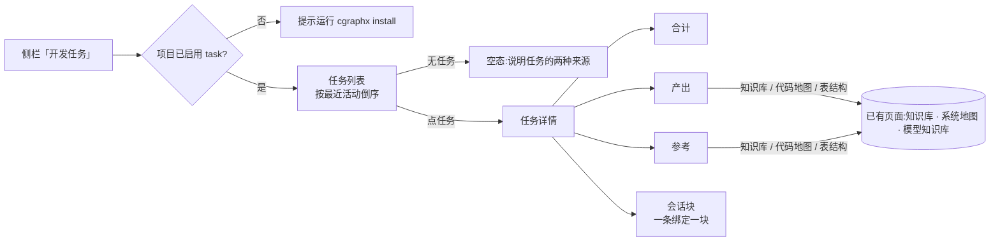

# 规格说明: cgraphx web 开发任务浏览

> feature-id: 2026-10-14-cgraphx-web开发任务浏览
> 负责人: liulongfei
> 日期: 2026-10-14

## 一图看懂

cgraphx web 侧栏新增「开发任务」入口,团队在浏览器里按任务查看投入与交付:每个任务跨了哪些会话、各花了多少时间、产出了哪些文件、参考了哪些知识库与代码地图。完全只读,所有数字在打开页面时按「会话 + 时间区间」现算。

页面布局与交互以 `cgraphx-web开发任务浏览-线框-v3.html` 为准。

| 页面 | 用户看到什么 | 没有数据 / 异常时 |
|---|---|---|
| 任务列表 | 任务名 · 进行中标记 · 来源 · 状态 · 会话数 · commit 数 · 活跃时长 · 最近活动 | 无任务 → 说明任务来源;项目没装 task → 提示 `cgraphx install` |
| 任务详情 | 任务信息 · 关联需求目录 · 合计 · 产出 · 参考 · 会话块(可展开事件)· 事件类型统计 | 从未绑定会话 → 产出 / 参考 / 会话三栏显示「尚未绑定任何会话」;任务不存在 → 404 |

## 1. 目标与范围

### 1.1 目标

把 task 子系统已经记录的「会话 ↔ 任务」绑定和 timeline 事件,在浏览器里以任务为单位呈现:投入(时长、会话、commit)、产出(交付了哪些文件)、参考(读了哪些已有知识)。

### 1.2 包含范围

| 模块 | 内容 |
|---|---|
| 侧栏 | 第 5 个入口「开发任务」,位于「系统地图」之后 |
| 任务列表页 | 全部本地任务及汇总数字 |
| 任务详情页 | 任务信息、关联需求目录、合计、产出、参考、会话块与事件、事件类型统计 |
| 时长口径 | 本需求定义「活跃时长」「工作时长」及任务合计口径(上一个需求未定义) |
| task 门面 | 允许新增 web 所需的只读能力(见 §9),不改既有函数的行为 |

### 1.3 非目标

- 任何写操作:页面上不能绑定 / 解绑 / 新建任务,不能刷新外部任务接口。
- token 用量统计(timeline 未采集)。
- 时间线页按任务筛选;时间线 → 任务的反向跳转;需求目录浏览页。
- 改动已有 4 个页面的行为(侧栏多一个入口除外)。
- 采集「Bash 生成且未提交」的文件(这类文件提交后自动出现在产出里)。
- 改动 task 子系统的业务规则(归属口径、绑定规则、自动绑定规则)。

## 2. 术语

| 术语 | 含义 |
|---|---|
| 任务 / 绑定 / 归属 | 同上一个需求 spec(`docs/features/2026-10-14-任务会话映射与timeline采集增强/`)§2、§3.2:事件 e 归属任务 T ⇔ 存在 T 的绑定 b,`b.session_id = e.session_id` 且 `b.bound_at ≤ e.ts < b.unbound_at`(`unbound_at` 为空视为无上界) |
| 绑定段 | 一条绑定记录对应的区间,即详情页的一个会话块 |
| 进行中 | 任务至少有一条 `unbound_at` 为空的绑定(任意会话) |
| 产出 | 本任务交付或改动的、当前仍存在的文件(§5) |
| 参考 | 本任务会话引用过的已有知识文件(§6),按命令记录推断,不等于确认读过 |

## 3. 时长与汇总口径

### 3.1 绑定段级

| 指标 | 口径 | 例子 |
|---|---|---|
| 活跃时长 | 该段内归属事件按时间排序;相邻两条间隔 **> 1 小时**即断开;各连续段「末条 − 首条」之和 | 09:00–10:00 连续,11:30–12:00 连续 → 1h30m |
| 工作时长 | 该段内归属事件「最后一条 − 第一条」 | 同上例 → 3h;绑定生效中但一晚无事件,工作时长不增长 |
| 无事件或仅 1 条事件 | 两项都为 0 | — |
| commit 数 | 该段内归属的 `git_commit` 事件数 | — |
| 事件数 | 该段内归属事件总数(所有类型) | — |

活跃时长口径与 task-history agent 的「去间隔活跃时长」一致(1 小时断点),但只计归属本任务的事件。

### 3.2 任务级

| 指标 | 口径 |
|---|---|
| 会话数 | 绑定段的**不同 `session_id`** 个数(同一会话绑定两段计 1) |
| 活跃时长 / 工作时长 | 全部绑定段**求和**;不同会话时间重叠也不扣除(A、B 并行各 3h → 6h) |
| commit 数 / 事件数 | 全部绑定段求和 |
| 最近活动 | 全部归属事件中最大的 `ts`;无归属事件为空 |

### 3.3 显示格式

- 时长:`<h>h <m>m`,不足 1 小时显示 `<m>m`,0 显示 `0m`;向下取整到分钟。
- 时间:进程本地时区,与时间线页一致;跨年时带年份。
- 列表中从未绑定过会话的任务,会话数 / commit 数 / 活跃时长 / 最近活动显示「—」;有绑定但无归属事件的,时长显示 `0m`、最近活动显示「—」。

### 3.4 完整性

合计、事件类型统计、产出、参考必须基于**全部**归属事件计算,不得静默截断。若实现上不得不设上限,超出时页面必须标明「统计基于前 N 条事件」。会话块里事件明细的显示上限(§7.3)不影响上述数字。

## 4. 任务列表页

| 项 | 规定 |
|---|---|
| 地址 | `/tasks` |
| 数据范围 | 本地全部任务(接口任务 + 手动任务);不请求外部接口,接口任务显示上次 `cgraphx task list` 拉取的缓存,不提示缓存新旧 |
| 列 | 任务名(带「进行中」标记)· 来源(接口 / 手动)· 外部状态原文(无则「—」)· 会话数 · commit 数 · 活跃时长 · 最近活动 |
| 排序 | 最近活动倒序;最近活动为空的排最后,其间按任务本地 id 倒序 |
| 交互 | 点任务名进入详情;无分页、筛选、搜索 |
| 「当前会话」 | 不显示「当前会话正在做的任务」(web 无会话概念) |

## 5. 产出

### 5.1 来源(合并去重,打开页面时现算)

| 来源 | 内容 |
|---|---|
| ① commit 文件 | 归属本任务的 `git_commit` 事件的改动文件清单 |
| ② 编辑文件 | 归属本任务的 Edit / Write / MultiEdit / NotebookEdit 工具事件的目标文件 |
| ③ 关联需求目录 | 主 spec 头部 `> 任务:` 指向本任务的需求目录下的全部文件(递归) |

- 只列**项目根目录内**且**当前存在**的文件;已删除的、项目外的(如临时目录)不列。
- 同一文件被多个任务改过,在各任务的产出里都出现。

### 5.2 分类(按路径,先命中先用)

| 序 | 类别 | 路径规则 |
|---|---|---|
| 1 | 需求文档 | `docs/features/**`(含线框、plan、测试规格与报告) |
| 2 | 知识库 | `docs/knowledge/**` |
| 3 | 数据库结构 | `docs/schema-knowledge/**`,以及其它位置的 `*.sql` |
| 4 | 业务图 | `docs/code-map/**`、`docs/design-map/**` |
| 5 | 接口测试 | `docs/bruno/**` |
| 6 | 代码 | 其余全部文件 |

- 空类别不显示;每类显示文件数;「代码」类默认收起,展开后列文件清单。
- 链接规则见 §8。

## 6. 参考

### 6.1 来源(打开页面时现算)

| 来源 | 识别方式 |
|---|---|
| 工具读取 | 归属本任务的 Read / Grep / Glob 工具事件中的路径参数 |
| 命令引用 | 归属本任务的 Bash 工具事件,命令文本中出现的、当前存在的项目文件路径(绝对路径换算为项目相对路径后匹配) |
| 知识库概念查询 | 归属本任务的 `cgraphx docs` 命令中按概念查询的概念名(如 `--concept=开发任务`) |

子 agent 发起的工具调用记在主会话下,同样参与识别。

### 6.2 范围与呈现

| 项 | 规定 |
|---|---|
| 类别 | 只列知识库、业务图(代码地图 / design-map)、数据库结构、需求文档四类,分类规则同 §5.2;代码文件不列 |
| 去重 | 已在本任务「产出」中出现的文件,不在参考里重复,只显示「另有 N 个文件既被参考也是本任务产出」 |
| 标注 | 栏标题注明「按命令记录推断」:命令中出现路径不等于确实读过(如 `git add`),通配符 / 变量拼出的路径识别不到 |
| 概念 | 「查询过知识库概念:A · B」,概念可点则跳知识库按该概念筛选(同系统地图页的概念标签口径),知识库无此概念则显示为不可点 |
| 链接 | 同 §8 |

## 7. 任务详情页

### 7.1 地址与区块顺序

地址 `/tasks/<任务本地 id>`。区块自上而下:

| 区块 | 内容 |
|---|---|
| 任务信息 | 来源 · 外部编号 · 外部状态 · 链接(`http` / `https` 链接新窗口打开,其它 scheme 只显示文本;空则「—」) |
| 关联需求目录 | 主 spec 头部声明本任务的需求目录路径(实时扫描),只显示路径,不可点;无则「—」 |
| 合计 | 会话数(附「N 段绑定」)· 活跃时长 · 工作时长 · commit 数 · 事件数 |
| 产出 | §5 |
| 参考 | §6 |
| 会话 | 一条绑定段一块,按绑定开始时间升序 |
| 事件类型统计 | 各事件类型的归属事件数,类型显示名沿用时间线页 |

### 7.2 会话块

| 项 | 规定 |
|---|---|
| 粒度 | 一条绑定段一块;同一会话绑定两段显示两块 |
| 块头 | 会话 id 前 8 位(悬停显示完整 id)· 区间「开始 → 结束 / 生效中」· 绑定来源(显式绑定 / 需求目录自动绑定)· 该段活跃时长 · 工作时长 · commit 数 |
| 事件 | 默认折叠,显示「事件(N)· M 轮」;展开后按轮次分组,轮次头为该轮 prompt 预览;无轮次的事件(commit、会话开始 / 结束)按时间穿插;事件行样式与时间线页一致 |
| 不跳转 | 会话不链接到时间线页 |

### 7.3 事件显示上限

每个会话块最多显示时间最早的 **500** 条事件;超出时块末显示「还有 N 条未显示,用 `cgraphx task show <任务> --events --limit <数量>` 查看」。

## 8. 跳转与链接

| 对象 | 行为 |
|---|---|
| 侧栏「开发任务」 | → `/tasks`,当前页高亮 |
| 列表任务名 | → `/tasks/<id>` |
| 知识库文件(产出 / 参考) | 已被知识库索引 → 知识库详情页;未被索引 → 只显示路径 |
| `docs/code-map/<名>.md` / `docs/code-map/flows/<名>.md` | → 系统地图的系统交互视图 / 流程视图 |
| `docs/schema-knowledge/<工程>/ddl/<表>.sql` | → 模型知识库该表详情;该工程下其它文件 → 该工程表清单 |
| 需求目录、design-map、bruno、代码、其它 sql | 只显示路径 |
| 已有页面 → 开发任务 | 不新增 |

## 9. 只读与边界

| 项 | 规定 |
|---|---|
| 不写库 | 任何 web 请求不得产生 DB 写入,包括不得创建 `task_*` 表、不得写 `task_reminders`、不得新建或更新任务 |
| 不请求外部 | 不请求外部任务接口 |
| 数据访问 | `src/web/` 只经 task / timeline / features / markdown 的公共门面取数;不得直接读 `task_*` 表或伸手进子系统内部模块 |
| 门面扩展 | 允许在 task 门面新增只读能力(如列表汇总、只读打开);既有函数与 `cgraphx task` 命令行为不变 |
| 基座 | 沿用 web 基座:只监听 127.0.0.1、应用壳、路径边界、错误页;启动预检不因 task 而变 |
| 文件读取 | 判断文件是否存在、扫描需求目录只在项目根目录内进行;不渲染文件内容 |

## 10. 异常与边界场景

| 场景 | 行为 |
|---|---|
| 项目没有 task 表(task 之前安装、未重装) | web 照常启动,其它页面不受影响;`/tasks` 与 `/tasks/<id>` 显示「本项目尚未启用开发任务,运行 `cgraphx install` 后可用」;库中不产生任何 `task_*` 表 |
| 一个任务都没有 | 列表显示「暂无开发任务」+ 两种来源:会话中 `cgraphx task use <名称>`;spec 头部写 `> 任务: <名称>` 后改动该需求目录自动绑定 |
| 任务从未绑定会话 | 列表排最后、数字列「—」;详情显示任务信息与关联需求目录,产出 / 参考 / 会话三栏显示「尚未绑定任何会话」,合计不显示 |
| 任务 id 非数字或不存在 | 基座 404 页 |
| 绑定生效中、会话仍在产生事件 | 每次刷新重新计算,看到最新数据;不缓存 |
| 产出文件后来被删 | 不再出现在产出里 |
| `cgraphx docs index` / CLI 并发写库 | 读请求不报错,可能读到新旧快照(同基座口径) |
| DB 读取失败 | 沿用基座错误页 |

## 11. 兼容性

| 对象 | 处理 |
|---|---|
| 已有 4 个页面 | 行为不变;仅侧栏新增入口 |
| web 启动预检 | 仍只要求 markdown / timeline schema;task 缺失不阻止启动 |
| task 子系统 | 业务规则与 CLI 输出不变;新增门面能力只读 |
| 历史数据 | 无迁移;历史未归属事件不出现在任何任务下 |

## 12. 验收标准

| # | 场景 | 期望 |
|---|---|---|
| A1 | 侧栏 | 出现第 5 个入口「开发任务」,点击进入 `/tasks`,高亮正确 |
| A2 | 项目无 task 表,打开 `/tasks` | 显示启用提示;访问前后 `sqlite_master` 中 `task_*` 表数量都为 0;其它页面正常 |
| A3 | 有 task 表、无任务 | 显示空态与两种来源说明 |
| A4 | 3 个任务:有近期活动 / 有较早活动 / 从未绑定 | 按最近活动倒序,从未绑定的排最后且数字列「—」 |
| A5 | 会话 A 在任务 T 下绑定两段 | 列表会话数 1;详情两个会话块;合计 = 两段之和;合计处注明 2 段绑定 |
| A6 | 会话 A、B 时间重叠地绑定同一任务,各活跃 3h | 任务活跃时长 6h |
| A7 | 段内事件 09:00–10:00 连续、11:30–12:00 连续 | 活跃 1h30m,工作 3h |
| A8 | 先产生事件后首次绑定 | 绑定前的事件计入该任务的时长、产出、参考(回溯规则) |
| A9 | 会话中途从 X 切到 Y | 切换前的事件只算 X,之后只算 Y;切换时刻的事件属于 Y |
| A10 | 任务会话中 Write 了 spec、commit 了 sql、需求目录有线框 | 三者分别出现在需求文档 / 数据库结构 / 需求文档类;文件删除后刷新不再出现 |
| A11 | 会话用 `cat docs/knowledge/X.md` 读了未被本任务改动的知识条目 | X 出现在参考的知识库类,可点进知识库详情 |
| A12 | 某知识条目既被读又被本任务改动 | 只在产出中出现,参考栏计入「另有 N 个文件」 |
| A13 | 会话执行 `cgraphx docs find --concept=开发任务` | 参考显示「查询过知识库概念:开发任务」 |
| A14 | 单个绑定段事件 600 条 | 展开显示前 500 条 + 剩余提示;合计与统计按 600 条计算 |
| A15 | 打开 `/tasks/abc`、`/tasks/99999` | 404 |
| A16 | 浏览列表与详情前后对比 DB | 无任何写入;外部任务接口无请求 |
| A17 | 在 Claude Code 会话内启动 `cgraphx web` | 列表不出现「当前会话」相关标记 |
| A18 | 任务链接为 `javascript:` 等非 http(s) | 只显示文本,不可点 |

## 13. Plan 编写约束

- 不得给 `timeline_events` 加任务列,不得新增「任务 ↔ 文件」存储;产出与参考必须查询时派生。
- web 调用 task 门面前,必须保证不会触发 task schema 应用(既有 `openTaskDb` 会执行 `ensureTaskSchema`);「项目没有 task 表」必须在不写库的前提下识别。
- 不得使用 `listTasks` 的 `currentTaskId`;如调用 `listTasks`,必须传 `local: true`。
- 列表页不得以「每个任务调一次 `getTaskDetail`」的方式求汇总;汇总经新增只读门面能力提供。
- 时长口径(§3)只实现一处,由 core 提供,便于后续 CLI 复用;web 不另写一份。
- 事件行样式复用时间线页的渲染,不另起一套。
- 新增运行时资产须加入 `scripts/copy-assets.cjs`;分层约束不变(`src/core` 不依赖 `src/web`)。

## 14. 本次 spec 补定的规则(请审阅)

以下规则在澄清中没有逐条讨论,是写 spec 时为保证契约完整而补定的:

1. **地址**:列表 `/tasks`,详情 `/tasks/<任务本地 id>`(§4、§7.1)。
2. **列表次级排序**:最近活动为空的任务之间按本地 id 倒序(§4)。
3. **时长显示**:向下取整到分钟,`<h>h <m>m`(§3.3)。
4. **完整性**:统计数字不得静默截断;不得不设上限时必须标明(§3.4)。
5. **产出分类先后**:`docs/features` 下的 sql 归需求文档,不归数据库结构(§5.2 序 1 先于序 3)。
6. **「代码」类**:实为「其余全部文件」,包括 `docs/guides` 等非代码文档(§5.2 序 6)。
7. **知识库文件未被索引**:只显示路径,不可点(§8)。
8. **任务链接**:只有 http(s) 可点,新窗口打开(§7.1)。
9. **事件上限取最早的 500 条**(§7.3)。

## 15. 待确认项

| # | 内容 | 影响 |
|---|---|---|
| Q1 | 未定性能目标(如 100 个任务、单任务 1 万条事件时列表页打开耗时)。建议:本地数据量下列表与详情 2 秒内打开 | 不阻塞 plan;plan 选汇总手段时参考 |
