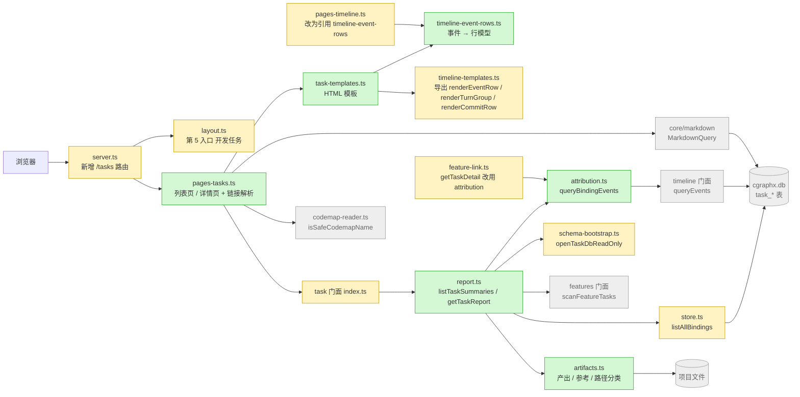
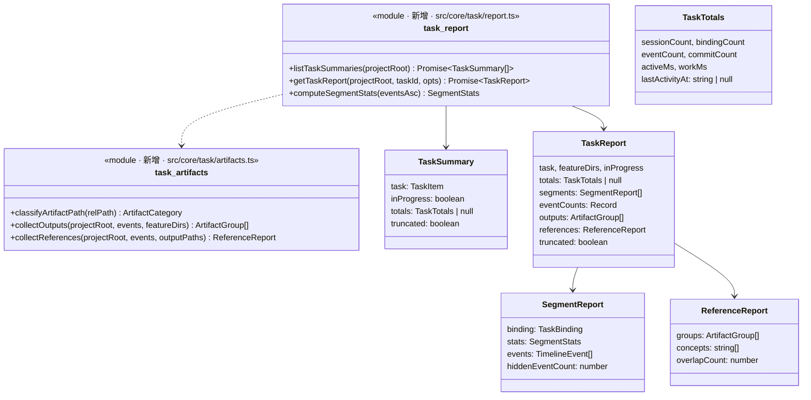
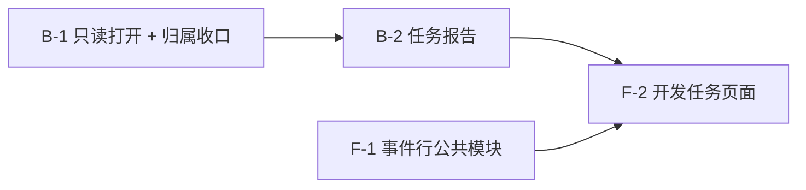

# Plan: cgraphx web 开发任务浏览

> feature-id: 2026-10-14-cgraphx-web开发任务浏览
> 负责人: liulongfei
> 日期: 2026-10-14
> 来源 spec: `../cgraphx-web开发任务浏览-spec.md`(唯一契约,本 plan 不重新定义);页面布局与交互以 `../cgraphx-web开发任务浏览-线框-v3.html` 为准

## 设计预览

task 子系统新增一组只读的「任务报告」能力:按绑定段取归属事件,算出时长、产出、参考。web 新增 `/tasks` 两个页面,经 task 门面拿到算好的报告,只负责把它画成 HTML 并加上跳往知识库、系统地图、模型知识库的链接。时间线页的事件行渲染抽成公共模块,两边共用一套样式。

**需要你重点看的**(改错了代价最大,其余可略读)

| # | 决策 | 为什么难回头 |
|---|---|---|
| 1 | web 只调 task 门面新增的两个只读函数 `listTaskSummaries` / `getTaskReport`;它们用新的 `openTaskDbReadOnly` 打开库,**不执行 `ensureTaskSchema`**,没有 task 表时抛 `TaskNotEnabledError` | 只读契约的边界(spec §9、A2)。若 web 改调既有的 `listTasks` / `getTaskDetail`,没装 task 的项目一打开页面就会被建表 |
| 2 | 时长、产出、参考的算法全部放在 `src/core/task/`(`report.ts` + `artifacts.ts`),web 不做任何口径计算 | 口径只有一处(spec §13),以后 CLI 或报告复用时不会出现两套数字 |
| 3 | URL 形态 `/tasks`、`/tasks/<本地 id>`;id 不是纯数字直接在路由层 404 | 用户会收藏链接(spec §14 第 1 条) |

**架构**——看颜色:绿色新增,黄色修改,灰色是已有且不动的邻居。注意 web 侧没有箭头直接指向 `cgraphx.db` 的 task 表,只经 task 门面;task 读事件只经 timeline 门面。



(底图:`docs/code-map/系统交互.md`、`flows/开发任务绑定.md`、`flows/开发时间线记录.md`、`flows/系统地图浏览.md`。自 source_commit 以来相关文件里只有 `src/core/task/hooks.ts` 改过,与本需求无关,视为新鲜;web 内部模块读代码确认。)

**主流程:打开任务详情**——看「没装 task」在哪一层被拦下,以及每条绑定段各查一次事件。

```mermaid
sequenceDiagram
  participant B as 浏览器
  participant S as server.ts
  participant P as pages-tasks.ts
  participant R as task/report.ts
  participant A as task/artifacts.ts
  participant T as timeline 门面
  B->>S: GET /tasks/<id>
  alt id 不是纯数字
    S-->>B: 404
  else
    S->>P: renderTaskDetailPage(db, id, ctx)
    P->>R: getTaskReport(projectRoot, id, {eventLimitPerSegment: 500})
    Note over R: openTaskDbReadOnly:没有 task_schema_versions → TaskNotEnabledError(不建表)
    R->>R: 读任务 + 绑定 + 关联需求目录
    loop 每条绑定段
      R->>T: queryEvents(session, since=bound_at, until=unbound_at)
      R->>R: 剔除 ts ≥ unbound_at;computeSegmentStats
    end
    R->>A: collectOutputs / collectReferences(全部归属事件, 需求目录)
    R-->>P: TaskReport
    P->>P: 解析链接(知识库 / 系统地图 / 模型知识库)
    P-->>B: 200 HTML(TaskNotEnabledError → 启用提示页;TaskArgError → 404)
  end
```

**类图**——看 core 对外只暴露两个函数和纯数据类型,web 拿到的是算好的数字和已分类的路径。



**关键取舍**

| 选了 | 没选 | 为什么 |
|---|---|---|
| 每条绑定段调一次 timeline `queryEvents`,命中 10000 条上限时标 `truncated` 并在页面注明 | 给 timeline 门面加无上限 / 分页查询 | 不动 timeline 子系统;一段超过 10000 条要连续工作约两天,spec §3.4 允许「标明」;真遇到再扩 |
| 新建 `attribution.ts` 收口「按绑定段取归属事件」,`getTaskDetail` 改用它 | 在 report.ts 里再写一份区间过滤 | 左闭右开的剔除规则只有一处,`task show` 与 web 口径不会分叉 |
| 抽出 `timeline-event-rows.ts` | 直接从 `pages-timeline.ts` 导出 `toEventRow` | `pages-timeline.ts` 已 673 行,超过 600 行硬线;抽出后两边共用且降到线下 |

## 目标与范围

- 实现 spec 全部条款:侧栏入口、任务列表页、任务详情页(合计 / 产出 / 参考 / 会话块 / 事件类型统计)、时长口径、只读边界、异常与空态。
- task 门面新增只读能力;timeline 页的事件行渲染抽成公共模块(行为不变)。

## 明确不包含

- 不改 `listTasks`、`getTaskDetail`、`cgraphx task` 各命令的行为与输出(`getTaskDetail` 只做内部重构)。
- 不改 timeline 子系统(`src/core/timeline/` 零改动)、不改 features / markdown 子系统。
- 不改时间线页、知识库页、模型知识库页、系统地图页的行为;不加反向跳转。
- 不新增表、不改 schema、不新增运行时资产文件(样式追加进已随包分发的 `src/web/public/app.css`)。
- 不写测试(测试走 `/write-unit-test-spec` → `/write-unit-test-code`)。

## 计划文件清单

| 文件 | 状态 |
|---|---|
| `cgraphx-web开发任务浏览-index.md` | 本文件 |
| `cgraphx-web开发任务浏览-01-schema.md` | 不涉及(无表结构变更) |
| `cgraphx-web开发任务浏览-02-backend.md` | B-1、B-2(src/core/task) |
| `cgraphx-web开发任务浏览-03-frontend.md` | F-1、F-2(src/web) |

## 总任务清单

| 任务 | 名称 | 对应 spec | 依赖 | 独立提交 |
|---|---|---|---|---|
| B-1 | task 只读打开 + 归属事件查询收口 | §9、§10 首行、§13 第 2 条、A2 | 无 | 是 |
| B-2 | 任务报告:时长、汇总、产出、参考 | §3、§4(数据)、§5、§6、§7(数据)、§13 | B-1 | 是 |
| F-1 | 时间线事件行渲染抽成公共模块 | §7.2「行样式与时间线页一致」、§13 | 无 | 是 |
| F-2 | 开发任务页面:路由、侧栏、列表、详情 | §1.2、§3.3、§4、§7、§8、§10、§11 | B-2、F-1 | 是 |

## 全局依赖图



## 推荐执行顺序与并行批次

| 批次 | 任务 | 可并行依据 |
|---|---|---|
| 1 | B-1、F-1 | 文件集不相交(B-1 只动 `src/core/task/`,F-1 只动 `src/web/pages-timeline.ts`、`timeline-templates.ts`、新文件 `timeline-event-rows.ts`);无公共契约 |
| 2 | B-2 | 依赖 B-1 的 `openTaskDbReadOnly` / `queryBindingEvents` / `listAllBindings` |
| 3 | F-2 | 依赖 B-2 的门面函数与类型、F-1 的导出 |

单 agent 执行时按 B-1 → F-1 → B-2 → F-2 串行即可。

## 必须严格执行的契约

1. **只读**:web 请求路径上不得调用 `openTaskDb`、`ensureTaskSchema`、`listTasks`、`getTaskDetail`、`bindSession*`、`autoBindFromFeatureDir`、`fetchRemoteTasks`;只调 `listTaskSummaries`、`getTaskReport`(及其类型/错误类)。
2. **门面**:`src/web/` 只 import `../core/task`(index.ts)、`../core/markdown`、`../core/timeline`(类型)、`../core/db`(类型);不得 import `src/core/task/` 下的内部文件。
3. **分层**:`src/core/` 不得 import `src/web/` / `src/cli/`。
4. **门面新增导出(逐字)**:函数 `listTaskSummaries`、`getTaskReport`、`computeSegmentStats`、`classifyArtifactPath`;常量 `ACTIVE_GAP_MS`、`ARTIFACT_CATEGORIES`、`REFERENCE_CATEGORIES`;错误 `TaskNotEnabledError`;类型 `SegmentStats`、`TaskTotals`、`TaskSummary`、`SegmentReport`、`ArtifactCategory`、`ArtifactGroup`、`ReferenceReport`、`TaskReport`。签名见 02-backend B-2,两端同文。
5. **口径唯一**:活跃时长、工作时长、合计、排序、产出、参考的计算只在 `src/core/task/report.ts` / `artifacts.ts`;web 只做格式化与链接。
6. **URL**:`/tasks`(`/tasks/` 等同)、`/tasks/<纯数字本地 id>`;其它 `/tasks/*` 一律 404。

## 实现手段决策(plan 自主,无 spec 信封外的业务可观察后果)

| 决策 | 选项 | 选定 | 理由 |
|---|---|---|---|
| 识别「没装 task」 | A web 自查 sqlite_master / B task 门面只读打开时检查 | B | 门面负责自己的表;web 不碰 task 表名(契约 2) |
| 列表汇总取数 | A 每任务调 getTaskDetail / B 一次取全部绑定、逐绑定段查事件 | B | spec §13 禁止 A;B 的查询数 = 绑定段数 |
| 事件上限 | A timeline 加分页 / B 沿用 10000 上限 + truncated 标注 | B | 见关键取舍第 1 条 |
| 产出/参考的文件存在判断 | 每次请求 `fs.statSync` 现查 | — | spec 要求现存文件、不缓存;文件数百级,ms 级 |
| 事件行复用 | A 导出 pages-timeline 私有函数 / B 抽公共模块 | B | 见关键取舍第 3 条 |
| 样式 | A 新 css 文件 / B 追加到 app.css | B | 沿用系统地图需求的做法;无需改 `copy-assets.cjs` |
| 显示上限 500 放哪 | web 常量 `TASK_SEGMENT_EVENT_LIMIT`,经 opts 传给 core | — | 是展示参数,不是口径 |

无回跳 spec 的项。

## 执行方式建议

**`/implementation`**。预估改动约 15 个文件(新增 7、修改 8),但只跨 `src/core/task` 与 `src/web` 两个模块,且 F-2 需要 B-2 的实际产出实时对齐,不满足 subagent 三条件(≥3 个相互独立模块)。

## 适用规范

| 文件 | 章节 | 用于 |
|---|---|---|
| `docs/guides/coding-standards.md` | 边界与结构 · 选型(偏离社区默认)· 错误与日志 | 全部任务 |
| `docs/guides/git-standards.md` | 提交消息规范 · 提交前检查点 | 结晶到下节 |

不涉及 `data-standards.md`(无 schema)、`interface-standards.md`(无 CLI 命令 / 退出码变化;web 页面不属于其范围)。

## 提交规范(结晶自 git-standards.md)

- 格式:`type(scope): 中文描述`;type 用 feat / refactor / fix / docs;本需求 scope 用 `task`、`web`。
- 补充说明用「——」,并列用「+」。非琐碎提交写 body:背景一行 + 「-」列要点。不写票据号。
- 结尾附 `Co-Authored-By: Claude Opus 5.5 <noreply@anthropic.com>`。
- 提交前逐项自查(`git diff --cached`):
  - 与 TS 同放的运行时资产未登记 `scripts/copy-assets.cjs`(本需求不应新增此类资产)
  - `src/core` 出现对 `src/cli` / `src/web` 的 import
  - `vitest.config.ts` 的 `TZ: 'UTC'` 被改
  - 写死的魔法值:绝对路径、阈值、版本号写进源码(阈值 1 小时、上限 500 / 10000 必须是具名常量)
  - 新增 TODO / FIXME

## 允许局部工程适配的范围

- 新文件内部的私有函数拆分与命名、模板 HTML 的具体结构与 class 名(须与线框 v3 的区块顺序一致)。
- app.css 新增规则的写法(沿用既有设计令牌与时间线页 class)。
- 报告组装时的循环与数据结构,只要对外类型和数字口径与契约一致。

除上述外,签名、导出名、URL、口径、错误语义一律固定。

## Plan 冲突上报规则

实现中发现 plan 与 spec 冲突、或 plan 的签名/口径在代码现实中无法成立时,停止该任务,按 `PLAN_CONFLICT: <任务> · <冲突点> · <spec 条款> · <建议>` 上报,不自行改口径。权威链:任务 ← plan ← spec。

## 关键风险与防跑偏约束

| 风险 | 约束 |
|---|---|
| 误调既有 `openTaskDb` 导致没装 task 的项目被建表 | 契约 1;F-2 验证步骤含「删表后访问,表数仍为 0」 |
| `getTaskDetail` 重构改变 `task show` 输出 | B-1 完成条件:重构前后 `task show <id> --events --json` 输出一致 |
| `pages-timeline.ts` 抽取后时间线页行为变化 | F-1 完成条件:抽取前后 `/timeline?range=7d` HTML 一致 |
| commit 文件路径相对 git 仓库根,项目根不是仓库根时对不上 | 按项目根解析,对不上的因「文件不存在」被过滤;已知局限,不另处理 |
| 截断时的口径偏差:timeline 按 ts 降序取上限,一段超过 10000 条时保留的是最近 10000 条,会话块显示的「最早 500 条」是保留集中最早的 | 页面截断文案写「统计基于每段最近 10000 条事件」,如实说明;spec §3.4 允许标明后截断 |
| Bash 命令文本路径提取误判 | spec 已定为「推断」并在页面标注;提取规则见 B-2,不扩大 |

## 待确认项

- spec Q1(性能目标)不阻塞:按「本地数据量下 2 秒内」自测,F-2 验证步骤记录实测耗时。
