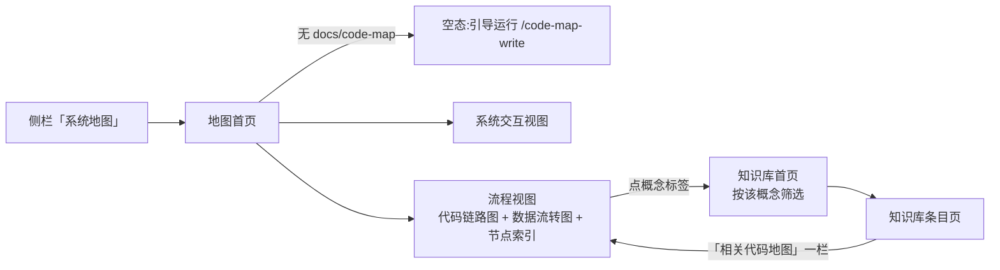

# 规格说明: cgraphx web 系统地图

> feature-id: 2026-10-14-cgraphx-web系统地图
> 负责人: liulongfei
> 日期: 2026-10-14

> **依赖声明**:本需求依赖《cgraphx-web知识库浏览》(feature-id: 2026-07-30-cgraphx-web知识库浏览)定义的**服务基座**——命令接口、启动预检、localhost 安全边界、应用壳与全局错误态、分层约束、路径边界与只读契约。本 spec 直接引用、不重复基座条款。本需求对基座的改动仅限:应用壳侧栏新增第四入口(§3.1)。

## 一图看懂

cgraphx web 侧栏新增「系统地图」,团队在浏览器里浏览 `docs/code-map/` 下的系统交互图与业务流程视图(代码链路 + 数据流转),过期视图会被标出,并与知识库双向跳转。只读本地文件。

页面布局与交互以 `cgraphx-web系统地图-线框-v1.html` 为准。

| 页面 | 用户看到什么 | 没有数据 / 出错时 |
|---|---|---|
| 地图首页 | 系统交互入口(置顶)+ 流程列表:名称 · 一句话 · 生成日期 · 过期标记 | 无 `docs/code-map/`:空态引导 `/code-map-write`;某文件头部坏了:列出但灰掉、不可点,注明「格式无法解析」 |
| 系统交互 / 流程视图 | 生成信息 + 一句话 + 图 + 节点索引 + 已知盲区;流程视图另有概念标签 | 断网:图退回原文 + 「未联网」提示;图写法错:退回原文 + 提示;过期:顶部提示 + 改过的文件 |
| 知识库条目页(既有) | 新增「相关代码地图」一栏 | 无相关视图:整栏不出现 |

## 1. 目标与范围

### 1.1 目标

给人一个看懂系统全貌的浏览入口:把 `code-map-write` 生成的代码地图在浏览器中以图的形式呈现,并与知识库的业务概念互相连通,补上代码地图「生成 → 人看」闭环的人看一端。

### 1.2 包含范围

- 应用壳侧栏第四入口「系统地图」;
- 地图首页、系统交互视图页、流程视图页;
- mermaid 图在浏览器中绘制(联网时),断网/写法错时退回原文;
- 视图过期标记;
- 视图 → 知识库(概念标签)与 知识库条目页 → 视图(「相关代码地图」一栏)双向跳转。

### 1.3 明确非目标

| 非目标 | 说明 |
|---|---|
| 生成 / 刷新视图 | 页面无任何写操作入口,含「重新生成」按钮;刷新回 Claude Code 跑 `/code-map-write` |
| 搜索视图 | 不提供视图搜索或筛选 |
| 知识库正文中的 mermaid | 知识库条目页的 markdown 正文渲染方式不变,不因本需求绘制其中的 mermaid |
| 补齐数据 | 不补知识库概念条目、不补视图 `concepts`;上线时现有两份视图一处都跳不通,属预期 |
| 未提交改动的过期提示 | 过期只看已提交改动(§3.5) |
| 打包画图组件 | 画图组件不随 npm 包分发(§9) |
| 使用 frontmatter 的 `knowledge` 字段 | 互跳只靠 `concepts` 对概念名,不读 `knowledge` |

## 2. 术语与业务对象

| 对象 | 定义 |
|---|---|
| 代码地图 / 视图 | `docs/code-map/` 下由 `code-map-write` 生成的 markdown 文件,带 frontmatter;格式以 `code-map-write` skill 及其样张为准 |
| 系统交互视图 | `docs/code-map/系统交互.md`;服务多时可按业务域拆为 `系统交互-<域>.md`(可能多份) |
| 流程视图 | `docs/code-map/flows/<流程名>.md`,一个业务流程一份 |
| 视图头部字段 | `title` · `view_type`(system / flow)· `concepts` · `related_code` · `source_commit` · `generated` · `entry`(流程视图可选)· `provider` |
| 过期 | 视图 `source_commit` 之后,`related_code` 中任一文件有**已提交**改动(与 `code-map-recall` 的 `git diff` 口径一致,不含其 `git status` 一项) |
| 概念对上 | 视图 `concepts` 中某个名字与知识库索引中的概念名**完全一致** |

## 3. 系统行为

### 3.1 侧栏第四入口【基座应用壳改动,仅此一处】

- 在「知识库 / 开发时间线 / 模型知识库」之后新增「系统地图」,常驻可点,无论 `docs/code-map/` 是否存在;
- 进入地图相关页面时该入口高亮;图标、路由命名由 plan 定。

### 3.2 地图首页

| 场景 | 行为 |
|---|---|
| 正常 | 顶部「系统交互」区:列出全部系统交互视图(通常一份),每项显示标题、一句话、生成日期、commit、过期标记;下方「业务流程」区:列出 `flows/` 下全部流程视图,每项显示流程名(title)、一句话、生成日期、过期标记;点击进入视图页 |
| `docs/code-map/` 不存在或无任何视图文件 | 空态:「还没有代码地图」+ 引导在 Claude Code 中运行 `/code-map-write` |
| 只有系统交互、无流程(或反之) | 有的一区正常显示,另一区显示「暂无」 |
| 某视图文件头部无法解析 | 该文件仍列出(显示文件名),灰掉、不可点击,注明「格式无法解析」;不影响其他视图 |

- 「一句话」取视图正文「一句话」节的内容;取不到时不显示该项,不算格式错误。
- 列表排序由 plan 定。

### 3.3 视图页(系统交互 / 流程)

- 顶部:标题、生成日期、`source_commit`;流程视图另显示 `entry`(有则显示)与概念标签(§3.6);`concepts` 为空则不显示概念行;
- 过期时在顶部显示过期提示(§3.5);
- 正文:按原文顺序渲染视图 markdown 全文(一句话、各图及其「看什么」说明、节点索引表、已知盲区),其中 mermaid 代码块按 §3.4 显示;
- 提供返回地图首页的入口。

### 3.4 图的显示

| 场景 | 用户看到 |
|---|---|
| 联网,图写法正确 | 绘制成图 |
| 断网(画图组件加载不到) | 显示 mermaid 原文 + 「未联网,图无法绘制」提示;页面其余部分正常 |
| 图写法有误(组件已加载但绘制失败) | 该图位置显示原文 + 「图的写法有误,无法绘制」提示;同页其他图不受影响 |

- 任何情况下页面不空白、不报未处理错误。

### 3.5 过期标记

| 场景 | 行为 |
|---|---|
| 过期(§2 定义) | 地图首页该项显示「已过期」;视图页顶部显示「已过期:生成之后以下文件有改动,图可能和代码不符」+ 改动文件列表 + 「在 Claude Code 中运行 `/code-map-write` 重新生成」 |
| 未过期 | 不显示任何标记 |
| 只有未提交改动 | 视为未过期,不提示 |
| 无法判断(项目不是 git 仓库 / 本机无 git / `source_commit` 在仓库中找不到) | 不显示标记,页面不报错 |

- **新鲜度**:每次打开页面时现场判断,不缓存判断结果;视图文件内容同理,文件现在是什么就显示什么。

### 3.6 与知识库互跳

| 方向 | 行为 |
|---|---|
| 视图 → 知识库 | 每个概念显示为标签;对上的标签可点,跳转到知识库首页并按该概念筛选(列出所有含该概念的条目,一篇也走筛选列表);对不上的标签显示为虚线样式、不可点,悬停提示「知识库中没有这个概念」 |
| 知识库条目页 → 视图 | 条目页新增「相关代码地图」一栏:列出 `concepts` 与本条目概念有交集的全部视图(标题,过期的带「已过期」),点击进入视图页;没有相关视图时整栏不出现 |

- 「对上」以**知识库索引**为准(沿用基座「元数据以索引 DB 为准」口径):新写的知识库条目在 `cgraphx docs index` 之前不计入。
- 知识库条目页其余部分(元数据、摘要、引用分区、正文)不变。

## 4. 数据与口径

| 数据 | 来源 | 读写 |
|---|---|---|
| 视图列表与内容 | `docs/code-map/*.md`、`docs/code-map/flows/*.md` 当前文件 | 只读 |
| 过期判定 | 目标项目 git 历史 | 只读 |
| 知识库概念 | 知识库索引(`.cgraphx/cgraphx.db` 中 markdown 表) | 只读 |

- 不新增任何持久化数据,不写 DB、不写文件。

## 5. 边界与安全

- 访问边界、只读口径沿用基座(仅 localhost、无写端点)。
- **路径边界**:只读取 `docs/code-map/` 根目录与 `flows/` 子目录下的 `.md` 文件;URL 中的视图标识不能读到这两处以外的任何文件。
- **内容不执行**:视图 markdown 中的原始 HTML 不生效(同基座 markdown 渲染口径);mermaid 图中的文本不得被当作脚本或链接执行。
- **外部脚本**:画图组件是 web 首次从公网加载的脚本,版本必须固定,不随远端更新而变化。
- 调用 git 仅限只读查询,不得改变仓库状态。

## 6. 兼容性

- 既有三个侧栏入口及其页面行为不变;知识库条目页仅新增一栏。
- 视图格式以 `code-map-write` 当前定义为准;字段缺失按 §3.2 / §3.3 / §7 降级,不要求旧视图重新生成。

## 7. 异常与边界场景

| 场景 | 行为 |
|---|---|
| 视图文件头部不是合法 frontmatter / 缺 `title` | 首页灰显「格式无法解析」;直接访问其视图页 → 404 页 |
| 缺 `source_commit` 或 `related_code` | 视为无法判断过期,不显示标记,视图正常显示 |
| 缺 `concepts` 或为空 | 不显示概念行;不参与反向关联 |
| 访问不存在的视图 | 基座 404 页 |
| 视图在浏览期间被重新生成 | 刷新即显示新内容,不报错 |
| 视图无 mermaid 块 | 正常渲染正文 |

## 8. 验收标准

1. 侧栏出现第四入口「系统地图」,点击进入地图首页;用本仓库两份真实视图,首页正确列出「系统交互」与「开发时间线记录」。
2. 删除(或改名)`docs/code-map/` 后首页显示空态与 `/code-map-write` 引导。
3. 联网打开「开发时间线记录」,代码链路图与数据流转图绘制成图;断网后刷新,两图退回原文并显示「未联网」提示,节点索引表等正常。
4. 人为改坏一张图的 mermaid 写法:该图退回原文 + 写法错误提示,同页另一张图正常。
5. 修改并**提交**某视图 `related_code` 中的文件后:首页与视图页显示「已过期」,视图页列出该文件;只修改不提交时不提示。
6. 在非 git 目录下运行 web:页面正常,无过期标记,无报错。
7. 「开发时间线」标签为虚线、不可点;在知识库补一篇含该概念的条目并 `cgraphx docs index` 后,标签变为可点,点击进入知识库首页按「开发时间线」筛选;该条目页出现「相关代码地图」一栏,含「开发时间线记录」。
8. 没有相关视图的知识库条目页不出现「相关代码地图」一栏。
9. 某视图头部改坏:首页灰显并注明「格式无法解析」,其余视图正常。
10. 构造 `../` 等路径的 URL 无法读到 `docs/code-map/` 以外的文件。
11. 全程无任何文件或 DB 写入;`git status` 在浏览前后不变。

## 9. Plan 编写约束

- 不引入前端构建链;画图组件**运行时从公网加载,不打包进 npm 包**(用户已确认团队机器可上外网)。
- 分层约束沿用:`src/core/` 不依赖 `src/web/`;web 只经 core 门面访问知识库数据。
- 不改基座机制(预检、回环绑定、错误态、静态资产);应用壳只加一个入口。
- 知识库条目页既有内容与行为不变。
- 过期判定口径必须与 `code-map-recall` 的 `git diff` 一致,不自行发明口径。
- 页面布局与交互以线框 v1 为准。

## 10. 不可留到实现期的决策(均已锁定)

| 决策 | 结论 |
|---|---|
| 图怎么显示 | 联网绘制,断网 / 写法错退回原文 + 提示 |
| 过期口径 | 只看已提交改动;每次打开现场判断;无法判断不显示 |
| 互跳 | 双向;概念名完全一致;以知识库索引为准;标签跳知识库首页按概念筛选 |
| 坏文件 | 首页列出、灰掉、不可点、注明「格式无法解析」 |
| 写操作 | 无 |

## 11. 待确认项

- 【待确认,不阻塞 plan】多 git 子工程项目中 `source_commit` 写成 `<子工程>:<hash>` 列表时的过期判定:本 spec 暂按「无法判断 → 不显示标记」处理;如需支持,另行补充。
