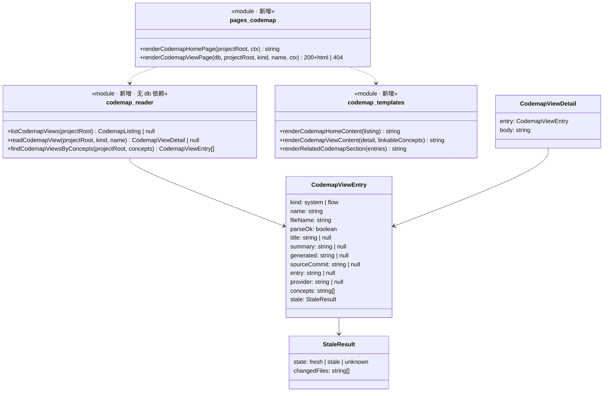

# Plan: cgraphx web 系统地图

> feature-id: 2026-10-14-cgraphx-web系统地图
> 负责人: liulongfei
> 日期: 2026-10-14
> 来源 spec: `../cgraphx-web系统地图-spec.md`(唯一契约,本 plan 不重新定义)

## 设计预览

web 层新增 codemap 模块:三个新文件负责"读 `docs/code-map/` + 问 git 是否过期 → 拼 HTML → 出页面",server 加一组 `/map` 路由,侧栏加第四入口;知识库详情页加一栏「相关代码地图」。图的绘制完全在浏览器里做:服务端只输出 mermaid 原文,`app.js` 在视图页按需从 CDN 加载画图组件,加载不到就保持原文。

**需要你重点看的**(改错了代价最大,其余可略读)

| # | 决策 | 为什么难回头 |
|---|---|---|
| 1 | URL 形态:`/map`、`/map/system/<文件名>`、`/map/flow/<流程名>`;名字含 `..` `/` `\` 时在路由层直接 404 | 用户会收藏链接;路径安全边界放在路由层,新页面不会漏 |
| 2 | 服务端**不改** `markdown.ts`,mermaid 块照常输出为代码块;只有带 `data-codemap` 标记的页面才由 `app.js` 绘制 | 保证知识库正文里的 mermaid 不被顺带绘制(spec §1.3);若改成服务端识别,知识库页会被波及 |
| 3 | 画图组件锁定 `mermaid@11.4.1`(jsDelivr),`securityLevel: 'strict'` | web 首次加载公网脚本;版本与安全级别是安全边界(spec §5) |

**架构**——看颜色:绿色新增,黄色修改,灰色是已有且不动的邻居;注意 codemap 模块读文件和 git,只有"概念对不对得上"经 core/markdown 门面查索引 DB。

```mermaid
flowchart LR
  browser[浏览器] --> server[server.ts<br/>新增 /map 路由组]
  server --> layout[layout.ts<br/>第四入口 系统地图]
  server --> pages[pages-codemap.ts<br/>首页 / 视图页]
  server --> detail[pages-detail.ts<br/>加「相关代码地图」一栏]
  pages --> tpl[codemap-templates.ts<br/>HTML 模板]
  pages --> reader[codemap-reader.ts<br/>读视图 + 过期判定]
  detail --> reader
  pages --> mdq[core/markdown 门面<br/>MarkdownQuery.listConcepts]
  detail --> mdq
  tpl --> md[markdown.ts<br/>renderMarkdownBody]
  reader --> fs[(docs/code-map/<br/>*.md + flows/*.md)]
  reader --> git[(git diff)]
  mdq --> db[(cgraphx.db)]
  browser -. app.js 按需加载 .-> cdn[jsDelivr<br/>mermaid@11.4.1]
  classDef new fill:#d4f7d4,stroke:#2a2
  classDef changed fill:#fff3c4,stroke:#c90
  classDef old fill:#eee,stroke:#999,color:#666
  class pages,tpl,reader new
  class server,layout,detail changed
  class mdq,md,db,fs,git,cdn old
```

(底图:`docs/code-map/系统交互.md`,source_commit 3c3d567 = HEAD,新鲜;web 内部模块由读代码确认。)

**主流程:打开一个流程视图**——看过期判定和图绘制分别在哪一侧发生,断网时在哪里退回原文。

```mermaid
sequenceDiagram
  participant B as 浏览器
  participant S as server.ts
  participant P as pages-codemap.ts
  participant R as codemap-reader.ts
  participant G as git
  B->>S: GET /map/flow/<流程名>
  alt 名字含 .. / 或 \
    S-->>B: 404(不进页面层)
  else 名字合法
    S->>P: renderCodemapViewPage(db, projectRoot, 'flow', 名字)
    P->>R: readCodemapView(projectRoot, 'flow', 名字)
    R->>G: git diff --name-only <source_commit> HEAD -- <related_code>
    G-->>R: 改动文件 / 失败
    R-->>P: CodemapViewDetail | null
    P-->>S: 200 + html / 404
    S-->>B: 200 HTML(mermaid 原文 + data-codemap)/ 404 → 基座 sendNotFound
    B->>B: app.js 加载 CDN 画图组件
    alt 加载失败
      B->>B: 保留原文,显示「未联网」
    else 加载成功
      B->>B: 逐图绘制;单图失败 → 保留原文 + 「写法有误」
    end
  end
```

**类图**——看 reader 对外只交纯数据,过期结果是三态。



**关键取舍**

| 选了 | 没选 | 为什么 |
|---|---|---|
| 读取放 `src/web/codemap-reader.ts` | 新建 core 子系统 | 与 `schema-reader.ts` 同构;只有 web 用,YAGNI |
| 浏览器端绘制,CDN 按需加载 | 服务端绘制 / 打包进 npm | spec §9 已锁定;服务端绘制需无头浏览器 |
| 每次请求现跑 git、现读文件 | 缓存 | spec §3.5 要求现场判断;视图数十级,git diff 毫秒级 |

## 目标与范围

见 spec「一图看懂」与 §1。本 plan 覆盖:侧栏第四入口、`/map` 路由组、地图首页、视图页、过期标记、浏览器端绘制与降级、视图 → 知识库标签跳转、知识库详情页「相关代码地图」一栏。

## 明确不包含

- 不改 `src/web/markdown.ts`(知识库正文 mermaid 不绘制,spec §1.3)
- 不改基座机制(预检/回环/错误态/静态资产服务);`layout.ts` 只加一个入口
- 不读 frontmatter 的 `knowledge` 字段(spec §1.3)
- 不提供写操作、搜索、未提交改动提示(spec §1.3)
- 不写新测试(测试是代码完成后的独立流程:write-unit-test-spec → write-unit-test-code)

## 计划文件清单

- `cgraphx-web系统地图-index.md`(本文件)
- `cgraphx-web系统地图-tasks.md`——T-1 ~ T-4 可执行步骤
- 不拆 `-01-schema`(无表变更)/ `-02-backend` / `-03-frontend`:单 web 模块,SSR 与前端增强强耦合,沿用上一个 web 需求的 index + tasks 形态。

## 总任务清单

| 任务 | 标题 | 对应 spec | 依赖 | 独立提交 |
|---|---|---|---|---|
| T-1 | codemap-reader:读视图 + 过期判定 + 按概念反查 | §2 §3.2 §3.5 §4 §5 §7 | — | 是 |
| T-2 | 地图首页 + 视图页 + 路由 + 侧栏入口 + 概念标签 | §3.1 §3.2 §3.3 §3.5 §3.6(正向) §5 §7 | T-1 | 是 |
| T-3 | 浏览器端绘制与降级(app.js + 样式) | §3.4 §5 | T-2 | 是 |
| T-4 | 知识库详情页「相关代码地图」一栏 | §3.6(反向) | T-1(使用 T-2 的模板文件) | 是 |

## 依赖与执行顺序

```
T-1 ──→ T-2 ──┬──→ T-3
              └──→ T-4
```

推荐顺序:T-1 → T-2 → T-3 → T-4。T-3 与 T-4 文件集不重叠(T-3:`public/app.js`、`public/app.css`;T-4:`pages-detail.ts`、`codemap-templates.ts` 追加一个函数),可并行;单 agent 串行即可。

## 必须严格执行的契约

1. **URL 形态**:`GET /map`(首页)· `GET /map/system/<name>` · `GET /map/flow/<name>`;`<name>` = 去掉 `.md` 的文件名,经 `decodeURIComponent`;解码失败或 `isSafeCodemapName` 不过 → 路由层 404。`/map/` 下其他形态 → 404。
2. **文件定位**:system = `docs/code-map/<name>.md`(根目录全部 `.md`);flow = `docs/code-map/flows/<name>.md`。只读这两处。
3. **过期判定**:`git diff --name-only <source_commit> HEAD -- <related_code...>`,`cwd = projectRoot`,超时 3000ms;输出非空 → stale(changedFiles = 输出行);输出为空 → fresh;命令失败 / 抛错 / `source_commit` 或 `related_code` 缺失 → unknown。不跑 `git status`。
4. **概念对上**:`new MarkdownQuery(db).listConcepts({ sort: 'name' })` 的 `name` 集合,与视图 `concepts` 完全相等比较(区分大小写,不 trim 以外处理)。
5. **标签跳转**:`buildOverviewUrl({ q: undefined, types: [], statuses: [], domains: [], concepts: [<概念名>], sort: 'updated', page: 1 })`。
6. **绘制范围**:只绘制 `[data-codemap] code.language-mermaid`;mermaid 初始化 `{ startOnLoad: false, securityLevel: 'strict', suppressErrorRendering: true }`;CDN 地址 `https://cdn.jsdelivr.net/npm/mermaid@11.4.1/dist/mermaid.min.js`(2026-10-14 已 curl 确认 200)。
8. **404**:不存在 / 坏文件的视图页一律走 server.ts 的基座 `sendNotFound`,页面层不自绘 404。
7. **只读**:codemap 模块不写任何文件、不写 DB;git 只调 `diff`。

## 实现手段决策(plan 自主,无业务可观察后果)

| 决策 | 选项 | 选定 | 理由 |
|---|---|---|---|
| 读取层位置 | core 子系统 / web 内 reader | web 内 `codemap-reader.ts` | 与 schema-reader 同构,只有 web 消费 |
| frontmatter 解析 | 自写 / 复用 core/markdown | 复用门面已导出的 `parseFrontmatter` + `stripFrontmatter`;列表字段由 reader 内私有 `toList` 宽松读取 | 与知识库同一解析器;实测该解析器把 `concepts: []` 解析为字符串 `"[]"`,core 的 `readList` 会抛错,故不用 |
| mermaid 识别 | 改 markdown.ts / 前端按容器识别 | 前端按 `data-codemap` 容器识别 markdown-it 默认产出的 `code.language-mermaid` | 不波及知识库页(契约 2) |
| 脚本加载 | 壳加 extraScripts / app.js 动态注入 | app.js 检测到 `[data-codemap]` 时动态插入 `<script>` | 壳不改,其他页面零开销 |
| 视图标识 | 路径参数 / 文件名 | 文件名(去 `.md`) | 视图文件名即流程名,天然唯一 |
| 列表排序 | 按名 / 按生成日期 | 按 `name` 的 `localeCompare(…, 'zh-CN')` | 稳定可预期;spec 交 plan 定 |

## 执行方式建议

**`/implementation`**。预估变更约 8 个文件,全部在 `src/web/`,core 零改动,不满足"跨 ≥3 个相互独立模块";T-2 → T-3/T-4 需要共享模板与样式,串行反馈更顺。

## 适用规范

- `docs/guides/coding-standards.md`:「边界与结构」(硬分层、门面硬约定、运行时资产登记)、「选型」(`node:` 前缀、`as const` 不用 enum、中文注释、单文件 ≤600 行)、「错误与日志」
- `interface-standards.md`:不涉及(HTML 页面,非对外 API;web 不承诺接口契约,见知识库条目 cgraphx web)
- `data-standards.md`:不涉及(无表变更)

## 提交规范(摘自 `git-standards.md`)

- 格式:`type(scope): 中文描述`;本需求 scope 用 `web`;补充说明用"——",并列用"+"。
- 非琐碎提交写 body:背景一行 + "-" 列要点。无票据关联。
- 提交前检查点(本需求相关):
  - 与 TS 同放的运行时资产未登记 `scripts/copy-assets.cjs`(本需求新资产只在 `src/web/public/`,已整目录拷贝,无需登记)
  - `src/core` 出现对 `src/cli` / `src/web` 的 import
  - 写死的魔法值:绝对路径、密钥、阈值、版本号写进源码(CDN 版本号与 git 超时**必须**放 `constants.ts` / app.js 顶部常量,不散落)
  - 新增 TODO / FIXME

## 允许局部工程适配的范围

- 模板内部 HTML 结构、CSS 类名(遵循既有 BEM 风格 `codemap__xxx`)、私有辅助函数拆分
- reader 内部实现(目录遍历方式、"一句话"节提取的正则写法),只要满足 tasks 中的行为表
- 侧栏图标字符

## Plan 冲突上报规则

实现中发现 plan 与代码现实冲突(签名不可行、既有函数不存在等)→ 停止该点,按 `PLAN_CONFLICT: <任务> <冲突> <建议>` 上报;发现 plan 与 spec 冲突 → 以 spec 为准并上报;局部适配记录为 `PLAN_ADAPTED: <任务> <改了什么> <原因>`。

## 关键风险与防跑偏约束

| 风险 | 约束 |
|---|---|
| 首页视图多时 git 调用串行变慢 | 本期不优化;每视图一次 `execFileSync`,超时 3000ms 兜底 |
| mermaid 全局对象污染其他页面 | 只在 `[data-codemap]` 存在时注入脚本 |
| 视图 markdown 含原始 HTML | 正文仍走 `renderMarkdownBody`(`html:false`),不另开渲染器 |
| server.ts 接近 600 行 | 路由处理函数 `handleCodemap` 控制在 60 行内;超出则拆到 `pages-codemap.ts` 的解析辅助 |

## Self-Review / Plan Review 记录

- Plan Review 已派 plan-document-reviewer:2 项阻塞已修(视图 404 收敛到基座 `sendNotFound`;删除越界的测试修正——用例 10 并不断言入口数);采纳建议 5 项(`suppressErrorRendering`、CDN 路径实测、T-4 不改 `app.css` 以保并行、壳 title、补线框中的计数行与 `provider` 显示、去重正文 H1)。

## 待确认项

- 无阻塞项。spec §11 多子工程 `source_commit` 按 unknown 处理,已覆盖于契约 3(git 命令失败即 unknown)。
