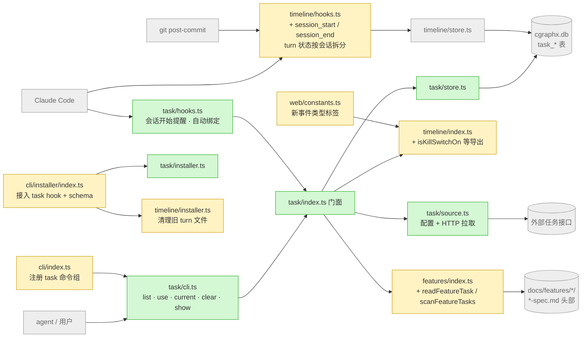
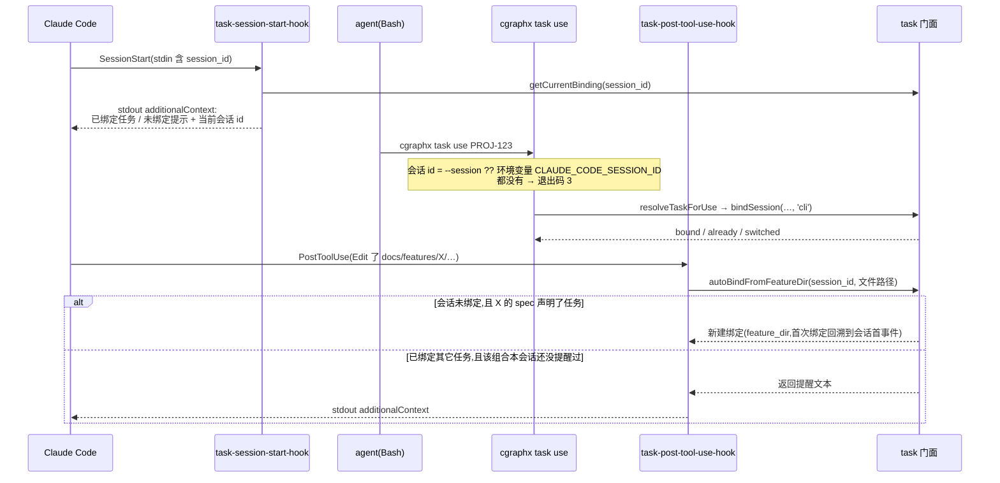
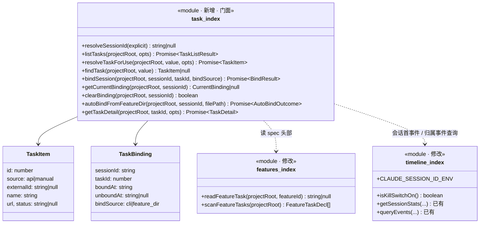
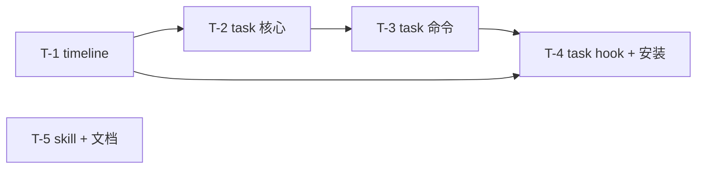

# 实现计划: 任务会话映射与 timeline 采集增强

> feature-id: 2026-10-14-任务会话映射与timeline采集增强
> 负责人: liulongfei
> 日期: 2026-10-14
> 来源 spec: `../任务会话映射与timeline采集增强-spec.md`

## 设计预览

新增一个 `src/core/task/` 子系统,负责任务存储、外部接口、绑定、两个 hook 和 `cgraphx task` 命令。timeline 补齐四项采集,features 门面加一个读 `> 任务:` 的函数,安装器顺带接入 task 的 hook。依赖方向只有一条:task → timeline / features。timeline 完全不知道 task 的存在。

**需要你重点看的**(改错了代价最大,其余可略读)

| # | 决策 | 为什么难回头 |
|---|---|---|
| 1 | task 有**自己的两个 hook 进程**(`task-session-start-hook`、`task-post-tool-use-hook`),不塞进 timeline 的 hook;依赖单向 task → timeline | 一旦 timeline 反过来调 task,两个子系统就不能分开删除或关闭,timeline 的「stdout 恒空」约定也会被打破(task hook 要往 stdout 输出给 agent 的上下文) |
| 2 | 表结构:`task_sessions` 用部分唯一索引保证「一个会话最多一条生效绑定」;时间统一用 ISO 8601 UTC 字符串,和 `timeline_events.ts` 直接比较 | 持久化结构,上线后改要迁移;时间格式不一致会让 §3.2 的归属 join 悄悄算错 |
| 3 | 当前会话 id 优先读宿主注入的 `CLAUDE_CODE_SESSION_ID`;降级方案是会话开始时把会话 id 写进给 agent 的上下文,agent 读不到环境变量时用 `--session` 传入 | 这个环境变量没有官方文档保证。如果宿主改名,绑定和 commit 归属会一起失效。降级路径必须现在就做进去 |

**架构**:看颜色。绿色是新增,黄色是修改,灰色是已有且不动的邻居。注意箭头全部从 task 指向别处,timeline 的 hook 没有任何箭头指向 task。

**主流程:会话内绑定与自动绑定**。看两点:一是会话 id 从哪来,二是自动绑定为什么不覆盖已有绑定。

**类图**:看门面对外暴露了什么,以及层间只传 `TaskItem` / `TaskBinding` 这类纯数据。

**关键取舍**

| 选了 | 没选 | 为什么 |
|---|---|---|
| 归属在查询时 join 派生 | 给 `timeline_events` 加 task_id 列 | spec §12 明确禁止加列;补绑、改绑不用回填 |
| 「同一对任务只提醒一次」记在内部表 `task_reminders` | 状态文件 | 和绑定数据在同一个库、同一个事务里,并发安全,也不会散落文件 |
| 会话开始的上下文里带上会话 id | PostToolUse 嗅探 `task use` 命令来补绑 | 一条路径就覆盖了环境变量缺失的情况,不用解析 Bash 命令文本 |

## 目标与范围

承载 spec 全部条款:task 子系统(§3–§5)、任务和需求目录的关联(§6)、会话开始提醒(§7)、timeline 采集增强(§8)、性能与降级(§9)、兼容与安装(§10)。

**明确不包含**(implementer 不得扩展):上传事件;脱敏;`features list` 与 web 展示任务字段;修改 developer-timeline / task-history skill;token 采集;按分支名推断终端 commit 的归属;`cgraphx timeline install` 子命令接入 task hook(task hook 只由 `cgraphx install` 接入);任何测试任务(单测走 `/write-unit-test-spec`)。

## 计划文件清单

| 文件 | 状态 |
|---|---|
| `任务会话映射与timeline采集增强-index.md` | 本文件 |
| `任务会话映射与timeline采集增强-01-schema.md` | **不涉及**:task 表属于包内表,走 `task_schema_versions` 版本表机制,DDL 契约写在 T-2 里;不适用需求 `sql/` 增量约定(data-standards「Schema 变更约定」只约束目标项目的业务库) |
| `任务会话映射与timeline采集增强-02-backend.md` | T-1 ~ T-5 全部任务 |
| `任务会话映射与timeline采集增强-03-frontend.md` | **不涉及**(web 只为编译通过补两个事件类型标签,归在 T-1) |

## 总任务清单

| 任务 | 内容 | spec 条款 | 独立提交 |
|---|---|---|---|
| T-1 | timeline 采集增强:会话与分支、turn 状态按会话拆分、session_start/end、Skill 摘要、门面导出、清理旧 turn 文件 | §8、§9 关闭开关、§10 旧 turn 文件 | 是 |
| T-2 | task 子系统核心:schema、store、外部接口、解析与绑定、需求目录关联、门面;features 门面新增读任务声明 | §3、§4、§5 解析与绑定规则、§6.1–§6.3、§9 | 是 |
| T-3 | `cgraphx task` 命令组:list / use / current / clear / show,并在 `cli/index.ts` 注册 | §5 | 是 |
| T-4 | task 的两个 hook 和 installer,接入 `cgraphx install` / `uninstall` | §6.3、§7、§9、§10 | 是 |
| T-5 | skill 与文档:write-spec 头部「任务」字段;CLAUDE.md 和 interface-standards 里关于 hook 与 turn 文件的描述 | §6.4、§10 | 是 |

## 全局依赖图

T-2 只依赖 T-1 新增的门面导出(`isKillSwitchOn`、`CLAUDE_SESSION_ID_ENV`)。T-4 要往 T-3 建好的 `task/cli.ts` 里注册隐藏 hook 命令,所以排在 T-3 之后。T-5 没有代码依赖。

## 推荐执行顺序与并行批次

| 批次 | 任务 | 可并行依据 |
|---|---|---|
| 1 | T-1、T-5 | 文件集不相交(T-1 动 `src/core/timeline/`、`src/web/constants.ts`、`src/web/pages-timeline.ts`、timeline 测试;T-5 只动 `assets/`、`CLAUDE.md`、`docs/guides/`) |
| 2 | T-2 | 需要 T-1 的门面导出 |
| 3 | T-3 | 需要 T-2 的门面 |
| 4 | T-4 | 需要 T-3 的 `task/cli.ts` |

## 必须严格执行的契约

- 依赖方向:`src/core/task/` 只通过 `../timeline`(index.ts)和 `../features`(index.ts)门面取数据;`src/core/timeline/` 和 `src/core/features/` 不得 import `task`。
- 时间格式:所有 task 表的时间列都存 `new Date().toISOString()` 格式(ISO 8601 UTC,毫秒精度,带 `Z`)。
- 会话 id 环境变量名只有一个来源:timeline 常量 `CLAUDE_SESSION_ID_ENV = 'CLAUDE_CODE_SESSION_ID'`,经 timeline 门面导出,task 从门面导入。
- 任何 Claude Code hook 或 git hook 内都不发网络请求,不 fire-and-forget,异常一律吞掉、只写 stderr,退出码恒为 0。
- 退出码:task 命令为 0 成功 / 1 其它 / 2 `TaskConfigError` / 3 `TaskArgError` / 4 `TaskStoreError`,统一经 `exitCodeForError` 映射。
- `timeline_events` 表结构不变,timeline schema 版本号不变(仍为 1)。

## 实现手段决策(plan 自主,无业务可观察后果)

| 决策 | 选项 | 推荐与理由 |
|---|---|---|
| task hook 形态 | A 并入 timeline hook / B task 自己的隐藏 hook 命令 | **B**,理由见预览第 1 条;多出的进程只在 SessionStart 和写类工具的 PostToolUse 触发(用 matcher 限定) |
| 会话 id 获取 | A 只读环境变量 / B 环境变量 + PostToolUse 嗅探 / C 环境变量 + 会话开始上下文注入会话 id | **C**,一条路径同时满足 spec §12 的降级要求 |
| 提醒去重 | A 状态文件 / B 内部表 `task_reminders` | **B**,和绑定同库同事务;这张表属于内部实现,不属于 spec 的数据契约 |
| turn 状态位置 | A `.cgraphx/turns/<会话>.json` / B 放进库表 | **A**,改动最小,沿用现有「缺失或损坏就降级」的读取逻辑 |
| 外部接口 HTTP | 用 Node 内置 `fetch` + `AbortController` 实现 10 秒超时 | 和 `src/core/dbquery/drivers/http.ts` 同一模式,不引入依赖 |
| 输出格式 | spec §5:默认人读输出,`--json` 开关输出 JSON | 与 interface-standards 一致,无例外 |

## 执行方式建议

**`/subagent-implement`**。三个条件同时成立:
- 跨 4 个相互独立的模块(timeline、task、cli/installer、skill/文档)。
- 预估变更文件约 25 个(task 新增约 12 个,timeline 约 8 个,另有 features 2 个、cli/installer 2 个、web 2 个、文档 4 个、copy-assets 1 个)。
- 各任务契约在 plan 里已写成原文,可以独立派出,不需要实时反馈。

## 适用规范

| 文件 | 章节 | 用于 |
|---|---|---|
| `docs/guides/coding-standards.md` | 边界与结构 · 选型(偏离社区默认)· 错误与日志 | 全部动代码任务 |
| `docs/guides/data-standards.md` | 模型层 · DDL 层 · ORM 映射约定 | T-2(task 表) |
| `docs/guides/interface-standards.md` | 命令注册 · 输出 · 退出码 · Hook 子命令契约 | T-1、T-3、T-4 |
| `docs/guides/git-standards.md` | 提交消息规范 · 提交前检查点 | 已结晶进下节 |

## 提交规范(摘自 git-standards.md)

- 格式:`type(scope): 中文描述`。type 用 feat / refactor / fix / docs;scope 本需求用 `timeline` / `task` / `installer` / `skills`。补充说明用「——」,并列用「+」。
- 非琐碎提交写 body:背景一行,再用「-」列要点。标题里不写票据号。
- 提交前检查点(逐条自查 `git diff --cached`):
  - 与 TS 放在一起的运行时资产已登记 `scripts/copy-assets.cjs`(T-2 的 `task/schema.sql`)。
  - `src/core` 里没有 import `src/cli` 或 `src/web`。
  - `schema.sql` 每条语句都带 `IF NOT EXISTS`。
  - hook 链路中没有未 await 的 DB 写入,也没有不吞的异常。
  - `vitest.config.ts` 的 `TZ: 'UTC'` 未被改动。
  - 没有被注释掉的 `.command(...)` 或 hook 接入项。
  - 源码里没有写死的绝对路径、密钥、阈值(超时 10 秒等阈值放进 `constants.ts`)。
  - 没有新增 TODO / FIXME。
- 每个任务完成后先跑 `npm run build && npx vitest run`,全绿再提交。

## 允许局部工程适配的范围

- 各模块内部的私有函数拆分和命名,在文件内或跨文件拆分(如 timeline 的 turn 状态逻辑可以抽成 `turn-state.ts`)。
- 表格输出的列宽算法(可以复用 features cli 的 `displayWidth` 写法)。
- stderr 文案的措辞,前提是带上 `[task]` / `[timeline]` 前缀和修复提示。
- 单文件超过 600 行时自行拆分。

除此之外的一律固定:函数签名、表结构、命令与选项名、退出码、JSON 字段名、hook 命令名、环境变量名。

## Plan 冲突上报规则

实现中发现 plan 与 spec 矛盾、plan 引用的既有符号不存在,或某条契约无法满足时,停下来按 `PLAN_CONFLICT: <任务> <冲突点> <证据>` 上报,不得自行改契约。权威链:任务 ← plan ← spec。

## 关键风险与防跑偏约束

| 风险 | 约束 / 应对 |
|---|---|
| `CLAUDE_CODE_SESSION_ID` 被宿主改名或取消 | 写 plan 时已在当前 Claude Code 会话(desktop 2.1.295)的 Bash 里确认该变量存在且等于 hook 的 session_id;T-1 开工先复核一次。降级:会话开始的上下文里带会话 id,`--session` 可手动传;commit 拿不到就记为未归属(符合 spec) |
| PostToolUse 的 `hookSpecificOutput.additionalContext` 是否被宿主采纳 | 【待确认】T-4 implementer 先对照 Claude Code hooks 文档确认 SessionStart 和 PostToolUse 两种 JSON 输出格式;若 PostToolUse 不支持,改用该事件文档规定的上下文回传字段,不得改为阻塞型输出 |
| 扩展 `EventType` 后 web 编译失败(`Record<EventType, …>`) | T-1 同步补 `src/web/constants.ts` 的标签和色调映射,以及 `pages-timeline.ts` 的计数初值 |
| 既有测试依赖旧 turn 文件路径和 4 个 hook 事件 | T-1 同步修正 `__tests__/core/timeline/turn-id.test.ts`、`duration.test.ts`、`installer.test.ts` 的断言;只改路径和事件清单,不删场景 |
| task hook 增加进程开销 | PostToolUse 只对写类工具(matcher)触发;hook 内只做本地文件读取和 SQLite 读写 |

## 待确认项

| # | 内容 | 是否阻塞 |
|---|---|---|
| P1 | PostToolUse 回传 agent 上下文的确切 JSON 字段(见上表) | 不阻塞拆分;T-4 实现时查文档锁定 |
| P2 | spec §14 Q1:resume 后 session_id 是否沿用 | 不阻塞;T-4 完成后实测,把结论写进提交 body |
