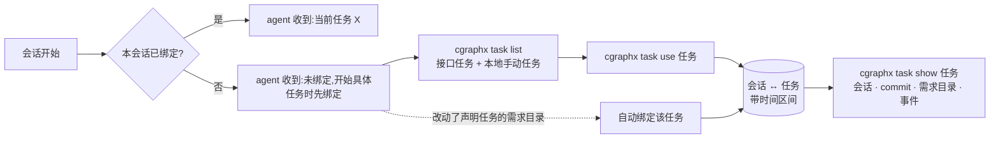

# 规格说明: 任务会话映射与 timeline 采集增强

> feature-id: 2026-10-14-任务会话映射与timeline采集增强
> 负责人: liulongfei
> 日期: 2026-10-14

## 一图看懂

开发者在 Claude Code 会话里绑定「我正在做的任务」后,这个会话此后的全部 timeline 事件(含 agent 发起的 git commit)都能按任务查出来。任务来自外部任务接口(查自己名下的),没配接口就手动输入任务名。需求 spec 头部可声明所属任务,会话一改动这个需求目录就自动绑定。多个会话并行做不同任务时互不串号。数据只记在本地,不上传。

| 场景 | 用户 / agent 看到什么 | 异常时 |
|---|---|---|
| 会话开始 | agent 收到当前绑定的任务,或一句「未绑定」提示 | 查不到绑定 → 当作未绑定,不阻塞会话 |
| `task list` | 接口返回的我名下任务 + 本地手动任务 | 接口失败 → 警告 + 只列本地已有任务 |
| `task use` | 绑定成功,显示任务编号、名称 | 不在 Claude Code 会话内且没给 `--session` → 报错退出 |
| 改动需求目录 | 未绑定的会话自动绑定 spec 声明的任务 | 已绑定其它任务 → 不切换,提醒 agent 一次 |
| `task show` | 任务的会话、commit、关联需求目录、事件 | 任务不存在 → 报错退出 |
| 终端手动 `git commit` | commit 照常记录 | 没有会话,记为「未归属」 |

## 1. 目标与范围

### 1.1 目标

把 timeline 采集到的开发事件按任务归属起来,为后续项目管理工具(任务进度、投入、交付物)提供本地数据基础;并顺带补齐 timeline 中影响归属准确性的采集缺口。

### 1.2 包含范围

| 模块 | 内容 |
|---|---|
| 新增 task 子系统 | 任务本体与「会话 ↔ 任务」映射的本地存储;`task list / use / current / clear / show` 命令;外部任务接口(可选配置) |
| 任务 ↔ 需求目录关联 | spec 头部新增可选字段 `> 任务:`;会话改动该需求目录时自动绑定 |
| 会话提醒 | 会话开始时把绑定状态告诉 agent |
| timeline 采集增强 | ① git_commit 记录会话与分支 ② turn 状态按会话隔离 ③ 新增会话开始 / 结束事件 ④ Skill 事件提取 skill 名 |
| skill 资产 | `write-spec` 头部模板与命名步骤加入「任务」字段 |
| 安装 / 卸载 | `cgraphx install` 接入新增 hook 与 task 存储;`uninstall` 对称移除 |

### 1.3 非目标

- 不上传任何事件,不与外部系统同步任务状态(只读接口,不回写)。
- 本地记录不做脱敏、不做隐私过滤。
- 不改 `developer-timeline` / `task-history` 等 skill 的报告口径,任务维度的消费另起需求。
- 不定义「任务投入时长」口径。
- `cgraphx features list` 与 `cgraphx web` 不展示任务字段。
- 终端手动 `git commit`(不在会话内)不做任何归属推断,包括不按分支名推断。
- 不采集 token 用量。

## 2. 术语

| 术语 | 含义 |
|---|---|
| 任务 | 项目管理意义上的工作项。来源二选一:**接口任务**(外部接口返回,有外部编号)或**手动任务**(用户输入名称,无外部编号) |
| 会话 | 一次 Claude Code 会话,以 hook 收到的 `session_id` 标识 |
| 绑定 | 某会话在一个时间区间内归属某任务。一个会话同一时刻最多一个生效绑定;一个任务可被多个会话绑定 |
| 归属 | 事件属于哪个任务:事件的 `session_id` 与时间落入某条绑定的区间,即归属该任务;否则为**未归属** |
| 需求目录 | `docs/features/<feature-id>/`,其主 spec 头部可声明所属任务 |

## 3. 数据与存储

### 3.1 task 存储(新增,位于 `.cgraphx/cgraphx.db`,表前缀 `task_`)

**任务表 `task_items`**

| 字段 | 含义 | 约束 |
|---|---|---|
| id | 本地主键 | 自增 |
| source | `api` / `manual` | 必填 |
| external_id | 外部编号 | `api` 必填,`manual` 为空;`(source, external_id)` 唯一 |
| name | 任务名称 | 必填;`manual` 任务的 name 唯一(同名复用,不重复建) |
| url | 任务链接 | 可空 |
| status | 外部状态原文 | 可空,仅展示,不参与任何判断 |
| raw | 接口返回的原始条目(JSON) | 可空 |
| created_at / updated_at | 时间 | 必填 |

**会话绑定表 `task_sessions`**

| 字段 | 含义 | 约束 |
|---|---|---|
| id | 本地主键 | 自增 |
| session_id | 会话 | 必填 |
| task_id | 关联 `task_items.id` | 必填 |
| bound_at | 区间开始 | 必填,与 `timeline_events.ts` 同格式(ISO 8601 UTC) |
| unbound_at | 区间结束 | 空表示生效中 |
| bind_source | `cli`(显式绑定)/ `feature_dir`(需求目录自动绑定) | 必填 |

- 同一 `session_id` **最多一条** `unbound_at` 为空的记录(存储层强制)。
- task 存储有独立的 schema 版本表,幂等应用,规则与 timeline、markdown 的 schema 相同。

### 3.2 归属口径

- 事件 e 归属任务 T ⇔ 存在绑定 b:`b.session_id = e.session_id` 且 `b.bound_at ≤ e.ts` 且(`b.unbound_at` 为空或 `e.ts < b.unbound_at`),并且 `b.task_id = T`。
- 归属是**查询时派生**的:`timeline_events` 不新增任务列,补绑或改绑不需要回填事件。
- **首次绑定回溯**:一个会话第一次绑定任务时,`bound_at` 取该会话最早一条 timeline 事件的时间(没有事件则取当前时间)。之后切换任务时,新绑定的 `bound_at` 取切换时刻,旧绑定的 `unbound_at` 取同一时刻。
- `session_id` 为空的事件(终端手动 commit)永远是未归属。

### 3.3 外部接口配置

- 配置文件:`.cgraphx/task-source.json`,不存在即视为**未配置接口**。
- 内容:`url`(必填)、`headers`(可选,原样附在请求上,用于认证)。
- 配置文件存在但格式非法时,`task` 命令报配置错误(退出码 2)并指出问题,不静默回退成未配置。

## 4. 外部任务接口契约(cgraphx 定义,对接方遵守)

| 项 | 规定 |
|---|---|
| 请求 | `GET <url>`,附带配置中的 `headers` |
| 「我名下」 | 由接口根据认证信息判定;cgraphx 不传身份参数 |
| 成功响应 | HTTP 2xx,body 为 `{"tasks":[{"id":"PROJ-123","name":"订单退款改造","url":"https://…","status":"进行中"}]}` |
| 字段 | `id`、`name` 为非空字符串,必填;`url`、`status` 可选 |
| 非法条目 | 缺必填字段的条目跳过并警告,其余照常使用 |
| 超时 | 单次请求不超过 10 秒 |
| 失败 | 非 2xx / 超时 / body 非法 → 视为接口不可用(见 §5.1) |

接口任务以 `external_id = id` 落入 `task_items` 作本地缓存;再次拉取时按 `external_id` 更新名称、链接、状态。接口不再返回的任务**保留**(历史绑定仍要能查到),不删除。

## 5. 命令行为

所有命令沿用 timeline 的退出码约定:0 成功(包括「无结果」)/ 2 配置错误(项目未初始化、配置非法)/ 3 参数错误 / 4 DB 错误。输出遵循 interface-standards:默认输出人读的表格 / 文本,带 `--json` 开关时输出 JSON。

### 5.1 `cgraphx task list`

| 条件 | 行为 |
|---|---|
| 已配置接口,请求成功 | 刷新缓存;列出接口返回的任务 + 本地手动任务,标明来源 |
| 已配置接口,请求失败 | stderr 输出警告(说明失败原因);列出本地已缓存的接口任务 + 手动任务;退出码 0 |
| 未配置接口 | 列出本地手动任务;无任务时提示可用 `task use <名称>` 新建 |
| `--local` | 不请求接口,只列本地 |

每行显示:本地 id、来源、外部编号、名称、状态、是否为当前会话绑定的任务。

### 5.2 `cgraphx task use <编号或名称>`

**会话判定**:有 `--session <id>` 就用它;否则使用当前 Claude Code 会话(agent 在会话内执行时必须能绑到该会话);两者都拿不到 → 报参数错误(退出码 3),提示用 `--session`。

**任务解析**(按顺序,先命中先用):

| 序 | 条件 | 结果 |
|---|---|---|
| 1 | 参数是数字,且等于某任务的本地 id | 该任务 |
| 2 | 等于某接口任务的 external_id | 该任务 |
| 3 | 已配置接口:刷新一次后等于某 external_id | 该任务 |
| 4 | 等于某手动任务的 name | 该任务 |
| 5 | 未配置接口 | 以该名称新建手动任务 |
| 6 | 已配置接口,且带 `--manual` | 以该名称新建手动任务 |
| 7 | 已配置接口,不带 `--manual` | 报错(退出码 3):接口中找不到,提示核对编号,或用 `--manual` 建手动任务 |

**绑定结果**:

| 当前会话状态 | 行为 |
|---|---|
| 未绑定 | 新建绑定;如果是首次绑定,按 §3.2 回溯 |
| 已绑定同一任务 | 无变化,提示「已绑定」 |
| 已绑定其它任务 | 关闭旧绑定,新建绑定(切换),输出里写明从哪个任务切到哪个任务 |

### 5.3 `cgraphx task current [--session <id>]`

显示当前会话生效的绑定(任务、绑定开始时间、绑定来源);未绑定时说明未绑定。会话判定与 §5.2 相同。

### 5.4 `cgraphx task clear [--session <id>]`

关闭当前会话的生效绑定(`unbound_at` 记为当前时间)。未绑定时为空操作,退出码 0。

### 5.5 `cgraphx task show <编号或名称>`

按 §5.2 的序 1、2、4 解析,不刷新接口、不新建任务;解析不到 → 退出码 3。输出:

| 区块 | 内容 |
|---|---|
| 任务 | 来源、外部编号、名称、链接、状态 |
| 关联需求目录 | 主 spec 头部声明了该任务的需求目录(实时扫描派生) |
| 会话 | 绑定过的会话及各自区间、绑定来源 |
| commit | 归属该任务的 git_commit:hash、message、分支、增删行数 |
| 事件统计 | 归属事件按类型计数 |
| `--events [--limit N]` | 追加归属事件明细,字段与 `timeline query` 一致,按时间升序,默认 100 条 |

## 6. 任务 ↔ 需求目录关联

### 6.1 声明方式

- 需求目录的主 spec 头部可写一行 `> 任务: <值>`,写法与 `> 负责人:` 一致,全角冒号也认。
- 主 spec 的认定规则与 `features` 扫描读负责人的规则相同。
- 多行 `> 任务:` 时只认第一行;值为空等同于未声明。
- 关联关系**只以 spec 头部为准**,不另外存储;一个任务可被多个需求目录声明。

### 6.2 声明值解析

在 §5.2 序 1、2、4 的基础上,不发网络请求:

| 情况 | 结果 |
|---|---|
| 命中已有任务 | 该任务 |
| 未命中,且已配置接口 | 以该值为 external_id、同时作为临时名称,建接口任务占位;下次 `task list` 刷新时更新名称 |
| 未命中,且未配置接口 | 以该值为名称新建手动任务 |

### 6.3 自动绑定

| 条件(全部满足才触发) | 说明 |
|---|---|
| 触发事件 | 会话中 Edit / Write / MultiEdit / NotebookEdit 成功执行 |
| 改动位置 | 文件位于某需求目录内(以项目根为基准判断) |
| 声明 | 该需求目录的主 spec 声明了任务,且能按 §6.2 解析 |
| 会话状态 | 会话**当前没有**生效绑定 |

满足时新建绑定,`bind_source = feature_dir`,首次绑定按 §3.2 回溯。

**不满足「未绑定」时**:会话已绑定任务 A,却改动了声明任务 B 的需求目录 → 不切换;向 agent 提示一次「当前绑定 A,本次改动属于任务 B 的需求目录,如需切换请与用户确认」。同一会话内,同一组 (A, B) 只提示一次。

刚写出的 spec 本身也算改动:write-spec 产出带 `> 任务:` 的 spec 时,如果会话尚未绑定,就会立即自动绑定。

### 6.4 write-spec skill 改动

- spec 头部模板加入可选行 `> 任务: <值>`,位置在 `> 负责人:` 之后。
- 「命名先行」一步增加对任务的确认:默认取当前会话的绑定(`cgraphx task current`),展示给用户确认;用户可改填,也可以留空;留空就不写这一行。

## 7. 会话开始提醒

会话开始时,向 agent 注入一段上下文:

| 状态 | 注入内容(语义) |
|---|---|
| 已绑定 | 当前会话绑定的任务:编号 + 名称 |
| 未绑定 | 当前会话未绑定任务;用户开始具体开发任务时,先用 `cgraphx task list` 列出候选让用户选,再 `cgraphx task use`;纯咨询类对话无需绑定 |

- 提醒只是给 agent 的上下文,不阻塞会话,也不强制绑定。
- 查询绑定失败(项目未初始化、DB 异常)时不注入任何内容,会话照常进行。

## 8. timeline 采集增强

| # | 改动 | 改前 | 改后 |
|---|---|---|---|
| 1 | git_commit 的会话 | `session_id` 恒为空 | commit 发生在 Claude Code 会话内(agent 通过 Bash 执行)时,记录该会话的 `session_id`;终端手动 commit 仍为空(未归属) |
| 2 | git_commit 的分支 | 不记录 | `metadata.branch` 记录当前分支名;detached HEAD 时为空 |
| 3 | turn 状态隔离 | 全项目共用一个 turn 状态,并行会话互相覆盖,约 14% 的工具事件缺 turn_id | 每个会话独立维护 turn 状态,并行会话互不影响 |
| 4 | 会话开始事件 | 无 | 新事件类型 `session_start`,`metadata.source` 记录宿主给出的启动来源(如 startup / resume / clear / compact) |
| 5 | 会话结束事件 | 无 | 新事件类型 `session_end`,`metadata.reason` 记录宿主给出的结束原因 |
| 6 | Skill 事件摘要 | 只存一段原始响应预览 | post_tool_use 的摘要 payload 带 `skill` 字段(取自调用参数中的 skill 名);保留成功 / 失败判定 |

补充约束:

- `session_start` / `session_end` 的 `turn_id` 为空;宿主没有给出 source / reason 时对应字段缺省,事件照常记录。
- `timeline query --type` 接受 `session_start`、`session_end`;`stats --by event_type` 正常计入这两类事件。
- 会话结束后,该会话的 turn 状态被清理。会话没有正常结束而残留的状态,不得影响其它会话的正确性。
- 第 1~6 项都不改变 `timeline_events` 的表结构(分支和来源都放进 `metadata`)。

## 9. 时效、性能与一致性

| 项 | 预期 |
|---|---|
| hook 耗时 | 新增和改动的 hook(包括自动绑定、会话提醒)单次不超过现有 50ms 预算;**hook 中不发任何网络请求** |
| 失败降级 | 任何 hook 内的 task 逻辑失败(DB 异常、spec 读不到、解析失败)只写 stderr,不阻塞 Claude Code,不影响 timeline 事件的写入 |
| 并发 | 多个会话同时绑定或自动绑定时,每个会话最多一个生效绑定的约束始终成立;两个并行会话的绑定互不影响 |
| 幂等 | 重复 `task use` 同一任务不产生新记录;重复拉取接口不产生重复任务 |
| 关闭开关 | `CGRAPHX_NO_TIMELINE` 生效时,timeline 记录、自动绑定、会话提醒一并关闭;显式的 `task` 命令不受影响 |

## 10. 兼容性与迁移

| 对象 | 处理 |
|---|---|
| 已有 timeline 数据 | 不迁移、不回填;历史事件全部未归属(历史 git_commit 本来就没有 session_id) |
| 已安装的项目 | 重新执行 `cgraphx install` 后才获得新 hook 与 task 存储;未重装前旧 hook 行为不变,不报错 |
| 旧的共享 turn 状态文件 `timeline-current-turn.json` | install 时清理;新逻辑不再读写它 |
| 旧 spec(无 `> 任务:`) | 视为未声明,行为不变 |
| `cgraphx uninstall` | 移除本需求新增的 hook;默认删除 `.cgraphx/`(含 task 数据);`--keep-data` 保留 |
| 分层约束 | task 子系统位于 `src/core/`,有公共门面;读取 timeline 事件、扫描需求目录只能经各自门面,不得伸手进内部模块 |

## 11. 验收标准

| # | 场景 | 期望 |
|---|---|---|
| A1 | 未配置接口,会话内 `task use 订单退款改造` | 新建手动任务并绑定;`task current` 显示该任务 |
| A2 | 再次 `task use 订单退款改造` | 复用同一手动任务,不新建记录;提示已绑定 |
| A3 | 已配置接口(假服务返回 2 个任务),`task list` | 列出 2 个接口任务 + 本地手动任务,来源标注正确 |
| A4 | 接口超时或返回 500 | 警告 + 列出本地缓存,退出码 0 |
| A5 | 已配置接口,`task use 不存在的编号` | 退出码 3;加 `--manual` 后成功建手动任务 |
| A6 | 两个会话并行,分别绑定 X 和 Y,交替产生事件 | `task show X` 只含会话 1 的事件,`task show Y` 只含会话 2 的;两边 turn_id 都不缺失 |
| A7 | 会话先产生事件,稍后才首次绑定 | 绑定前的事件也归属该任务 |
| A8 | 会话中途从 X 切到 Y | 切换前的事件属于 X,之后的属于 Y |
| A9 | agent 在会话内执行 `git commit` | git_commit 事件带该会话的 session_id 和分支名,出现在 `task show` 的 commit 区块 |
| A10 | 终端手动 `git commit` | 事件正常记录,session_id 为空,不归属任何任务 |
| A11 | 未绑定的会话 Edit 了 spec 声明 `> 任务: X` 的需求目录内的文件 | 自动绑定 X,`bind_source = feature_dir` |
| A12 | 已绑定 Y 的会话改动任务 X 的需求目录 | 绑定仍为 Y;agent 收到一次提醒,再次改动不重复提醒 |
| A13 | 会话开始,已绑定 / 未绑定 | agent 分别收到任务信息 / 未绑定提示 |
| A14 | 会话开始与结束 | 产生 `session_start` / `session_end` 事件,带 source / reason |
| A15 | 调用 Skill 工具 | post_tool_use 摘要含 `skill` 字段 |
| A16 | 不在会话内、不带 `--session` 执行 `task use` | 退出码 3,提示 `--session` |
| A17 | task 存储损坏或项目未初始化 | Claude Code 会话不受阻塞,timeline 事件照常写入(未初始化时与现状一致) |
| A18 | 已安装的旧项目重新执行 `cgraphx install` | 新 hook 接入,task schema 已应用,旧 turn 状态文件被清理;重复执行 install 结果不变 |

## 12. Plan 编写约束

- 不得给 `timeline_events` 加任务列;归属必须按 §3.2 在查询时派生。
- 不得在任何 Claude Code hook 或 git hook 中发起网络请求。
- 新增 hook 的接入与卸载必须并入现有 installer 的幂等、可逆机制,不得影响用户自己配置的其它 hook。
- 新增运行时资产(如 task 的 schema 文件)必须加入 `scripts/copy-assets.cjs`。
- skill 改动只改 `assets/claude-template/` 下的源文件。
- 「在会话内取得当前会话 id」的实现手段由 plan 选定,但必须覆盖 §5.2 的会话判定与 §8 第 1 项。若依赖宿主注入的环境变量,plan 须说明该变量缺失时如何降级。

## 13. 本次 spec 补定的规则(请审阅)

以下规则此前没有逐条讨论,是写 spec 时为保证契约完整而补定的,请重点审阅:

1. **首次绑定回溯到会话开始**(§3.2):会话里先聊后绑,绑定前的工作也算这个任务。
2. **配置了接口后,手动任务需要显式 `--manual`**(§5.2 序 6、7):避免编号输错时悄悄建出一个手动任务。
3. **spec 声明的值找不到时自动建任务**(§6.2):已配置接口时建接口任务占位,未配置时建手动任务。
4. **接口不再返回的任务保留不删**(§4)。
5. **`CGRAPHX_NO_TIMELINE` 同时关闭自动绑定与会话提醒**(§9)。

## 14. 待确认项

| # | 内容 | 影响 |
|---|---|---|
| Q1 | 会话恢复(resume)后,宿主是否沿用原 `session_id`。若不沿用,恢复后的会话表现为未绑定,会话开始提醒会再次出现,需要重新绑定 | 不影响 plan 拆分;只影响恢复场景下的体验,plan 阶段实测后在验收中注明结论 |
