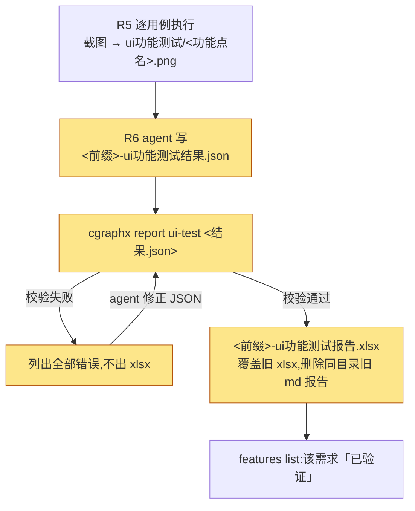

# 规格说明: UI测试报告改xlsx

> feature-id: 2026-10-15-UI测试报告改xlsx
> 负责人: liulongfei
> 任务: UI测试报告改xlsx
> 日期: 2026-10-15

## 一图看懂

`/run-ui-test` 的报告从 md 改为 xlsx:agent 先写结构化结果 JSON,再由 `cgraphx report ui-test` 生成 xlsx(每用例一行,截图嵌在行内)。JSON、截图、xlsx 三者独立保留,供研发管理服务端上传与在线展示。R0–R5 执行流程不变。



图例:黄色为本次新增/改变的环节。

| 场景 | 改前 | 改后 |
|---|---|---|
| 跑完 UI 测试,目录里有什么 | md 报告 + 截图 | xlsx 报告 + 结构化结果 JSON + 截图 |
| 打开报告 | md,截图为相对路径引用,单独发出去截图会丢 | xlsx,打开先看「汇总」表,「用例」表每行内嵌截图 |
| 结构化结果写错(如截图名错) | — | 命令报出每条错误,不生成 xlsx;agent 修正 JSON 后重新生成 |
| 存量需求(只有旧 md 报告) | 已验证 | 仍是已验证;重跑后旧 md 被 xlsx 取代 |

## 1. 目标与范围

**目标**:UI 测试报告能单独交付(截图随报告走)、符合测试同学的 Excel 交付形态;同时为研发管理服务端提供一份格式稳定、可程序读取的结构化结果。

**包含**:

- `run-ui-test` skill 的报告产出形态(R6、产物命名、收尾、质量检查、报告格式参考)
- 新增 CLI 命令 `cgraphx report ui-test`(校验结构化结果 + 生成 xlsx)
- 结构化结果 JSON 契约(本 spec §3 为权威定义)
- features 阶段派生对 UI 测试报告的识别范围
- 流程总图(`FLOW-MAP.md`)中 UI 测试产物描述同步

**非目标**:

- 存量 md 报告转 xlsx(不提供转换工具)
- `run-ui-test` R0–R5 执行流程、五道关、截图命名、不验库、失败只报告等既有行为
- `write-ui-test` 及其用例规格格式
- 接口测试报告、单元测试报告转 xlsx
- 研发管理服务端的上传、类型映射与展示(归服务端及其客户端映射需求)
- 阶段派生口径本身(「有报告即已验证」不变)

## 2. 产物与命名

均位于 `docs/features/<feature-id>/ui功能测试/`。

| 产物 | 文件名 | 谁产出 | 读者 |
|---|---|---|---|
| 结构化结果 | `<文件前缀>-ui功能测试结果.json` | agent(run-ui-test R6) | 生成命令、研发管理服务端 |
| 测试报告 | `<文件前缀>-ui功能测试报告.xlsx` | `cgraphx report ui-test` | 人 |
| 截图 | `<功能点名>.png`(同功能点多张追加 `-2`/`-3`),规则不变 | agent(R5) | 报告内嵌、服务端展示 |

- 文件前缀规则不变(有业务ID = `<业务ID>-<标题>`,无 = `<标题>`)。
- 三类产物的文件名即对外约定,下游(服务端客户端映射、阶段派生)依赖它识别产物,不得在实现期改动。
- **不再产出** `<文件前缀>-ui功能测试报告.md`。
- 同需求重复触发:三类产物均覆盖,不增量合并。

## 3. 结构化结果 JSON 契约

服务端会直接读取此文件,**字段名、类型、枚举值即对外契约**。任何不兼容变更(删字段、改类型、改枚举值、改语义)必须升 `schemaVersion`;仅新增可选字段可不升。

### 3.1 顶层字段

| 字段 | 类型 | 必填 | 含义 |
|---|---|---|---|
| `schemaVersion` | 整数 | 是 | 本契约版本,当前为 `1` |
| `featureId` | 字符串 | 是 | 所属需求的 feature-id,如 `2026-08-23-ui功能测试` |
| `executedAt` | 字符串 | 是 | 执行时间,ISO 8601 且带时区偏移,如 `2026-10-15T14:30:00+08:00` |
| `mode` | 字符串 | 是 | 运行模式,枚举 `headed` / `headless` |
| `entryUrl` | 字符串 | 是 | 本次实际使用的入口 URL |
| `cases` | 数组 | 是 | 用例结果,至少 1 条,顺序即报告行序 |

### 3.2 用例字段(`cases[]`)

| 字段 | 类型 | 必填 | 含义 |
|---|---|---|---|
| `index` | 整数 ≥1 | 是 | 用例序号,与用例规格中的用例编号一致,不重复 |
| `featurePoint` | 字符串 | 是 | 功能点名 |
| `steps` | 字符串数组 | 是 | 操作步骤,每步一项(不带序号),至少 1 项 |
| `expected` | 字符串数组 | 是 | 预期表现,每条一项,至少 1 项 |
| `actual` | 字符串 | 视结果 | 实际表现;通过写「同预期」 |
| `result` | 字符串 | 是 | 六状态之一(§3.3) |
| `reachedStep` | 整数 ≥1 或 `null` | 否 | 失败时执行到的步骤号;不适用为 `null` 或省略 |
| `note` | 字符串 | 视结果 | 备注:失败的疑似原因 / 跳过的原因 |
| `screenshots` | 字符串数组 | 是 | 截图路径,**相对本 JSON 文件所在目录**;可为空数组 |

### 3.3 结果枚举与字段要求

沿用现有六状态,不新增:

| `result` | `actual` | `note` | 说明 |
|---|---|---|---|
| `通过` | 必填(通常「同预期」) | 可空 | — |
| `失败-预期不符` | 必填 | 应写疑似原因 | 建议填 `reachedStep` |
| `失败-元素缺失` | 必填 | 应写疑似原因 | 建议填 `reachedStep` |
| `失败-环境` | 必填 | 可空 | 服务/浏览器/MCP 异常 |
| `失败-登录` | 必填 | 可空 | — |
| `跳过` | 可空 | 必填(跳过原因) | 截图通常为空 |

- 用例规格确认清单中的**每条用例都必须出现在 `cases` 中**。用户取消的、因浏览器/MCP 崩溃未执行到的,记 `跳过`,`note` 写明原因(如「执行中断,未执行」)。
- 汇总数字(总数、通过、失败、跳过、通过率、失败分类)**不写入 JSON**,由读取方从 `cases` 计算。

### 3.4 示例

```json
{
  "schemaVersion": 1,
  "featureId": "2026-08-23-ui功能测试",
  "executedAt": "2026-10-15T14:30:00+08:00",
  "mode": "headless",
  "entryUrl": "http://127.0.0.1:5173/admin",
  "cases": [
    {
      "index": 1,
      "featurePoint": "新建客户",
      "steps": ["左侧菜单点「客户管理」进入列表页", "点右上角「新建」", "填写客户名称、联系电话、所属行业", "点「保存」"],
      "expected": ["提示「保存成功」", "列表第一行出现「测试客户-0825」"],
      "actual": "同预期",
      "result": "通过",
      "reachedStep": null,
      "note": "",
      "screenshots": ["新建客户.png"]
    },
    {
      "index": 2,
      "featurePoint": "编辑客户",
      "steps": ["客户列表页找到「华东贸易」", "点该行「编辑」", "把联系电话改为「13900139000」,点「保存」"],
      "expected": ["提示「保存成功」", "列表中联系电话显示为「13900139000」"],
      "actual": "提示「保存成功」,但列表联系电话仍显示旧值;刷新后才更新",
      "result": "失败-预期不符",
      "reachedStep": 3,
      "note": "疑似保存后列表未重新拉取",
      "screenshots": ["编辑客户.png", "编辑客户-2.png"]
    },
    {
      "index": 3,
      "featurePoint": "删除客户",
      "steps": ["客户列表页找到「测试客户-0825」", "点该行「删除」并确认"],
      "expected": ["提示「删除成功」", "列表中不再出现该客户"],
      "actual": "",
      "result": "跳过",
      "note": "用户取消",
      "screenshots": []
    }
  ]
}
```

## 4. 生成命令 `cgraphx report ui-test`

### 4.1 输入输出

| 项 | 规格 |
|---|---|
| 形态 | `cgraphx report ui-test <结构化结果文件路径>`;新顶层命令组 `report`,本次只有 `ui-test` 一个子命令 |
| 输入 | 唯一位置参数;文件名必须以 `-ui功能测试结果.json` 结尾,否则报错 |
| 输出 | 同目录 `<文件前缀>-ui功能测试报告.xlsx`(前缀取自输入文件名),**不提供指定输出路径的参数**;已存在则覆盖 |
| 旧 md 清理 | 生成成功后,若同目录存在 `<文件前缀>-ui功能测试报告.md`,删除之,并在输出中注明 |
| 成功输出 | xlsx 路径 + 总数/通过/失败/跳过;退出码 0 |
| 运行前提 | 只读写文件,不依赖 `.cgraphx/` 初始化或数据库 |

### 4.2 校验(严格,全部通过才生成)

| 校验项 | 失败示例 |
|---|---|
| 文件存在且为合法 JSON | 「无法解析 JSON:第 12 行」 |
| `schemaVersion` 为本命令支持的版本 | 「不支持的 schemaVersion: 2」 |
| 顶层必填字段齐全、类型正确;`mode` 在枚举内;`cases` 非空 | 「缺少字段 entryUrl」 |
| 每条用例必填字段齐全、类型正确;`index` 不重复 | 「用例 2:缺少字段 steps」 |
| `result` 在六状态之内 | 「用例 3:未知结果 "失败"」 |
| §3.3 的视结果必填:失败类 `actual` 非空,`跳过` 的 `note` 非空,`通过` 的 `actual` 非空 | 「用例 4:跳过须填写 note」 |
| `screenshots` 中每个文件存在 | 「用例 2:截图不存在:编辑客户.png」 |
| 截图为 PNG 或 JPEG 图片(按文件内容判断，不看扩展名) | 「用例 2:截图不是 PNG/JPEG 图片:编辑客户.png」 |

- 一次运行**列出全部错误**(不是遇到第一个就停),退出码非 0,**不生成、不覆盖 xlsx,不删除旧 md**。
- 校验失败不影响已有产物。

## 5. xlsx 报告结构

两个工作表,顺序固定:「汇总」在前(打开即见),「用例」在后。

### 5.1 工作表「汇总」

| 项 | 取值 | 示例 |
|---|---|---|
| 需求 | `featureId` | 2026-08-23-ui功能测试 |
| 执行时间 | `executedAt`,按其自带时区显示到分钟 | 2026-10-15 14:30 |
| 运行模式 | `headed` → headed,`headless` → 无头 | 无头 |
| 入口 URL | `entryUrl` | http://127.0.0.1:5173/admin |
| 总数 / 通过 / 失败 / 跳过 | 由 `cases` 计算;失败 = 四种失败状态之和 | 8 / 5 / 2 / 1 |
| 通过率 | 通过 ÷ 总数(含跳过),百分比保留一位小数 | 62.5% |
| 失败按类型 | 四种失败状态各自计数(含 0) | 预期不符 1 · 元素缺失 1 · 环境 0 · 登录 0 |

### 5.2 工作表「用例」

每条用例一行,行序同 `cases`,列顺序固定:

| 列 | 取值 |
|---|---|
| 序号 | `index` |
| 功能点 | `featurePoint` |
| 操作步骤 | `steps`,单元格内按 `1. 2. 3.` 编号分行 |
| 预期表现 | `expected`,单元格内分行 |
| 实际表现 | `actual` |
| 结果 | `result` 原值;底色:通过绿、四种失败红、跳过灰 |
| 执行到 | `reachedStep` 有值显示「步骤 N」,否则「—」 |
| 备注 | `note` |
| 截图 | `screenshots` 中的图片嵌入本行;无截图留空 |

- 表头冻结、可筛选,便于按「结果」筛失败用例。
- 截图须**嵌入 xlsx 文件本身**(单独发送 xlsx 时截图不丢),不是外链。
- 同一用例多张截图的排版方式由 plan 决定(见 §9),但必须满足:所有截图都在 xlsx 内可见,且能看出属于哪条用例。

## 6. run-ui-test skill 行为变更

| 环节 | 改后行为 |
|---|---|
| R0–R5 | 不变 |
| R6 | ① 按 §3 写结构化结果 JSON;② 执行 `cgraphx report ui-test <JSON>`;③ 校验失败 → 按报错修正 JSON 后重新执行命令,直到生成成功。修正 JSON 属于修正自身产物,**不得因此重跑用例,也不得改动用例的结果判定** |
| 产物命名节 | 改为 §2 三类产物;删除 md 报告 |
| 报告格式参考(`references/report-format.md`) | 改为描述 JSON 契约与 xlsx 结构,与本 spec §3、§5 一致;删除「不产 JSONL——无程序化消费方」的前提 |
| 收尾 | 提示 xlsx 位置 + JSON + 截图目录;通过/失败/跳过汇总;失败清单与原因;下一步建议(原 md §4 内容,仅口头提示,不进报告) |
| 质量检查 | 增加:JSON 已生成且命令生成 xlsx 成功;目录中无旧 md 报告 |

`FLOW-MAP.md` 中 run-ui-test 的产物描述同步为「用例规格 + xlsx 报告 + 结构化结果 + 按功能点命名的截图」。

## 7. 阶段派生

- 口径不变:有任一测试报告 → 已验证。
- UI 测试报告识别范围:`ui功能测试/` 下文件名以 `-ui功能测试报告.xlsx` **或** `-ui功能测试报告.md` 结尾(后者兼容存量)。
- 结构化结果 JSON、截图、用例规格**不算**报告。

| 目录内容 | 阶段 |
|---|---|
| spec + `ui功能测试/x-ui功能测试报告.xlsx` | 已验证 |
| spec + `ui功能测试/x-ui功能测试报告.md`(存量) | 已验证 |
| spec + `ui功能测试/x-ui功能测试结果.json` + 截图(xlsx 未生成) | 已规格 |

## 8. 兼容性与存量

| 场景 | 行为 |
|---|---|
| 存量 md 报告 | 原样保留,不迁移、不转换;阶段派生继续识别 |
| 存量需求重跑 run-ui-test | 生成成功后旧 md 被删除(§4.1),目录只剩新三类产物 |
| 想把旧报告变成 xlsx | 重跑 `/run-ui-test` |
| 本仓库 | 当前无存量 UI 测试报告 |

## 9. Plan 编写约束

- **plan 须决定**:① 同一用例多张截图的排版(同单元格并排 / 另开工作表加超链接等),满足 §5.2 末条;② 是否引入 xlsx 生成库、引入哪个。
- 依赖约束:不得引入原生依赖或 wasm;须兼容 `package.json` 的 Node engines 范围;新运行时资产须加入 `scripts/copy-assets.cjs`。
- 分层不变:生成与校验逻辑在 `src/core`,不依赖 `src/cli` / `src/web`;CLI 只做注册与参数传递。
- skill 修改入口是 `assets/claude-template/`,不是根目录 `.claude/`。
- 不改 R0–R5、五道关、截图命名;不改 `write-ui-test`。
- 不允许 implementation 自行调整:§2 文件名、§3 JSON 字段/枚举/语义、§4 命令形态与校验失败语义、§5 工作表与列顺序、§7 识别范围。

## 10. 验收标准

| # | 场景 | 期望 |
|---|---|---|
| 1 | 用 §3.4 示例 JSON(截图文件存在)执行命令 | 生成 xlsx;「汇总」显示 3 / 1 / 1 / 1、通过率 33.3%、预期不符 1;「用例」3 行,第 2 行结果红底、执行到「步骤 3」、两张截图均在 xlsx 内可见;第 3 行灰底、截图为空 |
| 2 | 把 xlsx 单独拷到别处打开 | 截图仍可见 |
| 3 | JSON 中一张截图不存在、另一条用例 `result` 非法 | 两条错误同时列出,退出码非 0,不生成 xlsx;已有 xlsx 保持不变 |
| 4 | 同目录有旧 md 报告,执行命令成功 | 旧 md 被删除,输出注明 |
| 5 | 同一场景但校验失败 | 旧 md 保留 |
| 6 | 输入文件名不以 `-ui功能测试结果.json` 结尾 | 报错,不生成 |
| 7 | 在未执行 `cgraphx install` 的目录执行命令 | 正常生成 |
| 8 | 阶段派生 | §7 三行表格全部符合 |
| 9 | 构建后的 npm 包 | 从 `dist` 运行命令正常生成 xlsx(运行时资产齐全) |
| 10 | 部署后的 run-ui-test skill | R6 / 产物命名 / 收尾 / 质量检查 / report-format.md 与本 spec 一致,不再提及 md 报告;FLOW-MAP 已同步 |

## 11. 待确认项

无。

## 附:后续

- 知识库条目 `docs/knowledge/features需求阶段派生.md` 已过时(未记录 UI 报告识别),实现后经 `/knowledge-write` 补上 UI 报告(md/xlsx)识别口径。
