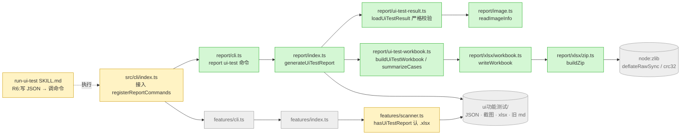
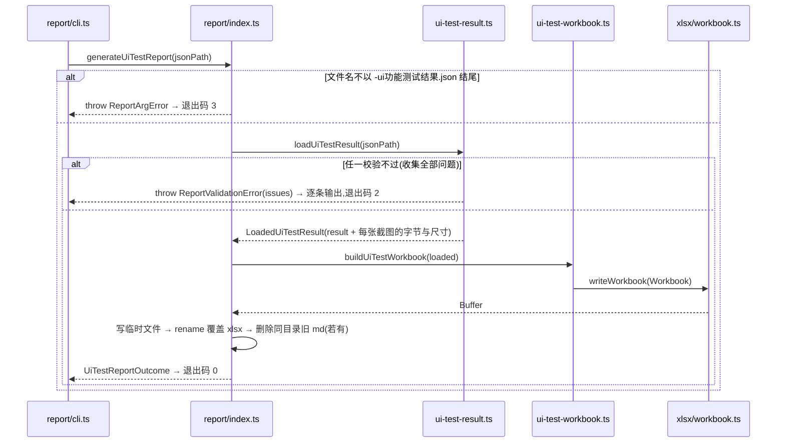
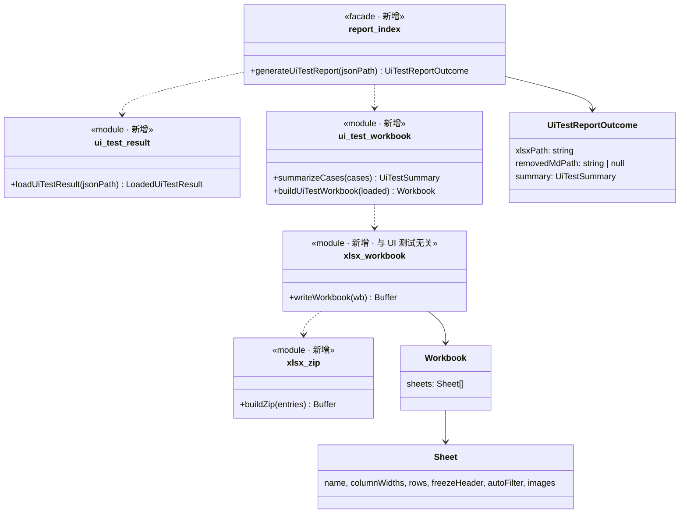

# 实现计划: UI测试报告改xlsx

> feature-id: 2026-10-15-UI测试报告改xlsx
> 负责人: liulongfei
> 日期: 2026-10-15
> 来源 spec: `../UI测试报告改xlsx-spec.md`

## 设计预览

新增 `src/core/report/` 子系统:先校验结构化结果 JSON,再把它映射成一个最小的工作簿模型，最后由自写的 OOXML + zip 写出器生成 xlsx。CLI 新增 `report` 命令组;features 的 scanner 把 `.xlsx` 也认作 UI 测试报告;run-ui-test skill 的 R6 改为「写 JSON → 调命令」。**不引入任何 npm 依赖**,zip 压缩与 CRC 用 `node:zlib`。

**需要你重点看的**(改错了代价最大，其余可略读)

| # | 决策 | 为什么难回头 |
|---|---|---|
| 1 | **不引入 xlsx 库**,自写 OOXML + zip(`node:zlib` 的 `deflateRawSync` / `crc32`)。生成器内部分两层：与 UI 报告无关的工作簿模型 `Workbook`,以及「UI 结果 → Workbook」映射 | 以后有公司模板(需要读模板 xlsx)时，要么给写出器补读能力，要么换 exceljs。模型层把这次替换限制在 `xlsx/` 目录内，映射层和校验层不受影响 |
| 2 | **截图只认 PNG / JPEG**(按文件头判断，不看扩展名),其他格式视为校验失败 | 业务可观察的校验规则，已经确认并补入 spec §4.2 |
| 3 | `report` 是**独立子系统**:features 不 import report,两边各写一份文件后缀字面量 | 保持「子系统可整体移除」。代价是后缀改名时要改两处，不过 spec §2 已把文件名锁成契约，不会随意改 |

**架构**:绿色新增，黄色修改，灰色是已有且不动的邻居。features 和 report 之间没有箭头，两者互不依赖。



**主流程：生成一份报告**。注意每一步失败时，已有产物都不会被改动。



**类图**:三层之间只传纯数据，写出器对「UI 测试」一无所知。



**关键取舍**

| 选了 | 没选 | 为什么 |
|---|---|---|
| 自写 OOXML + zip,零依赖 | exceljs 4.4.0 | exceljs 有 9 个直接依赖(archiver/unzipper/jszip/tmp/uuid 等),会给每个安装 cgraphx 的用户带来几十个传递依赖和 deprecated 告警，最近一次发布在 2023 年。这次只需要写，不需要读;要用到的 OOXML 只有内联字符串、6 种样式、冻结、筛选、图片锚点，大约 400 行，而且本机有 openpyxl / LibreOffice / WPS 可以做读回验证 |
| 同一用例的多张截图在同一行**横向排列**,固定高 180px、按比例缩放，从「截图」列起向右排 | 另开工作表 + 超链接 | 「截图」是最后一列，向右溢出不会遮挡数据;看一行就能看到这条用例的全部截图，满足 spec §5.2 末条。原图按原尺寸嵌入，只在显示时缩放，在 Excel 里重置大小就能看到原图 |
| 写临时文件后 rename | 直接写目标文件 | 写一半失败时，不会留下损坏的 xlsx,也不会覆盖旧文件 |

## 目标与范围

落实 spec 全部条款:§2 产物命名、§3 JSON 契约(校验)、§4 生成命令、§5 xlsx 结构、§6 skill 变更、§7 阶段派生、§8 存量兼容。

## 明确不包含

- 不改 `write-ui-test`,不改 run-ui-test 的 R0–R5、五道关和截图命名(spec §1 非目标)
- 不做 md 转 xlsx,不做接口 / 单元测试报告转 xlsx
- 不改根目录 `.claude/`(已部署的环境)
- 不更新知识库 `features需求阶段派生.md`(spec 附:实现后经 `/knowledge-write` 处理)
- 不排测试任务(测试是独立的后置流程);只要求既有测试不变红

## 计划文件清单

| 文件 | 状态 |
|---|---|
| `UI测试报告改xlsx-index.md` | 本文件 |
| `UI测试报告改xlsx-01-schema.md` | 不涉及(无 DB / 表) |
| `UI测试报告改xlsx-02-backend.md` | T-1 / T-2 / T-3 |
| `UI测试报告改xlsx-03-frontend.md` | 不涉及(无页面) |
| `UI测试报告改xlsx-04-skill.md` | T-4 |

## 总任务清单

| 任务 | 内容 | spec 条款 | 独立提交 |
|---|---|---|---|
| T-1 | report 子系统骨架 + JSON 校验器 + 图片识别 | §2、§3、§4.2 | 是 |
| T-2 | xlsx 写出器 + UI 报告映射 + 门面 + CLI 接线 | §4.1、§4.2(输出)、§5、§8 | 是 |
| T-3 | 阶段派生识别 `.xlsx` | §7 | 是 |
| T-4 | run-ui-test skill + FLOW-MAP 同步 | §2、§6 | 是 |

## 全局依赖图

```
T-1 ──→ T-2 ──→ T-4
T-3(无依赖)
```

## 推荐执行顺序与可并行批次

- 批次 1:T-1、T-3(文件集不相交:`src/core/report/*` 与 `src/core/features/scanner.ts`)
- 批次 2:T-2
- 批次 3:T-4(skill 要引用已经存在的命令)

## 必须严格执行的契约

- spec §2 文件名、§3 JSON 字段 / 类型 / 枚举 / 语义、§4 命令形态与校验失败语义、§5 工作表与列顺序、§7 识别范围,implementation 不得改动。
- 门面导出(逐字):`generateUiTestReport(jsonPath: string): UiTestReportOutcome`;CLI 只经 `src/core/report/index.ts` 调用。
- 退出码:成功 0 / `ReportValidationError` 2 / `ReportArgError` 3 / 其它 1,由 `report/cli.ts` 的 `exitCodeForError` 映射。
- `src/core/report/` 不 import `src/cli`、`src/web`,也不 import 其它子系统;features 不 import report。

## 实现手段决策

| 决策 | 选项 | 结论 | 理由 |
|---|---|---|---|
| xlsx 依赖 | exceljs / SheetJS / 自写 | **自写** | 见关键取舍。SheetJS 社区版不支持图片，且 npm 上的版本已停更 |
| 多截图排版 | 同行横排 / 另开工作表 + 超链接 | **同行横排** | 见关键取舍 |
| 字符串写法 | sharedStrings / inlineStr | inlineStr | 少一个部件;Excel / WPS / LibreOffice 都支持 |
| `--json` 开关 | 有 / 无 | **有** | interface-standards「新命令统一提供 `--json`」。不涉及 spec 锁定的「不提供指定输出路径的参数」 |
| 无截图行的行高 | 写死 / 不写 | 不写(由打开方自动行高) | 有截图的行固定为 `CUSTOM_IMAGE_ROW_HEIGHT_PT` |
| 运行时资产 | — | 无新增 | XML 模板是 TS 字符串常量,`copy-assets.cjs` 不用改 |

**回跳项**:截图格式限定为 PNG / JPEG(已确认，已补入 spec §4.2)。

## 执行方式建议

**`/implementation`**。预计改动约 13 个文件(report 新增 9 个，加 cli/index、scanner、SKILL.md、report-format.md、FLOW-MAP),但 T-2 依赖 T-1 的类型和产出，任务之间需要实时衔接，不满足「相互独立、可分别派出」的条件。

## 适用规范

- `docs/guides/coding-standards.md`:「边界与结构」「选型(偏离社区默认)」「错误与日志」
- `docs/guides/interface-standards.md`:「命令注册」「输出」「退出码」

## 提交规范

摘自 `docs/guides/git-standards.md`:

- 格式:`type(scope): 中文描述`。type 用 feat / refactor / fix / docs;补充说明用「——」,并列用「+」。非琐碎提交写 body:一行背景，下面用「-」列要点。不在标题里关联票据。
- 本需求建议的主题:
  - T-1 `feat(report): UI 测试结构化结果校验——report 子系统骨架 + 图片识别`
  - T-2 `feat(report): report ui-test 生成 xlsx——自写 OOXML + zip,零依赖`
  - T-3 `feat(features): 阶段派生识别 xlsx UI 测试报告`
  - T-4 `feat(skills): run-ui-test 报告改 xlsx——结构化结果 + 生成命令`
- 提交前检查点(逐项自查):
  - 与 TS 同放的运行时资产是否已登记 `scripts/copy-assets.cjs`(本需求预期没有)
  - `src/core` 是否出现对 `src/cli` / `src/web` 的 import
  - 是否有被注释掉的命令注册(commander `.command(...)`)
  - 是否写死魔法值:绝对路径、阈值、版本号(行高、缩略图高度、schemaVersion 一律走 `constants.ts`)
  - 是否新增 TODO / FIXME

## 允许局部工程适配的范围

- `src/core/report/` 内部的私有函数拆分、局部变量命名、XML 的拼装方式
- 列宽、缩略图间距、填充色具体色值(须满足:通过绿、四种失败红、跳过灰)
- 错误消息措辞:须包含用例序号和出错字段，校验错误末尾附修复提示
- 文件超过 600 行时，在 `xlsx/` 内部再拆

## Plan 冲突上报规则

实现时发现 plan 与 spec 或代码现实冲突(例如某个打开方不认 inlineStr),停下来按 `PLAN_CONFLICT: <任务> <冲突点> <证据>` 上报，不自行改契约。

## 关键风险与防跑偏约束

| 风险 | 约束 |
|---|---|
| 自写 xlsx 被 Excel 判为「内容有问题」 | T-2 验证方式要求 openpyxl 读回 + LibreOffice 无头转换 + WPS 人工打开三重检查 |
| 汇总数字与「用例」表对不上 | 汇总只由 `summarizeCases` 计算，不从 JSON 读 |
| 跑偏去改执行流程 | T-4 只允许改 SKILL.md 中 spec §6 表格列出的环节 |
| features 被顺手改成依赖 report | 契约禁止;T-3 只改 `hasUiTestReport` 一处 |

## Self-Review 记录

- spec 覆盖:§2 → T-1 / T-4;§3 → T-1(校验)/ T-4(格式文档);§4.1 → T-2;§4.2 → T-1(规则)/ T-2(输出与退出码);§5 → T-2;§6 → T-4;§7 → T-3;§8 → T-2(删除旧 md)/ T-3(md 继续识别);§9 → 本 index;§10 #1–#7、#9 → T-2 验证方式,#8 → T-3,#10 → T-4。
- 跨任务一致性:T-1 / T-2 共用的常量、类型和错误集中写在 02-backend「共享契约」,两个任务都按原文引用;门面签名在 index、02 和类图中三处一致。
- Plan Review:跳过(plan 小，4 个任务，共享契约集中在一处)。如需独立复核，可让我派 reviewer。

## 待确认项

| # | 内容 | 推荐 | 影响 |
|---|---|---|---|
| P1 | 截图文件存在但不是 PNG/JPEG(按文件头判断)时怎么办 | **已确认(2026-10-15)**:视为校验失败,已补入 spec §4.2 | — |
