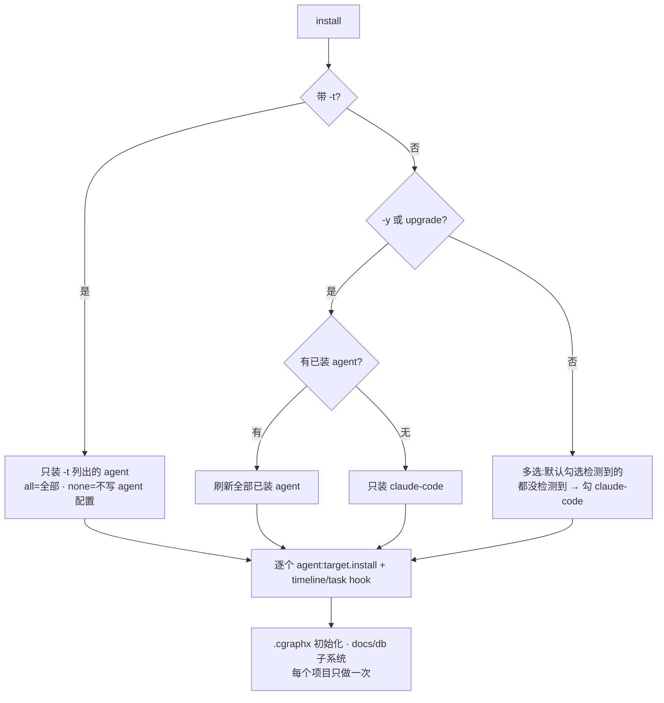
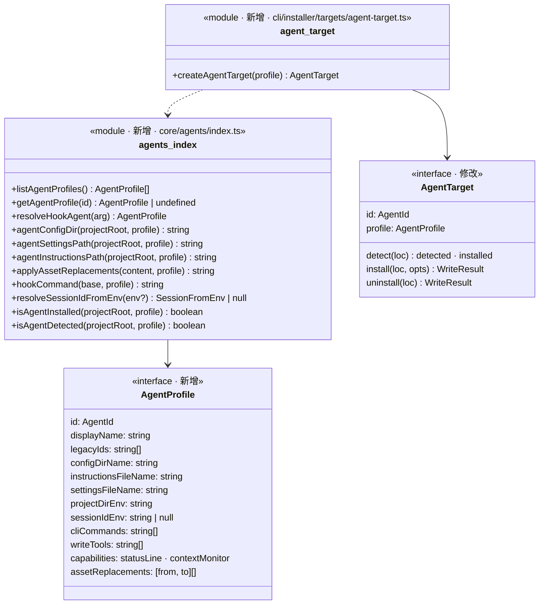
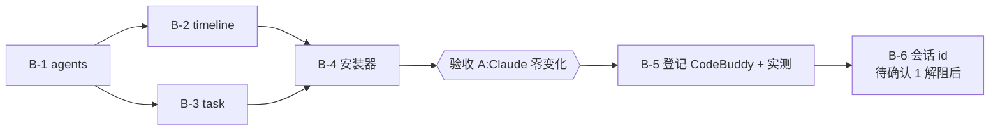

# 实现计划: 多 agent 适配

> feature-id: 2026-10-15-多agent适配
> 负责人: liulongfei
> 日期: 2026-10-15
> 来源 spec: `docs/features/2026-10-15-多agent适配/多agent适配-spec.md`

## 设计预览

新增一个 core 模块 `src/core/agents/`，用一份「agent 描述」承载各 agent 的差异：目录、文件名、环境变量、写类工具、能力、资产替换规则。timeline、task、安装器不再写死 `.claude`，改为按描述取值。hook 子命令新增 `--agent <id>` 参数，不带参数时视为 Claude Code，所以 Claude 的 settings 内容一字不变。`timeline_events` 加一列 `agent`。CodeBuddy 最后作为第二份描述登记进来。

**需要你重点看的**（改错了代价最大，其余可略读）

| # | 决策 | 为什么难回头 |
|---|---|---|
| 1 | `timeline_events` 新增可空列 `agent`；timeline schema 版本 1→2；首次打开旧库时补列并把存量行回填为 `'claude-code'` | 这是持久化数据结构。回填只做一次，数据写进去就改不回来。代价：降级到旧版 cgraphx 后，旧版会因「schema 版本比自身新」拒绝打开库，timeline 静默停止记录（hook 不报错） |
| 2 | 判断 hook 属于哪个 agent 的方式：settings 里的命令末尾带 `--agent <id>`，**不带即 Claude Code**；Claude 的命令字符串保持原样 | 已部署项目的 settings 认的就是这个命令格式。以后再改识别方式，就得让所有项目重装 |
| 3 | `src/core/agents/` 放在 core 层，timeline、task、cli 只经它的门面 `index.ts` 读取 agent 差异；agents 自身不依赖任何子系统 | 这条依赖方向决定了以后加 WorkBuddy 时改动是否只限于 agents（spec §9）。一旦有子系统自己写死 agent 判断，扩展性就破了 |

**架构**：绿色是新增，黄色是修改，灰色是已有且不动的邻居。注意观察三条依赖都指向 agents，agents 不指向任何子系统。

```mermaid
flowchart LR
  cliIndex[cli/index.ts<br/>install / uninstall 命令] --> orch[installer/index.ts<br/>选择 agent · 编排安装卸载]
  upgrade[upgrade/index.ts<br/>拉包后跑 install -y] --> orch
  orch --> registry[targets/registry.ts<br/>由 agent 描述生成 target]
  registry --> target[targets/agent-target.ts<br/>createAgentTarget(profile)]
  target --> assets[claude-assets.ts<br/>按 agent 部署 / 替换 / 卸载资产]
  target --> shared[targets/shared.ts<br/>标记块 · JSON 读写]
  orch --> tlInst[timeline/installer.ts<br/>按 agent 写 hook · git 钩子]
  orch --> taskInst[task/installer.ts<br/>按 agent 写 hook]
  tlCli[timeline/cli.ts<br/>hook 子命令 --agent · install -t] --> tlHooks[timeline/hooks.ts<br/>事件带 agent]
  tlHooks --> recorder[timeline/recorder.ts]
  recorder --> store[timeline/store.ts<br/>INSERT 带 agent]
  store --> boot[timeline/schema-bootstrap.ts<br/>v2 补列 + 回填]
  taskCli[task/cli.ts<br/>hook 子命令 --agent] --> taskHooks[task/hooks.ts<br/>按 agent 取写类工具]
  binding[task/binding.ts<br/>resolveSessionId] --> agents
  target --> agents[(core/agents/<br/>AgentProfile 描述 + 门面)]
  assets --> agents
  tlInst --> agents
  taskInst --> agents
  tlHooks --> agents
  taskHooks --> agents
  tlCli --> agents
  classDef new fill:#d4f7d4,stroke:#2a2
  classDef changed fill:#fff3c4,stroke:#c90
  classDef old fill:#eee,stroke:#999,color:#666
  class agents,target new
  class orch,registry,assets,tlInst,taskInst,tlCli,tlHooks,store,boot,taskCli,taskHooks,binding changed
  class cliIndex,upgrade,recorder,shared old
```

**主流程一：CodeBuddy 中的一次工具调用如何带上来源**。注意 `--agent` 缺省时走 Claude Code，以及 git_commit 的来源取自会话环境变量。

```mermaid
sequenceDiagram
  participant CB as CodeBuddy
  participant TC as timeline/cli.ts
  participant AG as core/agents
  participant H as timeline/hooks.ts
  participant RC as recorder.ts
  participant ST as store.ts
  CB->>TC: cgraphx timeline-post-tool-use-hook --agent codebuddy(stdin payload)
  TC->>AG: resolveHookAgent('codebuddy')
  Note over AG: 参数缺省或无法识别 → claude-code
  AG-->>TC: AgentProfile(codebuddy)
  TC->>H: postToolUseHook('codebuddy')
  H->>RC: recordEvent({... agent: 'codebuddy'})
  RC->>ST: INSERT timeline_events(..., agent)
  Note over H: git_commit:resolveSessionIdFromEnv() → {sessionId, agent};<br/>拿不到会话 → session_id 和 agent 都为 null
```

**主流程二：install 时决定装给谁**（spec §4.1）。



**类图**：看 agent 描述的字段，以及 agents 门面对外的函数。



**关键取舍**

| 选了 | 没选 | 为什么 |
|---|---|---|
| agent 差异做成一份数据描述（`AgentProfile`）＋少量纯函数 | 每个 agent 一个策略类，或为 payload 转换预留钩子 | CodeBuddy 的 hook 事件名、payload 字段、settings 结构都和 Claude Code 一致，差异只有名字和路径。多态类会把逻辑复制两份。等真有不同格式的 agent 再加转换钩子（spec §9 第 3 条） |
| hook 进程用 `--agent` 参数识别来源 | 读宿主注入的环境变量 | 参数在安装时由 cgraphx 自己写进命令，确定可控。宿主环境变量要逐个实测，没有文档保证 |
| `timeline_events` 加列并回填 | 把来源写进 `metadata` JSON | 写进 metadata 就分不清「改造前的 commit（视为 claude-code）」和「改造后未归属的 commit（来源为空）」，满足不了 spec §6 |

## 1. 目标与范围

承接 spec §1：先以 Claude Code 为第一个实现完成结构改造（B-1～B-4，验收 A），再登记 CodeBuddy 并做真机实测（B-5）。CodeBuddy 的会话 id（B-6）等【待确认 1】有结论后再做。

**明确不包含**（防止 implementer 扩大范围）：
- WorkBuddy。
- CodeBuddy 的 statusLine 和 context-monitor。
- 任何读取侧展示 agent：`timeline query/recent/show/stats` 的输出、developer-timeline、`cgraphx web`、`task show`。
- 改写 task 和 timeline 面向用户的文案，包括「Claude Code 会话」字样的报错和选项说明。
- `docs` / `db` / `features` 子系统。
- 新写测试：测试走代码完成后的独立流程。

## 2. 计划文件清单

| 文件 | 状态 |
|---|---|
| `多agent适配-index.md` | 本文件，含全部任务 |
| `多agent适配-01-schema.md` | 存在：`timeline_events.agent` 列的变更与迁移契约，B-2 引用 |
| `多agent适配-02-backend.md` | 不涉及：全部任务直接写在本文件 |
| `多agent适配-03-frontend.md` | 不涉及：没有页面改动 |

## 3. 总任务清单

| 任务 | 内容 | spec 条款 | 独立提交 |
|---|---|---|---|
| B-1 | 新建 `src/core/agents/`（只登记 claude-code） | §2、§3、§7、§9、§11 | 是 |
| B-2 | timeline：agent 列＋迁移、hook `--agent`、事件来源、按 agent 安装、`timeline install -t` | §4.3、§5、§6、§11、§12 | 是 |
| B-3 | task：按 agent 安装 hook、hook `--agent`、写类工具、会话 id 走 agents | §3、§8、§11 | 是 |
| B-4 | 安装器：通用 agent target、资产按 agent 部署、安装与卸载的选择规则 | §3、§4、§5、§7、§11、§12 | 是 |
| B-5 | 登记 CodeBuddy 描述＋真机实测（验收 B、C、D） | §3、§7、§9、§13 B/C/D | 是 |
| B-6 | 【阻塞】CodeBuddy 会话 id | §8、§10 待确认 1 | 是（待解阻） |

## 4. 依赖与执行顺序



- **推荐顺序**：B-1 → （B-2 ∥ B-3）→ B-4 → 验收 A → B-5 → B-6。
- **可并行批次**：B-2 和 B-3。两者文件集不重叠（`src/core/timeline/**` 对 `src/core/task/**`）。task 依赖 timeline 门面，但 B-2 只删除门面导出的 `CLAUDE_SESSION_ID_ENV`，B-3 同时停止使用它。为避免中间态编译失败，**B-3 先于 B-2 合入，或两者同批合入**。其余任务串行。

## 5. 必须严格执行的契约

**C1. agents 门面签名**（B-1 产出；B-2/B-3/B-4/B-5 消费，各任务内有原文）：

```ts
// src/core/agents/types.ts
export const AGENT_IDS = ['claude-code', 'codebuddy'] as const;
export type AgentId = (typeof AGENT_IDS)[number];
export interface AgentProfile {
  readonly id: AgentId;
  readonly displayName: string;
  readonly legacyIds: readonly string[];
  readonly configDirName: string;
  readonly instructionsFileName: string;
  readonly settingsFileName: string;
  readonly projectDirEnv: string;
  readonly sessionIdEnv: string | null;
  readonly cliCommands: readonly string[];
  readonly writeTools: readonly string[];
  readonly capabilities: { readonly statusLine: boolean; readonly contextMonitor: boolean };
  readonly assetReplacements: ReadonlyArray<readonly [from: string, to: string]>;
}
export interface SessionFromEnv { sessionId: string; agent: AgentId }

// src/core/agents/index.ts(门面)
export const DEFAULT_AGENT_ID: AgentId;               // 'claude-code'
export const AGENT_OPTION_FLAG: '--agent';
export const CGRAPHX_SECTION_START: '<!-- CGRAPHX_START -->';
export const CGRAPHX_SECTION_END: '<!-- CGRAPHX_END -->';
export function listAgentProfiles(): readonly AgentProfile[];
export function getAgentProfile(idOrLegacy: string): AgentProfile | undefined;
export function resolveHookAgent(arg: string | undefined): AgentProfile;
export function agentConfigDir(projectRoot: string, profile: AgentProfile): string;
export function agentSettingsPath(projectRoot: string, profile: AgentProfile): string;
export function agentInstructionsPath(projectRoot: string, profile: AgentProfile): string;
export function applyAssetReplacements(content: string, profile: AgentProfile): string;
export function hookCommand(base: string, profile: AgentProfile): string;
export function resolveSessionIdFromEnv(env?: NodeJS.ProcessEnv): SessionFromEnv | null;
export function isAgentInstalled(projectRoot: string, profile: AgentProfile): boolean;
export function isAgentDetected(projectRoot: string, profile: AgentProfile): boolean;
```

**C2. claude-code 描述的取值**：必须逐字一致，这是零变化的依据。

| 字段 | 值 |
|---|---|
| id / displayName | `'claude-code'` / `'Claude Code'` |
| legacyIds | `['claude']` |
| configDirName / instructionsFileName / settingsFileName | `'.claude'` / `'CLAUDE.md'` / `'settings.json'` |
| projectDirEnv / sessionIdEnv | `'CLAUDE_PROJECT_DIR'` / `'CLAUDE_CODE_SESSION_ID'` |
| cliCommands | `['claude']` |
| writeTools | `['Edit', 'Write', 'MultiEdit', 'NotebookEdit']` |
| capabilities | `{ statusLine: true, contextMonitor: true }` |
| assetReplacements | `[]`（空，部署时逐字节拷贝） |

**C3. codebuddy 描述的取值**（B-5 登记）：

| 字段 | 值 |
|---|---|
| id / displayName | `'codebuddy'` / `'CodeBuddy'` |
| legacyIds | `[]` |
| configDirName / instructionsFileName / settingsFileName | `'.codebuddy'` / `'CODEBUDDY.md'` / `'settings.json'` |
| projectDirEnv / sessionIdEnv | `'CODEBUDDY_PROJECT_DIR'` / `null`（B-6 解阻后填） |
| cliCommands | `['codebuddy']`【待确认 3：B-5 实测 `command -v codebuddy` 后锁定】 |
| writeTools | `['Edit', 'Write', 'MultiEdit', 'NotebookEdit']`【待确认 2：B-5 实测补全】 |
| capabilities | `{ statusLine: false, contextMonitor: false }` |
| assetReplacements | `[['.claude/', '.codebuddy/'], ['CLAUDE.md', 'CODEBUDDY.md'], ['CLAUDE_PROJECT_DIR', 'CODEBUDDY_PROJECT_DIR']]`，按此顺序；B-6 解阻后追加会话 id 变量 |

**C4. hook 命令格式**：`hookCommand(base, profile)` 的规则是：claude-code 返回 `base` 原样；其他 agent 返回 `` `${base} --agent ${profile.id}` ``。所有 hook 子命令（timeline 的 7 个中由宿主触发的 6 个，加上 task 的 2 个）都接受 `--agent <id>`，缺省或无法识别时按 claude-code 处理。git post-commit 钩子脚本**不带** `--agent`。

**C5. timeline 来源列**：见 `多agent适配-01-schema.md`。读取侧的类型 `TimelineEvent` 和所有命令输出**不得**出现 agent。

**C6. Claude 零变化**：在改造前后的同一个项目里，Claude 侧的这些内容必须逐字节一致：
- `install` 写出的 `.claude/settings.json` 和 `.claude/CLAUDE.md`；
- `.claude/` 下的全部资产；
- `.git/hooks/post-commit`；
- 所有命令的 stdout。

唯一例外：数据库里多了 `agent` 列和 schema 版本行 2。

## 6. 实现手段决策（plan 自主，无业务可观察后果）

| 决策 | 选项 | 选定 | 理由 |
|---|---|---|---|
| agent 差异放哪一层 | cli/installer 内 / core 新模块 | core `src/core/agents/` | timeline 和 task 的安装、hook 都在 core，core 不能依赖 cli |
| agents 模块形态 | 完整子系统形态 / 轻形态 | 轻形态：`index.ts` + `types.ts` + `profiles.ts` | 没有数据库、没有 CLI、没有自己的错误类型，同 features 的轻形态 |
| hook 识别来源 | `--agent` 参数 / 宿主环境变量 | `--agent` 参数，缺省为 claude-code | 见设计预览取舍 |
| git_commit 的来源 | 按会话查库 / 由会话环境变量所属 agent 推出 | `resolveSessionIdFromEnv()` 返回的 agent | 会话 id 本来就是从这个环境变量拿的，两者同源，省一次查询 |
| 存来源 | 新列 / metadata | 新列＋回填 | 见设计预览取舍 |
| schema 版本 | 不升版本只补列 / 升到 v2 | 升到 v2 | 遵守 `data-standards.md`「表结构变更 = schema.sql 追加 + 加版本号」，降级风险记在 §10 |
| Claude 资产部署 | 统一走文本替换 / 替换规则为空时直接拷贝 | 替换规则为空 → `copyFileSync` | 保证逐字节一致，二进制文件也不会被误读成文本 |
| 资产按能力过滤 | — | 不支持 statusLine → 不部署 `plugins/claude-hud`；不支持 contextMonitor → 不部署 `hooks/context-monitor` | spec §3 |
| task 的 matcher | 每个 agent 一份 / 共用常量 | 取 `profile.writeTools.join('\|')` | 为待确认 2 留出口子；claude-code 的结果和现在的字符串一致 |
| 「已装」判定 | 加查 skills 目录 / 只看 settings 和标记块 | 只看 settings hook 和标记块 | install 每次都会写这两样，查它们就够了；skills 清单在 cli 侧，core 拿不到 |
| `timeline install` 输出 | — | 只有一个 agent 时输出单个报告对象（和现在一致）；多个 agent 时输出数组 | C6 零变化 |
| 文件 `claude-assets.ts`、`targets/claude.ts` | 改名 / 保留 | 保留文件名；`claude.ts` 只导出 `claudeTarget` 兼容别名 | 既有测试按这个路径 import，改名徒增变动 |

不需要回跳 spec 的项：无。

## 7. 执行方式建议

建议用 **`/subagent-implement`**。三个条件都成立：
- 跨 4 个相互独立的模块：`core/agents`、`core/timeline`、`core/task`、`cli/installer`；
- 预估改动约 18 个文件（≥10）；
- B-2 和 B-3 可以独立派任，接口由 C1 钉死，不需要实时反馈。

B-5 要人在本机装 CodeBuddy 实测，由 controller 和人协同完成，不派子 agent。

## 8. 适用规范

| 文件 | 章节 | 作用于 |
|---|---|---|
| `docs/guides/coding-standards.md` | 边界与结构；选型（偏离社区默认）；错误与日志 | B-1～B-5 |
| `docs/guides/data-standards.md` | DDL 层 | B-2（表结构变更） |
| `docs/guides/git-standards.md` | 提交消息规范；提交前检查点 | 已结晶到下一节 |

已落进契约的规范要点：
- core 不 import cli/web；
- 枚举用 `as const` 数组加联合类型（即 `AGENT_IDS`）；
- 内置模块用 `node:` 前缀；
- 新注释用中文；
- 单文件不超过 600 行（`agent-target.ts` 承接 `claude.ts` 的 527 行，超限时拆出 `settings-hooks.ts`）；
- schema.sql 保持幂等并加版本行。

## 9. 提交规范

**消息格式**：`type(scope): 中文描述`
- type 用 feat、refactor、fix、docs。
- scope 用 agents、timeline、task、installer、skills。
- 补充说明用「——」，并列用「+」。
- 不写票据号。
- 非琐碎提交写 body：先一行背景，再用「-」列要点。
- 结尾附 `Co-Authored-By` 行。

各任务的建议主题：

| 任务 | 主题 |
|---|---|
| B-1 | `refactor(agents): 新增 agent 描述层——claude-code 为首个实现` |
| B-2 | `refactor(timeline): hook 与安装按 agent 适配——事件记录来源 agent` |
| B-3 | `refactor(task): hook 与安装按 agent 适配` |
| B-4 | `refactor(installer): 通用 agent target——多 agent 安装与卸载` |
| B-5 | `feat(agents): 接入 CodeBuddy` |
| B-6 | `feat(agents): CodeBuddy 会话 id 识别` |

**提交前检查点**（摘自 `git-standards.md`）：
- 与 TS 同放的运行时资产已登记 `scripts/copy-assets.cjs`；
- `src/core` 里没有对 `src/cli`、`src/web` 的 import；
- schema.sql 没有丢失 `IF NOT EXISTS`；
- timeline hook 链路上的 DB 写入都 await，抛错都吞掉；
- `vitest.config.ts` 的 `TZ: 'UTC'` 没被改；
- 没有被注释掉的命令注册或 hook 接入项；
- 没有写死的魔法值（绝对路径、密钥、阈值、版本号）；
- 不新增 TODO/FIXME。

## 10. 关键风险与防跑偏约束

| 风险 | 等级 | 约束 / 保护 |
|---|---|---|
| Claude 采集悄悄中断（hook 命令或 settings 变了） | HIGH | C6；B-4 完成后执行「零变化对比」（见 B-4 验证方式），对比不一致不得合入 |
| 迁移并发：两个 hook 同时首次打开旧库，各自 ALTER | MEDIUM | 01-schema 契约：在 `BEGIN IMMEDIATE` 事务内重新检查列是否存在；遇到「duplicate column name」视为成功 |
| 降级 cgraphx 后旧版拒开 v2 库 | LOW | 接受。这是 data-standards 规定的版本机制带来的。B-2 提交 body 里注明 |
| 文本替换误伤 | MEDIUM | 只对 C3 列出的字符串替换，只处理文本扩展名，claude-code 不替换。B-5 验证时 grep 部署产物，确认 `.codebuddy/` 下不再有 `.claude/` |
| implementer 顺手改 `cgraphx-guide` 等文案 | LOW | 资产正文不改。CodeBuddy 版靠替换规则生成 |

## 11. 允许局部工程适配的范围

- 模块内部的函数拆分、私有函数命名、文件内结构。
- `agent-target.ts` 超过 600 行时拆出辅助文件，文件名自定。
- 因签名变更而失败的既有测试：同步修改调用方式，**不改断言语义**。

除此之外一律按契约执行，包括 C1～C6、各任务「必须严格执行」所列内容、spec 规则。

## 12. Plan 冲突上报规则

implementer 发现以下情况时，停下来以 `PLAN_CONFLICT: <任务> — <冲突点> — <证据>` 上报 controller，不得自行改契约：
- plan 和 spec 冲突；
- plan 和代码现实冲突，例如签名不存在、文件结构不符；
- 契约无法同时满足，例如 C6 和某条具体要求互相矛盾。

权威链：spec > plan > 规范。

## 13. 待确认项

全部已于 2026-10-15 在 CodeBuddy 2.167.0 上实测解决：

| # | 内容 | 结论 |
|---|---|---|
| spec 待确认 1 | CodeBuddy 的会话 id 环境变量 | `CODEBUDDY_SESSION_ID`。B-6 已解阻，按原定方案只改 `profiles.ts`：`sessionIdEnv` 设为该变量，`assetReplacements` 末尾追加 `['CLAUDE_CODE_SESSION_ID', 'CODEBUDDY_SESSION_ID']` |
| spec 待确认 2 | CodeBuddy 写类工具名 | 维持 C3 取值 `['Edit', 'Write', 'MultiEdit', 'NotebookEdit']`。别名 `NotebookWrite` 不覆盖 |
| spec 待确认 3 | CodeBuddy CLI 命令名 | 维持 `['codebuddy']` |
| spec 待确认 4 | 是否读取项目 settings hooks 和 `.codebuddy/CODEBUDDY.md` | 都成立 |
| plan 补充 5 | 是否接受 `hookSpecificOutput.additionalContext` | 成立：会话开始提醒注入了上下文 |

## 14. Self-Review 记录

- **spec 覆盖**：spec 各节都有承载任务，见 §3 表中的条款列。
  - §1.3 的非目标都列入了本文件 §1「明确不包含」。
  - §15 补定规则：第 1 条落在 B-1（`isAgentInstalled` / `isAgentDetected`）；第 2、5、6 条落在 B-4；第 3 条落在 B-2（gitCommitHook 的 agent 取值）；第 4 条落在 B-2（`timeline install -t`）；第 7 条落在 B-1（`resolveHookAgent`）。
- **跨任务一致性**：消费 C1 签名的任务（B-2、B-3、B-4）都内嵌了所需签名的原文。B-2 和 B-3 的 installer 新签名，在 B-4 中逐字重复。
- **Plan Review**：本轮没有派 plan-document-reviewer 子 agent（本会话的约定是：用户没有明确要求，就不派子 agent）。需要独立复核时，可以单独发起。

---

## 任务详情

### B-1: 新建 `src/core/agents/`（只登记 claude-code）

- **目标**：建立 agent 描述层和门面，供 timeline、task、cli 统一读取 agent 差异。
- **对应 spec 条款**：§2（术语：检测到 / 已装）、§3、§7、§9、§11。
- **强制引用**：`coding-standards.md`。
- **依赖**：无。
- **涉及范围**：新建 `src/core/agents/types.ts`、`src/core/agents/profiles.ts`、`src/core/agents/index.ts`。
- **必须严格执行**：
  - 类型和门面签名逐字使用下面的 C1 原文：

```ts
// src/core/agents/types.ts
export const AGENT_IDS = ['claude-code', 'codebuddy'] as const;
export type AgentId = (typeof AGENT_IDS)[number];
export interface AgentProfile {
  readonly id: AgentId;
  readonly displayName: string;
  readonly legacyIds: readonly string[];
  readonly configDirName: string;
  readonly instructionsFileName: string;
  readonly settingsFileName: string;
  readonly projectDirEnv: string;
  readonly sessionIdEnv: string | null;
  readonly cliCommands: readonly string[];
  readonly writeTools: readonly string[];
  readonly capabilities: { readonly statusLine: boolean; readonly contextMonitor: boolean };
  readonly assetReplacements: ReadonlyArray<readonly [from: string, to: string]>;
}
export interface SessionFromEnv { sessionId: string; agent: AgentId }

// src/core/agents/index.ts(门面)
export const DEFAULT_AGENT_ID: AgentId;               // 'claude-code'
export const AGENT_OPTION_FLAG: '--agent';
export const CGRAPHX_SECTION_START: '<!-- CGRAPHX_START -->';
export const CGRAPHX_SECTION_END: '<!-- CGRAPHX_END -->';
export function listAgentProfiles(): readonly AgentProfile[];
export function getAgentProfile(idOrLegacy: string): AgentProfile | undefined;
export function resolveHookAgent(arg: string | undefined): AgentProfile;
export function agentConfigDir(projectRoot: string, profile: AgentProfile): string;
export function agentSettingsPath(projectRoot: string, profile: AgentProfile): string;
export function agentInstructionsPath(projectRoot: string, profile: AgentProfile): string;
export function applyAssetReplacements(content: string, profile: AgentProfile): string;
export function hookCommand(base: string, profile: AgentProfile): string;
export function resolveSessionIdFromEnv(env?: NodeJS.ProcessEnv): SessionFromEnv | null;
export function isAgentInstalled(projectRoot: string, profile: AgentProfile): boolean;
export function isAgentDetected(projectRoot: string, profile: AgentProfile): boolean;
```

  - `profiles.ts` **只登记 claude-code 一份描述**，取值逐字使用下表。codebuddy 留到 B-5 登记，`AGENT_IDS` 里先保留这个 id。

    | 字段 | 值 |
    |---|---|
    | id / displayName | `'claude-code'` / `'Claude Code'` |
    | legacyIds | `['claude']` |
    | configDirName / instructionsFileName / settingsFileName | `'.claude'` / `'CLAUDE.md'` / `'settings.json'` |
    | projectDirEnv / sessionIdEnv | `'CLAUDE_PROJECT_DIR'` / `'CLAUDE_CODE_SESSION_ID'` |
    | cliCommands | `['claude']` |
    | writeTools | `['Edit', 'Write', 'MultiEdit', 'NotebookEdit']` |
    | capabilities | `{ statusLine: true, contextMonitor: true }` |
    | assetReplacements | `[]` |

  - 门面各函数的语义：
    - `listAgentProfiles()`：按登记顺序返回。claude-code 永远排第一。
    - `getAgentProfile(x)`：`x` 等于某份描述的 id，或在它的 legacyIds 里，就返回那份描述；否则返回 `undefined`。
    - `resolveHookAgent(arg)`：`arg` 能用 `getAgentProfile` 找到就返回结果；否则（包括 `undefined` 和空串）返回 claude-code 描述。
    - `agentConfigDir`：返回 `path.join(path.resolve(projectRoot), profile.configDirName)`。`agentSettingsPath` 和 `agentInstructionsPath` 在它后面拼 `settingsFileName` 或 `instructionsFileName`。
    - `applyAssetReplacements(content, profile)`：按 `assetReplacements` 的顺序，对每一对做 `content.split(from).join(to)`。替换规则为空时原样返回。
    - `hookCommand(base, profile)`：claude-code 返回 `base`；其他 agent 返回 `` `${base} --agent ${profile.id}` ``。
    - `resolveSessionIdFromEnv(env = process.env)`：按登记顺序遍历 `sessionIdEnv !== null` 的描述，取第一个去空白后非空的值，返回 `{ sessionId, agent: profile.id }`；都没有时返回 `null`。
    - `isAgentInstalled`：满足以下任一条件就返回 true，读取或解析失败都按 false，不抛异常。
      1. settings 文件（JSON）的 `hooks` 中，任一 hook 的 `command` 包含以下任一子串：`'/hooks/precommit-check/precommit-check.cjs'`、`'/hooks/context-monitor/context-monitor.cjs'`、`'cgraphx timeline-'`、`'cgraphx task-'`；
      2. `statusLine.command` 包含 `'claude-hud'`；
      3. instructions 文件内容包含 `CGRAPHX_SECTION_START`。
    - `isAgentDetected`：`agentConfigDir` 存在，或 `cliCommands` 中任一命令在 PATH 上，就返回 true。PATH 检查在 POSIX 上用 `command -v <cmd>`，在 Windows 上用 `where <cmd>`，`stdio` 全部 pipe，失败视为不存在，不抛异常。
  - agents 模块不得 import 任何其他 core 子系统，也不得 import cli/web。
- **允许局部适配**：内部私有函数的拆分和命名；settings 解析的实现细节。
- **具体要求**：
  - 内置模块导入用 `node:` 前缀，注释用中文。
  - 本任务不修改任何既有文件。
- **完成条件**：
  - `npm run build` 通过；
  - `npm test` 全绿，既有测试不受影响。
- **验证方式**：
  - `npm run build && npm test`；
  - `node -e "const a=require('./dist/core/agents');console.log(a.listAgentProfiles().map(p=>p.id), a.hookCommand('cgraphx x', a.resolveHookAgent(undefined)), a.getAgentProfile('claude').id)"`，应输出 `[ 'claude-code' ] cgraphx x claude-code`。
- **独立提交**：是。新模块暂时没有调用方，仓库可以正常工作。主题：`refactor(agents): 新增 agent 描述层——claude-code 为首个实现`。
- **风险/注意事项**：
  - `AGENT_IDS` 已包含 `'codebuddy'`，但 profiles 里没有登记它。这时 `getAgentProfile('codebuddy')` 返回 `undefined`，属于预期行为。

### B-2: timeline 按 agent 适配

- **目标**：
  - timeline 的 hook 安装和卸载按 agent 进行；
  - hook 子命令识别 `--agent`；
  - 事件写入来源 agent；
  - git_commit 的会话和来源都走 agents；
  - 新增 agent 列及其迁移；
  - `timeline install/uninstall` 按 spec §4.3 选择 agent。
- **对应 spec 条款**：§4.3、§5（git 钩子归属）、§6、§11、§12。
- **强制引用**：`coding-standards.md`、`data-standards.md`。
- **依赖**：B-1。与 B-3 同批，或在 B-3 之后合入（理由见 §4）。
- **涉及范围**：
  - `src/core/timeline/` 下的 `schema.sql`、`schema-bootstrap.ts`、`constants.ts`、`types.ts`、`store.ts`、`hooks.ts`、`cli.ts`、`installer.ts`、`index.ts`；
  - 因签名变更而失败的 `__tests__/core/timeline/installer.test.ts` 等调用方。
- **必须严格执行**：
  - **表结构**按 `多agent适配-01-schema.md` 执行，要点原文：`timeline_events` 新增可空列 `agent TEXT`；`TIMELINE_SCHEMA_VERSION` 由 1 改为 2；首次补列时把存量行回填为 `'claude-code'`。
  - `TimelineEventInput` 新增 `agent?: AgentId | null`（`AgentId` 从 `../agents` 导入），store 的 INSERT 写入该列，`undefined` 按 `null` 写。`TimelineEvent`、`rowToEvent`，以及 query、recent、show、stats 的输出**不得**加入 agent（C6）。
  - 6 个宿主 hook 子命令（`HOOK_EVENTS_TO_COMMANDS`）在注册时增加 `.option('--agent <id>')`，action 中用 `resolveHookAgent(opts.agent).id` 得到 agentId，传给对应 handler。`userPromptHook`、`preToolUseHook`、`postToolUseHook`、`stopHook`、`sessionStartHook`、`sessionEndHook` 都改为接收参数 `agent: AgentId = 'claude-code'`，并在产出的事件上设置 `agent`。
  - `gitCommitHook`：删掉对 `CLAUDE_SESSION_ID_ENV` 的读取，改为 `const fromEnv = resolveSessionIdFromEnv();`，然后 `session_id = fromEnv?.sessionId ?? null`、`agent = fromEnv?.agent ?? null`。`GIT_COMMIT_SUBCOMMAND` 不加 `--agent`，post-commit 钩子脚本的内容不变。
  - 从 `constants.ts` 删除 `CLAUDE_SESSION_ID_ENV`，`index.ts` 门面不再导出它（唯一来源转到 agents 的 claude-code 描述）。
  - installer 的签名改为：
    - `installTimelineHooks(projectRoot: string, opts: { purgeFirst?: boolean; agent?: AgentId } = {}): InstallReport`
    - `uninstallTimelineHooks(projectRoot: string, opts: { purgeData?: boolean; agent?: AgentId; keepGitHook?: boolean } = {}): UninstallReport`
    - `agent` 缺省为 `'claude-code'`。
    - settings 路径用 `agentSettingsPath(root, profile)`；写入的命令用 `hookCommand(\`cgraphx ${subcommand}\`, profile)`。
    - 幂等判断仍是「已有完全相同的命令就跳过」。卸载识别仍用 `'cgraphx timeline-'` 子串。
    - `keepGitHook: true` 时不动 `.git/hooks/post-commit`。
    - `purgeFirst` 调用卸载时传入同一个 `agent`。
    - claude-code 下写出的 settings 内容和改造前逐字节一致。
  - `cgraphx timeline install` / `uninstall` 新增 `-t, --target <ids>`（逗号分隔，接受 id 或 legacyIds）。选择规则：
    - 给了 `-t` → 用列出的 agent；未知 id 时报错退出，消息列出可用 id（含 legacy 别名）。
    - 没给 `-t` → 取 `listAgentProfiles().filter(p => isAgentInstalled(root, p))`；结果为空时取 `[claude-code]`。
    - 对每个选中的 agent 调用 install 或 uninstall。
    - `uninstall`：没给 `-t` 时，git 钩子照旧移除；给了 `-t` 时传 `keepGitHook: true`。
    - 输出：选中 1 个 agent 时，输出该 agent 的单个报告对象，格式和现在一致；多个时输出报告数组。
- **允许局部适配**：迁移函数的内部组织；hook 注册时取 option 的写法。
- **具体要求**：
  - hook 链路上所有 DB 写入都要 await，异常吞掉，只写 stderr。`runHook` 退出码恒为 0，stdout 恒空，这个契约不变。
  - `--agent` 的值无法识别时按 claude-code 处理，不报错（spec §12）。
- **完成条件**：
  - build 和既有测试全绿（失败的测试只调整调用方式）；
  - 新库和旧库都能正确得到 `agent` 列；
  - claude-code 下 settings 和 git 钩子的内容不变。
- **验证方式**：
  1. `npm run build && npm test`。
  2. 用改造前的版本在临时目录初始化一个项目，并产生若干事件。换成新 build，执行 `echo '{"session_id":"s1","prompt":"hi","cwd":"'$PWD'"}' | node dist/cli/index.js timeline-user-prompt-hook`。然后用 sqlite 查询 `SELECT agent, count(*) FROM timeline_events GROUP BY agent`：旧行和新行都应为 `claude-code`；`SELECT max(version) FROM timeline_schema_versions` 应为 2。
  3. 同样执行一次带 `--agent codebuddy` 的 hook。由于 codebuddy 还没登记，按 spec §12 应记为 `claude-code`。
  4. 执行 `CLAUDE_CODE_SESSION_ID=abc node dist/cli/index.js timeline-git-commit-hook`（在有提交的仓库里），新行的 `session_id='abc'`、`agent='claude-code'`；不设这个变量时两者都为 NULL。
  5. 执行 `node dist/cli/index.js timeline recent --limit 3`，输出的 JSON 里没有 `agent` 字段。
- **独立提交**：是。主题：`refactor(timeline): hook 与安装按 agent 适配——事件记录来源 agent`。body 里注明降级风险（v2 库被旧版拒开）。
- **风险/注意事项**：
  - 迁移在 hook 进程里执行，必须满足 01-schema 的并发约束。
  - 单个 hook 的性能预算是 50ms。PRAGMA 检查只做一次查询，不要加全表扫描。回填只在补列的那一次执行。

### B-3: task 按 agent 适配

- **目标**：
  - task 的 hook 安装和卸载按 agent 进行；
  - hook 子命令识别 `--agent`，写类工具按 agent 判定；
  - 会话 id 从环境变量取时走 agents。
- **对应 spec 条款**：§3（任务绑定一行）、§8、§11。
- **强制引用**：`coding-standards.md`。
- **依赖**：B-1。与 B-2 同批，或先于 B-2 合入。
- **涉及范围**：`src/core/task/` 下的 `installer.ts`、`hooks.ts`、`cli.ts`（仅限两个隐藏 hook 命令的注册）、`binding.ts`、`index.ts`（若导出了安装函数则同步签名）。
- **必须严格执行**：
  - 门面函数原文（来自 `src/core/agents/index.ts`）：
    - `resolveHookAgent(arg: string | undefined): AgentProfile`
    - `agentSettingsPath(projectRoot: string, profile: AgentProfile): string`
    - `hookCommand(base: string, profile: AgentProfile): string`
    - `resolveSessionIdFromEnv(env?: NodeJS.ProcessEnv): SessionFromEnv | null`
    - 其中 `SessionFromEnv = { sessionId: string; agent: AgentId }`，`AgentProfile.writeTools: readonly string[]`。
  - installer 的签名改为：
    - `installTaskHooks(projectRoot: string, opts: { agent?: AgentId } = {}): { written: string[]; skipped: string[] }`
    - `uninstallTaskHooks(projectRoot: string, opts: { agent?: AgentId } = {}): { removed: string[] }`
    - `agent` 缺省为 `'claude-code'`。
    - settings 路径用 `agentSettingsPath`；两条命令分别是 `hookCommand('cgraphx task-session-start-hook', profile)` 和 `hookCommand('cgraphx task-post-tool-use-hook', profile)`。
    - PostToolUse 组的 matcher 取 `profile.writeTools.join('|')`。
    - 卸载识别仍用 `'cgraphx task-'` 子串。
    - claude-code 下写出的 settings 内容和改造前逐字节一致（matcher 仍为 `Edit|Write|MultiEdit|NotebookEdit`）。
  - `cli.ts` 中的 `task-session-start-hook`、`task-post-tool-use-hook` 两个隐藏命令增加 `.option('--agent <id>')`，把 `resolveHookAgent(opts.agent)` 得到的描述传给 handler。
  - `taskSessionStartHook(profile: AgentProfile)` 和 `taskPostToolUseHook(profile: AgentProfile)` 接收描述参数。PostToolUse 用 `profile.writeTools` 判断写类工具，替换模块常量 `WRITE_TOOLS`。
  - `binding.ts` 中的 `resolveSessionId(explicit)` 改为：显式值去空白后非空就用它，否则用 `resolveSessionIdFromEnv()?.sessionId`，都没有返回 `null`。不再 import timeline 的 `CLAUDE_SESSION_ID_ENV`。
  - 所有面向用户的文案和退出码不变，包括「不在 Claude Code 会话内」这类文字。
- **允许局部适配**：handler 拿描述参数的具体写法。
- **具体要求**：
  - hook 的 stdout 契约（`hookSpecificOutput.additionalContext`）不变。异常吞掉，退出码恒为 0。
  - 只依赖 agents 门面和 timeline 门面，不伸手进内部模块。
- **完成条件**：
  - build 和既有测试全绿；
  - claude-code 下 settings 的 task 部分不变；
  - `task use` 的会话判定行为不变。
- **验证方式**：
  1. `npm run build && npm test`。
  2. 在临时项目里依次执行 `node -e "require('./dist/core/task').installTaskHooks(process.argv[1])" <dir>`（若门面没有导出该函数，改用 `cgraphx install -y`），然后执行 `cat <dir>/.claude/settings.json`。task 的两组内容应和改造前完全一致。
  3. 执行 `CLAUDE_CODE_SESSION_ID=x node dist/cli/index.js task current`，应识别出会话 `x`；不设这个变量且不传 `--session` 时，`task use` 仍以退出码 3 报错，文案不变。
- **独立提交**：是。主题：`refactor(task): hook 与安装按 agent 适配`。
- **风险/注意事项**：
  - task 不得 import agents 以外的新模块。task → timeline 的单向依赖保持不变。

### B-4: 安装器通用 agent target 与多 agent 编排

- **目标**：
  - 把 Claude 专属的 target 改造成由 agent 描述生成的通用 target；
  - 资产按 agent 部署、替换、按能力过滤；
  - install、uninstall 实现 spec §4、§5 的选择规则，并把 timeline 和 task 的 hook 按 agent 接入。
- **对应 spec 条款**：§3、§4.1、§4.2、§5、§7、§11、§12。
- **强制引用**：`coding-standards.md`。
- **依赖**：B-1、B-2、B-3。
- **涉及范围**：
  - `src/cli/installer/` 下的 `targets/types.ts`、`targets/registry.ts`、`targets/claude.ts`、新建 `targets/agent-target.ts`、`claude-assets.ts`、`index.ts`；
  - `src/cli/index.ts`（仅限 install/uninstall 的选项说明，如有需要）；
  - 因签名变更而失败的 `__tests__/cli/installer/*`。
- **必须严格执行**：
  - 消费的门面原文：`listAgentProfiles()`、`getAgentProfile(idOrLegacy)`、`agentConfigDir`、`agentSettingsPath`、`agentInstructionsPath`、`applyAssetReplacements(content, profile)`、`isAgentInstalled(projectRoot, profile)`、`isAgentDetected(projectRoot, profile)`、`CGRAPHX_SECTION_START`、`CGRAPHX_SECTION_END`，签名同 C1；字段 `profile.capabilities.statusLine`、`profile.capabilities.contextMonitor`、`profile.projectDirEnv`、`profile.configDirName`。
  - 两个门面的新签名：
    - `installTimelineHooks(projectRoot, { agent?, purgeFirst? })`
    - `uninstallTimelineHooks(projectRoot, { agent?, purgeData?, keepGitHook? })`
    - `installTaskHooks(projectRoot, { agent? })`
    - `uninstallTaskHooks(projectRoot, { agent? })`
  - `targets/types.ts`：
    - `TargetId` 改为 `AgentId`；
    - `DetectionResult` 改为 `{ detected: boolean; installed: boolean; configPath?: string }`；
    - `AgentTarget` 新增 `readonly profile: AgentProfile`。
  - `targets/agent-target.ts` 导出 `createAgentTarget(profile: AgentProfile): AgentTarget`，承接 `claude.ts` 的全部行为，并按描述参数化：
    - 项目根仍取 `process.cwd()`；路径用 agents 门面计算。
    - context-monitor 的 hook 只在 `capabilities.contextMonitor` 时写入。命令是 `` `node $${profile.projectDirEnv}/${profile.configDirName}/hooks/context-monitor/context-monitor.cjs` ``。
    - statusLine 只在 `capabilities.statusLine` 时写入。命令是 `` `node $${profile.projectDirEnv}/${profile.configDirName}/plugins/claude-hud/dist/index.js` ``。
    - precommit 的 hook 一律写入（matcher `Bash`）。命令是 `` `node $${profile.projectDirEnv}/${profile.configDirName}/hooks/precommit-check/precommit-check.cjs` ``。
    - 以上三条命令在 claude-code 下必须和现在的 `CONTEXT_MONITOR_COMMAND`、`CLAUDE_HUD_COMMAND`、`PRECOMMIT_CHECK_COMMAND` 逐字相同。
    - 指引块：内容是 `applyAssetReplacements(readTemplateClaudeMd(), profile)`，用 `CGRAPHX_SECTION_START/END` 标记，upsert 到 `agentInstructionsPath`。卸载时只剥离标记块。
    - `detect()` 返回 `{ detected: isAgentDetected(root, p), installed: isAgentInstalled(root, p), configPath: agentSettingsPath(root, p) }`。
    - 死 hook 清理（`cleanupDeadHooks`）、uninstall 的「只移除 cgraphx 条目，保留用户条目」等逻辑保持不变，作用于该 agent 的 settings。
  - `targets/claude.ts` 只保留一行兼容导出：`export const claudeTarget = createAgentTarget(<claude-code 描述>)`。测试依赖的其他导出若被测试 import，从 `agent-target.ts` 重新导出。
  - `targets/registry.ts`：`ALL_TARGETS = listAgentProfiles().map(createAgentTarget)`。`resolveTargetFlag` 用 `getAgentProfile` 解析 id 和 legacy 别名，`all`、`auto`、`none` 的语义不变，未知 id 的报错列出可用 id。
  - `claude-assets.ts`：
    - `deployClaudeAssets(targetDir, profile = <claude-code 描述>)`：
      - 不支持 statusLine 时跳过 `plugins/claude-hud/` 下的全部文件；不支持 contextMonitor 时跳过 `hooks/context-monitor/` 下的全部文件；
      - 替换规则为空 → `copyFileSync`（逐字节拷贝）；
      - 替换规则非空且扩展名属于 `.md .html .cjs .js .mjs .json .jsonl .bru .txt .sh` → 按 utf8 读入、`applyAssetReplacements`、再写出；
      - 其他扩展名 → `copyFileSync`；
      - 返回的 `change.path` 前缀改为 `` `${profile.configDirName}/${rel}` ``（claude-code 下仍是 `.claude/...`）。
    - `removeClaudeAssets(targetDir, overrideTemplateDir?, profile = <claude-code 描述>)` 和 `cleanDeprecatedAssets(targetDir, overrideTemplateDir?, profile = <claude-code 描述>)`：只改路径前缀，删除逻辑不变。
    - 如果实际参数顺序和既有测试冲突，保持既有参数位置，把 profile 追加在最后。
  - `installer/index.ts`：选择规则逐条实现 spec §4.1。
    - 给了 `-t`（不论是否同时给 `-y`）→ `resolveTargetFlag`。
    - 没有 `-t` 但给了 `-y`（upgrade 走的就是这条）→ `ALL_TARGETS.filter(t => t.detect('local').installed)`；结果为空时取 `[claude-code target]`。
    - 交互模式 → 用 `clack.multiselect` 列出全部 target，`initialValues` 取 `detected` 为真的；都没检测到时取 `[claude-code]`；`required: false`；用户一个都不选时跳过 agent 配置写入，仍然执行 `.cgraphx/` 初始化（spec §15 第 2 条）。
    - 「可选子系统」里的 timeline 项：对**每个选中的 agent** 依次调用 `installTimelineHooks(root, { agent })` 和 `installTaskHooks(root, { agent })`。
    - `.cgraphx/` 初始化、遗留表清理、docs/db 子系统每个项目只执行一次。
  - `runUninstaller`：
    - 没有 `-t` → 对全部 target 执行 `uninstall`；对每个 agent 调用 `uninstallTimelineHooks(root, { agent })` 和 `uninstallTaskHooks(root, { agent })`，其中 git 钩子会被移除；之后的 `.cgraphx/` 删除询问逻辑不变。
    - 有 `-t` → 只处理列出的 agent；调用 `uninstallTimelineHooks(root, { agent, keepGitHook: true })`；**跳过** `.cgraphx/` 删除，忽略 `--keep-data`。处理完后，如果 `ALL_TARGETS` 里没有任何一个 `installed` 为真，输出提示「如需彻底卸载请执行不带 -t 的 cgraphx uninstall」。
  - `src/cli/upgrade/` 不修改。它跑的是 `install -y`，自然走「刷新已装 agent」这条规则。
- **允许局部适配**：
  - `agent-target.ts` 超过 600 行时，可拆出 settings hook 读写的辅助文件；
  - 编排代码内部的函数拆分；
  - clack 提示文案。只装 claude-code 时，已有的日志行保持原样。
- **具体要求**：
  - 每个 agent 的安装失败只警告，继续处理其他 agent（spec §12）。
  - 每个 agent 的日志行前缀用 `target.displayName`。只有 claude-code 时，输出和现在一致。
- **完成条件**：
  - build 和既有测试全绿；
  - 通过「零变化对比」；
  - 卸载的两种模式符合 spec §5。
- **验证方式**：
  1. `npm run build && npm test`。
  2. **零变化对比**（C6）：
     - 用改造前的 commit 构建出旧版 dist（`git stash` 或另开 worktree 后执行 `npm run build`），在临时项目 A 里执行 `node <旧dist>/cli/index.js install -y`；
     - 用新 dist 在空的临时项目 B 里执行同样的命令；
     - 执行 `diff -r A/.claude B/.claude`、`diff A/.git/hooks/post-commit B/.git/hooks/post-commit`，两者都应无差异；
     - 比较两次 install 的 stdout，去掉版本号所在行后应一致。
  3. 在项目 B 再执行一次 `install -y`，结果应幂等，`diff` 仍无差异。
  4. 在项目 B 执行 `node dist/cli/index.js uninstall -t claude-code`：`.claude/` 中 cgraphx 的条目被移除，`.cgraphx/` 和 post-commit 钩子仍在，并出现「彻底卸载」提示。
  5. 再执行 `install -y`：因为已没有已装 agent，会装回 claude-code。然后执行 `uninstall -y`：`.cgraphx/` 和 git 钩子都被删除。
- **独立提交**：是。主题：`refactor(installer): 通用 agent target——多 agent 安装与卸载`。
- **风险/注意事项**：
  - 风险最高的任务。零变化对比不通过就不得合入。
  - `claude.ts` 原有 527 行，迁移时注意不要丢掉死 hook 清理、非 cgraphx 的 statusLine 保留提示等分支。

### B-5: 登记 CodeBuddy 描述并真机实测

- **目标**：按 spec §9 的「新增 agent 改动点清单」接入 CodeBuddy，并完成验收 B、C、D。
- **对应 spec 条款**：§3、§7、§9、§13（B、C、D）。
- **强制引用**：`coding-standards.md`。
- **依赖**：B-4 已合入，且验收 A 已通过。
- **涉及范围**：`src/core/agents/profiles.ts`（只改这一个代码文件）。实测结论写回本 plan 的 §13 和 spec §10。
- **必须严格执行**：
  - 在 `profiles.ts` 中追加 codebuddy 描述，取值逐字使用下表，登记顺序排在 claude-code 之后：

    | 字段 | 值 |
    |---|---|
    | id / displayName | `'codebuddy'` / `'CodeBuddy'` |
    | legacyIds | `[]` |
    | configDirName / instructionsFileName / settingsFileName | `'.codebuddy'` / `'CODEBUDDY.md'` / `'settings.json'` |
    | projectDirEnv / sessionIdEnv | `'CODEBUDDY_PROJECT_DIR'` / `null` |
    | cliCommands | `['codebuddy']` |
    | writeTools | `['Edit', 'Write', 'MultiEdit', 'NotebookEdit']` |
    | capabilities | `{ statusLine: false, contextMonitor: false }` |
    | assetReplacements | `[['.claude/', '.codebuddy/'], ['CLAUDE.md', 'CODEBUDDY.md'], ['CLAUDE_PROJECT_DIR', 'CODEBUDDY_PROJECT_DIR']]` |

  - 本任务的代码改动**只能**落在 `profiles.ts`。如果必须改动别处才能让 CodeBuddy 工作，说明 §9 清单不成立，按 `PLAN_CONFLICT` 上报，不得私自扩散改动。
- **允许局部适配**：实测后根据结论调整 `cliCommands`、`writeTools` 的值（待确认 2、3），并在提交 body 里写明依据。
- **具体要求**：在本机安装 CodeBuddy CLI，用一个示例 git 项目实测。
- **完成条件**：验收 B1～B5、C1～C3、D1 通过；待确认 2、3、4 和 plan 补充 5 都有结论并写回文档。B6、B7 依赖 B-6。
- **验证方式**：
  1. 执行 `npm run build && npm test`。
  2. 在示例项目里交互执行 `cgraphx install`：列表里有 CodeBuddy，并按检测结果默认勾选。勾选两个 agent 后完成安装。
  3. 执行 `ls .codebuddy .codebuddy/hooks .codebuddy/plugins 2>&1`：应有 skills、agents、commands 和 `hooks/precommit-check`，没有 `hooks/context-monitor`，也没有 `plugins/`。
  4. 执行 `grep -rn "\.claude/" .codebuddy | wc -l`，应为 0。
  5. 执行 `grep -c "CGRAPHX_START" .codebuddy/CODEBUDDY.md`，应为 1。查看 `.codebuddy/settings.json`：每条 cgraphx 命令都带 `--agent codebuddy`（precommit 除外，它的路径是 `$CODEBUDDY_PROJECT_DIR/.codebuddy/...`）。
  6. 在 CodeBuddy 中：
     - 触发 `/clarify-requirements`；
     - 询问它是否看到 `.codebuddy/CODEBUDDY.md` 指引块里的内容；
     - 编辑一个带 `> 任务:` 声明的需求目录下的文件；
     - 执行一次 `git commit`。
  7. 用 sqlite 查询 `SELECT event_type, agent FROM timeline_events ORDER BY id DESC LIMIT 20`：应有 `codebuddy` 来源的 session_start、user_prompt、tool 事件；同时执行 `cgraphx task current --session <CodeBuddy 会话 id>`，确认已经自动绑定。
  8. 共存与卸载：执行 `cgraphx uninstall -t codebuddy`，`.claude/` 侧工作正常，`.cgraphx/` 和 git 钩子都在；再执行 `cgraphx uninstall -y`，两边的配置都被移除。
  9. 在 CodeBuddy 会话中执行 `env | grep -i -E "codebuddy|session"`，把结论写进 spec 待确认 1，用于给 B-6 解阻。
- **独立提交**：是。主题：`feat(agents): 接入 CodeBuddy`。
- **风险/注意事项**：
  - 第 6 步的任一项不成立（hook 不触发、指引块不被识别、additionalContext 不生效），都要回跳 write-spec，不在 plan 内硬改。

### B-6: 【阻塞】CodeBuddy 会话 id

- **目标**：让 CodeBuddy 会话里的 `task use`（不传 `--session`）和 agent 发起的 commit，都能拿到会话 id。
- **对应 spec 条款**：§8、§10 待确认 1。
- **强制引用**：`coding-standards.md`。
- **依赖**：B-5 第 9 步的实测结论。
- **阻塞说明**：拿到结论前不派任。
  - **若** CodeBuddy 会向 Bash 子进程注入会话 id 环境变量（记为 `<VAR>`）：本任务只改 `profiles.ts`，把 codebuddy 描述的 `sessionIdEnv` 设为 `'<VAR>'`，并在 `assetReplacements` 末尾追加 `['CLAUDE_CODE_SESSION_ID', '<VAR>']`。`resolveSessionIdFromEnv`、`gitCommitHook`、`resolveSessionId` 自动生效，无需再改。
  - **若**没有这类变量：回跳 `/write-spec` 另定方案（用户不接受降级），之后再修订本任务。
- **完成条件（解阻后）**：验收 B6、B7 通过。
- **验证方式（解阻后）**：在 CodeBuddy 会话中执行 `cgraphx task use <任务>`，不传 `--session` 也能成功。执行一次 `git commit` 后，用 sqlite 查询最新的 git_commit 行：`session_id` 为该会话，`agent='codebuddy'`。
- **独立提交**：是。主题：`feat(agents): CodeBuddy 会话 id 识别`。
