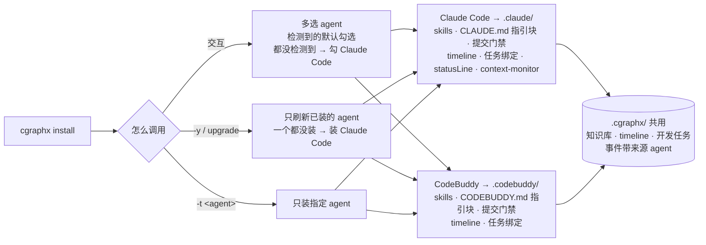

# 规格说明: 多 agent 适配

> feature-id: 2026-10-15-多agent适配
> 负责人: liulongfei
> 日期: 2026-10-15

## 一图看懂

cgraphx 从「只能装给 Claude Code」变为「同一个项目可以同时装给多个 agent」。首批支持 Claude Code 和 CodeBuddy。Claude Code 用户感受不到任何变化。CodeBuddy 用户能拿到同一套 skill、提交门禁、timeline 采集和开发任务绑定。两个 agent 共用同一份知识库、timeline 和开发任务数据。WorkBuddy 本批不接入，但以后接入时只需要新增它自己的描述。

| 场景 | 用户看到什么 | 例外 / 异常 |
|---|---|---|
| 交互 `cgraphx install` | 多选列表：Claude Code、CodeBuddy，检测到的默认勾选 | 都没检测到 → 默认勾选 Claude Code；一个都不选 → 不装任何 agent 配置 |
| `install -y` / `upgrade` 自动重装 | 已装的 agent 全部刷新到新版 | 一个都没装过 → 只装 Claude Code，和现在一样 |
| `install -t codebuddy` | 只装或刷新 CodeBuddy，Claude 的配置不动 | 未知 agent id → 报错退出，列出可用 id |
| 在 CodeBuddy 里工作 | skill 可触发、指引块生效、提交前有门禁提醒、事件进 timeline、编辑需求目录自动绑定任务 | 没有 statusLine 和 context-monitor（只有 Claude Code 有） |
| `cgraphx uninstall` | 移除所有 agent 的 cgraphx 配置，询问是否删除 `.cgraphx/` | `--keep-data` / `-y` 的行为和现在一致 |
| `cgraphx uninstall -t codebuddy` | 只移除 CodeBuddy 的 cgraphx 配置 | 不删除 `.cgraphx/`，不动 git post-commit 钩子，最后一个 agent 也不例外 |
| 只用 Claude Code 的老项目升级 cgraphx | 和以前一样，不需要重装也照常工作 | — |

## 1. 目标与范围

### 1.1 目标

1. **结构改造**：把 cgraphx 中写死 Claude Code 的部分抽成通用的 agent 适配结构，Claude Code 是它的第一个实现。改造前后 Claude Code 的可观察行为保持不变（例外见 §6）。
2. **接入 CodeBuddy**：作为第二个 agent，能力和 Claude Code 对齐（排除项见 §3）。
3. **可扩展**：以后接入 WorkBuddy 等 agent 时，改动限定在 §9 的范围内。

### 1.2 包含范围

- 安装、升级自动重装、卸载支持多个 agent 并存（§4、§5）。
- CodeBuddy 的 skill / agents / commands 部署、指引块、废弃资产清理、提交门禁、timeline 采集、开发任务绑定（§3）。
- 部署到不同 agent 时，skill 等资产里的 agent 专属路径、文件名按 agent 替换（§7）。
- timeline 事件记录来源 agent（§6）。
- CodeBuddy 会话中能拿到会话 id，供开发任务绑定和 commit 归属使用（§8，【待确认】）。

### 1.3 非目标

- WorkBuddy 接入。
- CodeBuddy 的 statusLine 和 context-monitor。
- timeline 来源的展示和筛选：日报、周报、阶段报告、`cgraphx web` 都不展示也不筛选来源。
- 开发任务投入时长按 agent 拆分。
- 让 CodeBuddy 读到项目根目录 `CLAUDE.md` 里的团队约定。
- `install -y` / `upgrade` 自动给项目新增 agent。
- 全局安装（`~/.claude`、`~/.codebuddy`），保持项目级安装。
- 改动 `docs` / `db` / `features` 子系统的行为。

## 2. 术语

| 术语 | 含义 |
|---|---|
| agent | cgraphx 安装的目标 AI 编码工具。本批有两个：`claude-code`（Claude Code）和 `codebuddy`（CodeBuddy Code）。id 用于 `-t` 参数和 timeline 来源 |
| agent 配置目录 | agent 在项目里的配置目录：Claude Code 是 `.claude/`，CodeBuddy 是 `.codebuddy/` |
| 检测到 | 满足任一条件：项目里存在该 agent 的配置目录；本机 PATH 上有该 agent 的 CLI 命令。只用来决定交互安装时默认勾选哪些 |
| 已装 | 该 agent 的配置里存在 cgraphx 写入的配置，包括 cgraphx 的 hook、指引块标记、包自带的 skill。只有一个空的或用户自建的 `.codebuddy/`，不算已装 |
| 来源 agent | timeline 事件产生于哪个 agent 的会话 |

`-t` 参数仍然接受 `claude`，含义是 `claude-code`，与现有用法兼容。

## 3. 各 agent 的能力范围

| 能力 | Claude Code | CodeBuddy | 说明 |
|---|---|---|---|
| skills / agents / commands 部署 | `.claude/` | `.codebuddy/` | 两边内容一致，只替换路径和文件名（§7） |
| 工作流指引块 | `.claude/CLAUDE.md` 标记块 | `.codebuddy/CODEBUDDY.md` 标记块 | 标记块外的用户内容不动；cgraphx 不碰项目根目录的 `CODEBUDDY.md`、`CLAUDE.md` |
| 废弃资产清理 | ✅ | ✅ | 同一份废弃清单作用于每个已装的 agent 配置目录 |
| 提交前门禁（precommit-check） | ✅ | ✅ | agent 执行 `git commit` 前提示按 `git-standards.md` 自查 |
| timeline 采集（7 个事件 hook） | ✅ | ✅ | 事件带来源 agent（§6） |
| 开发任务绑定（会话开始提醒、编辑需求目录自动绑定） | ✅ | ✅ | CodeBuddy 的「写类工具」按它自己的工具名覆盖到位（§10 待确认 2） |
| git post-commit 钩子 | 项目共用一个 | 项目共用一个 | 属于项目，不属于某个 agent |
| statusLine（claude-hud） | ✅ | ❌ | 不部署到 `.codebuddy/` |
| context-monitor | ✅ | ❌ | 不部署到 `.codebuddy/` |

hook 配置写入各 agent 的项目共享 settings 文件：Claude Code 是 `.claude/settings.json`，CodeBuddy 是 `.codebuddy/settings.json`。写入时保留用户自己的其他 hook 和配置，和现在 Claude 的处理方式相同。

## 4. 安装与升级行为

### 4.1 安装对象的决定规则

| 调用方式 | 装给哪些 agent |
|---|---|
| 交互 `cgraphx install`（含不带参数的 `cgraphx`） | 多选列表列出全部 agent。默认勾选「检测到」的；都没检测到时默认勾选 Claude Code。用户可以改选。一个都不选时，跳过 agent 配置写入，仍然初始化 `.cgraphx/` |
| `cgraphx install -y` | 所有「已装」的 agent。一个都没装过时只装 Claude Code |
| `cgraphx upgrade` 拉包后的自动重装 | 同 `-y` |
| `cgraphx install -t <id>[,<id>]` | 只装指定的 agent，不新增、也不移除其他 agent 的配置。`all` 表示全部 agent，`none` 表示不写 agent 配置；未知 id 报错退出并列出可用 id |
| `-t` 和 `-y` 同时给 | 以 `-t` 为准，不弹任何提示 |

### 4.2 每个 agent 的安装结果

- 按 §3 写入该 agent 的能力。重复安装是幂等的：同名包资产无条件覆盖，和现在一致；用户自加的文件保留。
- `.cgraphx/` 初始化、schema 应用、1.x 遗留表清理、docs / db 子系统配置，**每个项目只做一次**，和装了几个 agent 无关。
- timeline 和任务绑定的 hook 对每个选中的 agent 都写入；git post-commit 钩子每个项目只写一个。
- 现有「可选子系统」多选里的 Developer Timeline 选项，作用于本次选中的全部 agent。

### 4.3 独立的 timeline 安装命令

`cgraphx timeline install` / `cgraphx timeline uninstall` 作用于哪些 agent，规则同 `install -y`：已装的 agent；一个都没装过时只作用于 Claude Code。也接受 `-t`。

## 5. 卸载行为

| 调用方式 | 行为 |
|---|---|
| `cgraphx uninstall` | 移除所有 agent 的 cgraphx 配置（hook、statusLine、指引块、包自带资产），移除 git post-commit 钩子，然后按现在的规则询问是否删除 `.cgraphx/`（`-y` 不问直接删，`--keep-data` 保留） |
| `cgraphx uninstall -t <id>` | 只移除指定 agent 的 cgraphx 配置。**不删除 `.cgraphx/`，不动 git post-commit 钩子**，忽略 `--keep-data`。移除后项目里已经没有任何已装 agent 时，也不自动删除，只提示「如需彻底卸载请执行不带 `-t` 的 `cgraphx uninstall`」 |

无论哪种方式，都保留用户自己的 hook、settings 配置、标记块外的内容、不在包清单里的文件，和现在一致。

## 6. timeline 来源 agent

| 规则 | 内容 |
|---|---|
| 记录范围 | 每条 timeline 事件都记录来源 agent：`claude-code` 或 `codebuddy` |
| hook 事件 | 来源 = 触发该 hook 的 agent |
| git_commit 事件 | 来源 = 归属会话的来源 agent；commit 未归属任何会话（如终端手动提交）时来源为空 |
| 存量数据 | 改造前已有的事件一律视为 `claude-code` |
| 展示 | 本批不在任何报告和页面里展示或筛选来源，现有输出保持不变 |
| 统计口径 | 开发任务投入时长、日报等统计不按来源拆分 |

这是 Claude Code 唯一允许的可观察变化：数据库里多了来源信息，所有命令输出和页面不变。

## 7. 资产内容按 agent 替换

部署到某个 agent 时，资产里属于 agent 专属的引用替换成该 agent 的对应值，其余文字保持一致：

| 类别 | Claude Code | CodeBuddy |
|---|---|---|
| 配置目录路径 | `.claude/…` | `.codebuddy/…` |
| 指引块所在文件 | `.claude/CLAUDE.md` | `.codebuddy/CODEBUDDY.md` |
| settings 文件 | `.claude/settings.json` | `.codebuddy/settings.json` |
| 项目根环境变量 | `CLAUDE_PROJECT_DIR` | `CODEBUDDY_PROJECT_DIR` |
| 会话 id 环境变量 | `CLAUDE_CODE_SESSION_ID` | `CODEBUDDY_SESSION_ID` |

- 部署到 Claude Code 的结果，必须和改造前部署出来的内容逐字节一致。
- 替换只针对上表这些引用，不改写正文里对产品的一般性描述。比如「Claude Code」这几个字作为产品名出现时不替换。
- 现状参考：模板中这类引用约有 13 处 `CLAUDE.md`、5 处 `.claude/skills`、4 处 `.claude/settings`、2 处 `.claude/rules`。

## 8. CodeBuddy 会话 id

用户**不接受降级**：CodeBuddy 会话中，`cgraphx task use` 不传 `--session` 也要能拿到当前会话；agent 在会话内执行的 `git commit` 也要归属到该会话。效果要和 Claude Code 一样。

- 途径：CodeBuddy 会在 Bash 子进程中注入 `CODEBUDDY_SESSION_ID`，值等于 hook payload 里的 session_id（2026-10-15 在 CodeBuddy 2.167.0 实测）。cgraphx 从该变量取会话 id。
- 已知限制：在一个 agent 的会话里嵌套启动另一个 agent 时（例如在 Claude Code 的 Bash 里启动 CodeBuddy），两个 agent 的会话变量会同时存在，cgraphx 按登记顺序取 Claude Code 的变量。从普通终端或 IDE 启动时不受影响。
- Claude Code 的现有取法和降级路径不变（见知识库「会话 id 来源约束」）。

## 9. 可扩展性约束（为 WorkBuddy 预留）

新增一个 agent 时，改动必须限定在以下几类：

1. 新增该 agent 的描述：id、显示名、配置目录、指引块文件、settings 文件、检测方式、§7 的替换值、写类工具名、支持哪些能力。
2. 在 agent 注册处登记。
3. 仅当该 agent 的 hook 输入格式和已有 agent 不同时，增加对应的输入转换。

不需要改动 timeline / task 的业务逻辑、安装和卸载流程的主体，也不需要改动 skill 正文。plan 必须产出这份「新增 agent 改动点清单」，并让它对 CodeBuddy 成立（CodeBuddy 就是按这个清单接入的第一个案例）。

## 10. 待确认项

以下各项已于 2026-10-15 在 CodeBuddy 2.167.0 上实测确认：

| # | 问题 | 结论 |
|---|---|---|
| 1 | CodeBuddy 是否在 Bash 子进程中注入会话 id 环境变量 | 注入 `CODEBUDDY_SESSION_ID`，值等于 hook payload 的 session_id（见 §8） |
| 2 | CodeBuddy 的文件写入类工具名 | `Edit` / `Write` / `MultiEdit` / `NotebookEdit`，和 Claude Code 一致；另有别名 `NotebookWrite`，本批不覆盖 |
| 3 | CodeBuddy CLI 在 PATH 上的命令名 | `codebuddy`（另有别名 `cbc`、`codebuddy-code`，和 `codebuddy` 同时安装） |
| 4 | CodeBuddy 是否读取项目 `.codebuddy/settings.json` 的 hooks，`.codebuddy/CODEBUDDY.md` 是否被识别 | 都成立。hook 输出的 `hookSpecificOutput.additionalContext` 也会注入上下文 |

已知事实来源：CodeBuddy Code 官方文档（[目录结构](https://www.workbuddy.ai/docs/cli/codebuddy-dir)、[Hooks](https://www.workbuddy.ai/docs/cli/hooks)、[Memory](https://www.workbuddy.ai/docs/cli/memory)）。文档显示，hook 事件名、stdin 字段、settings 里 hooks 的结构都和 Claude Code 一致；项目记忆放在 `./CODEBUDDY.md` 或 `./.codebuddy/CODEBUDDY.md` 均可，两处等价。

## 11. 兼容性

| 对象 | 要求 |
|---|---|
| 只装了 Claude 的老项目，升级 cgraphx 但不重装 | settings 里已有的旧 hook 命令（不带 agent 标识）继续工作，按 Claude Code 处理；timeline、任务绑定、门禁不中断 |
| 老项目升级后重装 | `.claude/` 下的内容和改造前逐字节一致；settings 中 cgraphx 的条目最终与新版一致，用户条目保持不变 |
| `install -y` / `upgrade` 在只装了 Claude 的项目 | 结果和现在一致，不会出现 `.codebuddy/` |
| 存量 timeline 数据 | 视为 `claude-code`，不需要用户操作 |
| `-t claude` 老用法 | 继续可用 |
| 分层 | core 不依赖 cli 和 web；task → timeline 的依赖保持单向，只经门面 |

## 12. 异常与边界

| 场景 | 行为 |
|---|---|
| 某个 agent 的安装过程中写文件失败 | 报告失败，继续安装其他 agent 和后续步骤，和现在「子系统失败只 warn」的风格一致 |
| 项目里有用户自建的 `.codebuddy/`，但没装过 cgraphx | 交互安装时默认勾选 CodeBuddy；`-y` 不会为它安装 |
| hook 进程无法判断自己属于哪个 agent | 按 Claude Code 处理，不阻塞 hook |
| 当前目录不安全（`$HOME`、文件系统根） | 和现在一致：跳过 `.cgraphx/` 初始化并警告 |
| 两个 agent 同时在同一项目中运行 | 各自的会话互不串号，事件来源各自正确 |

## 13. 验收标准

**A. Claude Code 零变化**
1. 已有测试全部通过。
2. 用改造前版本安装的项目，换上新版 CLI 后不重装：会话开始、提示词、工具调用、提交事件照常进 timeline；任务绑定提醒和自动绑定照常；门禁照常。
3. 重装后 `.claude/` 的内容和改造前逐字节一致；命令输出和 web 页面不变。
4. 只装了 Claude 的项目跑 `install -y` / `upgrade`，不出现 `.codebuddy/`。

**B. CodeBuddy 真机实测**（本机安装 CodeBuddy CLI，用一个示例项目）
1. 交互安装时 CodeBuddy 出现在列表里，按检测结果默认勾选；装完 `.codebuddy/` 下有 skills / agents / commands / 门禁 hook，没有 claude-hud 和 context-monitor。
2. 在 CodeBuddy 中能触发 skill，例如 `/clarify-requirements`。
3. `.codebuddy/CODEBUDDY.md` 的指引块被 CodeBuddy 识别。
4. timeline 中出现来源为 `codebuddy` 的会话、提示词、工具调用事件。
5. 会话开始时有任务绑定提醒；编辑带任务声明的需求目录会自动绑定。
6. 在 CodeBuddy 中执行 `git commit` 前门禁会触发；提交被归属到该会话（依赖待确认 1 的结论）。
7. 不传 `--session` 执行 `cgraphx task use` 能绑定成功（依赖待确认 1 的结论）。

**C. 多 agent 共存**
1. 同一项目装两个 agent 后，两边各自工作，共用同一个 `.cgraphx/`。
2. `uninstall -t codebuddy` 后 Claude 侧完全正常，`.cgraphx/` 和 git 钩子还在。
3. `uninstall` 不带 `-t`，两边的配置都被移除。

**D. 可扩展性**
1. plan 中给出 §9 的「新增 agent 改动点清单」，并且 CodeBuddy 的接入改动没有越出这份清单。

**明确不测**：CodeBuddy 的 statusLine 和 context-monitor；WorkBuddy 的任何行为。

## 14. Plan 编写约束

- 必须先完成「以 Claude Code 为第一个实现」的结构改造，并通过验收 A，再接入 CodeBuddy。
- 不得改变 Claude Code 的可观察行为（§6 来源记录除外）。
- 不得引入新的运行时依赖；遵守现有分层和门面约束。新增的运行时资产要加进 `scripts/copy-assets.cjs`。
- timeline hook 进程仍须是短生命周期、必须 await 的，不能因为适配逻辑而阻塞或变慢到可感知。
- 改 skill 模板时，修改入口是 `assets/claude-template/`，不是仓库根目录的 `.claude/`。
- 待确认 1 没有结论前，§8 相关任务不写死实现途径。

## 15. 本次 spec 补定的规则（已确认）

以下几条是写 spec 时为了让契约完整而补定的，clarify 阶段没有逐条拍板，2026-10-15 经负责人审阅确认：

1. 「检测到」和「已装」的区分（§2）：只有用户自建的 `.codebuddy/` 算检测到，不算已装，因此 `-y` 不会为它安装。
2. 交互安装时一个 agent 都不选，仍然初始化 `.cgraphx/`（§4.1）。
3. 终端手动提交、未归属会话的 commit，来源为空，不视为 Claude Code（§6）；只有改造前的存量数据视为 Claude Code。
4. `cgraphx timeline install/uninstall` 沿用 `-y` 的选择规则，并接受 `-t`（§4.3）。
5. `-t` 和 `-y` 同时给时以 `-t` 为准（§4.1）。
6. 不带 `-t` 的 `uninstall` 也移除 git post-commit 钩子，和现在一致（§5）。
7. hook 进程无法判断所属 agent 时按 Claude Code 处理（§12）。
