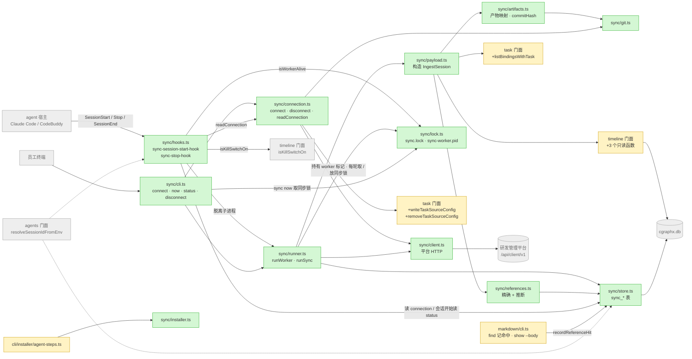
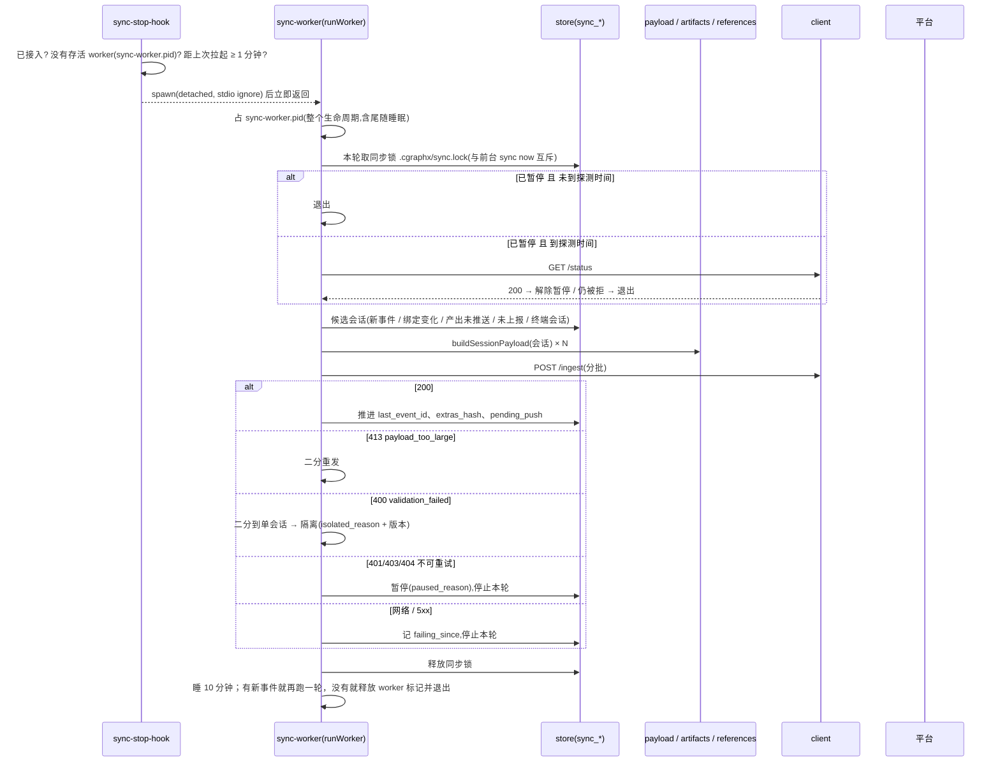
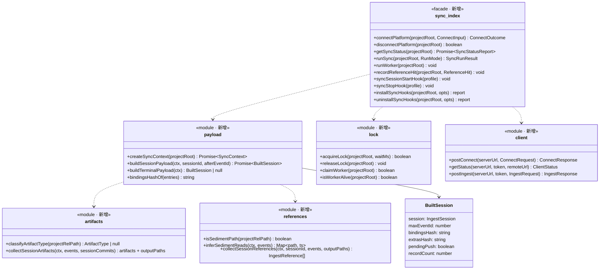
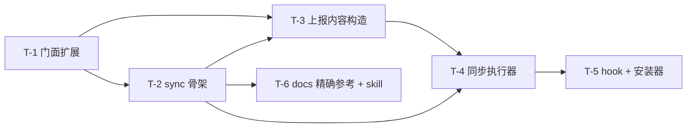

# 实现计划: cgraphx接入研发管理平台

> feature-id: 2026-10-16-cgraphx接入研发管理平台
> 负责人: liulongfei
> 日期: 2026-10-16
> 来源 spec: `docs/features/2026-10-16-cgraphx接入研发管理平台/cgraphx接入研发管理平台-spec.md`

## 设计预览

新增 `src/core/sync/` 子系统，承担"接入 → 从本地数据构造上报内容 → 发给平台 → 记进度"这条链路，同时给出 `cgraphx sync` 命令组和两个隐藏 hook。另外有四处既有代码要改，都只增不改：

- timeline 和 task 的门面各加几个只读函数，供 sync 取本地数据。
- `cgraphx docs` 在执行时调用 sync 门面，记下精确参考；`docs show` 新增 `--body`，用来输出正文。
- 安装器把 sync hook 和 timeline、task 的 hook 一起接入。
- knowledge-recall 和 knowledge-api 两个 skill 改为用 `docs show --body` 读正文。

hook 本身只做文件检查，然后拉起一个脱离的 `sync-worker` 进程。所有网络请求都发生在这个进程里。

**需要你重点看的**（这几处改错了，代价最大）

| # | 决策 | 为什么难回头 |
|---|---|---|
| 1 | **sync 的本地状态全部放在 sync 自己的 `sync_*` 表里，有独立的版本表；不给 timeline、task、markdown 的 schema 升版本** | timeline 打开库时，如果发现版本号比自己支持的高，会抛 `TimelineSchemaError`。agent 的 PATH 里优先命中的是旧版全局 cgraphx，一旦升了 timeline 的版本，旧版 hook 就会全部写库失败。表结构一旦落到用户机器上，就很难收回 |
| 2 | **依赖方向：sync → timeline / task / agents / db（只经门面）；markdown 的 cli → sync 门面（只调 `recordReferenceHit`）**。sync 不 import markdown，timeline 和 task 也不 import sync | 依赖方向一旦反了就会成环，以后拆不开 |
| 3 | **上报的对象只能由 `payload.ts` 里的构造函数从白名单字段逐个赋值**，禁止展开或透传本地记录。协议类型在 `sync/types.ts` 里手写一份镜像，不引入契约包和 zod | 这是隐私边界。只要有一处用 `...event` 透传，命令原文就会出本机 |

**架构**：绿色是新增，黄色是修改，灰色是已有且不动的邻居。注意看两点：sync 只经门面读 timeline 和 task；markdown 只有 cli 这一层指向 sync。

**主流程：一次后台同步**。看三类失败分别在哪里被截住，以及只有收到 200 才推进进度。

**类图**：看 sync 各模块的对外函数，以及模块之间只传 `IngestSession` / `SyncStatusReport` 这类纯数据。

**关键取舍**

| 选了 | 没选 | 为什么 |
|---|---|---|
| worker 跑完一轮后睡 10 分钟，有新事件就再同步，没有就退出（尾随一轮）；hook 只负责在 worker 不在时拉起 | 每次 Stop 都同步，或者靠固定节流 | 最后一次活动之后，最多约 10 分钟就能上报，满足 1 小时时效；hook 不用读库 |
| 每个会话记已上报的最大事件 id，以及"附属内容（绑定 / commit / 产出 / 参考）的哈希"；只有哈希变了才重发附属内容 | 每轮全量重发，或者给每条记录打已上报标记 | 事件只增不改，用水位就够了。附属内容会变（推送后才有 hash、绑定后来结束），比较哈希又便宜又准 |
| 协议类型在 `sync/types.ts` 手写一份镜像 | 依赖 `@cgraphx-server/contract` 加 zod | 不给 CLI 增加运行时依赖；契约只增不改，镜像保持稳定 |

## 目标与范围

把 spec 落成代码：接入 / 断开、自动同步加立即同步、上报内容构造（含产物映射、精确参考加推断）、失败分级处理、同步状态、会话开始时的提示、安装器接入，以及两个 skill 改读法。

**明确不包含**（防止 implementer 扩大范围）：
- 不改服务端仓库，不改契约包。
- 不改本地 web、`task show`、`features`、`timeline` 的输出。其中 `src/core/task/artifacts.ts` 的 `collectReferences` 和 `classifyArtifactPath` **一行都不改**。
- 不加系统定时任务，不加"排除会话"或"暂停"开关，不加平台数据删除。
- 不改 db-query、code-map-recall、design-map 这几个 skill。
- 不写新的测试（测试走 `/write-unit-test-spec` 之后的流程）。spec §11 要求的"证明请求体不含禁止内容的测试"，交给 `/write-unit-test-spec` 覆盖，交接时不要丢。
- **依赖真实平台或密码的验收项标为「人工验收」**，由负责人执行，implementer 不执行。平台不可用时记为"待人工验收"，不报 PLAN_CONFLICT。

## 计划文件

| 文件 | 状态 |
|---|---|
| `cgraphx接入研发管理平台-index.md` | 本文件 |
| `cgraphx接入研发管理平台-01-schema.md` | 有：`sync_*` 三张表 |
| `cgraphx接入研发管理平台-02-backend.md` | 有：T-1 至 T-6 的完整任务 |
| `-03-frontend.md` | 不涉及（没有页面） |

## 总任务清单

| 任务 | 名称 | 对应 spec | 独立提交 |
|---|---|---|---|
| T-1 | timeline / task 门面加只读读取与任务源配置读写 | §3.1 存量配置、§3.2、§5.1–5.4 | 是 |
| T-2 | sync 子系统骨架：本地状态、平台客户端、接入与断开 | §2、§3、§6 本地凭据、§7、§8 | 是 |
| T-3 | 上报内容构造：会话 / 事件 / 绑定 / commit / 产出 / 参考 | §5、§6 | 是 |
| T-4 | 同步执行器与 `sync now` / `status` / worker | §4、§7 | 是 |
| T-5 | 同步 hook、会话开始提示、安装器接入 | §4.1、§4.4 提示、§8 hook 预算 / 旧版共存 / 已安装项目 | 是 |
| T-6 | docs 精确参考记录、`show --body`、skill 改读法 | §5.6 | 是 |

## 全局依赖图

## 推荐执行顺序与可并行批次

| 批次 | 任务 | 为什么可以并行 / 为什么要串行 |
|---|---|---|
| 1 | T-1 | T-2 的接入和断开要调用 T-1 新增的 `writeTaskSourceConfig` / `removeTaskSourceConfig` |
| 2 | T-2 | 依赖 T-1 |
| 3 | T-3、T-6 | 两者的文件集不重叠：T-3 新建 `src/core/sync/{payload,artifacts,references}.ts`，并往 `git.ts`、`store.ts` 里追加函数；T-6 只改 `src/core/markdown/cli.ts` 和 skill / agent 的 md 文件。T-6 只依赖 T-2 已经提供的 `recordReferenceHit`；两者都不会让对方的测试变红 |
| 4 | T-4 | 依赖 T-2、T-3 |
| 5 | T-5 | 依赖 T-4 的 `runWorker`、`isWorkerAlive` 和 `sync-worker` 命令 |

`src/core/sync/{store,cli,index,constants}.ts` 会被 T-2 至 T-5 先后追加内容，所以除批次 3 外一律串行。

## 必须严格执行的契约

- **平台接口**（v1，路径前缀 `/api/client/v1`）：`POST /connect`；`GET /status?remoteUrl=`；`POST /ingest`；`GET /tasks`（由 task 的任务源调用）。认证头为 `Authorization: Bearer <token>`。错误体为 `{ error, message, retryable }`。
- **任务源配置**（`.cgraphx/task-source.json`）：`{"url": "<serverUrl>/api/client/v1/tasks", "headers": {"Authorization": "Bearer <token>"}}`。满足以下条件就算已接入：文件合法；`url` 以 `/api/client/v1/tasks` 结尾；`headers.Authorization` 以 `Bearer ` 开头。`serverUrl` = `url` 去掉 `/api/client/v1/tasks` 后缀。
- **本地状态**：只存在 `sync_*` 表里（见 01-schema），版本表是 `sync_schema_versions`。
- **白名单**：上报对象的每个字段都只能来自 02-backend 中 T-3「字段来源表」，逐字段赋值。
- **CLI 面**：`cgraphx sync connect --server <url> --user <name> [--force] [--password-stdin] [--json]` · `cgraphx sync now [--json]` · `cgraphx sync status [--json]` · `cgraphx sync disconnect [--json]`；另有隐藏命令 `cgraphx sync-worker [--project <path>]`、`cgraphx sync-session-start-hook [--agent <id>]`、`cgraphx sync-stop-hook [--agent <id>]`。
- **hook 标记**：安装和卸载都按命令里的 `cgraphx sync-` 识别；写进 settings 的命令统一带 `2>/dev/null || true` 后缀，幂等比较用完整命令串。注意 `sync-worker` 不会写进 settings。

## 实现手段决策（plan 自主，均无 spec 信封外的业务可观察后果）

| 决策 | 选项 | 推荐与理由 |
|---|---|---|
| 状态存储 | sync 自有 `sync_*` 表；或给 timeline / task 加列 | **自有表**：避免旧版二进制在 schema 版本上冲突（见重点 1）；符合"每子系统前缀表" |
| 精确参考记录放在哪 | sync 表；markdown 表；timeline 新事件类型 | **sync 表 `sync_reference_records`**：markdown 升版本会触发它自己的版本检查；新增 timeline 事件类型会改变本地时间线输出 |
| 触发 | Stop + SessionEnd 拉起 worker；worker 尾随一轮 | Stop 每轮都触发，最贴近活动；SessionEnd 兜底；尾随一轮保证最后一批数据不滞留 |
| 拉起节流 | 触发文件 `.cgraphx/sync-trigger` 的 mtime，1 分钟；已有存活 worker（`.cgraphx/sync-worker.pid`）时不拉起 | 只用 `fs.statSync`，不打开库，hook 耗时可以忽略 |
| 互斥（两个标记，语义分开） | `sync-worker.pid`：worker 整个生命周期都持有，保证同一仓库最多 1 个 worker；`sync.lock`：只在一次 `runSync` 期间持有，让前台 `sync now` 和后台互斥。两者都用 `wx` 独占创建，内容为 pid + 启动时间；pid 不存活或超过 2 小时就视为陈旧并接管 | 只用一个锁的话，worker 睡眠期间锁处于释放状态，hook 会反复拉起新 worker |
| 旧版二进制兜底 | hook 命令统一加 `2>/dev/null \|\| true` 后缀 | spec §8：PATH 命中的旧版 cgraphx 遇到未知命令时不能报错；代价是 hook 的 stderr 告警看不到（fail-silent） |
| 增量判定 | 每个会话记 `last_event_id` / `bindings_hash` / `extras_hash` / `pending_push` | 见关键取舍 |
| 批次 | 单个请求最多 50 个会话，或事件总数 5000、序列化后 4MB，先到哪个算哪个；413 时对半拆 | 服务端上限 32MB，留足余量 |
| 格式被拒的定位 | 对请求里的会话集合递归二分，直到单个会话 | 对应 spec §4.5 "最细到单个会话" |
| 接入后回传历史 | 接入成功后清空 `sync_sessions`，拉起 worker，命令立即返回 | 历史量大时不卡终端；进度用 `sync status` 查看 |
| 终端会话 id | `cgraphx-terminal-` + sha256(origin 远程地址)的前 16 位十六进制 | 同一个人在多个仓库下不撞号；不依赖平台的归一化规则 |
| 事件 id / 绑定段 id | `String(timeline_events.id)` / `String(task_sessions.id)` | 本地主键，同一库内稳定 |
| 斜杠命令识别 skill | `user_prompt` 的 prompt 去掉首尾空白后匹配 `^/([A-Za-z0-9][\w.:-]*)(\s|$)`；名字含 `:`，或者 `<各 agent 配置目录>/skills/<名>/SKILL.md` 存在，才计为 skill | 避免把 `/clear` 这类内置命令当成 skill |
| 路径基准 | 上报路径相对 `git rev-parse --show-toplevel`；产物分类和沉淀目录判断用相对项目根的路径 | 平台按仓库路径拼链接；cgraphx 的 docs 约定以项目根为准 |
| "已在远程" | `git branch -r --contains <hash>` 输出非空（同一轮内按 hash 缓存） | spec §5.5：以本机最近一次和远程同步后的状态为准 |
| 密码输入 | TTY 下关闭回显读一行；`--password-stdin` 时从 stdin 读第一行 | 密码不进命令行参数 |

## 执行方式建议

**`/subagent-implement`**。三个条件都满足：
- 任务跨越 ≥3 个相互独立的模块：sync 子系统、timeline / task 门面扩展、markdown 的 cli 加 skill、安装器。
- 预估变更文件约 25 个：新增 13 个，修改约 12 个。
- 任务按批次派发，契约原文已经写进每个任务，不需要实时互相反馈。

## 适用规范

| 文件 | 章节 | 用于 |
|---|---|---|
| `docs/guides/coding-standards.md` | 边界与结构；选型（偏离社区默认）；错误与日志 | 全部任务 |
| `docs/guides/data-standards.md` | 模型层；DDL 层；ORM 映射约定 | T-2（`sync_*` 表）。注意「Schema 变更约定」只针对目标项目的业务 DB，包内表走版本表机制，**不写** `docs/features/<id>/sql/` |
| `docs/guides/interface-standards.md` | 命令注册；输出；退出码；Hook 子命令契约 | T-2、T-4、T-5、T-6 |
| `docs/guides/git-standards.md` | 提交消息规范；提交前检查点 | 已结晶到下一节 |

## 提交规范

摘自 `docs/guides/git-standards.md`。实施时直接按这里执行，precommit 门禁只作兜底。

- 格式：`type(scope): 中文描述`。type 取 feat / refactor / fix / docs；scope 本次用 `sync` / `timeline` / `task` / `docs` / `skills` / `installer`。补充说明用"——"，并列用"+"。非琐碎提交要写 body：先一行背景，再用"-"逐条列要点。不关联票据。
- 提交前检查点：
  - 与 TS 同放的运行时资产（`src/core/sync/schema.sql`）已登记到 `scripts/copy-assets.cjs`。
  - `src/core` 下没有 import `src/cli` 或 `src/web`。
  - `schema.sql` 全部是 `IF NOT EXISTS`。
  - hook 链路里没有未 await 的 DB 写入，抛出的错误都被吞掉。
  - `vitest.config.ts` 里的 `TZ: 'UTC'` 没被改。
  - 没有被注释掉的命令注册或 hook 接入项。
  - 没有写死的绝对路径、密钥、阈值（阈值放进 `sync/constants.ts`）。
  - 没有新增 TODO / FIXME。

## 允许局部工程适配的范围

- `sync/` 各模块内部的函数拆分、私有辅助函数、局部命名。如果单文件超过 600 行，可以再拆，但拆出的文件仍放在 `src/core/sync/` 下，对外函数名不变。
- CLI 输出文案的措辞（意思必须和 spec §3.3 的提示表一致）。
- `constants.ts` 里的阈值可以微调，前提是不突破 spec 的 1 小时时效。worker 尾随间隔必须 ≤ 15 分钟。

## Plan 冲突上报规则

implementer 发现以下情况时，停止实现，以 `PLAN_CONFLICT: <任务号> <冲突点> <证据>` 上报，不得自行裁决：
- plan 与 spec 原文冲突。
- 契约里引用的既有函数或文件不存在，或者签名不符。
- 按 plan 实现会改变本地 web 或现有命令的输出。

## 关键风险与防跑偏约束

| 风险 | 等级 | 约束 |
|---|---|---|
| 白名单泄漏（prompt、命令原文、绝对路径出本机） | HIGH | 只能用 T-3 的构造函数；T-4 在发送前对请求做一次断言：所有 `path` / `files[]` / `value(file)` 都不以 `/` 开头、不含 `..` 和 `\`。违反就丢掉这一条并在本地记录日志，不发送 |
| 旧版全局 cgraphx 遇到新的 hook 命令 / `docs show --body` | MEDIUM | hook 命令加 `2>/dev/null \|\| true` 兜底（已实测本机全局 2.0.7 对未知命令返回退出码 1）；skill 读正文时如果遇到 `unknown option '--body'`，提示先升级全局 cgraphx（T-6） |
| hook 兜底依赖 POSIX shell | LOW | 【待确认】Windows 下的 hook shell 没实测；团队环境是 macOS，本期不受影响 |
| hook 耗时上升 | MEDIUM | sync hook 不打开库；只有 `sync-session-start-hook` 在已接入时才读一次 `sync_state`。hook 耗时超过 50ms 时，按现有惯例往 stderr 告警 |
| 多个 SessionStart hook 的 additionalContext 能否在 CodeBuddy 下叠加 | LOW | 【待确认】implementer 完成 T-5 后，在 CodeBuddy 里起一个会话实测，确认两段上下文都能出现；如果被覆盖，就以 PLAN_CONFLICT 上报 |
| 历史量大时一轮跑不完 | LOW | 每批确认后立即推进水位，worker 被中断也只是下轮继续 |

## 待确认项

- 实现期需要实测的有两项：CodeBuddy 下多段 additionalContext 能否叠加；Windows 下 hook 的 shell。两项都不影响任务拆分。
- spec 修正（属于事实更正，不是业务变更）：接口测试的验证记录实际产出为 `*-接口测试验证.jsonl`（见 run-api-test SKILL.md），spec §5.5 和 T-3 映射规则已改成 `.jsonl`。
