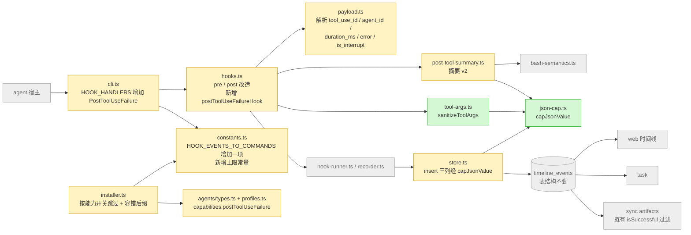
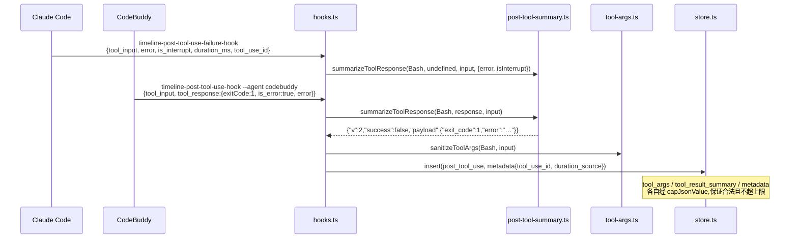
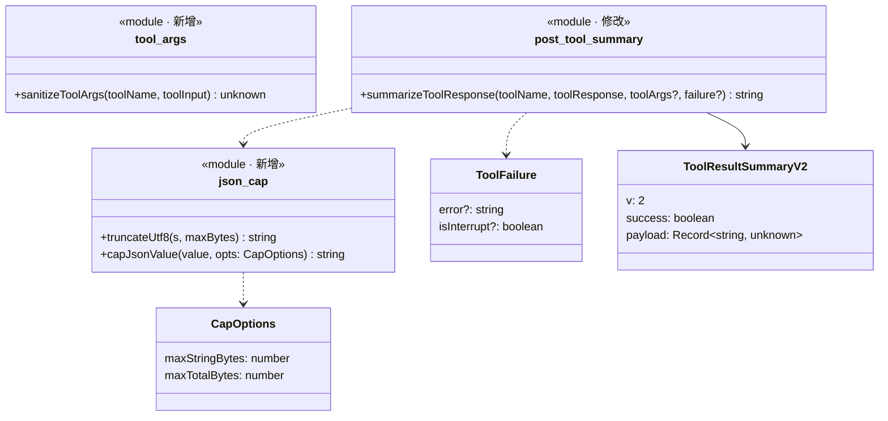

# 实现计划: timeline 采集的数据质量问题

> feature-id: 2026-10-16-timeline采集的数据质量问题
> 负责人: liulongfei
> 日期: 2026-10-16
> 来源 spec: `../timeline采集的数据质量问题-spec.md`

## 设计预览

改动集中在 timeline 的写入侧:

- 新增两个小模块:`json-cap.ts` 负责按字段截断、保证 JSON 合法;`tool-args.ts` 负责去掉 Write 正文、截短 Edit 片段。
- 摘要生成器改写为 v2。
- hooks 新增一个失败事件入口。
- agents 描述增加一个能力开关,安装器据此只给 Claude Code 接入 PostToolUseFailure。

读取方(web、task、sync)不改代码;表结构和 schema 版本不动。

**需要你重点看的**(改错了代价最大,其余可以略读)

| # | 决策 | 为什么难回头 |
|---|---|---|
| 1 | 新增隐藏子命令 `timeline-post-tool-use-failure-hook`。settings 里的命令写成 `cgraphx timeline-post-tool-use-failure-hook 2>/dev/null \|\| true`,只为 `capabilities.postToolUseFailure = true` 的 agent 写入(目前只有 Claude Code) | 命令串一旦部署进各项目的 settings,再改名就要做迁移;后缀决定了旧版全局 cgraphx 下宿主会不会报错 |
| 2 | 持久化契约的键名:摘要顶层 `v: 2`;metadata 增加 `tool_use_id`、`subagent: {id, type}`、`duration_source: 'host' \| 'estimated'` | 写进库就是存量,下游(sync、契约文档)按这些键读;改名就会出现第三种形状 |
| 3 | 三个 JSON 列统一在 store 写入时收口:`tool_args` 和 `metadata` 经 `capJsonValue`;摘要能解析且不超限时原样写入,否则经 `capJsonValue`。这是"永远合法"的唯一保证点。单个字段的上限统一由 `truncateUtf8` 实现。摘要总上限从 4KB 调到 8KB | 只在生成器里保证的话,任何新的写入方都可能绕过;放在 store,所有写入路径都兜住 |

**架构**:绿色新增,黄色修改,灰色是已有且不动的邻居。注意读取方(右侧灰色)没有箭头被改到。



**主流程:一次失败的 Bash**。重点看两个 agent 从不同入口进来,最后汇合成同一种 post_tool_use。



**类图**:三个对外函数的签名,以及摘要 v2 的形状。



**关键取舍**

| 选了 | 没选 | 为什么 |
|---|---|---|
| 失败用新的子命令,沿用 `post_tool_use` 事件类型 | 复用 `timeline-post-tool-use-hook` 并靠 payload 区分 | 子命令与 settings 事件一一对应,和既有 `HOOK_EVENTS_TO_COMMANDS` 的模式一致;失败的 payload 没有 `tool_response`,分开处理更清楚 |
| 只在 metadata 里记 `tool_use_id`,耗时估算仍沿用"同轮同工具最近一条 pre" | 用 `tool_use_id` 精确配对 | Claude Code 已改用宿主耗时,估算只剩 CodeBuddy 在用;精确配对要按 JSON 查询且没有索引,收益不抵成本。键已记下,以后要用随时可以做 |
| 截断按字段值进行,整体超限时把字符串上限减半重试,最后退化为占位对象 | 截整串 | spec R1 |

## 目标与范围

承载 spec 第 1 节"包含"的 9 项。不包含 spec"明确不做"表中的全部内容。另外,**读取方不改代码**:

- web、task、sync 已经满足 R10:`rowToEvent` 原样返回摘要字符串,sync 的 `isSuccessful` 解析失败按成功处理,web 只截断字符串显示;
- T-4 会逐项核对并记录这一点。

## 计划文件清单

| 文件 | 状态 |
|---|---|
| `timeline采集的数据质量问题-index.md` | 本文件 |
| `timeline采集的数据质量问题-02-backend.md` | T-1 至 T-4 的完整任务 |
| `-01-schema.md` | **不涉及**:表结构和 schema 版本都不变(spec §7) |
| `-03-frontend.md` | **不涉及**:界面不改(spec 第 1 节"明确不做") |

## 总任务清单

| 任务 | 内容 | spec 条款 | 独立提交 |
|---|---|---|---|
| T-1 | JSON 收口:新增 `json-cap.ts`,store 的三个 JSON 列都经它写入;上限常量 | R1、§7 | 是 |
| T-2 | 摘要 v2 + 调用参数净化 + metadata 扩展(pre / post 两个 hook) | R2(CodeBuddy 侧)、R4–R12、§4 | 是 |
| T-3 | 失败 hook:Claude Code 的 PostToolUseFailure 接入(常量、agents 能力开关、cli、installer、hooks) | R2(Claude 侧)、R3、§5 hook 接入、§7 | 是 |
| T-4 | 契约文档 + 读取方容错核对 + 知识库订正 | §4.4、R10、R11、§6 | 是 |

## 依赖与执行顺序

```
T-1 → T-2 → T-3 → T-4
```

严格串行,没有可以并行的批次:T-2 用 T-1 的 `capJsonValue`;T-3 用 T-2 的 `summarizeToolResponse` 的 `failure` 参数和 metadata 构造;T-4 要对照最终代码写文档。

## 必须严格执行的契约

以下契约在各任务里各有原文,这里汇总,以便交叉核对。

1. **摘要 v2 形状**:`{"v":2,"success":<boolean>,"payload":{…}}`。payload 的字段名为 `file`、`exit_code`、`stdout_preview`、`stderr_preview`、`category`、`pass`、`fail`、`duration_ms`(仅 Bash 测试类命令,含义是测试运行器自报的耗时,沿用 v1)、`interrupted`、`error`、`subagent_type`、`skill`、`url`、`taskId`、`subject`、`status`、`response_preview`。取不到的字段一律不写,不写 `null`。
2. **metadata 新增键**:
   - `tool_use_id`:字符串,pre 和 post 都写,宿主没给就不写;
   - `subagent`:`{"id":<agent_id>,"type":<agent_type>}`,仅当 payload 带非空字符串 `agent_id` 时写;
   - `duration_source`:`"host"` 或 `"estimated"`,仅当事件有 `duration_ms` 时写。
3. **上限常量**(`src/core/timeline/constants.ts`):

   | 常量 | 值 | 状态 |
   |---|---|---|
   | `RESULT_SUMMARY_MAX_BYTES` | `8 * 1024` | 原为 `4 * 1024` |
   | `SUMMARY_FIELD_MAX_BYTES` | `2 * 1024` | 新增 |
   | `METADATA_MAX_BYTES` | `8 * 1024` | 不变 |
   | `METADATA_FIELD_MAX_BYTES` | `2 * 1024` | 新增 |
   | `ARGS_MAX_BYTES` | `64 * 1024` | 不变,开始被使用 |
   | `ARGS_FIELD_MAX_BYTES` | `16 * 1024` | 新增 |
   | `EDIT_SNIPPET_MAX_BYTES` | `4 * 1024` | 新增 |
   | `SUMMARY_VERSION` | `2` | 新增 |

4. **`json-cap.ts` 的两个函数**:
   - `truncateUtf8(s: string, maxBytes: number): string`:单字段上限的唯一实现,在字符边界截断并接上 `'... [truncated]'`;
   - `capJsonValue(value: unknown, opts: { maxStringBytes: number; maxTotalBytes: number }): string`:不超限时原样序列化(快路径);超限时按字段截断,保证返回值一定能 `JSON.parse` 且 UTF-8 字节数 ≤ `maxTotalBytes`。另新增常量 `CAP_MIN_STRING_BYTES = 256`。
5. **`sanitizeToolArgs(toolName: string | undefined, toolInput: unknown): unknown`**:
   - Write 去掉 `content`,改写 `content_bytes` / `content_lines`;
   - Edit 的 `old_string` / `new_string`、MultiEdit 的 `edits[].old_string` / `edits[].new_string` 截到 `EDIT_SNIPPET_MAX_BYTES`;
   - 其它工具原样返回。
6. **`summarizeToolResponse(toolName: string | undefined, toolResponse: unknown, toolArgs?: unknown, failure?: { error?: string; isInterrupt?: boolean }): string`**:前三个参数保持现有顺序,第四个参数为新增。
7. **新子命令**:`timeline-post-tool-use-failure-hook`,接受 `--agent <id>`。settings 中的命令串为 `cgraphx timeline-post-tool-use-failure-hook 2>/dev/null || true`(claude-code 不带 `--agent`)。
8. **不变量**:
   - 不改 `schema.sql`,不改 `TIMELINE_SCHEMA_VERSION`;
   - 不新增 `EventType` 值;
   - 已有 6 个 hook 的命令串逐字不变;
   - hook 退出码恒为 0,不往 stdout 输出,所有写库都 await。

## 实现手段决策(plan 自主)

| 决策 | 选项 | 选定 | 理由 |
|---|---|---|---|
| 版本号键名 | `v` / `schema_version` / `_v` | `v` | 短;摘要按条存储,键越短越省 |
| 契约在代码里的位置 | 新文件 / `post-tool-summary.ts` | `post-tool-summary.ts` 导出 `ToolResultSummaryV2` 类型;版本号常量放 `constants.ts` | 生成器就是契约的唯一产出方,不必多一个文件 |
| JSON 收口位置 | 只在生成器 / store 统一收口 | 生成器按字段控长,store 兜底 | 契约 3 |
| 摘要总上限 | 4KB / 8KB | 8KB | stdout、stderr、error 三个预览各 2KB,加上包装约 6.5KB,4KB 放不下 |
| tool_use_id 配对 | 精确配对 / 只记录 | 只记录 | 见关键取舍 |
| Claude 成功的 Bash 写不写 `exit_code` | 写 0 / 不写 | 不写,只采宿主明确给出的 | spec 待确认 Q1 未决,不编造;Q1 确认后可以单独改 |
| 读取容错位置 | store 层统一 / 各读取方 | 各读取方现状已满足,不改 | 见"目标与范围" |
| 契约文档位置 | 代码目录 / 知识库 | `docs/knowledge/开发时间线工具事件契约.md` | 下游(sync)开发前会走 knowledge-recall,在知识库里才能被召回 |
| 旧版全局容错 | 所有 hook 加后缀 / 只给新 hook 加 | 只给新 hook 加 | 已有 6 个命令串必须零变化(spec §7) |

## 执行方式建议

**`/implementation`**。

- 预估变更约 12 个源文件,外加相关既有测试的修正和 1 篇知识库;
- 但集中在 timeline 一个模块(agents 只加一个能力字段);
- 4 个任务严格串行,不满足"跨 ≥3 个相互独立的模块、可以独立派任"。

## 适用规范

- `docs/guides/coding-standards.md`:「边界与结构」(core 不依赖 cli/web;单文件 ≤600 行,`store.ts` 现为 583 行,所以截断逻辑放进新文件 `json-cap.ts`)、「选型」(`node:` 前缀、新代码中文注释、`as const`)、「错误与日志」。
- `docs/guides/data-standards.md`:**不涉及**。不改表,`schema.sql` 不动。
- `docs/guides/interface-standards.md`:**不涉及**。没有对外 HTTP 接口;隐藏子命令遵循既有 hook 约定。
- `docs/guides/git-standards.md`:已整理进下面的「提交规范」。

## 提交规范

**消息格式**:`type(scope): 中文描述`。type 用 feat / refactor / fix / docs;本需求的 scope 统一用 `timeline`。补充说明用"——",并列用"+"。非琐碎提交要写 body:第一行写背景,其后用"-"列要点。标题不写需求编号。

**提交前逐项自查**(摘自 git-standards「提交前检查点」):

- 与 TS 源码放在一起的运行时资产,有没有登记到 `scripts/copy-assets.cjs`?(本需求不新增资产)
- `src/core` 里有没有 import `src/cli` 或 `src/web`?
- `schema.sql` 有没有丢掉 `IF NOT EXISTS`?(本需求不改)
- **timeline hook 链路里有没有未 await 的写库,或者没被吞掉的异常?**
- `vitest.config.ts` 里的 `TZ: 'UTC'` 有没有被改?
- 有没有被注释掉的命令注册或 hook 接入项?
- 有没有写死的魔法值?阈值一律进 `constants.ts`。
- 有没有新增 TODO / FIXME?

## 允许局部工程适配的范围

- 新模块内部的函数拆分和局部命名;
- `hooks.ts` 里 pre / post / failure 公共逻辑的抽取方式。若 `hooks.ts` 超过 600 行,可以把工具事件相关的处理移到新文件 `tool-event-hooks.ts`,但对外导出名不变;
- 改动导致失败的既有测试,同步修正断言,使其符合新契约(**不新增测试用例**:测试由 write-unit-test-spec 流程另行派生)。

## Plan 冲突上报

实现中发现以下情况,停下并按 `PLAN_CONFLICT: <任务> <冲突描述> <证据>` 上报,不要自行改契约:

- plan 与 spec 冲突;
- 契约 1–8 无法满足;
- 实测与 plan 的假设不符(比如 Claude Code 失败 payload 的字段名)。

## 关键风险与防跑偏约束

| 风险 | 防护 |
|---|---|
| 新 hook 在旧版全局 cgraphx 下报 `unknown command`,宿主显示错误 | 契约 7 的容错后缀;T-3 验证步骤用全局 2.0.7 实跑 |
| 改动已有 6 个 hook 的命令串,破坏零变化 | 契约 8;T-3 用新旧 dist 对比 settings |
| hook 变慢 | `capJsonValue` 只在超限时才进入重试;不新增 DB 查询 |
| Claude Code 的 PostToolUseFailure 字段名与文档不符(spec Q1) | T-3 按文档字段实现,payload 解析做宽松容错;实测作为验收项 A2,由用户在新会话里验证 |
| 子 agent 默默扩大范围(改读取方、加界面) | "目标与范围"已明确读取方不改代码 |

## 待确认项

| # | 内容 | 对 plan 的影响 |
|---|---|---|
| Q1(spec) | Claude Code 是否每个非零退出的 Bash 都走 PostToolUseFailure | 不阻塞。plan 已定:成功时不写 `exit_code`。需要在部署了新 hook 的新会话里验证(本会话的 hook 快照不会刷新) |
| Q2(spec) | CodeBuddy 下 Task* 工具和 NotebookEdit 的响应形状 | 不阻塞。生成器对这两类工具已有通用逻辑兜底;T-4 文档里标为"未实测" |
