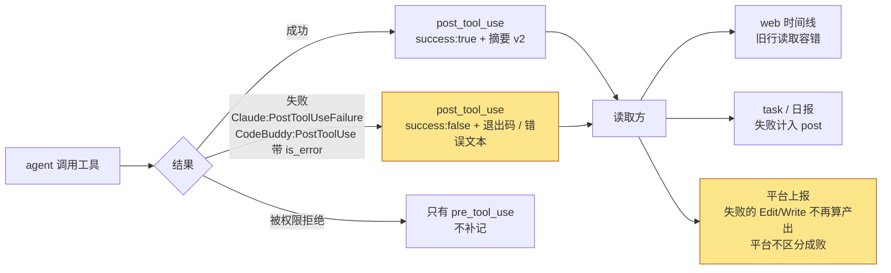

# 规格说明: timeline 采集的数据质量问题

> feature-id: 2026-10-16-timeline采集的数据质量问题
> 负责人: liulongfei
> 任务: T-27
> 日期: 2026-10-16

## 一图看懂

timeline 记下的工具事件改为**真实、完整、永远是合法 JSON**:

- 失败的工具调用开始被记录;
- 摘要里有实际内容,并按一份带版本号的契约写入;
- Write 不再保存文件正文。

旧版全局 cgraphx 照常工作;平台上报的字段不变。

图例:黄色为本需求带来的新行为。

| 场景 | 改前 | 改后 |
|---|---|---|
| Bash 输出很长(如 `cat` 一个大文件) | 整串摘要被截成非法 JSON(约 15% 的 Bash 事件) | 只截输出预览字段的值,摘要始终能解析 |
| Bash 命令失败(`ls /x`) | 完全没有记录,只留一条孤儿 pre | 一条 post_tool_use,`success:false`,带退出码和错误文本 |
| Edit / Write / Read | 摘要 payload 为空 | 摘要里有 `file`(文件路径) |
| Write 一个 50KB 文件 | pre 和 post 各存一份完整正文 | 只存路径、字节数和行数 |
| Claude Code 下各工具的耗时 | 只有写类工具有,由 hook 写库时刻相减得出 | 所有工具都有,取宿主测量的值 |
| 子 agent 里的工具调用 | 与主 agent 的无法区分 | 仍属于主会话;metadata 记下子 agent 的 id 和类型,读取方不展示 |
| 打开修复前的历史数据 | — | 照常显示;坏摘要按"摘要未知"处理,不报错 |
| agent 命中的是旧版全局 cgraphx | — | 宿主不报错;旧版继续按旧行为记录,直到全局 cgraphx 升级 |

## 1. 目标与范围

**目标**:修复 timeline 工具事件的采集质量问题,并把摘要契约化,让下游(web、task、日报、平台上报)能确定地理解每个字段。

**包含**:

1. JSON 合法性:timeline 的三个 JSON 列(`tool_args`、`tool_result_summary`、`metadata`)任何时候都是合法 JSON。
2. 失败调用:记录为 `post_tool_use` + `success:false`。
3. Bash 退出码:按 agent 的实际能力尽量采到。
4. 摘要内容:Read / Edit / Write / MultiEdit / NotebookEdit / Agent 的摘要有实际内容。
5. 摘要契约 v2:带版本号,字段集中定义并成文,Claude Code 和 CodeBuddy 归一到同一份契约。
6. 耗时:Claude Code 改用宿主测量的值,并标明来源。
7. 子 agent 归属:写入 metadata,读取方不展示。
8. Write 正文:不再保存。
9. 存量数据:读取时容错。

**明确不做**:

| 不做 | 原因 / 说明 |
|---|---|
| 新事件类型:SubagentStart/Stop、PreCompact、Notification 等 | 目前没有读取方;以后有了具体用途再单独立需求 |
| 新增 `event_type` 值(如 `post_tool_use_failure`) | 失败复用 `post_tool_use` |
| 平台侧区分调用成败 | 需要改服务端契约,属于跨仓库改动 |
| 补记被权限拒绝的调用 | 两个 agent 都没有可接的事件 |
| 改写、修复、回填存量数据 | 截掉的内容已经丢了;没有读取方需要旧行的新字段 |
| 读取方展示子 agent 信息、失败标识等新界面 | 本需求只保证数据正确,界面不改 |
| 修改事件时间戳 `ts` 的口径 | 宿主的 payload 不带事件发生时间,仍取 hook 写库的时刻 |

## 2. 术语

| 术语 | 含义 |
|---|---|
| 工具事件 | `pre_tool_use` / `post_tool_use` 两类 timeline 事件 |
| 摘要 | `post_tool_use` 事件的 `tool_result_summary` 列:一个 JSON 对象,概括这次工具调用的结果,不存完整响应 |
| 摘要契约 | 摘要的字段、含义和各 agent 下的可得性。v1 是修复前的形状(没有版本号字段);v2 是本需求定义的形状 |
| 孤儿 pre | 有 `pre_tool_use` 但没有对应 `post_tool_use` 的调用。修复后只剩"被权限拒绝"和"宿主未回调"两种情况 |
| 旧版全局 cgraphx | agent 的 Bash 加载用户 shell 配置,PATH 里优先命中全局安装的 cgraphx,它可能比项目部署的 hook 配置旧(见知识库「平台上报」「agent 适配」) |
| 宿主 | 运行 hook 的 agent:Claude Code、CodeBuddy |

## 3. 业务规则

| # | 规则 | 例子 |
|---|---|---|
| R1 | timeline 的三个 JSON 列在任何时候都必须能被 `JSON.parse` 解析。超过上限时只截断字段的值,并在该值上标注已截断;不得截断整串 JSON | 200KB 的 stdout → `stdout_preview` 被截到上限并带截断标记,摘要整体仍合法 |
| R2 | 宿主报告的失败调用记为一条 `post_tool_use`,摘要 `success:false` | Claude Code 的 PostToolUseFailure、CodeBuddy 带 `is_error:true` 的 PostToolUse,都记为 post_tool_use |
| R3 | 被权限拒绝的调用不补记 | 只留一条 pre_tool_use(仅写类工具和 Bash 有 pre) |
| R4 | 两个 agent 共用同一份摘要契约。宿主没有提供的信息就不写该字段,不推测、不编造 | CodeBuddy 的 Bash 没有输出,摘要里就没有 `stdout_preview` |
| R5 | 能从调用参数(`tool_input`)取到的信息优先取自调用参数,保证两个 agent 一致 | Edit 的 `file` 取 `tool_input.file_path` |
| R6 | 子 agent 内的工具事件仍归属主会话(`session_id` 不变);子 agent 的 id 和类型写入该事件的 metadata | 子 agent 读的文件照样算进主会话的统计 |
| R7 | Write 的调用参数不保存文件正文,改记字节数和行数;pre 和 post 都适用 | `{"file_path":"…","content_bytes":51642,"content_lines":1203}` |
| R8 | Edit / MultiEdit 的改前、改后片段保留;单个片段超长时按 R1 只截这个片段 | — |
| R9 | 有宿主测量的耗时时,`duration_ms` 取宿主的值;没有时沿用"post 时刻减 pre 时刻"的估算。两种情况都在 metadata 里标明来源 | Claude Code 的 Read 也有耗时;CodeBuddy 只有写类工具和 Bash 有估算耗时 |
| R10 | 任何读取方解析摘要或 metadata 失败时,都按"该信息未知"处理,不报错、不中断展示或统计 | 修复前残缺的 Bash 摘要,在 web 上照常显示原文 |
| R11 | 没有版本号的摘要按 v1 理解:字段缺失表示"当时没采到",不代表"真实为空" | — |
| R12 | 被中断的调用(宿主报告 `interrupted` / `is_interrupt` 为 true)算失败:`success:false`,payload 带 `interrupted:true` | 用户中途取消一条长时间运行的 Bash → 记为失败;被中断的 Edit 不算产出 |

## 4. 摘要契约 v2

### 4.1 公共字段

| 字段 | 含义 | 可得性 |
|---|---|---|
| 版本号 | 固定为 2,标识本契约。键名由 plan 定,定下后成为契约的一部分 | 所有 v2 摘要 |
| `success` | 宿主是否报告这次调用失败。`false` = 失败事件(R2) | 两个 agent |
| `payload` | 按工具区分的内容,见 4.2 | 两个 agent |

### 4.2 各工具的 payload

| 工具 | 字段 | 含义 | Claude Code | CodeBuddy |
|---|---|---|---|---|
| Read / Edit / Write / MultiEdit | `file` | 文件路径,取自调用参数 | ✓ | ✓ |
| NotebookEdit | `file` | notebook 路径,取自调用参数 | ✓ | ✓ |
| Bash | `exit_code` | 退出码 | 失败时从错误文本里解析;成功时见待确认 Q1 | ✓(`exitCode`) |
| Bash | `stdout_preview` / `stderr_preview` | 输出预览,有上限 | ✓ | ✗(宿主不提供) |
| Bash | `category` | 命令的语义类别(test / build / lint / git_write) | ✓ | ✓(按命令文本识别) |
| Bash | `pass` / `fail` | 测试通过 / 失败数 | ✓(从输出解析) | ✗ |
| Bash | `interrupted` | 是否被中断 | ✓ | ✓ |
| 所有工具(失败时) | `error` | 宿主给出的错误文本,有上限 | ✓ | Bash 有;Read 等只有错误码时不写 |
| Agent / Task | `subagent_type` | 子 agent 类型,取自调用参数 | ✓ | ✓ |
| Skill | `skill` | skill 名,取自调用参数 | ✓ | ✓ |
| WebFetch / WebSearch | `url` | 取自调用参数 | ✓ | ✓ |
| TaskCreate / TaskUpdate / TaskGet | `taskId` / `subject` / `status` | 同 v1 | ✓ | 实现时实测 |
| 其它工具 | `response_preview` | 响应预览,有上限 | ✓ | ✓ |

- v1 中的 `lines_changed` 从来没有采到过,v2 不再包含。
- 可得性表中"实现时实测"的项,实测后由 plan 或实现回填结论到契约文档;不改变上面的规则。

### 4.3 事件 metadata 新增的信息

| 信息 | 适用事件 | 说明 |
|---|---|---|
| 子 agent 的 id 和类型 | 子 agent 内的工具事件 | 只写入,读取方不展示(R6) |
| 耗时来源 | 有 `duration_ms` 的 post 事件 | 宿主测量 / 估算(R9) |

具体键名由 plan 定,写进契约文档。

### 4.4 成文要求

- 契约在代码里只定义一处。
- 同时有一份人读的契约文档,说明字段、含义、各 agent 下的可得性、v1 与 v2 的区别,供 sync 等下游引用。文档放在哪里由 plan 定。

## 5. 系统行为

| 触发 | 宿主 | 行为 |
|---|---|---|
| 工具成功 | 两个 agent | 记 post_tool_use,摘要 v2,`success:true` |
| 工具失败 | Claude Code | 接收 PostToolUseFailure,记 post_tool_use,`success:false`,带 `error` 和能解析出的 `exit_code` |
| 工具失败 | CodeBuddy | PostToolUse 带 `is_error:true` 时,记 post_tool_use,`success:false` |
| 工具被权限拒绝 | 两个 agent | 只有 pre(维持现状) |
| 子 agent 内调用工具 | 两个 agent | 同上,另在 metadata 里记子 agent 归属 |
| 任何字段超长 | — | 按 R1 截字段的值 |
| hook 内部出错 | — | 维持 hook 契约:只写 stderr,退出码 0,不阻塞宿主 |

**hook 接入**:

- PostToolUseFailure 只为支持它的 agent 接入(Claude Code 接入,CodeBuddy 不接入)。
- 已部署的项目重跑 `cgraphx install` / upgrade 后获得新 hook。
- 新增的 hook 命令在旧版全局 cgraphx 下不得让宿主显示报错。

## 6. 下游影响

| 读取方 | 影响 | 是否要改 |
|---|---|---|
| 平台上报 | 上报字段不变;失败调用作为普通 post 事件上报,平台上的事件数和活跃时长会略增;失败的 Edit/Write 不再被算成产出(既有的 `success===false` 过滤开始生效) | 不改,只需确认行为 |
| web 时间线 | 新旧摘要都能显示,解析失败不报错 | 按 R10 检查容错 |
| task / 日报 | 失败调用计入 post 事件数;按 event_type 统计的口径不变 | 不改 |
| 已上报到平台的历史数据 | 不受影响:上报的事件从不包含摘要 | 不处理 |

## 7. 兼容性与存量数据

| 项 | 要求 |
|---|---|
| schema | **不升 timeline 的 schema 版本,不加列,不新增 event_type 值。** 新信息一律放进已有的 JSON 列 |
| 旧版全局 cgraphx | 可以继续写 v1 形状、不记失败。宿主不报错,读取方按 R10、R11 兼容 |
| Claude 侧已部署的配置 | 除新增的 PostToolUseFailure hook 外,命令和输出保持零变化(验证方法见知识库「agent 适配」) |
| agent 差异 | 只经 agents 描述表达(如"是否支持 PostToolUseFailure"),不在 timeline 里写死 agent 名 |
| 平台上报白名单 | 不变;摘要和调用参数不出本机 |
| 存量数据 | 不改写;修复前的数据永远没有失败记录,跨越上线日期的报表前后口径不同 |
| hook 契约 | 约 5ms、必须 await、只写 stderr、退出码恒为 0、timeline hook 不往 stdout 输出 |

## 8. 不可留到实现期的决策(已全部锁定)

R1–R12 和 4.1–4.3 的语义,以及第 7 节的兼容要求,都已锁定;implementation 不得自行调整。

**由 plan 决定**(纯工程手段,不改变业务可观察的后果):

- 版本号和 metadata 新增信息的键名;
- 各字段的上限值,包括 Edit 片段(量级为几 KB);
- 是否用 `tool_use_id` 精确配对 pre / post;
- 读取容错放在哪一层;
- 契约文档放在哪里;
- 如何让新 hook 命令兼容旧版全局 cgraphx。

## 9. 验收标准

| # | 验收项 | 怎么验 |
|---|---|---|
| A1 | 新事件的三个 JSON 列 100% 可解析 | 用复核脚本对上线后的事件逐行 `JSON.parse`,失败数为 0;单测覆盖超长 stdout + stderr、超长 Edit 片段、超长 metadata |
| A2 | Claude Code 下失败的 Bash 有记录 | 执行 `ls /不存在`,出现 post_tool_use,`success:false`,带 `exit_code` 和 `error` |
| A3 | CodeBuddy 下失败的 Bash 有记录 | 同 A2,在 CodeBuddy 里执行 |
| A4 | Read / Edit / Write 的摘要有 `file` | 两个 agent 各验一次 |
| A5 | Write 的 tool_args 不含正文 | pre 和 post 都只有路径、字节数、行数 |
| A6 | Claude Code 的耗时取宿主的值,并标明来源;CodeBuddy 标为估算 | 查事件的 duration_ms 和 metadata |
| A7 | 子 agent 内的工具事件 `session_id` 与主会话相同,metadata 带子 agent 归属 | 派一个子 agent 读文件后查库 |
| A8 | 旧数据读取不报错 | web 时间线、`task show`、日报能正常打开含坏摘要的历史区间 |
| A9 | 旧版全局 cgraphx 配新的 hook 配置,宿主不报错 | 用旧版 dist 跑一轮会话 |
| A10 | Claude 侧除新增 hook 外零变化 | 新旧 dist 在空仓库跑 `install -y`,对比 `.claude/` |
| A11 | 平台上报行为符合第 6 节 | 失败的 Edit 不出现在产出里;上报的事件字段不变 |
| A12 | 已有测试全部通过 | `npm test` |

## 10. Plan 编写约束

- 不改 timeline 的 schema 版本和表结构;不新增 event_type。
- agent 差异只放在 agents 描述里;不在 timeline / task / 安装器里写死 agent 名、目录或环境变量。
- 不在 hook 里发网络请求,不改变 hook 的退出码和输出约定。
- 平台上报的白名单构造方式不变。
- 新 hook 的接入要覆盖已部署项目的升级路径。

## 11. 待确认项

| # | 问题 | 影响 | 处理 |
|---|---|---|---|
| Q1 | Claude Code 下,是否**每个**非零退出的 Bash 都会走 PostToolUseFailure?文档示例是这样,但没有明说 | 如果是,成功事件可以记 `exit_code:0`;否则成功事件不写 `exit_code` | 实现的第一步实测(本机 Claude CLI 未登录,还没抓到真实 payload);不影响 plan 的拆分 |
| Q2 | CodeBuddy 下 Task* 工具和 Notebook 的响应形状 | 只影响 4.2 中这几项的可得性 | 实现时实测,结论回填契约文档 |
