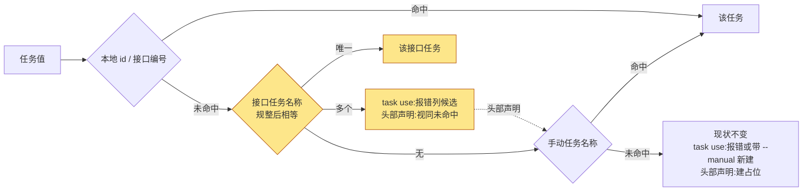

# 规格说明: 任务绑定名称匹配

> feature-id: 2026-10-16-任务绑定名称匹配
> 负责人: liulongfei
> 任务: T-27
> 日期: 2026-10-16

## 一图看懂

用**名称**指认平台上已有的接口任务时,系统会正确绑到这个接口任务,不再静默生成重复的手动任务或假的接口任务。write-spec 在会话未绑定时,引导用户从刷新后的接口任务列表里选,头部写编号。

图例:黄色为本需求新增的匹配步骤。

| 场景 | 改前 | 改后 |
|---|---|---|
| `task use "timeline采集的数据质量问题" --manual`(平台已有 T-27「timeline 采集的数据质量问题」) | 新建同名手动任务并绑定,与 T-27 重复 | 绑到 T-27,不新建 |
| 同上,不带 `--manual` | 报"接口中找不到任务" | 绑到 T-27 |
| 名称规整后对应两个接口任务 | 报找不到,或带 `--manual` 新建 | 报错,列出两个候选的编号和名称 |
| spec 头部 `> 任务: timeline 采集的数据质量问题`,本地已缓存 T-27 | 建一个"编号 = 该名称"的假接口任务 | 绑到 T-27 |
| spec 头部 `> 任务: T-30`,本地没有 T-30(同事名下的任务) | 建接口占位 T-30 | 不变 |
| write-spec 时会话未绑定 | 默认留空或自由填写 | 刷新接口任务列表让用户选,接口任务写编号 |

## 1. 目标与范围

**目标**:堵住"用名称指认接口任务"时产生重复手动任务或假接口占位的漏洞,并在 write-spec 的命名步骤里从源头引导用户写编号。

**包含**:

1. `cgraphx task use` 的名称匹配接口任务。
2. 需求目录 spec 头部 `> 任务:` 声明的名称匹配接口任务。
3. write-spec 第 0 步第 ④ 项「任务」的流程。

**明确不做**:

| 不做 | 说明 |
|---|---|
| 包含 / 模糊匹配 | 只做规整后完全相等 |
| 删除或合并已有的重复任务 | 已有的手动任务(如本地 id 12)保留 |
| 平台侧补绑与回写本地 | 维持现状 |
| 改 write-plan 及其它 skill | write-plan 继承 spec 头部,不写 `> 任务:` |
| 强制头部只能写编号 | 没配接口时,头部写手动任务名称仍然有效 |

## 2. 术语

| 术语 | 含义 |
|---|---|
| 接口任务 | 从任务接口拉取的开发任务,有外部编号(如 `T-27`),本地缓存在任务表中 |
| 手动任务 | 本地按名称建立的开发任务,没有编号 |
| 名称规整 | 去掉所有空白字符(空格、制表符、换行,包括全角空格)并忽略大小写后,再比较两个名称 |
| 接口任务名称匹配 | 规整后的输入值与本地缓存中某个接口任务的规整名称完全相等 |

## 3. 业务规则

| # | 规则 | 例子 |
|---|---|---|
| R1 | 名称匹配只做规整后完全相等;不做包含、前缀或相似度匹配 | `数据质量` 不匹配「timeline 采集的数据质量问题」 |
| R2 | `task use` 的解析顺序:本地 id(纯数字)→ 接口编号(含一次接口刷新)→ **接口任务名称** → 手动任务名称 → 未命中的既有处理。前两步的行为不变 | 名称同时等于手动任务 12 和接口任务 T-27 时,取 T-27 |
| R3 | `task use` 的名称唯一匹配上接口任务时,直接绑定该任务;带不带 `--manual` 都一样,不新建手动任务 | `--manual` 的含义保持"接口中找不到才新建" |
| R4 | `task use` 的名称匹配上多个接口任务时,报参数错误(退出码 3),消息列出每个候选的编号和名称,并提示改用编号;不绑定,不新建 | `名称「接口联调」对应多个接口任务:T-31 接口联调、T-35 接口联调;请用编号指定` |
| R5 | `task use` 的接口任务名称匹配,使用刷新后的缓存:已配置接口时,这一步发生在编号匹配那次刷新之后;刷新失败且带 `--manual` 时,用已有缓存匹配 | — |
| R6 | spec 头部声明的解析顺序:本地 id → 接口编号 → **接口任务名称(唯一)** → 手动任务名称 → 既有处理(配置了接口就建占位,否则建手动任务)。只查本地缓存,不联网 | 头部写名称且本地已缓存 T-27 → 绑 T-27 |
| R7 | spec 头部声明匹配上多个接口任务时,视同名称未命中,继续走后面的步骤 | 这种情况罕见;R9 让头部写编号,从源头避免 |
| R8 | 只读查找(`task show <值>` 等不联网、不新建的查找)与 R6 的匹配顺序一致 | `task show "timeline采集的数据质量问题"` 显示 T-27 |
| R9 | write-spec 第 0 步第 ④ 项改为: | — |
|  | ① 先看当前会话的绑定(`cgraphx task current`),已绑定就展示给用户确认 | |
|  | ② 未绑定,或用户要改,就运行 `cgraphx task list`(刷新接口,不加 `--local`),从列表里让用户选;用户给出的是名称时,在列表中找出对应编号,再确认 | |
|  | ③ 头部写法:接口任务写编号,手动任务写名称 | |
|  | ④ 列表里没有对应任务时,先问用户是否先在平台上建;用户明确不需要,才留空或用手动任务名称 | |
|  | ⑤ 头部写好后由自动绑定生效,skill 不另外执行 `task use` | |

## 4. 兼容性

| 项 | 要求 |
|---|---|
| 编号绑定 | 行为不变 |
| 手动任务名称绑定(名称没撞上接口任务) | 行为不变 |
| 头部写本地没有的编号 | 行为不变,照旧建占位 |
| 纯数字值先按本地 id 匹配 | 行为不变(见知识库「开发任务」2026-10-16 的约束) |
| 唯一的行为变化 | 名称撞上接口任务时,改为解析到该接口任务;以及 R4 的重名报错 |
| 已有数据 | 不迁移、不删除。已有的重复手动任务仍可用本地 id 指定 |
| hook | 自动绑定不发网络请求,失败只写 stderr,不阻塞宿主(维持现状) |

## 5. 不可留到实现期的决策(已全部锁定)

R1–R9 和第 4 节已锁定。plan 可以自主决定的只有:规整函数放在哪里,以及名称匹配是用 SQL 还是 JS 实现。

## 6. 验收标准

| # | 验收项 |
|---|---|
| A1 | 平台有 T-27「timeline 采集的数据质量问题」时,`task use "timeline采集的数据质量问题" --manual` 绑到 T-27,任务表不新增记录 |
| A2 | 同上,不带 `--manual` 也绑到 T-27 |
| A3 | 大小写和空白不同的名称(如 `Timeline 采集的数据质量问题`)也匹配 |
| A4 | `数据质量` 等部分名称不匹配,走既有的未命中处理 |
| A5 | 两个接口任务规整后同名时,`task use <该名称>` 以退出码 3 失败,输出包含两个候选编号,不绑定、不新建 |
| A6 | 名称同时等于手动任务名和接口任务名时,解析到接口任务 |
| A7 | spec 头部写接口任务名称,编辑需求目录时自动绑定到该接口任务,不新建占位 |
| A8 | spec 头部写本地不存在的编号,照旧建占位 |
| A9 | 编号绑定、手动任务名称绑定、纯数字本地 id 的行为不变;既有测试不变红 |
| A10 | `assets/claude-template/skills/write-spec/SKILL.md` 的第 0 步第 ④ 项按 R9 修改 |

## 7. Plan 编写约束

- 只改 task 子系统的解析和查找,以及 write-spec 的 skill 模板(`assets/claude-template/`,不是根目录的 `.claude/`)。
- 不改任务表结构,不升 task 的 schema 版本。
- 自动绑定路径不得新增网络请求。

## 8. 待确认项

无。
