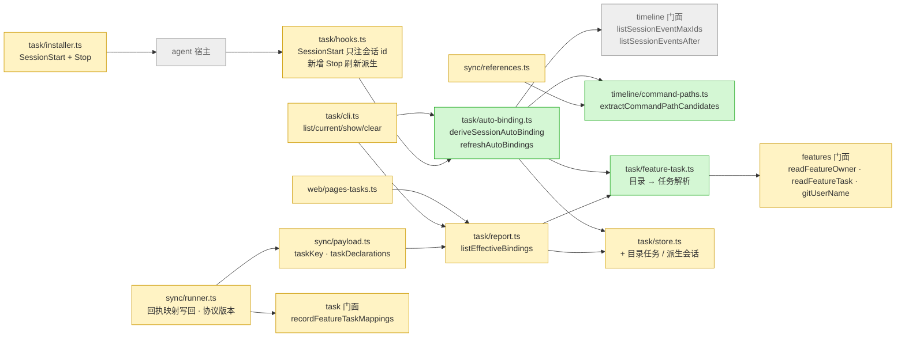
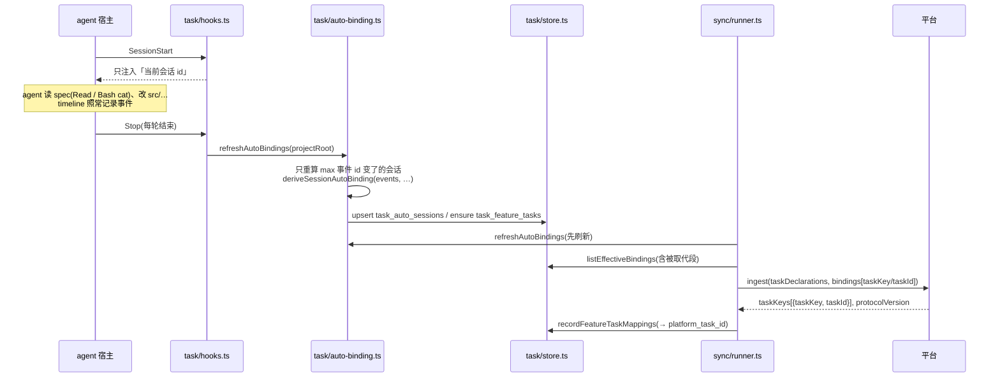
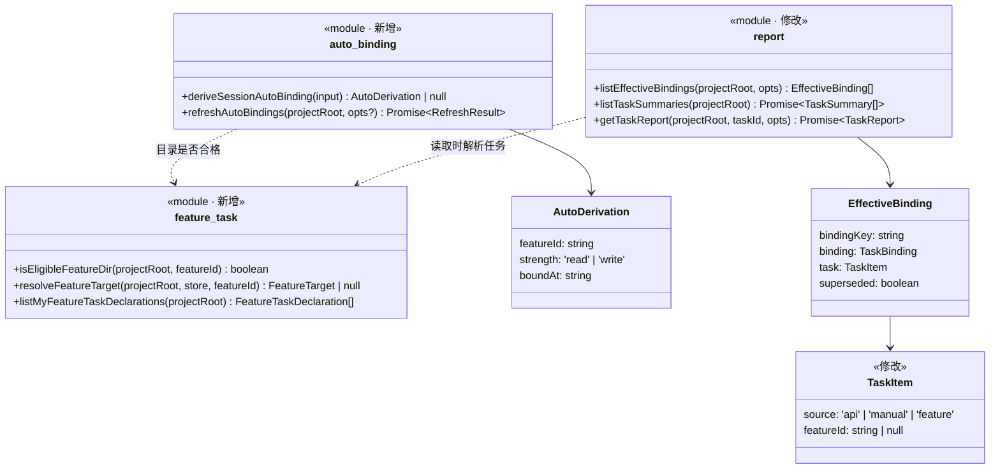
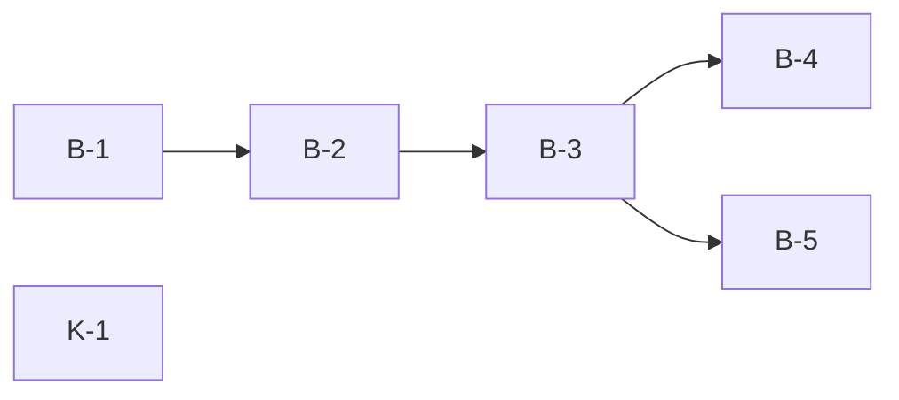

# 实现计划: 任务自动关联

> feature-id: 2026-10-17-任务自动关联
> 负责人: liulongfei
> 日期: 2026-10-17
> 来源: `../任务自动关联-spec.md`(唯一契约)· 服务端契约:cgraphx-server 仓库 `docs/features/2026-10-17-任务自动关联-服务端/plan/任务自动关联-服务端-02-backend.md` B-1「协议增量」(契约包 `@cgraphx-server/contract` 0.2.0,`CLIENT_PROTOCOL_VERSION = '1.1'`)

## 设计预览

自动绑定从「hook 在写入时当场绑定」改为「**从 timeline 事件派生**」:新增 `task/auto-binding.ts` 用一个纯函数按 R1~R7 算出每个会话归哪个产出目录,结果落在 task 的两张新表里;本地展示和 sync 上报都改读同一个「有效绑定」列表(手动绑定 + 派生绑定)。hook 侧只剩会话 id 注入,外加一个 Stop hook 在每轮结束时刷新派生。sync 在上报里声明本人负责的目录任务、绑定段带任务键,并把回执里的平台编号写回 task。

**需要你重点看的**(改错了代价最大,其余可略读)

| # | 决策 | 为什么难回头 |
|---|---|---|
| 1 | **task schema 只加表、不升版本号**(`task_feature_tasks`、`task_auto_sessions`、`task_superseded_bindings`、`task_auto_meta` 四张新表,`TASK_SCHEMA_VERSION` 保持 1);目录任务 id 从 `1000000001` 起,与 `task_items` 不重叠 | 升版本会让 PATH 里的旧版全局 cgraphx 打开库即抛错(「平台上报」知识条目的同类教训);一旦目录任务 id 进了本地 web 链接与上报,id 空间就不能再改 |
| 2 | **派生只存「哪个目录 + 读/写 + 区间」,不存「对应哪个任务」**;目录 → 任务(头部 T-xx 或目录任务)在读取时解析 | 头部改了(补 `> 任务: T-27`)不需要重算;反过来如果存了任务,头部一改本地与平台就不一致 |
| 3 | **被取代的旧绑定按零长度区间(end = start)继续上报**,不再按原区间上报 | 平台按绑定段 id 以最新为准,旧段若仍按原区间存在会和派生段重叠、双算投入;这是已上报历史数据能否被纠正的唯一路径 |

**架构**——看颜色:绿色新增,黄色修改,灰色是已有且不动的邻居;注意 task 不依赖 sync,`extractCommandPathCandidates` 下沉到 timeline 后由 task 和 sync 共用。

**主流程:一个会话从开始到上报**——看派生发生在哪(Stop / CLI / sync 前各刷新一次,结果一致),以及平台编号怎么回到本地。

**类图**——看新增模块的对外函数,以及「有效绑定」是本地展示与上报共用的唯一口径。

**关键取舍**

| 选了 | 没选 | 为什么 |
|---|---|---|
| 从 timeline 事件派生(Stop / CLI / sync 前刷新) | 在 PostToolUse hook 里实时绑定(matcher 加 Read / Bash) | 读类工具调用极频繁,每次多拉一个 hook 进程会拖慢会话;派生是纯函数,历史重算与日常同一口径(spec §11「派生口径只定义一处」) |
| 目录任务单独成表,id 从 1000000001 起 | 扩 `task_items.source` 的 CHECK | 改 CHECK 要重建表并升 schema 版本,旧版全局二进制会全部报错 |
| 被取代段零长度重报 | 不再上报被取代段 | 平台已存的旧段不会自己消失,只有同 id 重报才能把它改掉 |

## 目标与范围

落实 spec §3~§7:R1~R7 自动绑定、目录任务与负责人判定、上报任务声明与任务键、历史重新派生、agent 侧零任务注入、`/handoff-session` 新增与 write-spec 调整。

## 明确不包含

- 分支 / trailer / 模块锚点;agent 侧任何判断或提示(spec §1.3)。
- 修改 cgraphx-server 仓库与契约包(本 plan 只消费契约包 0.2.0 的可选字段)。
- 修改任何已有产出目录文件。
- 本地 web 页面结构改版(只补「目录」来源标签,见 B-3)。
- 测试任务(代码完成后走 `/write-unit-test-spec` → `/write-unit-test-code`)。

## 计划文件清单

| 文件 | 状态 |
|---|---|
| `任务自动关联-index.md` | 本文件 |
| `任务自动关联-01-schema.md` | **不涉及**:新表属于 cgraphx 包内 SQLite,随 B-2 的 `schema.sql` 追加;「Schema 变更约定」只约束目标项目业务库(见 data-standards.md 该节适用说明) |
| `任务自动关联-02-backend.md` | B-1 ~ B-5 |
| `任务自动关联-03-frontend.md` | **不涉及**(web 只改一个标签常量,并入 B-3) |
| `任务自动关联-04-skills.md` | K-1 |

## 总任务清单

| 任务 | 内容 | spec 条款 | 独立提交 |
|---|---|---|---|
| B-1 | 命令文本路径候选下沉 timeline,sync 参考推断改用它 | §3.1、§11 | 是 |
| B-2 | task 新表 + 派生核心(`auto-binding.ts` / `feature-task.ts`)+ features 读负责人 | §2、§3.1、§3.2、§4.1、§4.2、§6 | 是 |
| B-3 | 有效绑定合并 + 本地读取方切换(report / CLI / web 标签) | §3.2 R6、§4.3、§6 | 是 |
| B-4 | hook 与安装:SessionStart 只注会话 id、新增 Stop 刷新、撤掉 PostToolUse | §3.3、§8 | 是 |
| B-5 | sync 上报:任务键 / 任务声明 / 映射写回 / 协议版本补报 / 被取代段零长度 | §5、§6、§9 | 是 |
| K-1 | 新增 `/handoff-session`;write-spec 去掉选任务;FLOW-MAP 与 cgraphx-guide 登记 | §7 | 是 |

## 全局依赖图

K-1 不依赖任何代码任务。

## 推荐执行顺序与可并行批次

| 批次 | 任务 | 并行依据 |
|---|---|---|
| 1 | B-1 ∥ K-1 | B-1 只动 `src/core/timeline/`、`src/core/sync/references.ts`;K-1 只动 `assets/claude-template/` |
| 2 | B-2 | 串行:B-3/B-4/B-5 都调用它导出的函数 |
| 3 | B-3 | 串行:B-4/B-5 依赖 `listEffectiveBindings` 与 `TaskItem` 新形态 |
| 4 | B-4 ∥ B-5 | 文件集不重叠:B-4 = `task/hooks.ts`、`task/installer.ts`、`task/cli.ts` 的两个隐藏命令注册;B-5 = `sync/payload.ts`、`sync/runner.ts`、`sync/types.ts`、`sync/store.ts`、`sync/status.ts`。B-4 不改 `task/cli.ts` 中 B-3 改过的 list/current/show/clear |

## 必须严格执行的契约

以下名字跨任务逐字一致,每个引用任务里都写了原文:

- 表(B-2 建,B-3/B-5 读):
  - `task_feature_tasks(id INTEGER PRIMARY KEY, feature_id TEXT NOT NULL UNIQUE, platform_task_id TEXT, created_at TEXT NOT NULL, updated_at TEXT NOT NULL)`;id 从 `FEATURE_TASK_ID_BASE = 1_000_000_001` 起。
  - `task_auto_sessions(session_id TEXT PRIMARY KEY, derived_max_event_id INTEGER NOT NULL, feature_id TEXT, strength TEXT CHECK (strength IN ('read','write')), bound_at TEXT, stopped_at TEXT, derived_at TEXT NOT NULL)`;`feature_id IS NULL` = 派生无结果。
  - `task_superseded_bindings(binding_id INTEGER PRIMARY KEY REFERENCES task_sessions(id), superseded_at TEXT NOT NULL)`。
  - `task_auto_meta(key TEXT PRIMARY KEY, value TEXT NOT NULL)`;键只有 `history_pass_done`。
- 函数(B-2 出,B-3/B-4/B-5 用):`refreshAutoBindings(projectRoot: string, opts?: { sessionIds?: string[] }): Promise<{ recomputed: number; historyPass: boolean }>`;`recordFeatureTaskMappings(projectRoot: string, mappings: Array<{ featureId: string; taskId: string }>): void`;`listMyFeatureTaskDeclarations(projectRoot: string): Array<{ featureId: string; name: string; declaredAt: string }>`。
- 类型(B-3 出,B-5 用):`TaskSource = 'api' | 'manual' | 'feature'`;`TaskItem` 增 `featureId: string | null`;`EffectiveBinding = { bindingKey: string; binding: TaskBinding; task: TaskItem; superseded: boolean }`;`listEffectiveBindings(projectRoot: string, opts?: { includeSuperseded?: boolean }): EffectiveBinding[]`。派生绑定的 `bindingKey = 'auto:' + sessionId`,手动 / 旧绑定的 `bindingKey = String(task_sessions.id)`。
- 上报字段(B-5,照抄契约包 0.2.0):`IngestRequest.taskDeclarations?: Array<{ taskKey; name; declaredAt }>`;`IngestBinding.taskKey?: string`;`IngestResponse.taskKeys?: Array<{ taskKey; taskId }>`、`protocolVersion?: string`;任务键 = feature-id。
- 规则原文以 spec §3.2 表(R1~R7)为准,不得改写判定顺序。

## 实现手段决策

| 决策 | 选项 | 推荐(已定) | 理由 |
|---|---|---|---|
| 派生时机 | PostToolUse 实时 / 读时纯派生 / 事件派生 + 落表刷新 | 事件派生 + 落表;刷新点 = task Stop hook、`task list/current/show/clear` 执行前、sync 构造上报前 | web 只读不能写库,纯读时派生又要每次扫全部事件;落表后 web 读最近一次刷新结果,1 小时时效足够 |
| 刷新范围 | 每次全量 / 按会话 max 事件 id 增量 | 增量:`listSessionEventMaxIds` 与 `task_auto_sessions.derived_max_event_id` 比较,只重算变了的;`history_pass_done` 缺失时首轮全量 | 平时一次刷新只多一条聚合查询 |
| 派生输入 | 会话全部事件 | `listSessionEventsAfter(projectRoot, sid, 0)`,只看 `post_tool_use` 的 Read / Bash / 写类工具,截止到「首条保留的手动绑定 bound_at 与 stopped_at 的较早者」 | R6:手动之后自动停止 |
| 写类工具名 | 写死 / agent 描述 | 按事件 `agent` 取 `requireAgentProfile(...).writeTools`,取不到用默认 agent | 多 agent 规则相同(spec §8) |
| Bash 读识别 | 复制 sync 逻辑 / 下沉共用 | `bashCandidates` 原样下沉为 timeline 的 `extractCommandPathCandidates` | spec §11 同一处定义;task 不得依赖 sync |
| schema 变更 | 升版本重建表 / 只加表 | 只加表、不升版本(规范例外,见「适用规范」) | 旧版全局二进制兼容 |
| 历史派生 | 改写 `task_sessions` / 标记取代 | 首轮全量时,对「有派生结果」的会话把其 `bind_source='feature_dir'` 行和指向手动任务的 `cli` 行写入 `task_superseded_bindings`;不删不改原行 | spec §6「不改旧数据、可追溯」;派生不出结果的会话不标记 |
| 服务端升级后补归属 | 手动重报 / 哈希含协议版本 | 绑定段哈希的输入加上「服务端是否支持 1.1」;回执 `protocolVersion` 记进 sync 状态,首次变为 `'1.1'` 后各会话哈希变化,自动重报一次 | spec §5「须自动补上归属」,无需员工操作 |
| 被取代段 | 不报 / 零长度报 | 以原 bindingId 上报 `end = start` | 见设计预览 #3 |

## 执行方式建议

**每批一个会话,跑 `/implementation`;全部完成后回 Claude 做 `/code-review`。**

- 规模上本需求满足 `/subagent-implement` 的条件:变更文件约 20 个,跨 timeline / task / sync / skills 四个相互独立的模块。但执行环节交给其他 agent 和模型(Claude Code CLI 接第三方模型,或 CodeBuddy),controller 角色对模型要求高,所以改为按批次串行:一个会话只做一批,上下文小,出错只影响这一批。
- 每个会话按下节启动语开局,做完本批全部任务、完成条件全部通过、按「提交规范」逐任务提交后停下,不进入下一批。
- 下一批开始前,人确认上一批的提交已落地(`git log --oneline -3`)。
- 全部批次完成后,回到 Claude 会话对本需求的提交范围跑 `/code-review`,发现的问题再开会话修。

## 执行会话启动语

每批开一个新会话,把对应一句原样粘贴进去。启动语只给文件路径,会话读到产出目录里的文件,就会归属到本任务(本需求上线后按新规则,上线前的会话会在上线后重新派生补归属)。

| 批次 | 启动语 |
|---|---|
| 1 | `/implementation 先读 docs/features/2026-10-17-任务自动关联/plan/任务自动关联-index.md,再按 plan/任务自动关联-02-backend.md 执行 B-1、按 plan/任务自动关联-04-skills.md 执行 K-1;每个任务完成条件全部通过后按 index「提交规范」单独提交,两个都完成后停下。` |
| 2 | `/implementation 先读 docs/features/2026-10-17-任务自动关联/plan/任务自动关联-index.md,再按 plan/任务自动关联-02-backend.md 执行 B-2;完成条件全部通过(含本仓库库副本上的派生核对与耗时记录)后按 index「提交规范」提交,然后停下。` |
| 3 | `/implementation 先读 docs/features/2026-10-17-任务自动关联/plan/任务自动关联-index.md,再按 plan/任务自动关联-02-backend.md 执行 B-3;完成条件全部通过后按 index「提交规范」提交,然后停下。` |
| 4 | `/implementation 先读 docs/features/2026-10-17-任务自动关联/plan/任务自动关联-index.md,再按 plan/任务自动关联-02-backend.md 依次执行 B-4、B-5;每个任务完成条件全部通过后按 index「提交规范」单独提交,两个都完成后停下。` |
| 审查 | (回到 Claude)`/code-review 审查需求「任务自动关联」B-1 ~ B-5、K-1 的全部提交,对照 docs/features/2026-10-17-任务自动关联/ 下的 spec 与 plan。` |

- 批次 1、4 各含两个互不依赖的任务,在一个会话里依次执行即可;想再省时间,也可以每个任务各开一个会话并行(文件集不重叠,见「推荐执行顺序与可并行批次」)。
- 执行中遇到 plan 与代码现状冲突,按「Plan 冲突上报规则」停下上报,不自行改契约。

## 适用规范

| 文件 | 章节 | 适用任务 |
|---|---|---|
| `docs/guides/coding-standards.md` | 「边界与结构」「选型(偏离社区默认)」「错误与日志」 | B-1 ~ B-5 |
| `docs/guides/data-standards.md` | 「模型层」「DDL 层」「ORM 映射约定」 | B-2 |
| `docs/guides/git-standards.md` | 「提交消息规范」「提交前检查点」 | 全部(结晶见下节) |

**规范例外**:data-standards.md「DDL 层」要求「表结构变更 = schema.sql 追加 + 加版本号」。本 plan 追加的四张表是纯新增(不改任何旧表),**不加版本号**——原因见设计预览 #1;`schema.sql` 仍全部 `CREATE TABLE IF NOT EXISTS`。

## 提交规范

结晶自 `docs/guides/git-standards.md`:

- 格式 `type(scope): 中文描述`;type ∈ feat / refactor / fix / docs;补充说明用「——」,并列用「+」。正例:`feat(task): 自动绑定改为事件派生——读暂定写确定 + 历史重新派生`。
- 非琐碎提交写 body:背景一行 + 「-」列要点;标题不带票据号。
- 提交前检查点(`git diff --cached` 逐项过):
  - 与 TS 同放的运行时资产未登记 `scripts/copy-assets.cjs`;
  - `src/core` 出现对 `src/cli` / `src/web` 的 import;
  - `schema.sql` 丢失 `IF NOT EXISTS`;
  - timeline hook 链路出现未 await 的 DB 写入 / 抛错不吞;
  - `vitest.config.ts` 的 `TZ: 'UTC'` 被改;
  - 被注释掉的命令注册 / hook 接入项;
  - 写死的魔法值(绝对路径、密钥、阈值、版本号);
  - 新增 TODO / FIXME。

## 允许局部工程适配的范围

- 新模块内部的私有函数拆分与命名;store 内 SQL 写法;错误消息措辞(须带修复提示)。
- `extractCommandPathCandidates` 的内部实现(签名与返回结构固定)。
- B-3 中 CLI 输出的列宽、对齐。
- 除此之外,表名、列名、函数签名、bindingKey 形态、上报字段一律固定。

## Plan 冲突上报规则

实现中发现 plan 与 spec 或代码现状冲突(如某读取方依赖 `TaskBinding.id` 为 `task_sessions` 行 id、契约包字段与本 plan 不符)时:停下,用 `PLAN_CONFLICT: <任务号> <冲突点> <spec 条款> <建议>` 上报,不自行改契约。权威顺序:spec > plan > docs/guides。

## 关键风险与防跑偏约束

| 风险 | 约束 |
|---|---|
| 首轮全量派生在 Stop hook 里耗时过长 | B-2 完成条件含本仓库实测耗时;超过 1 秒时 B-4 的 Stop hook 只刷新当前会话(`sessionIds: [payload.session_id]`),全量留给 CLI / sync |
| 派生规则与 spec 漂移 | `deriveSessionAutoBinding` 是唯一实现;B-2 验证用 spec §6 表格中的会话逐条核对 |
| 本地手动任务被误取代 | 只在首轮全量、且该会话派生有结果时标记;之后新建的手动绑定永不标记 |
| sync 回归 | B-5 完成后对未接入、已接入旧服务端(无 `protocolVersion`)两种情况各跑一轮 `sync now`,不报错、积压正常归零 |
| 旧版全局二进制 | 新 hook 命令带 `LEGACY_BINARY_TOLERANT_SUFFIX`;旧二进制打开库不因新表报错(未升版本) |

## 待确认项

spec §13 两项按 spec 正文已写的规则执行,不另行决定:① `task clear` 后不恢复自动规则(R6);② 只声明有绑定段指向的目录任务(§5「只声明有绑定段指向它的任务」)。若负责人改口,只影响 B-3 的 clear 分支与 B-5 的声明过滤。
