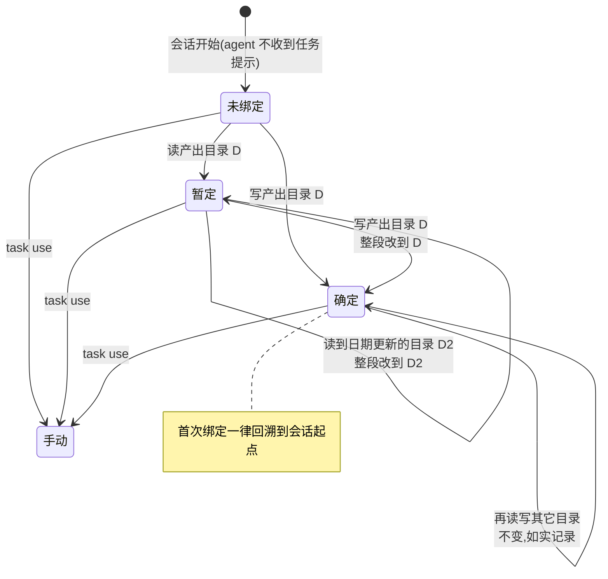

# 规格说明: 任务自动关联

> feature-id: 2026-10-17-任务自动关联
> 负责人: liulongfei
> 日期: 2026-10-17

## 一图看懂

会话属于哪个任务,由本地程序根据会话**读写了哪个产出目录**(`docs/features/<feature-id>/`)自动判断;人和 agent 都不需要做任何事,agent 上下文里不再出现任务相关内容。一个产出目录对应平台上一个任务,负责人取目录头部 `> 负责人:`;同事基于同一目录干活,他的会话作为协作会话计入同一任务。探索会话用新增的 `/handoff-session` 把交接内容写进产出目录,探索投入就不会遗漏。

服务端配套规则见 cgraphx-server 仓库 `docs/features/2026-10-17-任务自动关联-服务端/任务自动关联-服务端-spec.md`(下称「服务端 spec」),**服务端先上线**。

| 场景 | 结果 | 例子 |
|---|---|---|
| 会话只读了 `2026-09-16-cgraphx-web数据库预览/` 的 spec,改的是 `src/` | 暂定绑定到该目录的任务,覆盖整个会话 | implementation 会话自动归属 |
| 先读旧方案 `2026-07-30-…知识库浏览/`,再读 `2026-09-16-…数据库预览/` | 暂定改到日期更新的 `数据库预览` | 参考旧方案不误记 |
| 已确定绑定 A,又写了 B 的 spec | 仍归 A;B 的 spec 记为 A 的产出 | 流程误用如实记录,平台改绑修正 |
| 同事读写我建的产出目录 | 同事的会话指向同一任务,平台按协作会话计入 | 任务详情:我 5h · 同事 2h(协作) |
| 会话从没碰过产出目录 | 未归属;本人在平台补绑 | 只改了 `src/` 的小修复 |
| 探索后 `/handoff-session` 拆成 3 个任务 | 探索会话归主任务;3 个新会话各读自己的交接文件,各归各的任务 | 本会话的 ①~④ |

## 1. 目标与范围

### 1.1 目标

让任务关联这一上报核心动作对人和 agent 完全无感:程序按产出目录派生绑定,任务从本地产生并随同步进入平台,多人协作、跨会话交接都不漏记。

### 1.2 包含范围

| 模块 | 内容 |
|---|---|
| 自动绑定 | 按产出目录读写派生绑定:暂定 / 确定两级、回溯、不切换;手动绑定最高优先 |
| 目录任务 | 产出目录对应的任务:任务键、名称、负责人判定;spec 头部关联平台任务 |
| 上报 | 声明本人负责的目录任务;绑定段指向任务键或平台任务 id;回执映射写回本地 |
| 历史 | 全部历史会话按新规则重新派生并重新上报 |
| agent 侧 | 去掉会话开始的任务注入和自动绑定提醒,只保留会话 id 注入 |
| skill | 新增 `/handoff-session`;write-spec 去掉「选任务」步骤 |

### 1.3 非目标

- 按分支名、commit trailer、改动模块推断归属。
- agent 参与任何归属判断;会话开始或中途提示用户选任务。
- 确定绑定后的自动切换;把一个会话的时间分摊到多个任务。
- 修改已有产出目录里的任何文件(含补负责人头部、改任务头部、重命名)。
- 平台补绑 / 改绑回写本地;任务合并、改名。
- 修改服务端仓库(由服务端 spec 负责)。

## 2. 术语

| 术语 | 含义 |
|---|---|
| 产出目录 | `docs/features/<feature-id>/`,是**某个任务的产出目录**,不是平台上的「需求」;平台的一个需求下挂多个任务。原「需求目录」一词在本需求涉及的说明中改称产出目录 |
| 目录任务 | 一个产出目录对应的任务。任务键 = feature-id;名称 = feature-id 去掉日期前缀后的部分(即文件前缀,如 `任务自动关联`、`HUYI-REQ-0143-临期提醒对接审批流`) |
| 目录负责人 | 产出目录主 spec 头部 `> 负责人:` 的值;没有主 spec 时取交接文件头部的 `> 负责人:` |
| 暂定绑定 | 由「读产出目录」产生的绑定,后续可被更新的读或任何写整段改正 |
| 确定绑定 | 由「写产出目录」产生的绑定,之后不再被自动规则改动 |
| 手动绑定 | 由 `cgraphx task use` 产生的绑定,自动规则从此不改动该会话 |
| 交接文件 | `/handoff-session` 写入产出目录的 `<文件前缀>-交接提示词.md` |
| 协作会话 | 归属某任务、但会话上报者不是任务负责人的会话(由平台判定,见服务端 spec §5) |

## 3. 自动绑定规则

### 3.1 什么算「读 / 写产出目录」

| 动作 | 识别 |
|---|---|
| 写 | 编辑类工具(Edit / Write / MultiEdit / NotebookEdit)**成功**改动了产出目录下的文件 |
| 读 | Read 工具读取了产出目录下的文件;或 Bash 命令读取了产出目录下的文件——Bash 识别**复用平台上报现有的「命令文本推断读取文件」口径**(含 `cd <目录> && …` 前缀解析、跳过含 `$` 的片段),不另立一套 |
| 不算 | 只列目录、grep 命中、glob 匹配;产出目录之外的文件;不满足 §4.2 的目录(没有负责人头部) |

### 3.2 规则

| # | 当前状态 | 触发 | 结果 |
|---|---|---|---|
| R1 | 未绑定 | 读目录 D | 暂定绑定到 D 的任务,区间起点回溯到会话最早一条事件 |
| R2 | 暂定(D) | 读目录 D2,且 D2 的日期前缀**晚于** D | 暂定绑定**整段**改为 D2(起点仍是会话起点) |
| R3 | 暂定(D) | 读目录 D2,日期相同或更早 | 不变 |
| R4 | 未绑定 / 暂定 | 写目录 D | 确定绑定到 D,**整段**(从会话起点)改为 D |
| R5 | 确定(D) | 读或写任何其它目录 | 不变;写入的文件按现有产出规则记为 D 任务的产出 |
| R6 | 任意 | `task use` / `task clear` | 以手动为准;此后本会话的自动规则全部停止 |
| R7 | 未绑定 | 整个会话没碰过任何产出目录 | 保持未归属,不建任务;纯问答会话同此 |

- 日期前缀取 feature-id 开头的 `YYYY-MM-DD`;取不到日期的目录视为最早。
- 多个目录指向同一平台任务(如两个目录头部都写 `> 任务: T-27`)时,按目录比较,改正后的任务可能相同,不影响结果。
- 自动规则只在 `CGRAPHX_NO_TIMELINE` 未开启时生效(沿用现有总开关)。

### 3.3 agent 侧

- 会话开始时只注入当前会话 id(现有降级用途),**不再注入当前任务**,未绑定时也不提示。
- 去掉「已绑定 A、改动了声明 B 的目录」时对 agent 的提醒。
- 本需求之后,agent 上下文里不出现任何由 cgraphx 注入的任务内容。

## 4. 目录任务

### 4.1 目录 → 任务

| 目录头部 | 对应任务 |
|---|---|
| 主 spec 头部 `> 任务:` 的值是平台任务编号(形如 `T-27`) | 该平台任务,对所有人一样;非负责人的会话由平台按协作会话计入 |
| 没有 `> 任务:`,或值不是平台任务编号(如历史的 `> 任务: UI测试报告改xlsx`) | 目录任务(任务键 = feature-id) |

### 4.2 负责人与声明

| 情况 | 本机行为 |
|---|---|
| 目录负责人 = 本机 `git config user.name`(去首尾空白后完全相等) | 本机是负责人:上报时**声明**该目录任务(任务键 + 名称) |
| 目录负责人 ≠ 本机 git 用户 | 只上报绑定段,指向任务键;不声明 |
| 目录没有负责人头部(主 spec 与交接文件都没有) | 该目录**不对应任何任务**,也不触发绑定(按 §3.1「不算」处理) |
| 目录头部关联了平台任务编号 | 不声明;绑定段直接带平台任务 id |

本仓库现状:22 个产出目录中 21 个有负责人头部,`2026-07-25-cgraphx2.0重构/` 没有,碰过它的会话不会因它绑定。

### 4.3 本地可见

- `cgraphx task list / current / show` 与本地 web「开发任务」页把目录任务作为一种新的任务来源展示(与接口任务、手动任务并列);拿到平台映射后显示平台编号。
- 本需求接受由此带来的本地输出变化(含历史重新派生后的归属变化);原「接入研发管理平台」需求中"本地 web 与本地命令输出不变"的约束,在任务归属这一点上由本需求取代。

## 5. 上报

| 项 | 规则 |
|---|---|
| 任务声明 | 本机是负责人的目录任务,随上报批次声明(任务键、名称、声明时间);只声明有绑定段指向它的任务 |
| 绑定段 | 目录任务 → 带任务键;头部关联的平台任务 → 带平台任务 id;本地手动任务 → 都不带(平台算未归属,沿用) |
| 回执映射 | 平台返回的「任务键 → 平台任务 id」写回本地,本地任务显示平台编号;之后同一任务的绑定段同时带上平台任务 id |
| 改正后的重报 | 暂定绑定被改正、历史重新派生,都对同一会话段重新上报;平台按绑定段 id 以最新为准,不重复计数;平台已补绑 / 改绑的区间以平台为准 |
| 时效 | 沿用平台上报约定:本地变化 1 小时内在平台可见 |
| 服务端尚未升级 | 新字段被旧服务端忽略,目录任务的绑定段在平台上暂为未归属;服务端升级后,这些已上报的数据**须自动补上归属**,不需要员工手动操作 |
| 白名单 | 新增上报内容只有任务键与名称(均来自目录名);其余白名单不变 |

## 6. 历史会话

| 项 | 规则 |
|---|---|
| 范围 | 本地库中全部历史会话,按 §3、§4 规则重新派生 |
| 手动绑定到平台任务(T-xx) | 保留不动;该会话中这些区间之外的部分照常派生 |
| 手动绑定到本地手动任务 | 按新规则重新派生的结果替换;派生不出结果的区间保留原手动绑定 |
| 文件 | 不修改任何已有产出目录文件 |
| 上报 | 派生结果按 §5 重新上报 |
| 时机 | 升级到本版本后自动执行一次,员工无需操作 |

本仓库预期效果(09-01 以来碰过产出目录的会话):

| 会话 | 现状 | 派生后 |
|---|---|---|
| ea609e33(10-16) | 手动任务 07:03–11:52 → T-27 11:52– | 08:33 写 `timeline采集的数据质量问题`(头部 T-27)→ 07:03 起整段 T-27;12:06 写 `任务绑定名称匹配` 的 spec 不切换(该目录头部也是 T-27,本例结果相同) |
| d510911c | 无 | 先读 `07-30-知识库浏览`,后写 `09-16-数据库预览` → 整段归 `cgraphx-web数据库预览` |
| a680ce3f | T-24 | 保留 T-24 |
| b1ac8f3c、f3b0b9c4 | 本地手动任务 | 归各自的目录任务 `任务会话映射与timeline采集增强`、`cgraphx-web开发任务浏览` |
| 其余碰过产出目录、无绑定的会话 | 无 | 归各自的目录任务 |

## 7. skill 调整

### 7.1 新增 `/handoff-session`(会话交接)

| 项 | 规则 |
|---|---|
| 用途 | 一个会话完成探索 / 澄清后,把工作交给 1~N 个新会话继续,并保证新旧会话都归到对应任务 |
| 确认产出目录 | 每个交接目标确认一个 feature-id:已有目录复用;没有则按 write-spec 的命名规则新建(日期-业务ID-标题,标题语言与业务 ID 由用户确认)。之后 write-spec 复用该 feature-id |
| 主任务 | 多个目标时由用户指定主任务,默认第一个;**先写主任务目录**(使本会话确定绑定到主任务) |
| 交接文件 | 每个目录写 `<文件前缀>-交接提示词.md`,头部含 `> 负责人:`(默认 git user.name,向用户确认);内容只写本任务的范围、已锁定决策、与其它任务的依赖 |
| 共享背景 | 只写在主任务的交接文件里;其它交接文件引用它,不复制 |
| 启动语 | 每个目录给用户一条启动语,内容只有「先读 `docs/features/<id>/<前缀>-交接提示词.md` 再继续」,不贴交接全文 |
| 不做 | 不写 spec / plan / 代码;不自动开启新会话 |

### 7.2 write-spec

- 删除命名步骤中的「④ 任务」(查当前绑定、拉任务列表让用户选)。
- 头部 `> 任务:` 改为可选:只在需要关联平台上已有任务时写平台编号;不写不影响自动关联。
- `> 负责人:` 保持必填(它现在也是任务负责人的判定依据)。
- 产出目录已存在(由 `/handoff-session` 建立)时复用其 feature-id。

## 8. 兼容性

| 对象 | 要求 |
|---|---|
| hook 预算 | hook 不发网络请求;单次耗时不明显增加;timeline hook 的 stdout 仍为空 |
| 旧版全局 cgraphx | agent 的 PATH 优先命中旧版二进制时,不得报错阻塞会话、不得写出错误归属 |
| 已有手动命令 | `task use / clear / list / current / show` 保留;手动绑定优先级最高 |
| 已有本地数据 | 新增的本地状态不改变现有表的语义;动表按 `docs/guides/data-standards.md`「Schema 变更约定」 |
| 多 agent | Claude Code 与 CodeBuddy 规则相同 |
| 未接入平台的仓库 | 自动绑定照常生效(本地可见),只是不上报 |

## 9. 异常与边界

| 场景 | 行为 |
|---|---|
| 拿不到会话 id | 不绑定,不报错,不影响事件记录 |
| 产出目录在会话期间被删除 | 已产生的绑定保留 |
| 目录负责人头部写的是他人 | 本机不声明,只上报绑定;他人声明之前平台挂起 |
| 两人都把自己写成负责人(头部被改过) | 本机按头部判断声明;平台以首个声明者为负责人(服务端 spec §4) |
| 头部 `> 任务:` 写了不存在的平台编号 | 照常上报该编号;平台按未归属处理并 warning(沿用) |
| 会话恢复(resume)后 session id 不变 | 视为同一会话,沿用其绑定状态 |
| 读的文件是交接文件 | 与读 spec 相同,按 R1~R3 |

## 10. 验收标准

- **零侵入**:新会话的 agent 上下文中除会话 id 外没有 cgraphx 注入的任务内容;任何情况下不出现绑定提醒。
- **规则**:构造会话分别验证 R1~R7(含「先读旧目录再读新目录」「暂定后写」「确定后写他目录不切换」「手动后自动停止」);首次绑定区间起点为会话最早事件。
- **Bash 读**:`cat docs/features/<id>/<前缀>-spec.md`、`cd docs/features/<id> && cat <文件>` 都触发读。
- **负责人**:负责人 = 本机 git 用户时上报含该任务声明;不同时只有绑定段带任务键;无负责人头部的目录不产生任何绑定。
- **平台**:负责人与同事各自上报同一目录后,平台上只有一个任务,同事会话为协作会话;同事先上报时为挂起,负责人上报后自动归入。
- **历史**:升级后按 §6 表格核对本仓库的派生结果;T-xx 手动绑定未变;已有产出目录文件无任何改动。
- **兼容**:对旧版服务端上报不报错;服务端升级后已上报的目录任务绑定自动获得归属。
- **交接**:用 `/handoff-session` 拆 3 个目标:主任务目录先写入,本会话确定绑定主任务;3 个交接文件均有负责人头部,共享背景只在主任务文件;按启动语开的新会话各自绑定到对应任务。
- **write-spec**:不再询问任务;不写 `> 任务:` 时新目录照常自动关联。

## 11. Plan 编写约束

- 依赖方向不变:task → timeline / features,sync 只经门面读;timeline / task / features 不反向依赖 sync。
- Bash 读识别必须复用 sync 现有的命令文本推断口径(同一处定义),不得复制一份。
- 绑定的派生口径只定义一处,本地展示与上报共用。
- hook 内不发网络请求、不等待子进程;不得因派生失败影响 hook 退出码与事件记录。
- 契约以服务端 spec 发布的契约包新次版本为准,只用其中可选字段;不修改服务端仓库。
- 改 skill 的入口是 `assets/claude-template/`;新增 skill 若有改名 / 废弃旧资产,同步 `deprecated-assets.json`。
- 新增运行时资产加进 `scripts/copy-assets.cjs`。

## 12. 不可留到实现期的决策

已在本 spec 锁定:绑定信号只看产出目录;读 = 暂定、写 = 确定;暂定取日期更新的目录、写整段改正;确定后不切换;手动最高且停用自动;首次绑定回溯;无负责人头部的目录不对应任务;目录任务的任务键与名称取法;负责人按 git user.name 判定并决定是否声明;agent 侧零任务注入;历史派生范围与 T-xx 手动绑定保留;不改旧文件;服务端升级后自动补归属;`/handoff-session` 的主任务、共享背景与启动语规则;write-spec 删「选任务」。

## 13. 待确认项

| # | 问题 | 推荐 | 是否阻塞 plan |
|---|---|---|---|
| 1 | `task clear` 之后本会话是否恢复自动规则(R6 现写为不恢复) | 不恢复:clear 也是明确的手动意图 | 否 |
| 2 | 只声明「有绑定段指向它」的目录任务,还是本人负责的全部目录都声明(后者会让从未开发过的目录也出现在平台) | 只声明有绑定段的 | 否 |
